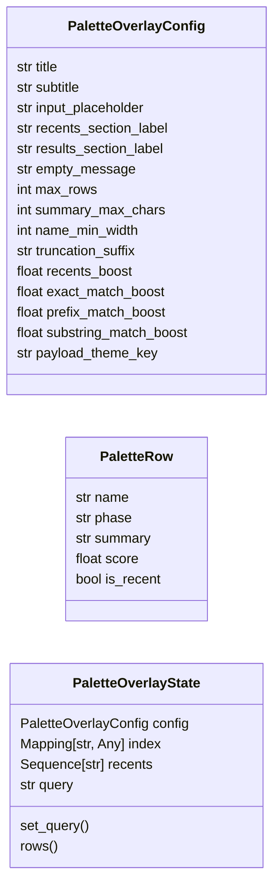
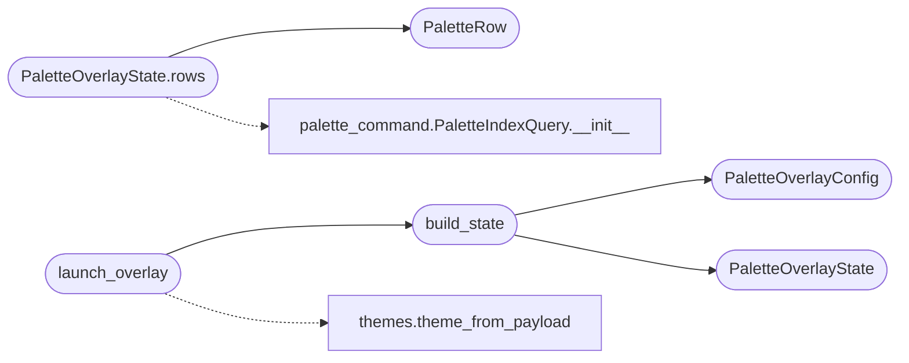

# `cli.palette_overlay`

> Source: [cli/palette_overlay.py:1](../../cli/palette_overlay.py#L1) | language `py` | coverage 100.0% | [API index](../index.md)

Textual Cmd-K palette overlay for the LazyOwn shell.

The overlay is a modal command launcher: the operator presses a single
hotkey, types a fuzzy query against every ``do_*`` command, picks one
with the arrow keys and gets the verb echoed back to the shell. It shares
the index, filtering and ranking logic with the existing
`[`cli.palette_command`](cli.palette_command.py.md)` and `[`cli.palette_telemetry`](cli.palette_telemetry.py.md)` modules so the C2
``/palette`` view, the MCP ``lazyown_palette`` tool and the CLI overlay
always agree on what is searchable.

Design (SOLID):

- Single Responsibility: [`PaletteOverlayConfig`](#paletteoverlayconfig) owns constants,
  [`PaletteOverlayState`](#paletteoverlaystate) performs filtering and ranking,
  `PaletteOverlayApp` (Textual) renders. The launcher
  [`launch_overlay`](#launch_overlay) wires them together and returns the selected
  command name.
- Dependency Inversion: the state takes an already-loaded index and the
  recents list so tests never have to touch the filesystem.
- Open/Closed: ranking strategies live behind a method that subclasses
  can override; the default ranks by recency boost + substring match.
- No magic numbers/paths: every limit and label lives in the config.
- Textual is imported lazily so importing this module on a host without
  Textual does not error — the launcher returns ``None`` instead.

## Contents

- **Classes:** [`PaletteOverlayConfig`](#paletteoverlayconfig), [`PaletteRow`](#paletterow), [`PaletteOverlayState`](#paletteoverlaystate)
- **Functions:** [`build_state`](#build_state), [`launch_overlay`](#launch_overlay)

## Type Diagram



## Call Graph

Solid arrows stay in this module, dashed arrows leave it.



## Classes

<a id="paletteoverlayconfig"></a>

### `PaletteOverlayConfig`

`class` `dataclass` | [cli/palette_overlay.py:38](../../cli/palette_overlay.py#L38)

Decorators: `@dataclass(frozen=True)`

```python
class PaletteOverlayConfig
```

Centralised constants for the overlay.

**Attributes**

| Name | Type | Default | Description |
|---|---|---|---|
| [`title`](#paletteoverlayconfig-title) | `str` | `'Command palette'` |  |
| [`subtitle`](#paletteoverlayconfig-subtitle) | `str` | `'Type to filter, Enter to select, Esc to cancel'` |  |
| [`input_placeholder`](#paletteoverlayconfig-input_placeholder) | `str` | `'Search commands and summaries'` |  |
| [`recents_section_label`](#paletteoverlayconfig-recents_section_label) | `str` | `'Recent'` |  |
| [`results_section_label`](#paletteoverlayconfig-results_section_label) | `str` | `'Results'` |  |
| [`empty_message`](#paletteoverlayconfig-empty_message) | `str` | `'No commands match the current filter.'` |  |
| [`max_rows`](#paletteoverlayconfig-max_rows) | `int` | `30` |  |
| [`summary_max_chars`](#paletteoverlayconfig-summary_max_chars) | `int` | `80` |  |
| [`name_min_width`](#paletteoverlayconfig-name_min_width) | `int` | `12` |  |
| [`truncation_suffix`](#paletteoverlayconfig-truncation_suffix) | `str` | `'...'` |  |
| [`recents_boost`](#paletteoverlayconfig-recents_boost) | `float` | `0.5` |  |
| [`exact_match_boost`](#paletteoverlayconfig-exact_match_boost) | `float` | `1.0` |  |
| [`prefix_match_boost`](#paletteoverlayconfig-prefix_match_boost) | `float` | `0.75` |  |
| [`substring_match_boost`](#paletteoverlayconfig-substring_match_boost) | `float` | `0.25` |  |
| [`payload_theme_key`](#paletteoverlayconfig-payload_theme_key) | `str` | `'tui_theme'` |  |

---

<a id="paletterow"></a>

### `PaletteRow`

`class` `dataclass` | [cli/palette_overlay.py:59](../../cli/palette_overlay.py#L59)

Decorators: `@dataclass(frozen=True)`

```python
class PaletteRow
```

Immutable row produced by [`PaletteOverlayState`](#paletteoverlaystate).

**Attributes**

| Name | Type | Default | Description |
|---|---|---|---|
| [`name`](#paletterow-name) | `str` |  |  |
| [`phase`](#paletterow-phase) | `str` |  |  |
| [`summary`](#paletterow-summary) | `str` |  |  |
| [`score`](#paletterow-score) | `float` |  |  |
| [`is_recent`](#paletterow-is_recent) | `bool` |  |  |

---

<a id="paletteoverlaystate"></a>

### `PaletteOverlayState`

`class` `dataclass` | [cli/palette_overlay.py:70](../../cli/palette_overlay.py#L70)

Decorators: `@dataclass`

```python
class PaletteOverlayState
```

Pure data layer for the overlay.

The state owns the loaded command index, the recents list and the
current query string. It exposes [`rows`](#paletteoverlaystate-rows) which returns the
deterministic, ranked list of [`PaletteRow`](#paletterow) for rendering.

**Attributes**

| Name | Type | Default | Description |
|---|---|---|---|
| [`config`](#paletteoverlaystate-config) | `PaletteOverlayConfig` |  |  |
| [`index`](#paletteoverlaystate-index) | `Mapping[str, Any]` |  |  |
| [`recents`](#paletteoverlaystate-recents) | `Sequence[str]` | `field(default_factory=tuple)` |  |
| [`query`](#paletteoverlaystate-query) | `str` | `''` |  |

**Members**

| Member | Kind | Summary |
|---|---|---|
| [`set_query`](#paletteoverlaystate-set_query) | method | Replace the active query with ``value`` (trimmed). |
| [`rows`](#paletteoverlaystate-rows) | method | Return the ranked, truncated rows for the current query. |

<a id="paletteoverlaystate-set_query"></a>

#### `PaletteOverlayState.set_query`

`method` | [cli/palette_overlay.py:83](../../cli/palette_overlay.py#L83)

```python
def set_query(self, value: str) -> None
```

Replace the active query with ``value`` (trimmed).

**Parameters**

| Name | Type | Default | Description |
|---|---|---|---|
| `value` | `str` |  |  |

<a id="paletteoverlaystate-rows"></a>

#### `PaletteOverlayState.rows`

`method` | [cli/palette_overlay.py:87](../../cli/palette_overlay.py#L87)

```python
def rows(self) -> list[PaletteRow]
```

Return the ranked, truncated rows for the current query.

**Returns:** `list[PaletteRow]`

*Calls:* [`PaletteIndexQuery.__init__`](cli.palette_command.py.md#paletteindexquery-__init__), [`PaletteRow`](#paletterow)

---

## Functions

<a id="build_state"></a>

### `build_state`

`function` | [cli/palette_overlay.py:162](../../cli/palette_overlay.py#L162)

```python
def build_state(payload: Mapping[str, Any] | None = None, index: Mapping[str, Any] | None = None, recents: Sequence[str] | None = None, config: PaletteOverlayConfig | None = None) -> PaletteOverlayState | None
```

Wire the canonical state used by [`launch_overlay`](#launch_overlay).

**Parameters**

| Name | Type | Default | Description |
|---|---|---|---|
| `payload` | `Mapping[str, Any] \| None` | `None` | Loaded ``payload.json`` (only used to pick the theme). |
| `index` | `Mapping[str, Any] \| None` | `None` | Optional pre-loaded command index (tests inject one). |
| `recents` | `Sequence[str] \| None` | `None` | Optional pre-loaded recents list. |
| `config` | `PaletteOverlayConfig \| None` | `None` | Optional override for the overlay configuration. |

**Returns:** `PaletteOverlayState | None` - A ready-to-use [`PaletteOverlayState`](#paletteoverlaystate), or ``None`` when the
command index is unavailable.

*Calls:* [`PaletteOverlayConfig`](#paletteoverlayconfig), [`PaletteOverlayState`](#paletteoverlaystate)

*Called by:* [`launch_overlay`](#launch_overlay)

---

<a id="launch_overlay"></a>

### `launch_overlay`

`function` | [cli/palette_overlay.py:188](../../cli/palette_overlay.py#L188)

```python
def launch_overlay(payload: Mapping[str, Any] | None = None, state: PaletteOverlayState | None = None, runner: Callable[[Any], str | None] | None = None) -> str | None
```

Open the Textual overlay and return the selected command verb.

**Parameters**

| Name | Type | Default | Description |
|---|---|---|---|
| `payload` | `Mapping[str, Any] \| None` | `None` | Loaded ``payload.json``; used to pick the theme. |
| `state` | `PaletteOverlayState \| None` | `None` | Optional pre-built state (tests inject one). |
| `runner` | `Callable[[Any], str \| None] \| None` | `None` | Optional callable that takes the Textual app and returns the selected command name. Tests substitute a no-Textual runner; production passes ``None`` and the function falls back to ``app.run()``. |

**Returns:** `str | None` - The chosen command name (``do_<verb>`` form preserved) or
``None`` when the overlay was cancelled or could not be opened.

*Calls:* [`build_state`](#build_state), [`theme_from_payload`](cli.themes.py.md#theme_from_payload)

---
