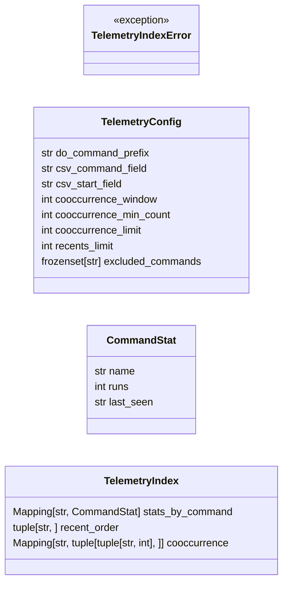
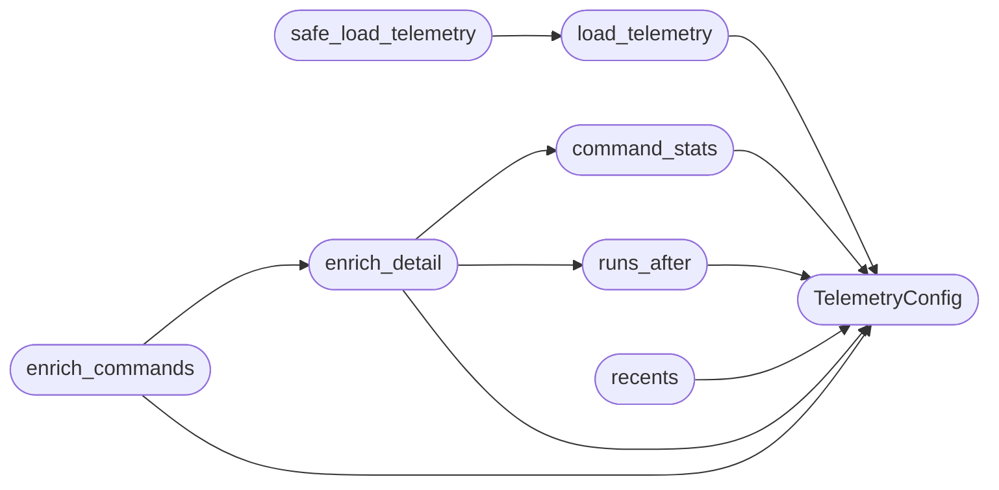

# `cli.palette_telemetry`

> Source: [cli/palette_telemetry.py:1](../../cli/palette_telemetry.py#L1) | language `py` | coverage 100.0% | [API index](../index.md)

Behavioural telemetry derived from ``sessions/LazyOwn_session_report.csv``.

The CLI logs every executed command to a CSV file. This module reads that
artefact once per process and exposes a tiny read-only API so the palette CLI,
the C2 web overlay and the MCP detail view can all attach the same "how often
did this run" / "what runs after it" / "what did I just use" hints to a
detail entry without duplicating parsing logic.

Design constraints driving the shape of this module:

- Single Responsibility — [`TelemetryIndex`](#telemetryindex) only loads and caches; pure
  functions like [`command_stats`](#command_stats), [`runs_after`](#runs_after) and
  [`recents`](#recents) translate it into palette-friendly shapes.
- Open/Closed — every threshold, field name and limit lives on
  [`TelemetryConfig`](#telemetryconfig); new aggregations mean adding a function, not
  editing existing call sites.
- Dependency Inversion — every public entry point accepts the parsed
  telemetry index, never reads it from disk on its own. Callers wire the
  loader through [`load_telemetry`](#load_telemetry) so tests can inject fixtures.
- Sad path is a no-op. A missing or malformed CSV degrades to an empty
  index so the palette stays usable on hosts that have never run a command.

## Contents

- **Classes:** [`TelemetryConfig`](#telemetryconfig), [`CommandStat`](#commandstat), [`TelemetryIndex`](#telemetryindex)
- **Exceptions:** [`TelemetryIndexError`](#telemetryindexerror)
- **Functions:** [`load_telemetry`](#load_telemetry), [`safe_load_telemetry`](#safe_load_telemetry), [`command_stats`](#command_stats), [`runs_after`](#runs_after), [`recents`](#recents), [`enrich_detail`](#enrich_detail), [`enrich_commands`](#enrich_commands)
- **Constants:** [`DEFAULT_TELEMETRY_PATH`](#default_telemetry_path)

## Type Diagram



## Call Graph

Solid arrows stay in this module, dashed arrows leave it.



## Classes

<a id="telemetryconfig"></a>

### `TelemetryConfig`

`class` `dataclass` | [cli/palette_telemetry.py:42](../../cli/palette_telemetry.py#L42)

Decorators: `@dataclass(frozen=True)`

```python
class TelemetryConfig
```

Centralised constants for behavioural telemetry parsing.

Every literal that affects telemetry derivation lives here so behaviour
is tunable without touching call sites. ``frozen=True`` prevents
accidental mutation by per-surface consumers.

**Attributes**

| Name | Type | Default | Description |
|---|---|---|---|
| [`do_command_prefix`](#telemetryconfig-do_command_prefix) | `str` | `'do_'` |  |
| [`csv_command_field`](#telemetryconfig-csv_command_field) | `str` | `'command'` |  |
| [`csv_start_field`](#telemetryconfig-csv_start_field) | `str` | `'start'` |  |
| [`cooccurrence_window`](#telemetryconfig-cooccurrence_window) | `int` | `3` |  |
| [`cooccurrence_min_count`](#telemetryconfig-cooccurrence_min_count) | `int` | `2` |  |
| [`cooccurrence_limit`](#telemetryconfig-cooccurrence_limit) | `int` | `6` |  |
| [`recents_limit`](#telemetryconfig-recents_limit) | `int` | `8` |  |
| [`excluded_commands`](#telemetryconfig-excluded_commands) | `frozenset[str]` | `frozenset({'', 'default', 'exit', 'EOF'})` |  |

---

<a id="commandstat"></a>

### `CommandStat`

`class` `dataclass` | [cli/palette_telemetry.py:61](../../cli/palette_telemetry.py#L61)

Decorators: `@dataclass(frozen=True)`

```python
class CommandStat
```

Aggregated invocation data for a single ``do_*`` command.

**Attributes**

| Name | Type | Default | Description |
|---|---|---|---|
| [`name`](#commandstat-name) | `str` |  | Canonical ``do_<verb>`` form so the value plugs straight into the command-index key space. |
| [`runs`](#commandstat-runs) | `int` |  | Total number of invocations seen in the CSV. |
| [`last_seen`](#commandstat-last_seen) | `str` |  | ISO timestamp of the most recent invocation, or the empty string when the CSV row carried no timestamp. |

---

<a id="telemetryindex"></a>

### `TelemetryIndex`

`class` `dataclass` | [cli/palette_telemetry.py:78](../../cli/palette_telemetry.py#L78)

Decorators: `@dataclass(frozen=True)`

```python
class TelemetryIndex
```

Read-only view derived from the session CSV.

**Attributes**

| Name | Type | Default | Description |
|---|---|---|---|
| [`stats_by_command`](#telemetryindex-stats_by_command) | `Mapping[str, CommandStat]` | `field(default_factory=dict)` | ``{do_<verb>: CommandStat}`` for every command seen in the CSV. |
| [`recent_order`](#telemetryindex-recent_order) | `tuple[str, ...]` | `field(default_factory=tuple)` | ``do_<verb>`` names in most-recent-first order, with duplicates collapsed. Truncated to [`TelemetryConfig.recents_limit`](#telemetryconfig-recents_limit). |
| [`cooccurrence`](#telemetryindex-cooccurrence) | `Mapping[str, tuple[tuple[str, int], ...]]` | `field(default_factory=dict)` | ``{do_<verb>: ((do_<other>, count), ...)}`` listing commands that ran shortly after ``do_<verb>`` within the configured window, sorted by descending frequency. |

---

## Exceptions

<a id="telemetryindexerror"></a>

### `TelemetryIndexError`

`exception` | [cli/palette_telemetry.py:37](../../cli/palette_telemetry.py#L37)

```python
class TelemetryIndexError(RuntimeError)
```

Bases: `RuntimeError`

Raised when the telemetry CSV is malformed in a way callers must see.

---

## Functions

<a id="load_telemetry"></a>

### `load_telemetry`

`function` | [cli/palette_telemetry.py:186](../../cli/palette_telemetry.py#L186)

Decorators: `@lru_cache(maxsize=4)`

```python
def load_telemetry(path: str | None = None) -> TelemetryIndex
```

Return the parsed telemetry index, cached per resolved path.

**Parameters**

| Name | Type | Default | Description |
|---|---|---|---|
| `path` | `str \| None` | `None` | Override the default CSV location. ``None`` uses [`DEFAULT_TELEMETRY_PATH`](#default_telemetry_path). |

**Returns:** `TelemetryIndex` - A [`TelemetryIndex`](#telemetryindex). When the file is missing the function
returns an empty index; callers that want to surface parse errors
should catch [`TelemetryIndexError`](#telemetryindexerror).

*Calls:* [`TelemetryConfig`](#telemetryconfig)

*Called by:* [`safe_load_telemetry`](#safe_load_telemetry)

---

<a id="safe_load_telemetry"></a>

### `safe_load_telemetry`

`function` | [cli/palette_telemetry.py:204](../../cli/palette_telemetry.py#L204)

```python
def safe_load_telemetry(path: str | None = None) -> TelemetryIndex | None
```

Best-effort variant of [`load_telemetry`](#load_telemetry).

Returns ``None`` instead of raising so the palette stays usable on hosts
where the CSV is malformed.

**Parameters**

| Name | Type | Default | Description |
|---|---|---|---|
| `path` | `str \| None` | `None` |  |

**Returns:** `TelemetryIndex | None`

*Calls:* [`load_telemetry`](#load_telemetry)

---

<a id="command_stats"></a>

### `command_stats`

`function` | [cli/palette_telemetry.py:216](../../cli/palette_telemetry.py#L216)

```python
def command_stats(telemetry: TelemetryIndex | None, command_name: str, *, config: TelemetryConfig | None = None) -> CommandStat | None
```

Return aggregated stats for `[`command_name`](cli.command_form.py.md#commandformstate-command_name)` or ``None`` when unseen.

**Parameters**

| Name | Type | Default | Description |
|---|---|---|---|
| `telemetry` | `TelemetryIndex \| None` |  | The loaded telemetry index, or ``None`` for a no-op. |
| `command_name` | `str` |  | A ``do_*`` command name with or without the ``do_`` prefix. |
| `config` | `TelemetryConfig \| None` | `None` | Optional override for the lookup config. |

**Returns:** `CommandStat | None`

*Calls:* [`TelemetryConfig`](#telemetryconfig)

*Called by:* [`enrich_detail`](#enrich_detail)

---

<a id="runs_after"></a>

### `runs_after`

`function` | [cli/palette_telemetry.py:239](../../cli/palette_telemetry.py#L239)

```python
def runs_after(telemetry: TelemetryIndex | None, command_name: str, *, config: TelemetryConfig | None = None) -> list[str]
```

Return commands that frequently run after `[`command_name`](cli.command_form.py.md#commandformstate-command_name)`.

Sorted by descending frequency; ties broken alphabetically. The list is
truncated to [`TelemetryConfig.cooccurrence_limit`](#telemetryconfig-cooccurrence_limit) entries.

**Parameters**

| Name | Type | Default | Description |
|---|---|---|---|
| `telemetry` | `TelemetryIndex \| None` |  |  |
| `command_name` | `str` |  |  |
| `config` | `TelemetryConfig \| None` | `None` |  |

**Returns:** `list[str]`

*Calls:* [`TelemetryConfig`](#telemetryconfig)

*Called by:* [`enrich_detail`](#enrich_detail)

---

<a id="recents"></a>

### `recents`

`function` | [cli/palette_telemetry.py:259](../../cli/palette_telemetry.py#L259)

```python
def recents(telemetry: TelemetryIndex | None, *, config: TelemetryConfig | None = None) -> list[str]
```

Return the most-recently invoked unique ``do_*`` commands.

Order is most-recent-first; truncated to
[`TelemetryConfig.recents_limit`](#telemetryconfig-recents_limit) entries.

**Parameters**

| Name | Type | Default | Description |
|---|---|---|---|
| `telemetry` | `TelemetryIndex \| None` |  |  |
| `config` | `TelemetryConfig \| None` | `None` |  |

**Returns:** `list[str]`

*Calls:* [`TelemetryConfig`](#telemetryconfig)

---

<a id="enrich_detail"></a>

### `enrich_detail`

`function` | [cli/palette_telemetry.py:275](../../cli/palette_telemetry.py#L275)

```python
def enrich_detail(telemetry: TelemetryIndex | None, entry: Mapping[str, object] | None, *, config: TelemetryConfig | None = None) -> dict[str, object] | None
```

Attach `[`runs`](#commandstat-runs)`, `[`last_seen`](#commandstat-last_seen)` and `[`runs_after`](#runs_after)` to a detail entry.

The returned dict is a shallow copy so the underlying command index is
never mutated. ``None`` input passes through unchanged so callers can
delegate the missing-target sad path to the renderer.

**Parameters**

| Name | Type | Default | Description |
|---|---|---|---|
| `telemetry` | `TelemetryIndex \| None` |  |  |
| `entry` | `Mapping[str, object] \| None` |  |  |
| `config` | `TelemetryConfig \| None` | `None` |  |

**Returns:** `dict[str, object] | None`

*Calls:* [`TelemetryConfig`](#telemetryconfig), [`command_stats`](#command_stats), [`runs_after`](#runs_after)

*Called by:* [`enrich_commands`](#enrich_commands)

---

<a id="enrich_commands"></a>

### `enrich_commands`

`function` | [cli/palette_telemetry.py:300](../../cli/palette_telemetry.py#L300)

```python
def enrich_commands(telemetry: TelemetryIndex | None, rows: Iterable[Mapping[str, object]], *, config: TelemetryConfig | None = None) -> list[dict[str, object]]
```

Enrich every entry of ``rows`` with telemetry data.

Used by the C2 view and the Cmd+K overlay so the client-side renderer
can show `[`runs`](#commandstat-runs)` badges per row without round-tripping.

**Parameters**

| Name | Type | Default | Description |
|---|---|---|---|
| `telemetry` | `TelemetryIndex \| None` |  |  |
| `rows` | `Iterable[Mapping[str, object]]` |  |  |
| `config` | `TelemetryConfig \| None` | `None` |  |

**Returns:** `list[dict[str, object]]`

*Calls:* [`TelemetryConfig`](#telemetryconfig), [`enrich_detail`](#enrich_detail)

---

## Constants

<a id="default_telemetry_path"></a>

### `DEFAULT_TELEMETRY_PATH`

`constant` | [cli/palette_telemetry.py:34](../../cli/palette_telemetry.py#L34)

```python
DEFAULT_TELEMETRY_PATH = REPO_ROOT / 'sessions' / 'LazyOwn_session_report.csv'
```

---
