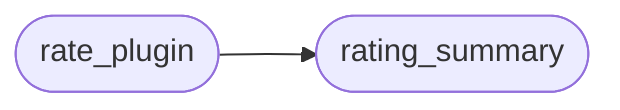

# `cli.plugin_tiers`

> Source: [cli/plugin_tiers.py:1](../../cli/plugin_tiers.py#L1) | language `py` | coverage 100.0% | [API index](../index.md)

Plugin tiers and operator ratings for the marketplace.

Tiers separate what the core team maintains from community contributions
and unvetted experiments:

- ``official``: shipped in-repo and maintained by the core team.
- `[`community`](cli.graph_advisor.py.md#graphnode-community)`: default for everything else, including community clones.
- ``experimental``: explicitly marked as unvetted; may break or change
  without notice.

Resolution order for a plugin name: explicit entry in
``plugins/tiers.yaml`` first, then a ``tier:`` field inside the plugin's
own YAML metadata, then `[`community`](cli.graph_advisor.py.md#graphnode-community)`.

Ratings are operator-local (stored in ``sessions/plugin_ratings.json`` by
default, never committed) and aggregate as a plain average with a count.

## Contents

- **Functions:** [`load_tier_manifest`](#load_tier_manifest), [`tier_of`](#tier_of), [`rate_plugin`](#rate_plugin), [`rating_summary`](#rating_summary), [`format_rating`](#format_rating), [`default_store`](#default_store), [`read_metadata_tier`](#read_metadata_tier)
- **Constants:** [`TIER_OFFICIAL`](#tier_official), [`TIER_COMMUNITY`](#tier_community), [`TIER_EXPERIMENTAL`](#tier_experimental), [`KNOWN_TIERS`](#known_tiers), [`DEFAULT_RATINGS_FILE`](#default_ratings_file)

## Call Graph

Solid arrows stay in this module, dashed arrows leave it.



## Functions

<a id="load_tier_manifest"></a>

### `load_tier_manifest`

`function` | [cli/plugin_tiers.py:35](../../cli/plugin_tiers.py#L35)

```python
def load_tier_manifest(manifest: str | Path) -> dict[str, str]
```

Load explicit tier overrides from a ``tiers.yaml`` manifest.

**Parameters**

| Name | Type | Default | Description |
|---|---|---|---|
| `manifest` | `str \| Path` |  | Path to a YAML mapping of plugin name to tier. |

**Returns:** `dict[str, str]` - Mapping of plugin name to tier. Unknown tiers and malformed
entries are ignored so a bad manifest can never break listing.

---

<a id="tier_of"></a>

### `tier_of`

`function` | [cli/plugin_tiers.py:61](../../cli/plugin_tiers.py#L61)

```python
def tier_of(name: str, manifest_tiers: dict[str, str] | None = None, metadata_tier: str = '') -> str
```

Resolve the tier for a plugin name.

**Parameters**

| Name | Type | Default | Description |
|---|---|---|---|
| `name` | `str` |  | Plugin/addon/tool stem. |
| `manifest_tiers` | `dict[str, str] \| None` | `None` | Explicit overrides from [`load_tier_manifest`](#load_tier_manifest). |
| `metadata_tier` | `str` | `''` | Value of the plugin YAML ``tier:`` field, if any. |

**Returns:** `str` - The manifest tier, the metadata tier when valid, else `[`community`](cli.graph_advisor.py.md#graphnode-community)`.

---

<a id="rate_plugin"></a>

### `rate_plugin`

`function` | [cli/plugin_tiers.py:98](../../cli/plugin_tiers.py#L98)

```python
def rate_plugin(name: str, stars: int, store: str | Path) -> tuple[float, int]
```

Record an operator rating and return the new ``(average, count)``.

**Parameters**

| Name | Type | Default | Description |
|---|---|---|---|
| `name` | `str` |  | Plugin/addon/tool stem. Must be non-empty. |
| `stars` | `int` |  | Integer rating from 1 to 5. |
| `store` | `str \| Path` |  | JSON file holding the ratings map. |

**Returns:** `tuple[float, int]`

**Raises**

- `ValueError`: When the name is empty or stars are outside 1-5.

*Calls:* [`rating_summary`](#rating_summary)

---

<a id="rating_summary"></a>

### `rating_summary`

`function` | [cli/plugin_tiers.py:121](../../cli/plugin_tiers.py#L121)

```python
def rating_summary(name: str, store: str | Path) -> tuple[float, int]
```

Return the ``(average, count)`` rating for a plugin name.

**Parameters**

| Name | Type | Default | Description |
|---|---|---|---|
| `name` | `str` |  | Plugin/addon/tool stem. |
| `store` | `str \| Path` |  | JSON file holding the ratings map. |

**Returns:** `tuple[float, int]` - ``(0.0, 0)`` when nobody rated the plugin yet.

*Called by:* [`rate_plugin`](#rate_plugin)

---

<a id="format_rating"></a>

### `format_rating`

`function` | [cli/plugin_tiers.py:137](../../cli/plugin_tiers.py#L137)

```python
def format_rating(average: float, count: int) -> str
```

Render a compact rating label for list and info views.

**Parameters**

| Name | Type | Default | Description |
|---|---|---|---|
| `average` | `float` |  |  |
| `count` | `int` |  |  |

**Returns:** `str`

---

<a id="default_store"></a>

### `default_store`

`function` | [cli/plugin_tiers.py:144](../../cli/plugin_tiers.py#L144)

```python
def default_store(base_dir: str | Path) -> Path
```

Return the default ratings file under ``<base_dir>/sessions``.

**Parameters**

| Name | Type | Default | Description |
|---|---|---|---|
| `base_dir` | `str \| Path` |  |  |

**Returns:** `Path`

---

<a id="read_metadata_tier"></a>

### `read_metadata_tier`

`function` | [cli/plugin_tiers.py:149](../../cli/plugin_tiers.py#L149)

```python
def read_metadata_tier(path: str | Path) -> str
```

Read the optional ``tier:`` field from a plugin YAML file.

**Parameters**

| Name | Type | Default | Description |
|---|---|---|---|
| `path` | `str \| Path` |  |  |

**Returns:** `str`

---

## Constants

<a id="tier_official"></a>

### `TIER_OFFICIAL`

`constant` | [cli/plugin_tiers.py:26](../../cli/plugin_tiers.py#L26)

```python
TIER_OFFICIAL = 'official'
```

---

<a id="tier_community"></a>

### `TIER_COMMUNITY`

`constant` | [cli/plugin_tiers.py:27](../../cli/plugin_tiers.py#L27)

```python
TIER_COMMUNITY = 'community'
```

---

<a id="tier_experimental"></a>

### `TIER_EXPERIMENTAL`

`constant` | [cli/plugin_tiers.py:28](../../cli/plugin_tiers.py#L28)

```python
TIER_EXPERIMENTAL = 'experimental'
```

---

<a id="known_tiers"></a>

### `KNOWN_TIERS`

`constant` | [cli/plugin_tiers.py:30](../../cli/plugin_tiers.py#L30)

```python
KNOWN_TIERS = frozenset({TIER_OFFICIAL, TIER_COMMUNITY, TIER_EXPERIMENTAL})
```

---

<a id="default_ratings_file"></a>

### `DEFAULT_RATINGS_FILE`

`constant` | [cli/plugin_tiers.py:32](../../cli/plugin_tiers.py#L32)

```python
DEFAULT_RATINGS_FILE = 'plugin_ratings.json'
```

---
