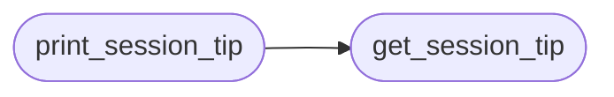

# `cli.protips`

> Source: [cli/protips.py:1](../../cli/protips.py#L1) | language `py` | coverage 100.0% | [API index](../index.md)

Pro tips system for the LazyOwn shell.

Two surfaces:
  - Session-start tip: one contextual tip printed after the banner when
    the shell first starts (reads phase, os_id, rhost).
  - Post-command tip: a single dim line printed after graph hints when
    the just-executed command makes a related tool especially relevant.

Design constraints:
  - Zero imports from lazyown.py or lazyc2.py.
  - Never blocks the prompt — all rendering is non-interactive.
  - Respects enable_inline_hints=false (caller checks before calling).
  - Tips rotate; the same tip is never shown twice in a row.

## Contents

- **Classes:** [`ProTip`](#protip)
- **Functions:** [`get_session_tip`](#get_session_tip), [`render_contextual_tip`](#render_contextual_tip), [`print_session_tip`](#print_session_tip)
- **Constants:** [`TIPS`](#tips)

## Call Graph

Solid arrows stay in this module, dashed arrows leave it.



## Classes

<a id="protip"></a>

### `ProTip`

`class` `dataclass` | [cli/protips.py:34](../../cli/protips.py#L34)

Decorators: `@dataclass(frozen=True)`

```python
class ProTip
```

A single contextual tip with a trigger condition and display text.

**Attributes**

| Name | Type | Default | Description |
|---|---|---|---|
| [`text`](#protip-text) | `str` |  |  |
| [`command`](#protip-command) | `str` |  |  |
| [`trigger`](#protip-trigger) | `Callable[[dict[str, Any]], bool]` |  |  |
| [`category`](#protip-category) | `str` | `'general'` |  |

---

## Functions

<a id="get_session_tip"></a>

### `get_session_tip`

`function` | [cli/protips.py:307](../../cli/protips.py#L307)

```python
def get_session_tip(ctx: dict[str, Any]) -> str | None
```

Return a single tip to show at session start.

Prefers tips that match the current context. Falls back to rotating
through the session tip list so the operator sees something fresh each
session.

**Parameters**

| Name | Type | Default | Description |
|---|---|---|---|
| `ctx` | `dict[str, Any]` |  | Context dict with keys: phase, os_id, rhost, domain, api_key. |

**Returns:** `str | None` - Rich-formatted string, or None if tips are disabled.

*Called by:* [`print_session_tip`](#print_session_tip)

---

<a id="render_contextual_tip"></a>

### `render_contextual_tip`

`function` | [cli/protips.py:333](../../cli/protips.py#L333)

```python
def render_contextual_tip(last_cmd: str, ctx: dict[str, Any]) -> None
```

Print a single dim tip line when the last command triggers one.

Called from the postcmd hook. Does nothing when no tip matches or when
the same tip would repeat.

**Parameters**

| Name | Type | Default | Description |
|---|---|---|---|
| `last_cmd` | `str` |  | Raw string of the command just executed. |
| `ctx` | `dict[str, Any]` |  | Context dict with current session state. |

---

<a id="print_session_tip"></a>

### `print_session_tip`

`function` | [cli/protips.py:363](../../cli/protips.py#L363)

```python
def print_session_tip(ctx: dict[str, Any]) -> None
```

Print the session-start tip (called once after the banner).

**Parameters**

| Name | Type | Default | Description |
|---|---|---|---|
| `ctx` | `dict[str, Any]` |  | Context dict with current session state. |

*Calls:* [`get_session_tip`](#get_session_tip)

---

## Constants

<a id="tips"></a>

### `TIPS`

`constant` | [cli/protips.py:82](../../cli/protips.py#L82)

```python
TIPS: list[ProTip]
```

---
