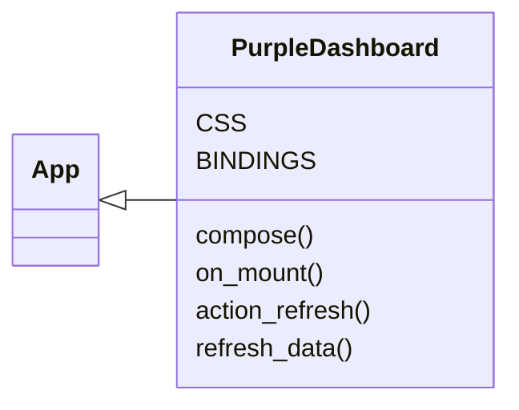
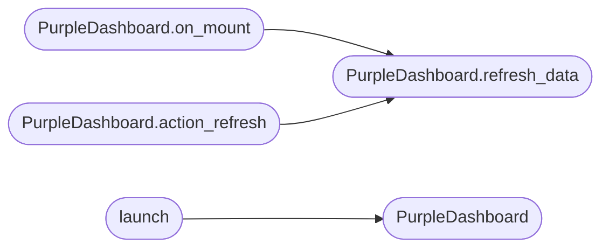

# `cli.purple_tui`

> Source: [cli/purple_tui.py:1](../../cli/purple_tui.py#L1) | language `py` | coverage 42.9% | [API index](../index.md)

Purple Team Dashboard — Textual TUI for engagement monitoring.

Launch from the LazyOwn shell with ``purple_dashboard`` or directly:

    python3 -m cli.purple_tui

Layout:
    ┌─ Header (session / score / detection rate) ────────────────────────┐
    │  Left (Score + Methods)  │  Center (Recent Actions) │ Right (Stats)│
    ├────────────────────────────────────────────────────────────────────┤
    │  Footer ([Q] Quit  [R] Refresh  [E] Exec  [?] Help)              │
    └───────────────────────────────────────────────────────────────────┘

## Contents

- **Classes:** [`PurpleDashboard`](#purpledashboard)
- **Functions:** [`launch`](#launch)

## Type Diagram



## Call Graph

Solid arrows stay in this module, dashed arrows leave it.



## Classes

<a id="purpledashboard"></a>

### `PurpleDashboard`

`class` | [cli/purple_tui.py:79](../../cli/purple_tui.py#L79)

```python
class PurpleDashboard(App)
```

Bases: [`App`](lazy_sentinel4.py.md#app)

Textual TUI for purple team engagement monitoring.

**Attributes**

| Name | Type | Default | Description |
|---|---|---|---|
| [`CSS`](#purpledashboard-css) |  | `'\n Screen { background: $surface }\n #score-panel { height: 8; border: solid $accent; padding: 1 2 }\n #methods-panel { height: auto; border: solid $accent; padding: 1 2 }\n #actions-panel { border: solid $accent; padding: 1 2 }\n #stats-panel { width: 35; border: solid $accent; padding: 1 2 }\n .title { text-style: bold; color: $accent }\n .hit { color: green }\n .miss { color: red }\n '` |  |
| [`BINDINGS`](#purpledashboard-bindings) |  | `[('q', 'quit', 'Quit'), ('r', 'refresh', 'Refresh')]` |  |

**Members**

| Member | Kind | Summary |
|---|---|---|
| [`compose`](#purpledashboard-compose) | method |  |
| [`on_mount`](#purpledashboard-on_mount) | method |  |
| [`action_refresh`](#purpledashboard-action_refresh) | method |  |
| [`refresh_data`](#purpledashboard-refresh_data) | method |  |

<a id="purpledashboard-compose"></a>

#### `PurpleDashboard.compose`

`method` `generator` | [cli/purple_tui.py:98](../../cli/purple_tui.py#L98)

```python
def compose(self) -> ComposeResult
```

**Returns:** `ComposeResult`

<a id="purpledashboard-on_mount"></a>

#### `PurpleDashboard.on_mount`

`method` | [cli/purple_tui.py:108](../../cli/purple_tui.py#L108)

```python
def on_mount(self) -> None
```

*Calls:* [`PurpleDashboard.refresh_data`](#purpledashboard-refresh_data)

<a id="purpledashboard-action_refresh"></a>

#### `PurpleDashboard.action_refresh`

`method` | [cli/purple_tui.py:112](../../cli/purple_tui.py#L112)

```python
def action_refresh(self) -> None
```

*Calls:* [`PurpleDashboard.refresh_data`](#purpledashboard-refresh_data)

<a id="purpledashboard-refresh_data"></a>

#### `PurpleDashboard.refresh_data`

`method` | [cli/purple_tui.py:115](../../cli/purple_tui.py#L115)

```python
def refresh_data(self) -> None
```

*Called by:* [`PurpleDashboard.action_refresh`](#purpledashboard-action_refresh), [`PurpleDashboard.on_mount`](#purpledashboard-on_mount)

---

## Functions

<a id="launch"></a>

### `launch`

`function` | [cli/purple_tui.py:233](../../cli/purple_tui.py#L233)

```python
def launch() -> None
```

Launch the purple team dashboard TUI.

*Calls:* [`PurpleDashboard`](#purpledashboard)

*Called by:* [`PurpleTeamCommandSet.do_purple_dashboard`](cli.commands.purple_team.py.md#purpleteamcommandset-do_purple_dashboard)

---
