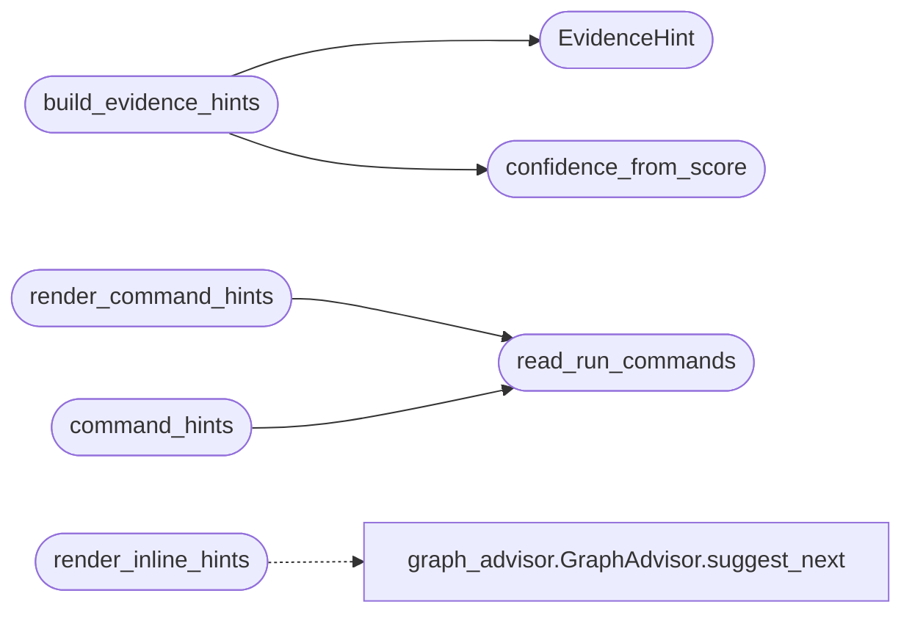

# `cli.reactive_hints`

> Source: [cli/reactive_hints.py:1](../../cli/reactive_hints.py#L1) | language `py` | coverage 100.0% | [API index](../index.md)

Non-blocking inline hint renderer for the LazyOwn cmd2 shell.

After each command executes, a single dim line is printed with the top-N
graph-based next-step suggestions derived from the graphify knowledge graph.
The GraphLoader caches by (path, mtime) so rendering is sub-millisecond after
the first graph load; subsequent calls return from memory.

Design notes:
- Zero coupling to cmd2, lazyown.py or Flask — this module is a pure renderer.
- The caller decides whether hints are enabled (reads payload.json flag).
- Output goes to stdout via rich so ANSI is handled correctly on all terminals.
- Commands on SKIP_COMMANDS never produce hints (noise-free UX).

## Contents

- **Classes:** [`EvidenceHint`](#evidencehint)
- **Functions:** [`render_inline_hints`](#render_inline_hints), [`confidence_from_score`](#confidence_from_score), [`build_evidence_hints`](#build_evidence_hints), [`render_evidence_hints`](#render_evidence_hints), [`read_run_commands`](#read_run_commands), [`render_command_hints`](#render_command_hints), [`command_hints`](#command_hints)
- **Constants:** [`SKIP_COMMANDS`](#skip_commands)

## Call Graph

Solid arrows stay in this module, dashed arrows leave it.



## Classes

<a id="evidencehint"></a>

### `EvidenceHint`

`class` `dataclass` | [cli/reactive_hints.py:299](../../cli/reactive_hints.py#L299)

Decorators: `@dataclass(frozen=True)`

```python
class EvidenceHint
```

A next-step suggestion enriched with its justification and confidence.

The bare inline hint prints only command names, forcing the operator to
trust an unexplained list. This value object carries the *why* and *how
sure* so the hint line reads like advice rather than a menu.

**Attributes**

| Name | Type | Default | Description |
|---|---|---|---|
| [`verb`](#evidencehint-verb) | `str` |  | The command (or copy-paste preview) to run next. |
| [`confidence`](#evidencehint-confidence) | `int` |  | Display confidence in ``[0, 100]`` derived from the fused recommendation score via [`confidence_from_score`](#confidence_from_score). |
| [`reason`](#evidencehint-reason) | `str` |  | One-line English justification, stripped of the ``[source]`` provenance tag and truncated for the inline hint line. |
| [`sources`](#evidencehint-sources) | `tuple[str, ...]` |  | Names of the signals that agreed on this action. |

---

## Functions

<a id="render_inline_hints"></a>

### `render_inline_hints`

`function` | [cli/reactive_hints.py:220](../../cli/reactive_hints.py#L220)

```python
def render_inline_hints(advisor: GraphAdvisor, last_command: str, limit: int = 3, enabled: bool = True) -> None
```

Print a single dim hint line below the command output and return immediately.

The line format is:
    ↳ label_a · label_b · label_c

This renders between the command output and the next cmd2 prompt so it
never blocks the operator from typing the next command.

**Parameters**

| Name | Type | Default | Description |
|---|---|---|---|
| `advisor` | `GraphAdvisor` |  | GraphAdvisor instance (reuses its internal mtime-keyed cache). |
| `last_command` | `str` |  | Raw command string that just executed (first token used). |
| `limit` | `int` | `3` | Maximum number of suggestions to display. |
| `enabled` | `bool` | `True` | When False the function is a no-op. Controlled by the ``enable_inline_hints`` key in payload.json. |

**Returns:** `None` - None — side effect is at most one line written to stdout.

*Calls:* [`GraphAdvisor.suggest_next`](cli.graph_advisor.py.md#graphadvisor-suggest_next)

---

<a id="confidence_from_score"></a>

### `confidence_from_score`

`function` | [cli/reactive_hints.py:321](../../cli/reactive_hints.py#L321)

```python
def confidence_from_score(score: float) -> int
```

Map an unbounded fused recommendation score to a 0-100 display confidence.

[`cli.recommendation.RecommendationEngine`](cli.recommendation.py.md#recommendationengine) produces scores that are
unbounded above because multiple agreeing signals add up, so a raw
percentage would be meaningless. This applies a saturating map
``100 * s / (s + K)`` where ``K`` (`_CONFIDENCE_HALF_SCORE`) is the
score at which confidence reaches 50%. The map is monotonic — more signal
agreement yields higher confidence — and floors at 99 so the display never
claims a dishonest 100%.

**Parameters**

| Name | Type | Default | Description |
|---|---|---|---|
| `score` | `float` |  | The fused recommendation score. Negative values are floored at zero. |

**Returns:** `int` - Integer confidence in ``[0, 99]``.

*Called by:* [`build_evidence_hints`](#build_evidence_hints)

---

<a id="build_evidence_hints"></a>

### `build_evidence_hints`

`function` | [cli/reactive_hints.py:362](../../cli/reactive_hints.py#L362)

```python
def build_evidence_hints(recommendations: Sequence[Any], limit: int) -> list[EvidenceHint]
```

Convert fused recommendations into display-ready evidence hints.

A recommendation without a usable verb or without a justification is
skipped so the operator never sees a bare, unexplained suggestion — an
explained shorter list beats a padded opaque one.

**Parameters**

| Name | Type | Default | Description |
|---|---|---|---|
| `recommendations` | `Sequence[Any]` |  | Ranked objects exposing ``action``, ``score``, ``reasons``, `[`sources`](#evidencehint-sources)` and optional ``command_preview`` (a [`cli.recommendation.Recommendation`](cli.recommendation.py.md#recommendation) or any duck-typed equivalent), best first. |
| `limit` | `int` |  | Maximum number of hints to return. |

**Returns:** `list[EvidenceHint]` - Up to ``limit`` [`EvidenceHint`](#evidencehint) items preserving input order.

*Calls:* [`EvidenceHint`](#evidencehint), [`confidence_from_score`](#confidence_from_score)

---

<a id="render_evidence_hints"></a>

### `render_evidence_hints`

`function` | [cli/reactive_hints.py:400](../../cli/reactive_hints.py#L400)

```python
def render_evidence_hints(hints: Sequence[EvidenceHint]) -> None
```

Print evidence-backed hint lines: verb, confidence, reason, provenance.

The first hint carries the ``↳`` arrow; the rest are indented to align, so
a glance reads as one ranked block of advice.

**Parameters**

| Name | Type | Default | Description |
|---|---|---|---|
| `hints` | `Sequence[EvidenceHint]` |  | The hints to render, already truncated and ranked. |

**Returns:** `None` - None — writes one dim line per hint to stdout.

---

<a id="read_run_commands"></a>

### `read_run_commands`

`function` | [cli/reactive_hints.py:443](../../cli/reactive_hints.py#L443)

```python
def read_run_commands(sessions_dir: str = 'sessions') -> set[str]
```

Return the set of command names already executed this session.

Reads the CSV transcript and extracts the first token of the first
populated column (``tool``, ``command``, or ``name``). Shared by the
inline hint renderer, the tips engine, and any other surface that must
filter already-run commands out of its suggestions.

**Parameters**

| Name | Type | Default | Description |
|---|---|---|---|
| `sessions_dir` | `str` | `'sessions'` | Directory containing ``LazyOwn_session_report.csv``. |

**Returns:** `set[str]` - A set of command verbs, empty when the transcript is missing or
unreadable.

*Called by:* [`command_hints`](#command_hints), [`render_command_hints`](#render_command_hints)

---

<a id="render_command_hints"></a>

### `render_command_hints`

`function` | [cli/reactive_hints.py:514](../../cli/reactive_hints.py#L514)

```python
def render_command_hints(last_command: str, phase: str = '', sessions_dir: str = 'sessions', limit: int = 3, enabled: bool = True) -> None
```

Print phase-aware, history-filtered command hints after each step.

Uses kill-chain adjacency (``_KILL_CHAIN_NEXT``) first, then falls back
to phase priority (``_PHASE_PRIORITY``).  Commands already in the session
CSV are skipped so the hint is always forward-looking.

**Parameters**

| Name | Type | Default | Description |
|---|---|---|---|
| `last_command` | `str` |  | The command that just ran (first token used). |
| `phase` | `str` | `''` | Current engagement phase (from payload.json / world_model). |
| `sessions_dir` | `str` | `'sessions'` | Path to sessions/ directory. |
| `limit` | `int` | `3` | Maximum labels to display. |
| `enabled` | `bool` | `True` | When False this is a no-op. |

**Returns:** `None` - None — prints at most one dim line.

*Calls:* [`read_run_commands`](#read_run_commands)

---

<a id="command_hints"></a>

### `command_hints`

`function` | [cli/reactive_hints.py:549](../../cli/reactive_hints.py#L549)

```python
def command_hints(last_command: str, phase: str = '', sessions_dir: str = 'sessions', limit: int = 3) -> list[str]
```

Return the top next-step command verbs without printing them.

Mirrors the logic of [`render_command_hints`](#render_command_hints) but separates the
suggestion engine from the I/O side effect so other UI surfaces (the
persistent status bar in [`cli.status_bar`](cli.status_bar.py.md), future TUI widgets)
can consume the exact same data the inline hints use.

**Parameters**

| Name | Type | Default | Description |
|---|---|---|---|
| `last_command` | `str` |  | Raw command string that most recently executed. Only the first token is considered. When empty or in [`SKIP_COMMANDS`](#skip_commands) the adjacency lookup is skipped and the phase priority table feeds the result. |
| `phase` | `str` | `''` | Current engagement phase identifier. Falls back to ``recon`` when empty. |
| `sessions_dir` | `str` | `'sessions'` | Path to ``sessions/`` used to filter out commands that already appear in the CSV transcript. |
| `limit` | `int` | `3` | Maximum number of verbs to return. |

**Returns:** `list[str]` - Ordered list of suggested command verbs, length ``<= limit``.
Returns an empty list when no candidates remain after filtering.

*Calls:* [`read_run_commands`](#read_run_commands)

---

## Constants

<a id="skip_commands"></a>

### `SKIP_COMMANDS`

`constant` | [cli/reactive_hints.py:33](../../cli/reactive_hints.py#L33)

```python
SKIP_COMMANDS: frozenset[str] = BASE_NOISE_VERBS | HINTS_EXTRA_VERBS
```

---
