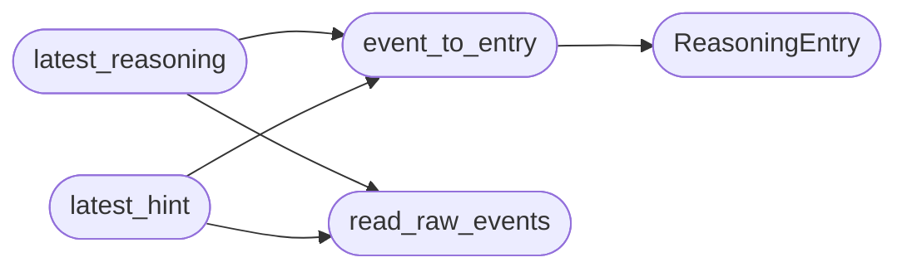

# `cli.reasoning_stream`

> Source: [cli/reasoning_stream.py:1](../../cli/reasoning_stream.py#L1) | language `py` | coverage 100.0% | [API index](../index.md)

Operator-facing view over the autonomous daemon decision log.

The autonomous daemon (``skills/autonomous_daemon.py``) appends structured
events to ``sessions/autonomous_events.jsonl`` through its ``_emit`` helper.
Every event is a JSON object with the shape::

    {"id": "...", "ts": "<iso8601>", "type": "STEP_START",
     "severity": "info", "payload": {...}}

This module turns that raw stream into a compact, human-readable sequence of
[`ReasoningEntry`](#reasoningentry) records so the dashboard can render *what the daemon is
thinking* in real time: the command it chose, the phase, the selector that
produced the decision, the rationale and the reinforcement-learning reward.

The module performs no rendering and imports nothing from ``lazyown.py`` or
``lazyc2.py``; it only reads the JSONL log. This keeps it unit-testable and
reusable by the Textual dashboard, the web dashboard or any other consumer.

## Contents

- **Classes:** [`ReasoningEntry`](#reasoningentry)
- **Functions:** [`read_raw_events`](#read_raw_events), [`event_to_entry`](#event_to_entry), [`latest_reasoning`](#latest_reasoning), [`latest_hint`](#latest_hint)
- **Constants:** [`DEFAULT_EVENTS_FILE`](#default_events_file), [`DEFAULT_LIMIT`](#default_limit), [`SUMMARY_MAX_LEN`](#summary_max_len), [`COMMAND_MAX_LEN`](#command_max_len), [`BYTES_PER_KB`](#bytes_per_kb), [`KB_DISPLAY_THRESHOLD`](#kb_display_threshold), [`TIME_SLICE_START`](#time_slice_start), [`TIME_SLICE_END`](#time_slice_end)

## Call Graph

Solid arrows stay in this module, dashed arrows leave it.



## Classes

<a id="reasoningentry"></a>

### `ReasoningEntry`

`class` `dataclass` | [cli/reasoning_stream.py:66](../../cli/reasoning_stream.py#L66)

Decorators: `@dataclass(frozen=True)`

```python
class ReasoningEntry
```

One human-readable line in the daemon reasoning stream.

**Attributes**

| Name | Type | Default | Description |
|---|---|---|---|
| [`ts`](#reasoningentry-ts) | `str` |  | Wall-clock ``HH:MM:SS`` slice of the event timestamp. |
| [`kind`](#reasoningentry-kind) | `str` |  | Canonical event type as emitted by the daemon. |
| [`icon`](#reasoningentry-icon) | `str` |  | Single-glyph marker used by the renderer. |
| [`style`](#reasoningentry-style) | `str` |  | Rich style string for the marker and command. |
| [`phase`](#reasoningentry-phase) | `str` |  | Kill-chain phase the event belongs to, empty if unknown. |
| [`command`](#reasoningentry-command) | `str` |  | Command associated with the event, empty if not applicable. |
| [`summary`](#reasoningentry-summary) | `str` |  | Compact rationale or outcome description. |
| [`reward`](#reasoningentry-reward) | `float \| None` |  | Reinforcement-learning reward for the step, ``None`` when the event carries no reward signal. |

---

## Functions

<a id="read_raw_events"></a>

### `read_raw_events`

`function` | [cli/reasoning_stream.py:91](../../cli/reasoning_stream.py#L91)

```python
def read_raw_events(path: str = DEFAULT_EVENTS_FILE, limit: int = DEFAULT_LIMIT) -> list[dict[str, Any]]
```

Return the last ``limit`` well-formed events from the JSONL log.

Malformed lines are skipped silently so a single corrupt write never
breaks the dashboard. The newest event is last in the returned list.

**Parameters**

| Name | Type | Default | Description |
|---|---|---|---|
| `path` | `str` | `DEFAULT_EVENTS_FILE` | Path to the autonomous events JSONL file. |
| `limit` | `int` | `DEFAULT_LIMIT` | Maximum number of events to return from the tail. |

**Returns:** `list[dict[str, Any]]` - A list of decoded event dictionaries, oldest first.

*Called by:* [`latest_hint`](#latest_hint), [`latest_reasoning`](#latest_reasoning)

---

<a id="event_to_entry"></a>

### `event_to_entry`

`function` | [cli/reasoning_stream.py:183](../../cli/reasoning_stream.py#L183)

```python
def event_to_entry(event: dict[str, Any]) -> ReasoningEntry
```

Convert a raw daemon event into a [`ReasoningEntry`](#reasoningentry).

**Parameters**

| Name | Type | Default | Description |
|---|---|---|---|
| `event` | `dict[str, Any]` |  | A decoded event dictionary from the JSONL log. |

**Returns:** `ReasoningEntry` - A populated [`ReasoningEntry`](#reasoningentry). Unknown event types fall back to
a neutral marker so the stream never drops information.

*Calls:* [`ReasoningEntry`](#reasoningentry)

*Called by:* [`latest_hint`](#latest_hint), [`latest_reasoning`](#latest_reasoning)

---

<a id="latest_reasoning"></a>

### `latest_reasoning`

`function` | [cli/reasoning_stream.py:216](../../cli/reasoning_stream.py#L216)

```python
def latest_reasoning(path: str = DEFAULT_EVENTS_FILE, limit: int = DEFAULT_LIMIT) -> list[ReasoningEntry]
```

Return the most recent daemon decisions as reasoning entries.

**Parameters**

| Name | Type | Default | Description |
|---|---|---|---|
| `path` | `str` | `DEFAULT_EVENTS_FILE` | Path to the autonomous events JSONL file. |
| `limit` | `int` | `DEFAULT_LIMIT` | Maximum number of entries to return, newest last. |

**Returns:** `list[ReasoningEntry]` - A list of [`ReasoningEntry`](#reasoningentry), oldest first.

*Calls:* [`event_to_entry`](#event_to_entry), [`read_raw_events`](#read_raw_events)

---

<a id="latest_hint"></a>

### `latest_hint`

`function` | [cli/reasoning_stream.py:229](../../cli/reasoning_stream.py#L229)

```python
def latest_hint(events_path: str = DEFAULT_EVENTS_FILE) -> str
```

Return the newest human-readable reasoning line for spinners.

Reads the tail of the autonomous events log and renders the most
recent entry as ``icon kind — summary``. Returns an empty string
when the log is missing or unreadable so spinners fall back to a
generic waiting message instead of failing.

**Parameters**

| Name | Type | Default | Description |
|---|---|---|---|
| `events_path` | `str` | `DEFAULT_EVENTS_FILE` |  |

**Returns:** `str`

*Calls:* [`event_to_entry`](#event_to_entry), [`read_raw_events`](#read_raw_events)

---

## Constants

<a id="default_events_file"></a>

### `DEFAULT_EVENTS_FILE`

`constant` | [cli/reasoning_stream.py:27](../../cli/reasoning_stream.py#L27)

```python
DEFAULT_EVENTS_FILE: str = 'sessions/autonomous_events.jsonl'
```

---

<a id="default_limit"></a>

### `DEFAULT_LIMIT`

`constant` | [cli/reasoning_stream.py:28](../../cli/reasoning_stream.py#L28)

```python
DEFAULT_LIMIT: int = 12
```

---

<a id="summary_max_len"></a>

### `SUMMARY_MAX_LEN`

`constant` | [cli/reasoning_stream.py:29](../../cli/reasoning_stream.py#L29)

```python
SUMMARY_MAX_LEN: int = 60
```

---

<a id="command_max_len"></a>

### `COMMAND_MAX_LEN`

`constant` | [cli/reasoning_stream.py:30](../../cli/reasoning_stream.py#L30)

```python
COMMAND_MAX_LEN: int = 28
```

---

<a id="bytes_per_kb"></a>

### `BYTES_PER_KB`

`constant` | [cli/reasoning_stream.py:31](../../cli/reasoning_stream.py#L31)

```python
BYTES_PER_KB: int = 1024
```

---

<a id="kb_display_threshold"></a>

### `KB_DISPLAY_THRESHOLD`

`constant` | [cli/reasoning_stream.py:32](../../cli/reasoning_stream.py#L32)

```python
KB_DISPLAY_THRESHOLD: int = 1024
```

---

<a id="time_slice_start"></a>

### `TIME_SLICE_START`

`constant` | [cli/reasoning_stream.py:33](../../cli/reasoning_stream.py#L33)

```python
TIME_SLICE_START: int = 11
```

---

<a id="time_slice_end"></a>

### `TIME_SLICE_END`

`constant` | [cli/reasoning_stream.py:34](../../cli/reasoning_stream.py#L34)

```python
TIME_SLICE_END: int = 19
```

---
