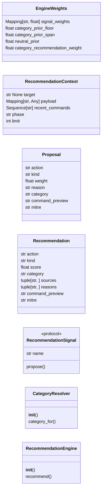
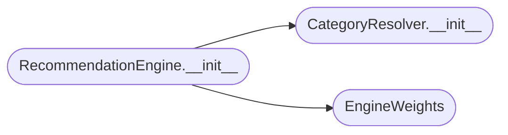

# `cli.recommendation`

> Source: [cli/recommendation.py:1](../../cli/recommendation.py#L1) | language `py` | coverage 100.0% | [API index](../index.md)

Unified next-best-action engine: the single source of truth for "what next".

Before this module the framework carried four independent "what should I run
next" brains that never spoke to each other:

* the graphify proximity walk ([`cli.graph_advisor.GraphAdvisor.suggest_next`](cli.graph_advisor.py.md#graphadvisor-suggest_next)),
* the learned transition policy ([`skills.lazyown_policy.LazyOwnPolicyIntegration`](skills.lazyown_policy.py.md#lazyownpolicyintegration)),
* the nmap trigger-matched recon plan ([`cli.recon_plan.build_recon_plan`](cli.recon_plan.py.md#build_recon_plan)),
* the static kill-chain adjacency tables in [`cli.reactive_hints`](cli.reactive_hints.py.md).

Each surface (the ``recommend_next`` CLI verb, the inline push hints, the MCP
tool) wired a different subset by hand, so the operator saw three unmerged lists
and had to synthesise them mentally. This module collapses them into one logical
chain of thought.

The fusion model has two tiers, mirroring the natural granularity of the inputs:

* **Concrete-action signals** (graph, recon plan, kill-chain) propose individual
  commands / addons / tools, each with a signal-local weight.
* **Category-prior signals** (policy) propose kill-chain *categories* with a
  confidence. These do not name a command; instead they up- or down-weight every
  concrete action that belongs to the category.

[`RecommendationEngine`](#recommendationengine) normalises every signal, multiplies each concrete
action by its category prior, merges duplicates across signals (carrying the full
provenance), and returns a single ranked list of [`Recommendation`](#recommendation).

Design contract:
    - Zero imports from ``lazyown.py`` or ``lazyc2.py`` (Dependency Inversion):
      consumers depend on this module, never the reverse.
    - Every signal is a [`RecommendationSignal`](#recommendationsignal); adding a sixth brain means
      writing one adapter and registering it (Open/Closed). The engine never
      changes.
    - Each signal owns its own failure handling: a signal that raises or whose
      backend is absent contributes nothing instead of breaking the chain, so the
      engine is always available (graceful degradation).
    - No magic numbers: every weight, floor and span lives in
      [`EngineWeights`](#engineweights).

## Contents

- **Classes:** [`EngineWeights`](#engineweights), [`RecommendationContext`](#recommendationcontext), [`Proposal`](#proposal), [`Recommendation`](#recommendation), [`CategoryResolver`](#categoryresolver), [`RecommendationEngine`](#recommendationengine)
- **Protocols:** [`RecommendationSignal`](#recommendationsignal)
- **Constants:** [`SOURCE_GRAPH`](#source_graph), [`SOURCE_POLICY`](#source_policy), [`SOURCE_RECON`](#source_recon), [`SOURCE_KILLCHAIN`](#source_killchain), [`KIND_COMMAND`](#kind_command), [`KIND_ADDON`](#kind_addon), [`KIND_TOOL`](#kind_tool), [`KIND_CATEGORY`](#kind_category), [`KIND_NOTE`](#kind_note)

## Type Diagram



## Call Graph

Solid arrows stay in this module, dashed arrows leave it.



## Classes

<a id="engineweights"></a>

### `EngineWeights`

`class` `dataclass` | [cli/recommendation.py:67](../../cli/recommendation.py#L67)

Decorators: `@dataclass(frozen=True)`

```python
class EngineWeights
```

Immutable fusion parameters shared by every recommendation run.

**Attributes**

| Name | Type | Default | Description |
|---|---|---|---|
| [`signal_weights`](#engineweights-signal_weights) | `Mapping[str, float]` | `field(default_factory=lambda: {SOURCE_RECON: 1.0, SOURCE_GAP: 0.8, SOURCE_GRAPH: 0.6, SOURCE_KILLCHAIN: 0.5})` | Global multiplier per concrete-action signal. The recon plan ranks highest because it is grounded in a real scan of the target; the graph walk and the static kill-chain tables are advisory. |
| [`category_prior_floor`](#engineweights-category_prior_floor) | `float` | `0.6` | Lowest multiplier a concrete action can receive from a cold policy category. Never zero, so a single signal can still surface an action the policy has not yet learned to favour. |
| [`category_prior_span`](#engineweights-category_prior_span) | `float` | `0.8` | Width added on top of the floor for a maximally confident policy category. ``floor + span`` is the hottest prior. |
| [`neutral_prior`](#engineweights-neutral_prior) | `float` | `1.0` | Multiplier applied to actions whose category carries no policy signal at all. |
| [`category_recommendation_weight`](#engineweights-category_recommendation_weight) | `float` | `0.45` | Score assigned to a standalone strategic category recommendation so it ranks below concrete actions of similar confidence while remaining visible. |

---

<a id="recommendationcontext"></a>

### `RecommendationContext`

`class` `dataclass` | [cli/recommendation.py:101](../../cli/recommendation.py#L101)

Decorators: `@dataclass(frozen=True)`

```python
class RecommendationContext
```

Everything a signal needs to produce proposals for one decision.

**Attributes**

| Name | Type | Default | Description |
|---|---|---|---|
| [`target`](#recommendationcontext-target) | `str \| None` |  | Active rhost (or ``None`` to let scan-backed signals fall back to the most recent artefact in ``sessions/``). |
| [`payload`](#recommendationcontext-payload) | `Mapping[str, Any]` |  | ``payload.json`` mapping; signals read phase, creds and OS hints. |
| [`recent_commands`](#recommendationcontext-recent_commands) | `Sequence[str]` |  | Ordered command verbs already executed this session, most recent last. Seeds the graph walk and the kill-chain adjacency. |
| [`phase`](#recommendationcontext-phase) | `str` |  | Resolved kill-chain phase, used by the recon plan and as a category fallback. |
| [`limit`](#recommendationcontext-limit) | `int` | `_DEFAULT_LIMIT` | Maximum number of fused recommendations the caller wants. |

---

<a id="proposal"></a>

### `Proposal`

`class` `dataclass` | [cli/recommendation.py:123](../../cli/recommendation.py#L123)

Decorators: `@dataclass(frozen=True)`

```python
class Proposal
```

A single raw suggestion emitted by one signal, before fusion.

**Attributes**

| Name | Type | Default | Description |
|---|---|---|---|
| [`action`](#proposal-action) | `str` |  | Command / addon / tool identifier, or a category name when `[`kind`](#proposal-kind)` is [`KIND_CATEGORY`](#kind_category). |
| [`kind`](#proposal-kind) | `str` |  | One of the ``KIND_*`` constants. |
| [`weight`](#proposal-weight) | `float` |  | Signal-local importance in ``[0, 1]``. Normalised against the signal's own maximum before the global weight is applied. |
| [`reason`](#proposal-reason) | `str` |  | One-line English justification shown to the operator. |
| [`category`](#proposal-category) | `str` | `''` | Kill-chain category the action belongs to, when the signal already knows it. Empty lets the engine resolve it from the command index. |
| [`command_preview`](#proposal-command_preview) | `str` | `''` | Best-effort copy-paste command string, when available. |
| [`mitre`](#proposal-mitre) | `str` | `''` | Optional MITRE ATT&CK technique id. |

---

<a id="recommendation"></a>

### `Recommendation`

`class` `dataclass` | [cli/recommendation.py:150](../../cli/recommendation.py#L150)

Decorators: `@dataclass(frozen=True)`

```python
class Recommendation
```

A fused, ranked next action with full provenance.

**Attributes**

| Name | Type | Default | Description |
|---|---|---|---|
| [`action`](#recommendation-action) | `str` |  | The suggested command / addon / tool / category. |
| [`kind`](#recommendation-kind) | `str` |  | One of the ``KIND_*`` constants. |
| [`score`](#recommendation-score) | `float` |  | Fused score after normalisation, global weighting and category priors. Higher is better; values are not bounded to ``[0, 1]`` once multiple signals reinforce the same action. |
| [`category`](#recommendation-category) | `str` |  | Resolved kill-chain category, or empty when unknown. |
| [`sources`](#recommendation-sources) | `tuple[str, ...]` |  | Names of every signal that contributed, in registration order. |
| [`reasons`](#recommendation-reasons) | `tuple[str, ...]` |  | One provenance line per contributing signal. |
| [`command_preview`](#recommendation-command_preview) | `str` | `''` | Copy-paste command when any signal supplied one. |
| [`mitre`](#recommendation-mitre) | `str` | `''` | MITRE technique id when any signal supplied one. |

---

<a id="categoryresolver"></a>

### `CategoryResolver`

`class` | [cli/recommendation.py:192](../../cli/recommendation.py#L192)

```python
class CategoryResolver
```

Map a concrete command to its kill-chain category.

The lookup is built once from ``cli/command_index.json`` (its
``category_to_commands`` / ``phase_to_commands`` sections) and consulted by
the engine to decide which policy prior applies to each concrete action. The
loader is injected so tests run without touching the real index.

**Members**

| Member | Kind | Summary |
|---|---|---|
| [`__init__`](#categoryresolver-__init__) | constructor | Build the resolver from the command index. |
| [`category_for`](#categoryresolver-category_for) | method | Return the kill-chain category for `[`action`](#proposal-action)` or an empty string. |

<a id="categoryresolver-__init__"></a>

#### `CategoryResolver.__init__`

`constructor` | [cli/recommendation.py:201](../../cli/recommendation.py#L201)

```python
def __init__(self, index_path: str = _DEFAULT_COMMAND_INDEX, loader: Callable[[Path], Mapping[str, Any] | None] | None = None) -> None
```

Build the resolver from the command index.

**Parameters**

| Name | Type | Default | Description |
|---|---|---|---|
| `index_path` | `str` | `_DEFAULT_COMMAND_INDEX` | Path to ``command_index.json``. |
| `loader` | `Callable[[Path], Mapping[str, Any] \| None] \| None` | `None` | Injected reader returning the parsed index or ``None``. |

*Called by:* [`RecommendationEngine.__init__`](#recommendationengine-__init__), [`build_default_engine`](cli.recommendation_signals.py.md#build_default_engine)

<a id="categoryresolver-category_for"></a>

#### `CategoryResolver.category_for`

`method` | [cli/recommendation.py:227](../../cli/recommendation.py#L227)

```python
def category_for(self, action: str) -> str
```

Return the kill-chain category for `[`action`](#proposal-action)` or an empty string.

**Parameters**

| Name | Type | Default | Description |
|---|---|---|---|
| `action` | `str` |  |  |

**Returns:** `str`

---

<a id="recommendationengine"></a>

### `RecommendationEngine`

`class` | [cli/recommendation.py:232](../../cli/recommendation.py#L232)

```python
class RecommendationEngine
```

Fuse every registered signal into one ranked recommendation list.

The engine holds no per-call state; [`recommend`](modules.recommender.py.md#recommend) is pure with respect to
the injected signals and resolver, which is what lets the CLI verb, the push
hints and the MCP tool share a single instance without coupling.

**Members**

| Member | Kind | Summary |
|---|---|---|
| [`__init__`](#recommendationengine-__init__) | constructor | Wire the engine with its signals and fusion parameters. |
| [`recommend`](#recommendationengine-recommend) | method | Return the fused, ranked recommendations for ``ctx``. |

<a id="recommendationengine-__init__"></a>

#### `RecommendationEngine.__init__`

`constructor` | [cli/recommendation.py:240](../../cli/recommendation.py#L240)

```python
def __init__(self, signals: Sequence[RecommendationSignal], resolver: CategoryResolver | None = None, weights: EngineWeights | None = None) -> None
```

Wire the engine with its signals and fusion parameters.

**Parameters**

| Name | Type | Default | Description |
|---|---|---|---|
| `signals` | `Sequence[RecommendationSignal]` |  | Concrete-action and category-prior signals to fuse. |
| `resolver` | `CategoryResolver \| None` | `None` | Command-to-category resolver. Built from the default index when omitted. |
| `weights` | `EngineWeights \| None` | `None` | Fusion parameters. Defaults to [`EngineWeights`](#engineweights). |

*Calls:* [`CategoryResolver.__init__`](#categoryresolver-__init__), [`EngineWeights`](#engineweights)

*Called by:* [`build_default_engine`](cli.recommendation_signals.py.md#build_default_engine)

<a id="recommendationengine-recommend"></a>

#### `RecommendationEngine.recommend`

`method` | [cli/recommendation.py:258](../../cli/recommendation.py#L258)

```python
def recommend(self, ctx: RecommendationContext) -> list[Recommendation]
```

Return the fused, ranked recommendations for ``ctx``.

**Parameters**

| Name | Type | Default | Description |
|---|---|---|---|
| `ctx` | `RecommendationContext` |  | The decision context shared with every signal. |

**Returns:** `list[Recommendation]` - Up to ``ctx.limit`` [`Recommendation`](#recommendation) objects, ordered by fused
score descending and action name ascending for determinism.

---

## Protocols

<a id="recommendationsignal"></a>

### `RecommendationSignal`

`protocol` | [cli/recommendation.py:177](../../cli/recommendation.py#L177)

Decorators: `@runtime_checkable`

```python
class RecommendationSignal(Protocol)
```

Bases: `Protocol`

Contract every recommendation brain must satisfy to join the chain.

Implementations must be side-effect free beyond reading their own backend and
must never raise out of [`propose`](#recommendationsignal-propose); an unavailable backend returns an
empty list so the engine degrades gracefully.

**Attributes**

| Name | Type | Default | Description |
|---|---|---|---|
| [`name`](#recommendationsignal-name) | `str` |  |  |

**Members**

| Member | Kind | Summary |
|---|---|---|
| [`propose`](#recommendationsignal-propose) | method | Return zero or more [`Proposal`](#proposal) objects for ``ctx``. |

<a id="recommendationsignal-propose"></a>

#### `RecommendationSignal.propose`

`method` | [cli/recommendation.py:187](../../cli/recommendation.py#L187)

```python
def propose(self, ctx: RecommendationContext) -> list[Proposal]
```

Return zero or more [`Proposal`](#proposal) objects for ``ctx``.

**Parameters**

| Name | Type | Default | Description |
|---|---|---|---|
| `ctx` | `RecommendationContext` |  |  |

**Returns:** `list[Proposal]`

---

## Constants

<a id="source_graph"></a>

### `SOURCE_GRAPH`

`constant` | [cli/recommendation.py:49](../../cli/recommendation.py#L49)

```python
SOURCE_GRAPH = 'graph'
```

---

<a id="source_policy"></a>

### `SOURCE_POLICY`

`constant` | [cli/recommendation.py:50](../../cli/recommendation.py#L50)

```python
SOURCE_POLICY = 'policy'
```

---

<a id="source_recon"></a>

### `SOURCE_RECON`

`constant` | [cli/recommendation.py:51](../../cli/recommendation.py#L51)

```python
SOURCE_RECON = 'recon'
```

---

<a id="source_killchain"></a>

### `SOURCE_KILLCHAIN`

`constant` | [cli/recommendation.py:52](../../cli/recommendation.py#L52)

```python
SOURCE_KILLCHAIN = 'killchain'
```

---

<a id="kind_command"></a>

### `KIND_COMMAND`

`constant` | [cli/recommendation.py:55](../../cli/recommendation.py#L55)

```python
KIND_COMMAND = 'command'
```

---

<a id="kind_addon"></a>

### `KIND_ADDON`

`constant` | [cli/recommendation.py:56](../../cli/recommendation.py#L56)

```python
KIND_ADDON = 'addon'
```

---

<a id="kind_tool"></a>

### `KIND_TOOL`

`constant` | [cli/recommendation.py:57](../../cli/recommendation.py#L57)

```python
KIND_TOOL = 'tool'
```

---

<a id="kind_category"></a>

### `KIND_CATEGORY`

`constant` | [cli/recommendation.py:58](../../cli/recommendation.py#L58)

```python
KIND_CATEGORY = 'category'
```

---

<a id="kind_note"></a>

### `KIND_NOTE`

`constant` | [cli/recommendation.py:59](../../cli/recommendation.py#L59)

```python
KIND_NOTE = 'note'
```

---
