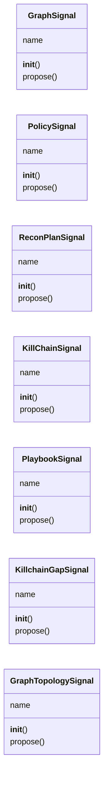
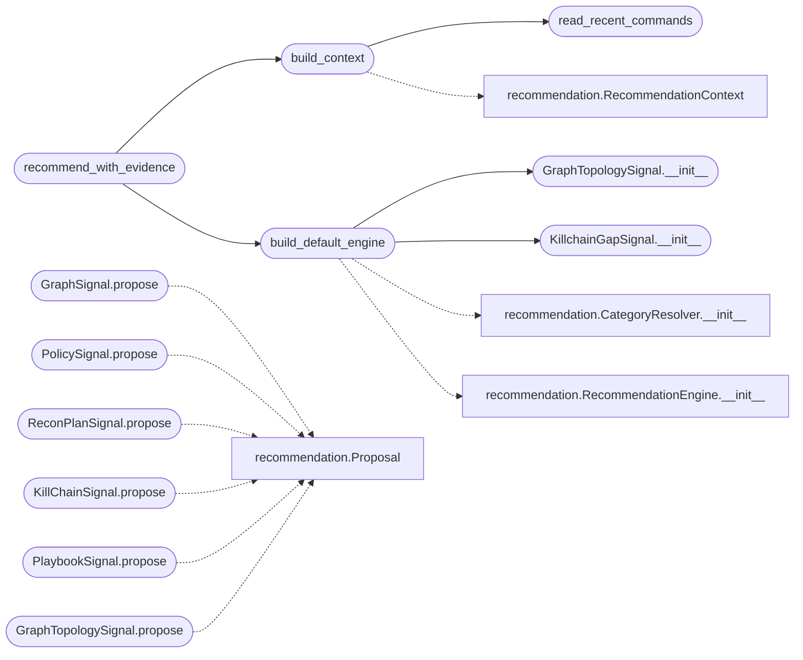

# `cli.recommendation_signals`

> Source: [cli/recommendation_signals.py:1](../../cli/recommendation_signals.py#L1) | language `py` | coverage 92.3% | [API index](../index.md)

Concrete [`cli.recommendation.RecommendationSignal`](cli.recommendation.py.md#recommendationsignal) adapters.

Each adapter wraps one of the framework's pre-existing "what next" brains and
translates its native output into the common [`cli.recommendation.Proposal`](cli.recommendation.py.md#proposal)
currency so [`cli.recommendation.RecommendationEngine`](cli.recommendation.py.md#recommendationengine) can fuse them. The
heavy backends (the graphify index, the policy store, the nmap reader) are
imported lazily inside each adapter, which keeps the core engine module free of
optional third-party dependencies and lets a missing backend degrade to an empty
proposal list instead of an import error.

The [`build_default_engine`](#build_default_engine) factory wires the four deterministic signals in
priority order and is the single entry point every consumer (the ``recommend_next``
CLI verb, the inline push hints, the MCP tool) should call.

## Contents

- **Classes:** [`GraphSignal`](#graphsignal), [`PolicySignal`](#policysignal), [`ReconPlanSignal`](#reconplansignal), [`KillChainSignal`](#killchainsignal), [`PlaybookSignal`](#playbooksignal), [`KillchainGapSignal`](#killchaingapsignal), [`GraphTopologySignal`](#graphtopologysignal)
- **Functions:** [`read_recent_commands`](#read_recent_commands), [`build_context`](#build_context), [`build_default_engine`](#build_default_engine), [`recommend_with_evidence`](#recommend_with_evidence)
- **Constants:** [`SOURCE_PLAYBOOK`](#source_playbook), [`SOURCE_TOPOLOGY`](#source_topology)

## Type Diagram



## Call Graph

Solid arrows stay in this module, dashed arrows leave it.



## Classes

<a id="graphsignal"></a>

### `GraphSignal`

`class` | [cli/recommendation_signals.py:111](../../cli/recommendation_signals.py#L111)

```python
class GraphSignal
```

Adapt [`cli.graph_advisor.GraphAdvisor.suggest_next`](cli.graph_advisor.py.md#graphadvisor-suggest_next) into proposals.

**Attributes**

| Name | Type | Default | Description |
|---|---|---|---|
| [`name`](#graphsignal-name) |  | `SOURCE_GRAPH` |  |

**Members**

| Member | Kind | Summary |
|---|---|---|
| [`__init__`](#graphsignal-__init__) | constructor | Store the graph advisor facade. |
| [`propose`](#graphsignal-propose) | method | Return graph-adjacent command proposals for ``ctx``. |

<a id="graphsignal-__init__"></a>

#### `GraphSignal.__init__`

`constructor` | [cli/recommendation_signals.py:116](../../cli/recommendation_signals.py#L116)

```python
def __init__(self, advisor: Any) -> None
```

Store the graph advisor facade.

**Parameters**

| Name | Type | Default | Description |
|---|---|---|---|
| `advisor` | `Any` |  | Any object exposing ``suggest_next(recent_commands, limit)`` and returning summary dicts carrying ``label``/``id`` and `[`score`](modules.chain_match.py.md#score)` keys. |

<a id="graphsignal-propose"></a>

#### `GraphSignal.propose`

`method` | [cli/recommendation_signals.py:126](../../cli/recommendation_signals.py#L126)

```python
def propose(self, ctx: RecommendationContext) -> list[Proposal]
```

Return graph-adjacent command proposals for ``ctx``.

**Parameters**

| Name | Type | Default | Description |
|---|---|---|---|
| `ctx` | `RecommendationContext` |  |  |

**Returns:** `list[Proposal]`

*Calls:* [`Proposal`](cli.recommendation.py.md#proposal)

---

<a id="policysignal"></a>

### `PolicySignal`

`class` | [cli/recommendation_signals.py:149](../../cli/recommendation_signals.py#L149)

```python
class PolicySignal
```

Adapt the learned transition policy into kill-chain category priors.

**Attributes**

| Name | Type | Default | Description |
|---|---|---|---|
| [`name`](#policysignal-name) |  | `SOURCE_POLICY` |  |

**Members**

| Member | Kind | Summary |
|---|---|---|
| [`__init__`](#policysignal-__init__) | constructor | Store the policy integration facade. |
| [`propose`](#policysignal-propose) | method | Return category-prior proposals for ``ctx``. |

<a id="policysignal-__init__"></a>

#### `PolicySignal.__init__`

`constructor` | [cli/recommendation_signals.py:154](../../cli/recommendation_signals.py#L154)

```python
def __init__(self, policy: Any) -> None
```

Store the policy integration facade.

**Parameters**

| Name | Type | Default | Description |
|---|---|---|---|
| `policy` | `Any` |  | Object exposing ``get_recommendations(target)`` returning dicts with ``category``, ``confidence`` and ``reason`` keys. |

<a id="policysignal-propose"></a>

#### `PolicySignal.propose`

`method` | [cli/recommendation_signals.py:163](../../cli/recommendation_signals.py#L163)

```python
def propose(self, ctx: RecommendationContext) -> list[Proposal]
```

Return category-prior proposals for ``ctx``.

**Parameters**

| Name | Type | Default | Description |
|---|---|---|---|
| `ctx` | `RecommendationContext` |  |  |

**Returns:** `list[Proposal]`

*Calls:* [`Proposal`](cli.recommendation.py.md#proposal)

---

<a id="reconplansignal"></a>

### `ReconPlanSignal`

`class` | [cli/recommendation_signals.py:186](../../cli/recommendation_signals.py#L186)

```python
class ReconPlanSignal
```

Adapt the nmap trigger-matched recon plan into concrete proposals.

**Attributes**

| Name | Type | Default | Description |
|---|---|---|---|
| [`name`](#reconplansignal-name) |  | `SOURCE_RECON` |  |

**Members**

| Member | Kind | Summary |
|---|---|---|
| [`__init__`](#reconplansignal-__init__) | constructor | Store the exploration engine and the plan builder callable. |
| [`propose`](#reconplansignal-propose) | method | Return trigger-matched addon/tool/command proposals for ``ctx``. |

<a id="reconplansignal-__init__"></a>

#### `ReconPlanSignal.__init__`

`constructor` | [cli/recommendation_signals.py:191](../../cli/recommendation_signals.py#L191)

```python
def __init__(self, engine: Any, builder: Any) -> None
```

Store the exploration engine and the plan builder callable.

**Parameters**

| Name | Type | Default | Description |
|---|---|---|---|
| `engine` | `Any` |  | A configured `[`cli.exploration.ExplorationEngine`](cli.exploration.py.md#explorationengine)`. |
| `builder` | `Any` |  | The `[`cli.recon_plan.build_recon_plan`](cli.recon_plan.py.md#build_recon_plan)` callable. |

<a id="reconplansignal-propose"></a>

#### `ReconPlanSignal.propose`

`method` | [cli/recommendation_signals.py:201](../../cli/recommendation_signals.py#L201)

```python
def propose(self, ctx: RecommendationContext) -> list[Proposal]
```

Return trigger-matched addon/tool/command proposals for ``ctx``.

**Parameters**

| Name | Type | Default | Description |
|---|---|---|---|
| `ctx` | `RecommendationContext` |  |  |

**Returns:** `list[Proposal]`

*Calls:* [`Proposal`](cli.recommendation.py.md#proposal)

---

<a id="killchainsignal"></a>

### `KillChainSignal`

`class` | [cli/recommendation_signals.py:225](../../cli/recommendation_signals.py#L225)

```python
class KillChainSignal
```

Adapt the static kill-chain adjacency tables into concrete proposals.

**Attributes**

| Name | Type | Default | Description |
|---|---|---|---|
| [`name`](#killchainsignal-name) |  | `SOURCE_KILLCHAIN` |  |

**Members**

| Member | Kind | Summary |
|---|---|---|
| [`__init__`](#killchainsignal-__init__) | constructor | Store the adjacency and phase-priority tables. |
| [`propose`](#killchainsignal-propose) | method | Return adjacency- and phase-derived proposals for ``ctx``. |

<a id="killchainsignal-__init__"></a>

#### `KillChainSignal.__init__`

`constructor` | [cli/recommendation_signals.py:230](../../cli/recommendation_signals.py#L230)

```python
def __init__(self, next_table: Mapping[str, Sequence[str]], phase_table: Mapping[str, Sequence[str]]) -> None
```

Store the adjacency and phase-priority tables.

**Parameters**

| Name | Type | Default | Description |
|---|---|---|---|
| `next_table` | `Mapping[str, Sequence[str]]` |  | Map of command verb to its sensible follow-ups. |
| `phase_table` | `Mapping[str, Sequence[str]]` |  | Map of kill-chain phase to its priority verbs. |

<a id="killchainsignal-propose"></a>

#### `KillChainSignal.propose`

`method` | [cli/recommendation_signals.py:244](../../cli/recommendation_signals.py#L244)

```python
def propose(self, ctx: RecommendationContext) -> list[Proposal]
```

Return adjacency- and phase-derived proposals for ``ctx``.

**Parameters**

| Name | Type | Default | Description |
|---|---|---|---|
| `ctx` | `RecommendationContext` |  |  |

**Returns:** `list[Proposal]`

*Calls:* [`Proposal`](cli.recommendation.py.md#proposal)

---

<a id="playbooksignal"></a>

### `PlaybookSignal`

`class` | [cli/recommendation_signals.py:338](../../cli/recommendation_signals.py#L338)

```python
class PlaybookSignal
```

Adapt APT playbook suggestions into concrete proposals.

When nmap services match a known playbook profile (APT group, attack
surface pattern), this signal suggests relevant playbook commands.

**Attributes**

| Name | Type | Default | Description |
|---|---|---|---|
| [`name`](#playbooksignal-name) |  | `SOURCE_PLAYBOOK` |  |

**Members**

| Member | Kind | Summary |
|---|---|---|
| [`__init__`](#playbooksignal-__init__) | constructor | Store an optional playbook engine facade. |
| [`propose`](#playbooksignal-propose) | method | Return playbook-based proposals for the current context. |

<a id="playbooksignal-__init__"></a>

#### `PlaybookSignal.__init__`

`constructor` | [cli/recommendation_signals.py:347](../../cli/recommendation_signals.py#L347)

```python
def __init__(self, playbook_engine: Any = None) -> None
```

Store an optional playbook engine facade.

**Parameters**

| Name | Type | Default | Description |
|---|---|---|---|
| `playbook_engine` | `Any` | `None` | Object exposing `[`list_playbooks`](modules.apt_playbooks.py.md#aptplaybookengine-list_playbooks)` returning a list of playbook summary dicts. |

<a id="playbooksignal-propose"></a>

#### `PlaybookSignal.propose`

`method` | [cli/recommendation_signals.py:356](../../cli/recommendation_signals.py#L356)

```python
def propose(self, ctx: RecommendationContext) -> list[Proposal]
```

Return playbook-based proposals for the current context.

**Parameters**

| Name | Type | Default | Description |
|---|---|---|---|
| `ctx` | `RecommendationContext` |  |  |

**Returns:** `list[Proposal]`

*Calls:* [`Proposal`](cli.recommendation.py.md#proposal)

---

<a id="killchaingapsignal"></a>

### `KillchainGapSignal`

`class` | [cli/recommendation_signals.py:387](../../cli/recommendation_signals.py#L387)

```python
class KillchainGapSignal
```

Detect missing steps in the kill chain from world model and session state.

Inspects ``sessions/world_model.json`` host states and session artefacts
to identify gaps where the operator has not progressed. Each detected gap
produces a high-confidence `Proposal` for the most impactful next
action.

Gap detection rules (ordered by priority):
    - Host in EXPLOITED state without privesc output: recommend
      linpeas/winpeas.
    - Host in OWNED state without credential dump: recommend
      mimikatz/secretsdump/lazydump.
    - Scan XML exists but no enumeration: recommend gobuster/ffuf/enum4linux.
    - Credentials exist but no lateral movement: recommend
      crackmapexec/psexec.

**Attributes**

| Name | Type | Default | Description |
|---|---|---|---|
| [`name`](#killchaingapsignal-name) |  | `SOURCE_GAP` |  |

**Members**

| Member | Kind | Summary |
|---|---|---|
| [`__init__`](#killchaingapsignal-__init__) | constructor |  |
| [`propose`](#killchaingapsignal-propose) | method | Return gap-detection proposals for ``ctx``. |

<a id="killchaingapsignal-__init__"></a>

#### `KillchainGapSignal.__init__`

`constructor` | [cli/recommendation_signals.py:407](../../cli/recommendation_signals.py#L407)

```python
def __init__(self, sessions_dir: str = 'sessions') -> None
```

**Parameters**

| Name | Type | Default | Description |
|---|---|---|---|
| `sessions_dir` | `str` | `'sessions'` |  |

*Called by:* [`build_default_engine`](#build_default_engine)

<a id="killchaingapsignal-propose"></a>

#### `KillchainGapSignal.propose`

`method` | [cli/recommendation_signals.py:410](../../cli/recommendation_signals.py#L410)

```python
def propose(self, ctx: RecommendationContext) -> list[Proposal]
```

Return gap-detection proposals for ``ctx``.

**Parameters**

| Name | Type | Default | Description |
|---|---|---|---|
| `ctx` | `RecommendationContext` |  |  |

**Returns:** `list[Proposal]`

---

<a id="graphtopologysignal"></a>

### `GraphTopologySignal`

`class` | [cli/recommendation_signals.py:532](../../cli/recommendation_signals.py#L532)

```python
class GraphTopologySignal
```

Adapt WorldModel network graph pivot_candidates into lateral movement proposals.

Reads the degree-centrality pivot candidates computed by the WorldModel's
NetworkGraph and emits high-confidence proposals for lateral movement,
credential spraying, and network topology exploration — data that was
previously computed but never consumed by the recommendation engine.

**Attributes**

| Name | Type | Default | Description |
|---|---|---|---|
| [`name`](#graphtopologysignal-name) |  | `SOURCE_TOPOLOGY` |  |

**Members**

| Member | Kind | Summary |
|---|---|---|
| [`__init__`](#graphtopologysignal-__init__) | constructor |  |
| [`propose`](#graphtopologysignal-propose) | method | Return lateral movement and topology proposals from network graph. |

<a id="graphtopologysignal-__init__"></a>

#### `GraphTopologySignal.__init__`

`constructor` | [cli/recommendation_signals.py:543](../../cli/recommendation_signals.py#L543)

```python
def __init__(self, sessions_dir: str = 'sessions') -> None
```

**Parameters**

| Name | Type | Default | Description |
|---|---|---|---|
| `sessions_dir` | `str` | `'sessions'` |  |

*Called by:* [`build_default_engine`](#build_default_engine)

<a id="graphtopologysignal-propose"></a>

#### `GraphTopologySignal.propose`

`method` | [cli/recommendation_signals.py:546](../../cli/recommendation_signals.py#L546)

```python
def propose(self, ctx: RecommendationContext) -> list[Proposal]
```

Return lateral movement and topology proposals from network graph.

**Parameters**

| Name | Type | Default | Description |
|---|---|---|---|
| `ctx` | `RecommendationContext` |  |  |

**Returns:** `list[Proposal]`

*Calls:* [`Proposal`](cli.recommendation.py.md#proposal)

---

## Functions

<a id="read_recent_commands"></a>

### `read_recent_commands`

`function` | [cli/recommendation_signals.py:276](../../cli/recommendation_signals.py#L276)

```python
def read_recent_commands(sessions_dir: str = 'sessions', window: int = _DEFAULT_RECENT_WINDOW) -> list[str]
```

Return the last `[`window`](lazygui.config.constants.py.md#appconstants-window)` command verbs from the session transcript.

**Parameters**

| Name | Type | Default | Description |
|---|---|---|---|
| `sessions_dir` | `str` | `'sessions'` | Path to the ``sessions/`` directory. |
| `window` | `int` | `_DEFAULT_RECENT_WINDOW` | Maximum number of trailing verbs to return. |

**Returns:** `list[str]` - Ordered command verbs, most recent last. Empty when the transcript is
absent or unreadable.

*Called by:* [`build_context`](#build_context)

---

<a id="build_context"></a>

### `build_context`

`function` | [cli/recommendation_signals.py:309](../../cli/recommendation_signals.py#L309)

```python
def build_context(payload: Mapping[str, Any], sessions_dir: str = 'sessions', target: str | None = None, limit: int = 5) -> RecommendationContext
```

Assemble a [`RecommendationContext`](cli.recommendation.py.md#recommendationcontext) from live engagement state.

**Parameters**

| Name | Type | Default | Description |
|---|---|---|---|
| `payload` | `Mapping[str, Any]` |  | ``payload.json`` mapping. |
| `sessions_dir` | `str` | `'sessions'` | Path to ``sessions/`` for transcript reads. |
| `target` | `str \| None` | `None` | Explicit target. Falls back to ``payload['rhost']``. |
| `limit` | `int` | `5` | Maximum recommendations the caller wants. |

**Returns:** `RecommendationContext` - A populated context shared by every signal.

*Calls:* [`RecommendationContext`](cli.recommendation.py.md#recommendationcontext), [`read_recent_commands`](#read_recent_commands)

*Called by:* [`MiscMigratedCommandSet.do_recommend_next`](cli.commands.misc_migrated.py.md#miscmigratedcommandset-do_recommend_next), [`recommend_with_evidence`](#recommend_with_evidence), [`next_actions`](modules.engage_summary.py.md#next_actions)

---

<a id="build_default_engine"></a>

### `build_default_engine`

`function` | [cli/recommendation_signals.py:650](../../cli/recommendation_signals.py#L650)

```python
def build_default_engine(payload: Mapping[str, Any] | None = None, sessions_dir: str = 'sessions', graph_path: str | None = None, command_index_path: str = 'cli/command_index.json', weights: EngineWeights | None = None) -> RecommendationEngine
```

Wire every available deterministic signal into one engine.

Signals whose backend cannot be imported or constructed are skipped silently
so the returned engine always works with whatever is present. The kill-chain
signal is unconditional because its tables ship with the framework.

**Parameters**

| Name | Type | Default | Description |
|---|---|---|---|
| `payload` | `Mapping[str, Any] \| None` | `None` | ``payload.json`` mapping used to resolve the victim OS for the recon-plan signal. |
| `sessions_dir` | `str` | `'sessions'` | Path to ``sessions/`` (currently informational; the collaborators resolve their own paths). |
| `graph_path` | `str \| None` | `None` | Optional explicit graphify graph path. |
| `command_index_path` | `str` | `'cli/command_index.json'` | Path to ``command_index.json`` for category priors. |
| `weights` | `EngineWeights \| None` | `None` | Optional fusion-weight override. |

**Returns:** `RecommendationEngine` - A ready [`RecommendationEngine`](cli.recommendation.py.md#recommendationengine).

*Calls:* [`CategoryResolver.__init__`](cli.recommendation.py.md#categoryresolver-__init__), [`RecommendationEngine.__init__`](cli.recommendation.py.md#recommendationengine-__init__), [`GraphTopologySignal.__init__`](#graphtopologysignal-__init__), [`KillchainGapSignal.__init__`](#killchaingapsignal-__init__)

*Called by:* [`recommend_with_evidence`](#recommend_with_evidence), [`next_actions`](modules.engage_summary.py.md#next_actions)

---

<a id="recommend_with_evidence"></a>

### `recommend_with_evidence`

`function` | [cli/recommendation_signals.py:706](../../cli/recommendation_signals.py#L706)

```python
def recommend_with_evidence(payload: Mapping[str, Any], sessions_dir: str = 'sessions', target: str | None = None, phase: str = '', limit: int = 3, engine: RecommendationEngine | None = None) -> list[Recommendation]
```

Return fused, ranked recommendations carrying reason and score for display.

Thin convenience over [`build_default_engine`](#build_default_engine) and [`build_context`](#build_context)
for the evidence-backed inline hints. An already-built ``engine`` may be
injected so a caller on a hot path (the post-command hook) constructs the
engine once and reuses it across commands instead of rebuilding every step.

**Parameters**

| Name | Type | Default | Description |
|---|---|---|---|
| `payload` | `Mapping[str, Any]` |  | ``payload.json`` mapping used to resolve OS and target. |
| `sessions_dir` | `str` | `'sessions'` | Path to ``sessions/`` for transcript and world-model reads. |
| `target` | `str \| None` | `None` | Explicit target; falls back to ``payload['rhost']``. |
| `phase` | `str` | `''` | Caller-resolved kill-chain phase. When non-empty it overrides the phase [`build_context`](#build_context) derives from the payload, letting the hint reuse the shell's authoritative [`modules.killchain.KillChain`](modules.killchain.py.md#killchain) resolution. |
| `limit` | `int` | `3` | Maximum number of recommendations to return. |
| `engine` | `RecommendationEngine \| None` | `None` | Optional pre-built engine to reuse. |

**Returns:** `list[Recommendation]` - Up to ``limit`` [`cli.recommendation.Recommendation`](cli.recommendation.py.md#recommendation) objects,
best first. Empty when no signal produces a proposal.

*Calls:* [`build_context`](#build_context), [`build_default_engine`](#build_default_engine)

---

## Constants

<a id="source_playbook"></a>

### `SOURCE_PLAYBOOK`

`constant` | [cli/recommendation_signals.py:51](../../cli/recommendation_signals.py#L51)

```python
SOURCE_PLAYBOOK = 'playbook'
```

---

<a id="source_topology"></a>

### `SOURCE_TOPOLOGY`

`constant` | [cli/recommendation_signals.py:52](../../cli/recommendation_signals.py#L52)

```python
SOURCE_TOPOLOGY = 'topology'
```

---
