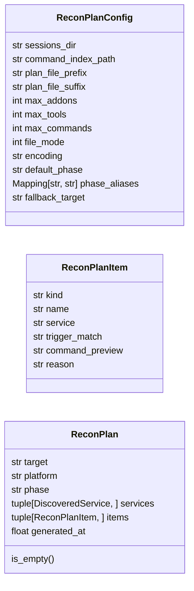
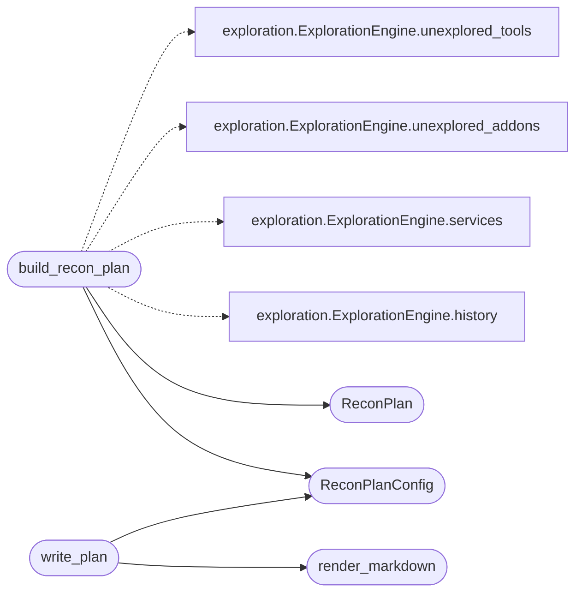

# `cli.recon_plan`

> Source: [cli/recon_plan.py:1](../../cli/recon_plan.py#L1) | language `py` | coverage 100.0% | [API index](../index.md)

Reconnaissance plan generator built on top of [`cli.exploration`](cli.exploration.py.md).

After `[`do_lazynmap`](cli.commands.recon.py.md#reconcommandset-do_lazynmap)` finishes scanning a target the operator is left with
a raw XML in ``sessions/`` and no immediate guidance about which addon,
``.tool`` or CLI verb to invoke next. This module bridges that gap by
composing the trigger-matched outputs already produced by
[`cli.exploration.ExplorationEngine`](cli.exploration.py.md#explorationengine) (addons + tools) with the
phase-aware ``cli/command_index.json`` into a single, persisted plan.

The module is pure: it does no shell I/O, holds no global state and
never imports ``cmd2``, ``rich`` or ``lazyown.py``. The CLI integration
lives in `[`do_lazynmap`](cli.commands.recon.py.md#reconcommandset-do_lazynmap)` / `[`do_recommend_next`](cli.commands.misc_migrated.py.md#miscmigratedcommandset-do_recommend_next)` which call
[`build_recon_plan`](#build_recon_plan), then optionally pipe the result through
[`render_markdown`](#render_markdown) (operator + LLM consumption) or
[`render_rich`](#render_rich) (terminal preview).

Design constraints honoured:

* Single Responsibility: every helper does exactly one thing.
* Open / Closed: new item kinds extend [`ReconPlanItem`](#reconplanitem) without
  touching the renderer.
* Liskov / Interface Segregation: the engine collaborator only needs to
  satisfy the `[`unexplored_addons`](cli.exploration.py.md#explorationengine-unexplored_addons)` / `[`unexplored_tools`](cli.exploration.py.md#explorationengine-unexplored_tools)` / `[`services`](#reconplan-services)`
  / `[`history`](modules.collab_bp.py.md#history)` contract already provided by
  [`cli.exploration.ExplorationEngine`](cli.exploration.py.md#explorationengine).
* Dependency Inversion: file I/O, command-index loading and time are all
  injected so the suite never touches the real ``sessions/`` tree.
* No magic numbers / hardcoded paths: every default lives in
  [`ReconPlanConfig`](#reconplanconfig).
* Sessions `[`write_plan`](#write_plan)` is atomic (``*.tmp`` then ``os.replace``) with
  ``0o600`` permissions, matching the pattern used by
  [`skills.unified_orchestrator.EventBus`](skills.unified_orchestrator.py.md#eventbus).

## Contents

- **Classes:** [`ReconPlanConfig`](#reconplanconfig), [`ReconPlanItem`](#reconplanitem), [`ReconPlan`](#reconplan)
- **Functions:** [`build_recon_plan`](#build_recon_plan), [`render_markdown`](#render_markdown), [`write_plan`](#write_plan), [`render_rich`](#render_rich)

## Type Diagram



## Call Graph

Solid arrows stay in this module, dashed arrows leave it.



## Classes

<a id="reconplanconfig"></a>

### `ReconPlanConfig`

`class` `dataclass` | [cli/recon_plan.py:62](../../cli/recon_plan.py#L62)

Decorators: `@dataclass(frozen=True)`

```python
class ReconPlanConfig
```

Immutable defaults for plan generation, rendering and persistence.

**Attributes**

| Name | Type | Default | Description |
|---|---|---|---|
| [`sessions_dir`](#reconplanconfig-sessions_dir) | `str` | `'sessions'` |  |
| [`command_index_path`](#reconplanconfig-command_index_path) | `str` | `'cli/command_index.json'` |  |
| [`plan_file_prefix`](#reconplanconfig-plan_file_prefix) | `str` | `_PLAN_FILE_PREFIX` |  |
| [`plan_file_suffix`](#reconplanconfig-plan_file_suffix) | `str` | `_PLAN_FILE_SUFFIX` |  |
| [`max_addons`](#reconplanconfig-max_addons) | `int` | `5` |  |
| [`max_tools`](#reconplanconfig-max_tools) | `int` | `5` |  |
| [`max_commands`](#reconplanconfig-max_commands) | `int` | `5` |  |
| [`file_mode`](#reconplanconfig-file_mode) | `int` | `384` |  |
| [`encoding`](#reconplanconfig-encoding) | `str` | `'utf-8'` |  |
| [`default_phase`](#reconplanconfig-default_phase) | `str` | `'enum'` |  |
| [`phase_aliases`](#reconplanconfig-phase_aliases) | `Mapping[str, str]` | `field(default_factory=lambda: {'recon': 'recon', 'scan': 'recon', 'enum': 'enum', 'exploit': 'exploit', 'privesc': 'privesc', 'lateral': 'lateral', 'cred': 'cred', 'persist': 'persist', 'exfil': 'exfil', 'report': 'report', 'c2': 'c2'})` |  |
| [`fallback_target`](#reconplanconfig-fallback_target) | `str` | `'unknown-target'` |  |

---

<a id="reconplanitem"></a>

### `ReconPlanItem`

`class` `dataclass` | [cli/recon_plan.py:94](../../cli/recon_plan.py#L94)

Decorators: `@dataclass(frozen=True)`

```python
class ReconPlanItem
```

One actionable suggestion in a [`ReconPlan`](#reconplan).

**Attributes**

| Name | Type | Default | Description |
|---|---|---|---|
| [`kind`](#reconplanitem-kind) | `str` |  | One of ``addon``, ``tool``, ``command``, `[`note`](modules.emulation_runner.py.md#emulationresult-note)`. |
| [`name`](#reconplanitem-name) | `str` |  | Identifier of the addon, tool or CLI verb. |
| [`service`](#reconplanitem-service) | `str` |  | ``service:port/proto`` label that triggered the item, or an empty string for phase-priority command suggestions. |
| [`trigger_match`](#reconplanitem-trigger_match) | `str` |  | Comma-separated trigger keywords that matched. |
| [`command_preview`](#reconplanitem-command_preview) | `str` |  | Best-effort copy-paste command shown to the operator. Empty when the item is a CLI verb the operator invokes directly. |
| [`reason`](#reconplanitem-reason) | `str` |  | One-line justification (English, no emoji) explaining why the item is in the plan. |

---

<a id="reconplan"></a>

### `ReconPlan`

`class` `dataclass` | [cli/recon_plan.py:119](../../cli/recon_plan.py#L119)

Decorators: `@dataclass(frozen=True)`

```python
class ReconPlan
```

Snapshot of a target's next-step plan.

**Attributes**

| Name | Type | Default | Description |
|---|---|---|---|
| [`target`](#reconplan-target) | `str` |  | Host or hostname the plan was built for. |
| [`platform`](#reconplan-platform) | `str` |  | Resolved victim OS used to filter items. |
| [`phase`](#reconplan-phase) | `str` |  | Kill-chain phase the command suggestions came from. |
| [`services`](#reconplan-services) | `tuple[DiscoveredService, ...]` |  | Discovered services that fed the trigger matching. |
| [`items`](#reconplan-items) | `tuple[ReconPlanItem, ...]` |  | Ordered actionable suggestions. |
| [`generated_at`](#reconplan-generated_at) | `float` |  | Epoch seconds when the plan was assembled. |

**Members**

| Member | Kind | Summary |
|---|---|---|
| [`is_empty`](#reconplan-is_empty) | property | Return ``True`` when the plan carries no actionable items. |

<a id="reconplan-is_empty"></a>

#### `ReconPlan.is_empty`

`property` | [cli/recon_plan.py:139](../../cli/recon_plan.py#L139)

Decorators: `@property`

```python
def is_empty(self) -> bool
```

Return ``True`` when the plan carries no actionable items.

**Returns:** `bool`

---

## Functions

<a id="build_recon_plan"></a>

### `build_recon_plan`

`function` | [cli/recon_plan.py:144](../../cli/recon_plan.py#L144)

```python
def build_recon_plan(target: str | None, engine: ExplorationEngine, payload: Mapping[str, Any] | None = None, config: ReconPlanConfig | None = None, command_index_loader: Callable[[Path], Mapping[str, Any] | None] | None = None, clock: Callable[[], float] | None = None) -> ReconPlan
```

Assemble a [`ReconPlan`](#reconplan) for `[`target`](#reconplan-target)` using ``engine``.

**Parameters**

| Name | Type | Default | Description |
|---|---|---|---|
| `target` | `str \| None` |  | Host the plan is for. ``None`` lets the engine fall back to the most recent scan in ``sessions/``. |
| `engine` | `ExplorationEngine` |  | An [`ExplorationEngine`](cli.exploration.py.md#explorationengine) already configured with the current victim OS. |
| `payload` | `Mapping[str, Any] \| None` | `None` | Optional ``payload.json`` mapping. Used to resolve the active phase and substitute ``{ip}`` / ``{domain}`` / ``{username}`` / ``{password}`` placeholders in the previewed commands. |
| `config` | `ReconPlanConfig \| None` | `None` | Optional [`ReconPlanConfig`](#reconplanconfig) override. |
| `command_index_loader` | `Callable[[Path], Mapping[str, Any] \| None] \| None` | `None` | Injected loader for ``cli/command_index.json``. Defaults to a stdlib-only reader. Returning ``None`` skips the command-suggestions layer cleanly. |
| `clock` | `Callable[[], float] \| None` | `None` | Zero-arg callable returning the current epoch seconds. Defaults to `time.time`. |

**Returns:** `ReconPlan` - A populated [`ReconPlan`](#reconplan). The result is empty (`[`is_empty`](#reconplan-is_empty)`
true) when no nmap scan has been performed yet.

*Calls:* [`ExplorationEngine.history`](cli.exploration.py.md#explorationengine-history), [`ExplorationEngine.services`](cli.exploration.py.md#explorationengine-services), [`ExplorationEngine.unexplored_addons`](cli.exploration.py.md#explorationengine-unexplored_addons), [`ExplorationEngine.unexplored_tools`](cli.exploration.py.md#explorationengine-unexplored_tools), [`ReconPlan`](#reconplan), [`ReconPlanConfig`](#reconplanconfig)

*Called by:* [`run_post_scan`](cli.lazynmap_post.py.md#run_post_scan)

---

<a id="render_markdown"></a>

### `render_markdown`

`function` | [cli/recon_plan.py:207](../../cli/recon_plan.py#L207)

```python
def render_markdown(plan: ReconPlan) -> str
```

Render ``plan`` as a Markdown document suitable for sessions/.

The output is intentionally small (no embedded HTML, no nested
formatting) so both the operator and downstream LLM agents can parse
it deterministically.

**Parameters**

| Name | Type | Default | Description |
|---|---|---|---|
| `plan` | `ReconPlan` |  |  |

**Returns:** `str`

*Called by:* [`write_plan`](#write_plan)

---

<a id="write_plan"></a>

### `write_plan`

`function` | [cli/recon_plan.py:257](../../cli/recon_plan.py#L257)

```python
def write_plan(plan: ReconPlan, sessions_dir: str | os.PathLike[str] | None = None, config: ReconPlanConfig | None = None) -> Path
```

Persist ``plan`` to ``sessions/recon_plan_<target>.md`` atomically.

**Parameters**

| Name | Type | Default | Description |
|---|---|---|---|
| `plan` | `ReconPlan` |  | Plan to persist. |
| `sessions_dir` | `str \| os.PathLike[str] \| None` | `None` | Override for the sessions directory. Defaults to ``config.sessions_dir`` resolved against the current working directory. |
| `config` | `ReconPlanConfig \| None` | `None` | Optional [`ReconPlanConfig`](#reconplanconfig) override. |

**Returns:** `Path` - The absolute `Path` of the written plan file.

*Calls:* [`ReconPlanConfig`](#reconplanconfig), [`render_markdown`](#render_markdown)

*Called by:* [`run_post_scan`](cli.lazynmap_post.py.md#run_post_scan)

---

<a id="render_rich"></a>

### `render_rich`

`function` | [cli/recon_plan.py:299](../../cli/recon_plan.py#L299)

```python
def render_rich(plan: ReconPlan, console: Any) -> None
```

Render ``plan`` to the supplied Rich console.

The console is duck-typed; only `[`print`](modules.resource_script.py.md#scriptcontext-print)` is required so callers can
inject any object implementing the same interface in tests.

**Parameters**

| Name | Type | Default | Description |
|---|---|---|---|
| `plan` | `ReconPlan` |  |  |
| `console` | `Any` |  |  |

*Called by:* [`run_post_scan`](cli.lazynmap_post.py.md#run_post_scan)

---
