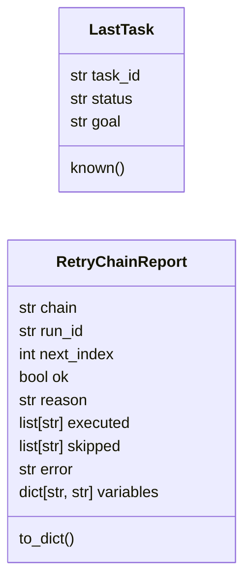
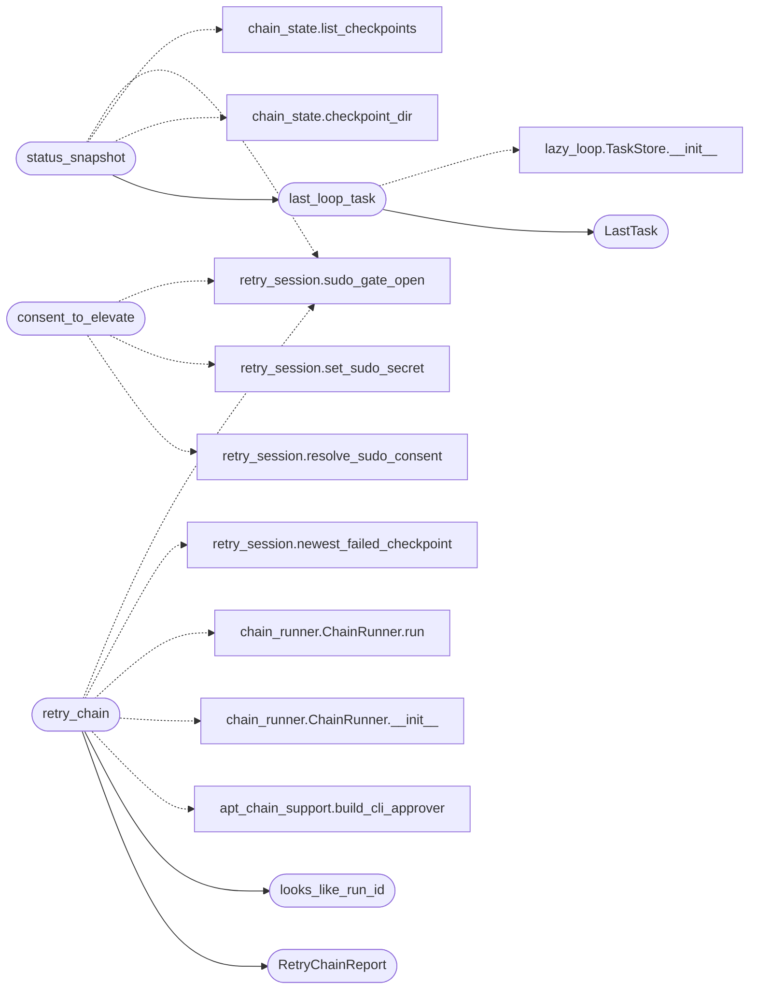

# `cli.retry_support`

> Source: [cli/retry_support.py:1](../../cli/retry_support.py#L1) | language `py` | coverage 100.0% | [API index](../index.md)

Retry support - resume logic shared by the ``retry`` CLI surface.

The CommandSet (`[`cli.commands.retry_ops`](cli.commands.retry_ops.py.md)`) stays thin: argument parsing,
checkpoint selection, variable overrides, elevated-sudo arming and the
actual relaunch live here, mirroring the ``apt_chain`` support split.

Relaunch semantics:

- chain: [`modules.retry_session.newest_failed_checkpoint`](modules.retry_session.py.md#newest_failed_checkpoint) picks
  the freshest aborted/failed checkpoint (chain-name or run-id selector),
  the recorded variables rehydrate as tokens and every ``--var
  key=value`` wins over them. The ChainRunner keeps the same run id, so
  the resumed attempt is auditable against the stored checkpoint.
- loop: the last non-complete task (TaskStore) or an explicit task id
  re-enters [`modules.lazy_runner.run_loop`](modules.lazy_runner.py.md#run_loop) with the ordinary
  ``auto_loop`` flags, so the operator can vary rounds, target, budget.
- elevation: ``--sudo`` arms [`modules.retry_session`](modules.retry_session.py.md) after a
  warned confirmation; command lines flow through
  [`modules.retry_session.apply_sudo_askpass`](modules.retry_session.py.md#apply_sudo_askpass) so bare ``sudo``
  invocations switch to ``sudo -A`` without touching operators' code.

## Contents

- **Classes:** [`LastTask`](#lasttask), [`RetryChainReport`](#retrychainreport)
- **Functions:** [`looks_like_run_id`](#looks_like_run_id), [`last_loop_task`](#last_loop_task), [`status_snapshot`](#status_snapshot), [`consent_to_elevate`](#consent_to_elevate), [`retry_chain`](#retry_chain)
- **Constants:** [`RUN_ID_PARTS_MIN`](#run_id_parts_min)

## Type Diagram



## Call Graph

Solid arrows stay in this module, dashed arrows leave it.



## Classes

<a id="lasttask"></a>

### `LastTask`

`class` `dataclass` | [cli/retry_support.py:62](../../cli/retry_support.py#L62)

Decorators: `@dataclass`

```python
class LastTask
```

One non-complete loop task candidate for ``retry loop``.

**Parameters**

| Name | Type | Default | Description |
|---|---|---|---|
| `task_id` | `str` | `''` | Task id (``tNNNN``). |
| `status` | `str` | `''` | TaskStore status (failed, timeout, exhausted, paused). |
| `goal` | `str` | `''` | The goal text the task chased. |

**Attributes**

| Name | Type | Default | Description |
|---|---|---|---|
| [`task_id`](#lasttask-task_id) | `str` | `''` |  |
| [`status`](#lasttask-status) | `str` | `''` |  |
| [`goal`](#lasttask-goal) | `str` | `''` |  |

**Members**

| Member | Kind | Summary |
|---|---|---|
| [`known`](#lasttask-known) | property | Return True when a task record exists. |

<a id="lasttask-known"></a>

#### `LastTask.known`

`property` | [cli/retry_support.py:76](../../cli/retry_support.py#L76)

Decorators: `@property`

```python
def known(self) -> bool
```

Return True when a task record exists.

**Returns:** `bool`

---

<a id="retrychainreport"></a>

### `RetryChainReport`

`class` `dataclass` | [cli/retry_support.py:164](../../cli/retry_support.py#L164)

Decorators: `@dataclass`

```python
class RetryChainReport
```

Outcome of one chain relaunch attempt.

**Parameters**

| Name | Type | Default | Description |
|---|---|---|---|
| `chain` | `str` | `''` | Resumed chain name. |
| `run_id` | `str` | `''` | Checkpoint run id (kept identical to the failed run). |
| `next_index` | `int` | `0` | Step index the run resumed at. |
| `ok` | `bool` | `True` | True when every step ended ok / skipped / dry-run. |
| `reason` | `str` | `''` | Failure reason of the relaunch (empty on success). |
| `executed` | `list[str]` | `field(default_factory=list)` | Resolved step lines executed this attempt. |
| `skipped` | `list[str]` | `field(default_factory=list)` | Step ids skipped (already done / guards). |
| `error` | `str` | `''` | Checkpoint or registry problem that blocked the relaunch. |
| `variables` | `dict[str, str]` | `field(default_factory=dict)` | Starting tokens after user overrides. |

**Attributes**

| Name | Type | Default | Description |
|---|---|---|---|
| [`chain`](#retrychainreport-chain) | `str` | `''` |  |
| [`run_id`](#retrychainreport-run_id) | `str` | `''` |  |
| [`next_index`](#retrychainreport-next_index) | `int` | `0` |  |
| [`ok`](#retrychainreport-ok) | `bool` | `True` |  |
| [`reason`](#retrychainreport-reason) | `str` | `''` |  |
| [`executed`](#retrychainreport-executed) | `list[str]` | `field(default_factory=list)` |  |
| [`skipped`](#retrychainreport-skipped) | `list[str]` | `field(default_factory=list)` |  |
| [`error`](#retrychainreport-error) | `str` | `''` |  |
| [`variables`](#retrychainreport-variables) | `dict[str, str]` | `field(default_factory=dict)` |  |

**Members**

| Member | Kind | Summary |
|---|---|---|
| [`to_dict`](#retrychainreport-to_dict) | method | Return a JSON-serializable view. |

<a id="retrychainreport-to_dict"></a>

#### `RetryChainReport.to_dict`

`method` | [cli/retry_support.py:189](../../cli/retry_support.py#L189)

```python
def to_dict(self) -> dict
```

Return a JSON-serializable view.

**Returns:** `dict`

---

## Functions

<a id="looks_like_run_id"></a>

### `looks_like_run_id`

`function` | [cli/retry_support.py:45](../../cli/retry_support.py#L45)

```python
def looks_like_run_id(token: str) -> bool
```

Return True when the token reads as a chain run id, not a name.

**Parameters**

| Name | Type | Default | Description |
|---|---|---|---|
| `token` | `str` |  | Operator-provided selector. |

**Returns:** `bool` - True when the token carries the ``<slug>_<date>_<pid>`` shape
rather than a plain chain name.

*Called by:* [`retry_chain`](#retry_chain)

---

<a id="last_loop_task"></a>

### `last_loop_task`

`function` | [cli/retry_support.py:81](../../cli/retry_support.py#L81)

```python
def last_loop_task() -> LastTask
```

Return the last non-complete task from the TaskStore.

**Returns:** `LastTask` - LastTask; `[`known`](#lasttask-known)` False when the store has no candidate.

*Calls:* [`LastTask`](#lasttask), [`TaskStore.__init__`](modules.lazy_loop.py.md#taskstore-__init__)

*Called by:* [`status_snapshot`](#status_snapshot)

---

<a id="status_snapshot"></a>

### `status_snapshot`

`function` | [cli/retry_support.py:104](../../cli/retry_support.py#L104)

```python
def status_snapshot(limit: int = 5) -> dict
```

Collect retry-relevant state: failed checkpoints + last task.

**Parameters**

| Name | Type | Default | Description |
|---|---|---|---|
| `limit` | `int` | `5` | Rows per listing. |

**Returns:** `dict` - Mapping with ``checkpoint_rows`` (newest failed first),
``last_task`` and ``sudo_armed`` for the operator summary.

*Calls:* [`last_loop_task`](#last_loop_task), [`checkpoint_dir`](modules.chain_state.py.md#checkpoint_dir), [`list_checkpoints`](modules.chain_state.py.md#list_checkpoints), [`sudo_gate_open`](modules.retry_session.py.md#sudo_gate_open)

---

<a id="consent_to_elevate"></a>

### `consent_to_elevate`

`function` | [cli/retry_support.py:129](../../cli/retry_support.py#L129)

```python
def consent_to_elevate(rest: list[str], confirmer) -> tuple[bool, str]
```

Resolve ``--sudo`` for one retry invocation.

**Parameters**

| Name | Type | Default | Description |
|---|---|---|---|
| `rest` | `list[str]` |  | Token list of the retry subcommand; ``--sudo`` toggles. |
| `confirmer` |  |  | Warned-confirmation callable returning the answer ( ``(str) -> str`` ); None refuses the mode fail-closed. |

**Returns:** `tuple[bool, str]` - (armed, note). ``armed`` True only when the warning was accepted
and a password was provided; the note explains refusals.

**Raises**

- `ValueError`: Never surfaced; getpass EOF yields a note instead.

*Calls:* [`resolve_sudo_consent`](modules.retry_session.py.md#resolve_sudo_consent), [`set_sudo_secret`](modules.retry_session.py.md#set_sudo_secret), [`sudo_gate_open`](modules.retry_session.py.md#sudo_gate_open)

---

<a id="retry_chain"></a>

### `retry_chain`

`function` | [cli/retry_support.py:204](../../cli/retry_support.py#L204)

```python
def retry_chain(chain_or_run: str, shell=None, extra_vars: dict[str, str] | None = None, dry_run: bool = False) -> RetryChainReport
```

Resume a failed chain, applying user-varied tokens.

**Parameters**

| Name | Type | Default | Description |
|---|---|---|---|
| `chain_or_run` | `str` |  | Chain name (newest failed) or explicit run id. |
| `shell` |  | `None` | Live shell for verb steps (None keeps raw execution). |
| `extra_vars` | `dict[str, str] \| None` | `None` | ``--var key=value`` overrides on recorded variables. |
| `dry_run` | `bool` | `False` | Resolve without executing (verify a varied config first). |

**Returns:** `RetryChainReport` - RetryChainReport; `[`error`](#retrychainreport-error)` explains selection/registry issues.

*Calls:* [`build_cli_approver`](cli.apt_chain_support.py.md#build_cli_approver), [`RetryChainReport`](#retrychainreport), [`looks_like_run_id`](#looks_like_run_id), [`ChainRunner.__init__`](modules.chain_runner.py.md#chainrunner-__init__), [`ChainRunner.run`](modules.chain_runner.py.md#chainrunner-run), [`newest_failed_checkpoint`](modules.retry_session.py.md#newest_failed_checkpoint), [`sudo_gate_open`](modules.retry_session.py.md#sudo_gate_open)

---

## Constants

<a id="run_id_parts_min"></a>

### `RUN_ID_PARTS_MIN`

`constant` | [cli/retry_support.py:40](../../cli/retry_support.py#L40)

```python
RUN_ID_PARTS_MIN = 2
```

---
