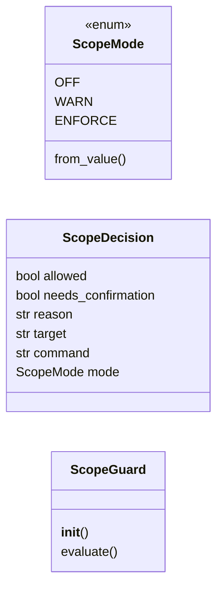
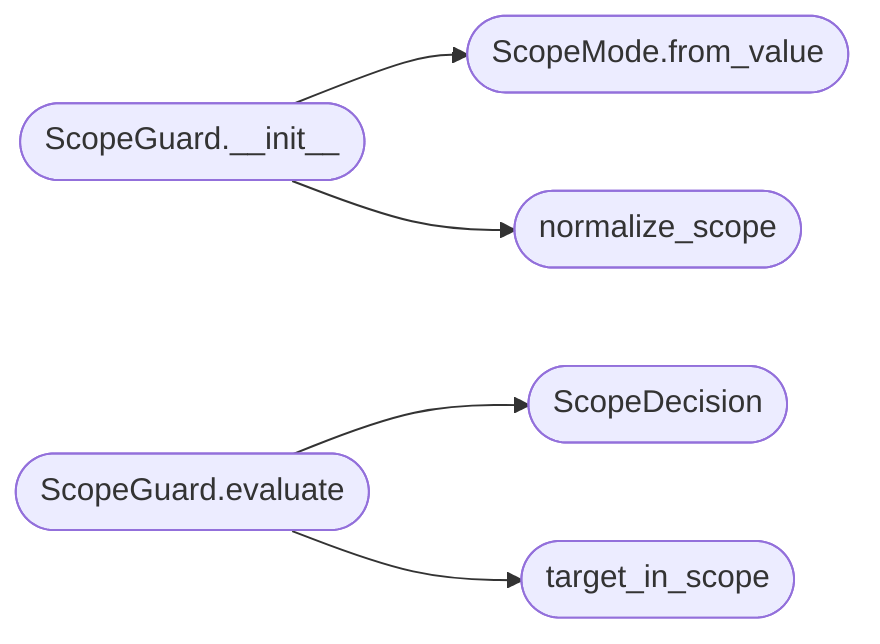

# `cli.scope_guard`

> Source: [cli/scope_guard.py:1](../../cli/scope_guard.py#L1) | language `py` | coverage 100.0% | [API index](../index.md)

Authorization scope guard for offensive command execution.

A red-team framework that reads its target from ``payload.json`` has a sharp
edge: if the operator leaves ``rhost`` pointing at the wrong machine, every
offensive command fires at an unauthorized host. That is an engagement
incident, not a cosmetic bug. This module is the safety net.

The guard answers a single question before a command runs: *is the active
target inside the authorized engagement scope for this (potentially offensive)
command?* It is deliberately conservative and fail-open so it never breaks an
existing workflow:

* When the enforcement mode is ``off`` it is a no-op.
* When no scope is configured it allows everything (you cannot enforce a scope
  that was never defined), so operators who never touch the feature see no
  change at all.
* When the command is not classified as offensive (reporting, configuration,
  local helpers) it allows it.
* When the target is empty it allows it (nothing to check).

Only when an *offensive* command targets a host *outside* a *defined* scope does
the guard react, and even then `[`warn`](skills.setup.sh.md#warn)` mode merely annotates the decision
while ``enforce`` mode blocks pending operator confirmation.

Design contract:
    - Zero imports from ``lazyown.py`` or ``lazyc2.py`` (Dependency Inversion);
      the shell depends on this module, never the reverse.
    - The offensive/benign classification is pure data
      ([`OFFENSIVE_CATEGORIES`](#offensive_categories)) plus a pure function
      ([`build_offensive_commands`](#build_offensive_commands)), so it is unit-testable without a live
      cmd2 shell. A drift test pins the category strings against
      ``utils.py``.
    - Scope matching understands CIDR networks, bare IPs and hostnames
      (including ``*.`` wildcards) via the standard library only.
    - Every decision is a value object ([`ScopeDecision`](#scopedecision)) carrying the
      reason, so the caller owns all rendering and prompting.

## Contents

- **Classes:** [`ScopeDecision`](#scopedecision), [`ScopeGuard`](#scopeguard)
- **Enums:** [`ScopeMode`](#scopemode)
- **Functions:** [`build_offensive_commands`](#build_offensive_commands), [`normalize_scope`](#normalize_scope), [`target_in_scope`](#target_in_scope)
- **Constants:** [`OFFENSIVE_CATEGORIES`](#offensive_categories), [`SCOPE_EXEMPT_COMMANDS`](#scope_exempt_commands)

## Type Diagram



## Call Graph

Solid arrows stay in this module, dashed arrows leave it.



## Classes

<a id="scopedecision"></a>

### `ScopeDecision`

`class` `dataclass` | [cli/scope_guard.py:125](../../cli/scope_guard.py#L125)

Decorators: `@dataclass(frozen=True)`

```python
class ScopeDecision
```

Outcome of a single scope evaluation.

**Attributes**

| Name | Type | Default | Description |
|---|---|---|---|
| [`allowed`](#scopedecision-allowed) | `bool` |  | Whether the command may proceed without confirmation. |
| [`needs_confirmation`](#scopedecision-needs_confirmation) | `bool` |  | Whether the caller must obtain explicit operator confirmation before proceeding (only set in ``enforce`` mode). |
| [`reason`](#scopedecision-reason) | `str` |  | Human-readable explanation, empty when the command is allowed for an uninteresting reason (mode off, no scope, benign command). |
| [`target`](#scopedecision-target) | `str` |  | The target the decision was made against. |
| [`command`](#scopedecision-command) | `str` |  | The command the decision was made against. |
| [`mode`](#scopedecision-mode) | `ScopeMode` |  | The enforcement mode in effect when the decision was made. |

---

<a id="scopeguard"></a>

### `ScopeGuard`

`class` | [cli/scope_guard.py:254](../../cli/scope_guard.py#L254)

```python
class ScopeGuard
```

Decides whether an offensive command may run against the active target.

The guard is cheap to construct and holds no mutable state, so the shell
can build a fresh instance per command with the current payload values;
this guarantees mid-session changes to the scope or the enforcement mode
take effect immediately.

**Members**

| Member | Kind | Summary |
|---|---|---|
| [`__init__`](#scopeguard-__init__) | constructor | Initialise the guard. |
| [`evaluate`](#scopeguard-evaluate) | method | Evaluate a single command against the active target. |

<a id="scopeguard-__init__"></a>

#### `ScopeGuard.__init__`

`constructor` | [cli/scope_guard.py:263](../../cli/scope_guard.py#L263)

```python
def __init__(self, scope_entries: object, mode: object, is_offensive: Callable[[str], bool]) -> None
```

Initialise the guard.

**Parameters**

| Name | Type | Default | Description |
|---|---|---|---|
| `scope_entries` | `object` |  | The authorized scope, in any form accepted by [`normalize_scope`](#normalize_scope). |
| `mode` | `object` |  | The enforcement mode, in any form accepted by [`ScopeMode.from_value`](#scopemode-from_value). |
| `is_offensive` | `Callable[[str], bool]` |  | Predicate returning ``True`` when a command name is offensive. Injected so the guard never imports the shell. |

*Calls:* [`ScopeMode.from_value`](#scopemode-from_value), [`normalize_scope`](#normalize_scope)

<a id="scopeguard-evaluate"></a>

#### `ScopeGuard.evaluate`

`method` | [cli/scope_guard.py:283](../../cli/scope_guard.py#L283)

```python
def evaluate(self, command: str, target: str) -> ScopeDecision
```

Evaluate a single command against the active target.

**Parameters**

| Name | Type | Default | Description |
|---|---|---|---|
| `command` | `str` |  | The command name about to run. |
| `target` | `str` |  | The active target (``rhost``). |

**Returns:** `ScopeDecision` - A [`ScopeDecision`](#scopedecision). The guard fails open: any classification
error is treated as benign so a bug here never blocks the operator.

*Calls:* [`ScopeDecision`](#scopedecision), [`target_in_scope`](#target_in_scope)

---

## Enums

<a id="scopemode"></a>

### `ScopeMode`

`enum` | [cli/scope_guard.py:90](../../cli/scope_guard.py#L90)

```python
class ScopeMode(StrEnum)
```

Bases: `StrEnum`

Enforcement posture for the scope guard.

**Attributes**

| Name | Type | Default | Description |
|---|---|---|---|
| [`OFF`](#scopemode-off) |  | `'off'` | The guard is disabled and always allows. |
| [`WARN`](#scopemode-warn) |  | `'warn'` | Out-of-scope offensive commands are allowed but annotated. |
| [`ENFORCE`](#scopemode-enforce) |  | `'enforce'` | Out-of-scope offensive commands are blocked pending confirmation. |

**Members**

| Member | Kind | Summary |
|---|---|---|
| [`from_value`](#scopemode-from_value) | classmethod | Coerce an arbitrary payload value into a [`ScopeMode`](#scopemode). |

<a id="scopemode-from_value"></a>

#### `ScopeMode.from_value`

`classmethod` | [cli/scope_guard.py:105](../../cli/scope_guard.py#L105)

Decorators: `@classmethod`

```python
def from_value(cls, value: object) -> ScopeMode
```

Coerce an arbitrary payload value into a [`ScopeMode`](#scopemode).

**Parameters**

| Name | Type | Default | Description |
|---|---|---|---|
| `value` | `object` |  | A [`ScopeMode`](#scopemode), a mode string, or anything else. |

**Returns:** `ScopeMode` - The matching mode, defaulting to [`WARN`](#scopemode-warn) for unknown input so
a typo never silently disables the guard.

*Called by:* [`ScopeGuard.__init__`](#scopeguard-__init__)

---

## Functions

<a id="build_offensive_commands"></a>

### `build_offensive_commands`

`function` | [cli/scope_guard.py:147](../../cli/scope_guard.py#L147)

```python
def build_offensive_commands(command_categories: Mapping[str, object]) -> frozenset[str]
```

Select the command names whose category is offensive.

**Parameters**

| Name | Type | Default | Description |
|---|---|---|---|
| `command_categories` | `Mapping[str, object]` |  | Mapping of command name to its cmd2 help category (or ``None`` for uncategorised commands). |

**Returns:** `frozenset[str]` - The frozenset of command names that belong to
[`OFFENSIVE_CATEGORIES`](#offensive_categories).

---

<a id="normalize_scope"></a>

### `normalize_scope`

`function` | [cli/scope_guard.py:163](../../cli/scope_guard.py#L163)

```python
def normalize_scope(entries: object) -> tuple[str, ...]
```

Coerce a scope specification into a tuple of entry strings.

Accepts the canonical list form stored in ``payload.json`` as well as the
string forms an operator might produce via ``assign`` (a JSON array, or a
comma/space separated list), so the guard is robust to either source.

**Parameters**

| Name | Type | Default | Description |
|---|---|---|---|
| `entries` | `object` |  | A list/tuple/set of entries, a string, or ``None``. |

**Returns:** `tuple[str, ...]` - A tuple of non-empty, stripped entry strings.

*Called by:* [`ScopeGuard.__init__`](#scopeguard-__init__)

---

<a id="target_in_scope"></a>

### `target_in_scope`

`function` | [cli/scope_guard.py:218](../../cli/scope_guard.py#L218)

```python
def target_in_scope(target: str, entries: Sequence[str]) -> bool
```

Return whether *target* falls within any of the scope *entries*.

IP targets are matched against CIDR networks and bare IP entries; hostname
targets are matched against hostname entries (supporting a leading ``*.``
wildcard for subdomains). Cross-kind comparisons (IP target vs hostname
entry, or vice versa) never match because resolving them would require DNS,
which the guard deliberately avoids.

**Parameters**

| Name | Type | Default | Description |
|---|---|---|---|
| `target` | `str` |  | The active target (IP address or hostname). |
| `entries` | `Sequence[str]` |  | Authorized scope entries. |

**Returns:** `bool` - ``True`` when the target is authorized by at least one entry.

*Called by:* [`ScopeGuard.evaluate`](#scopeguard-evaluate)

---

## Constants

<a id="offensive_categories"></a>

### `OFFENSIVE_CATEGORIES`

`constant` | [cli/scope_guard.py:47](../../cli/scope_guard.py#L47)

```python
OFFENSIVE_CATEGORIES: frozenset[str]
```

Kill-chain categories whose commands generate traffic to or act upon the target.

Membership drives the scope guard. Local-only surfaces (Command & Control infrastructure, Reporting, Miscellaneous) are intentionally excluded so the guard never interferes with payload generation, report writing or configuration.

---

<a id="scope_exempt_commands"></a>

### `SCOPE_EXEMPT_COMMANDS`

`constant` | [cli/scope_guard.py:69](../../cli/scope_guard.py#L69)

```python
SCOPE_EXEMPT_COMMANDS: frozenset[str]
```

Commands that only read or drive local state and never generate traffic to the target.

They are exempt from scope enforcement even when a kill-chain category was assigned to them for help grouping, so an operator can always inspect the engagement while RHOST points at an out-of-scope host.

---
