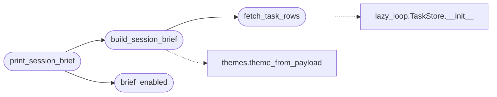

# `cli.session_brief`

> Source: [cli/session_brief.py:1](../../cli/session_brief.py#L1) | language `py` | coverage 100.0% | [API index](../index.md)

Consolidated session-start brief for the LazyOwn shell.

The shell used to print scattered startup noise (auth warnings, one
session tip, chain prompts, toasts). This contract owns one short
campaign overview instead: target, derived world-model phase,
autonomous tasks, loop-throttled verb count and declarative trigger
count in a single panel. Every collaborator failure collapses into its
muted placeholder line so the brief can never block or crash the shell.

Single responsibility: rendering one startup panel. Persistence stays
in `[`modules.world_model`](modules.world_model.py.md)` (world model), `[`modules.lazy_loop`](modules.lazy_loop.py.md)`
(tasks), `[`modules.verb_catalog`](modules.verb_catalog.py.md)` (verbs) and
`[`modules.trigger_policy`](modules.trigger_policy.py.md)` (triggers); the shell only injects
``payload.json`` and the ``ui_hints`` gate.

## Contents

- **Classes:** [`SessionBriefConfig`](#sessionbriefconfig)
- **Functions:** [`brief_enabled`](#brief_enabled), [`fetch_task_rows`](#fetch_task_rows), [`build_session_brief`](#build_session_brief), [`print_session_brief`](#print_session_brief)
- **Constants:** [`SESSION_BRIEF`](#session_brief)

## Call Graph

Solid arrows stay in this module, dashed arrows leave it.



## Classes

<a id="sessionbriefconfig"></a>

### `SessionBriefConfig`

`class` `dataclass` | [cli/session_brief.py:35](../../cli/session_brief.py#L35)

Decorators: `@dataclass(frozen=True)`

```python
class SessionBriefConfig
```

Display knobs for the startup brief.

**Attributes**

| Name | Type | Default | Description |
|---|---|---|---|
| [`title`](#sessionbriefconfig-title) | `str` | `'session brief'` |  |
| [`goal_cap`](#sessionbriefconfig-goal_cap) | `int` | `60` |  |
| [`hint_key`](#sessionbriefconfig-hint_key) | `str` | `'ui_hints'` |  |
| [`hint_off_values`](#sessionbriefconfig-hint_off_values) | `tuple[str, ...]` | `('off', 'false', '0', 'no')` |  |

---

## Functions

<a id="brief_enabled"></a>

### `brief_enabled`

`function` | [cli/session_brief.py:47](../../cli/session_brief.py#L47)

```python
def brief_enabled(payload: Mapping[str, Any] | None) -> bool
```

Return False when the UI hints continuity suppresses the brief.

**Parameters**

| Name | Type | Default | Description |
|---|---|---|---|
| `payload` | `Mapping[str, Any] \| None` |  |  |

**Returns:** `bool`

*Called by:* [`print_session_brief`](#print_session_brief)

---

<a id="fetch_task_rows"></a>

### `fetch_task_rows`

`function` | [cli/session_brief.py:84](../../cli/session_brief.py#L84)

```python
def fetch_task_rows() -> list[dict]
```

Read the full task rows from the loop store, never raising.

**Returns:** `list[dict]`

*Calls:* [`TaskStore.__init__`](modules.lazy_loop.py.md#taskstore-__init__)

*Called by:* [`build_session_brief`](#build_session_brief)

---

<a id="build_session_brief"></a>

### `build_session_brief`

`function` | [cli/session_brief.py:135](../../cli/session_brief.py#L135)

```python
def build_session_brief(payload: Mapping[str, Any], tasks: list[dict] | None = None) -> Panel
```

Build the one-startup campaign brief panel.

**Parameters**

| Name | Type | Default | Description |
|---|---|---|---|
| `payload` | `Mapping[str, Any]` |  | Active ``payload.json`` mapping. |
| `tasks` | `list[dict] \| None` | `None` | Optional pre-fetched task rows (tests sandbox the store). |

**Returns:** `Panel` - A Rich panel with ``label=value`` pairs so the operator can grep
the block instead of reading prose.

*Calls:* [`fetch_task_rows`](#fetch_task_rows), [`theme_from_payload`](cli.themes.py.md#theme_from_payload)

*Called by:* [`print_session_brief`](#print_session_brief)

---

<a id="print_session_brief"></a>

### `print_session_brief`

`function` | [cli/session_brief.py:171](../../cli/session_brief.py#L171)

```python
def print_session_brief(console: Any, payload: Mapping[str, Any]) -> bool
```

Render the brief through ``console`` when UI hints allow.

**Parameters**

| Name | Type | Default | Description |
|---|---|---|---|
| `console` | `Any` |  | The shell's Rich console. |
| `payload` | `Mapping[str, Any]` |  | Active ``payload.json`` mapping. |

**Returns:** `bool` - ``True`` when the brief printed.

*Calls:* [`brief_enabled`](#brief_enabled), [`build_session_brief`](#build_session_brief)

*Called by:* [`LazyOwnShell.preloop`](lazyown.py.md#lazyownshell-preloop)

---

## Constants

<a id="session_brief"></a>

### `SESSION_BRIEF`

`constant` | [cli/session_brief.py:44](../../cli/session_brief.py#L44)

```python
SESSION_BRIEF = SessionBriefConfig()
```

---
