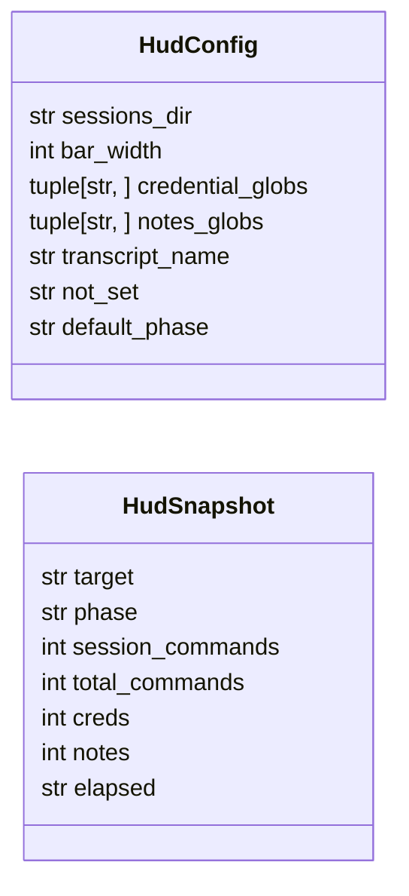
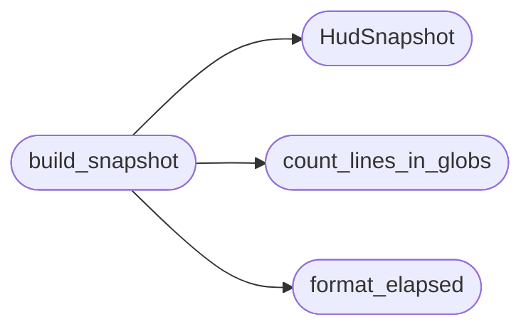

# `cli.session_hud`

> Source: [cli/session_hud.py:1](../../cli/session_hud.py#L1) | language `py` | coverage 100.0% | [API index](../index.md)

Compact session HUD: the numbers no other command shows.

`[`killchain`](lazygui.panels.registry.py.md#panelregistry-killchain)` already owns the kill-chain view and does it better, with
per-phase percentages. ``sitrep`` owns the full operational picture. This
module covers only the gap: how long the session has run, how many
commands it has executed, and how much material it has captured.

Every figure comes from a source that actually exists on disk. Credential
and note counts use the same globs as the dashboard
(``credentials*.txt``, ``notes*.txt``); the command count and the session
clock come from the engagement state, which is the only component that
knows when the session started.

## Contents

- **Classes:** [`HudConfig`](#hudconfig), [`HudSnapshot`](#hudsnapshot)
- **Functions:** [`count_lines_in_globs`](#count_lines_in_globs), [`count_csv_rows`](#count_csv_rows), [`format_elapsed`](#format_elapsed), [`phase_bar`](#phase_bar), [`build_snapshot`](#build_snapshot), [`render_snapshot`](#render_snapshot)
- **Constants:** [`DEFAULT_HUD_CONFIG`](#default_hud_config)

## Type Diagram



## Call Graph

Solid arrows stay in this module, dashed arrows leave it.



## Classes

<a id="hudconfig"></a>

### `HudConfig`

`class` `dataclass` | [cli/session_hud.py:25](../../cli/session_hud.py#L25)

Decorators: `@dataclass(frozen=True)`

```python
class HudConfig
```

Centralized knobs for HUD data sources.

**Attributes**

| Name | Type | Default | Description |
|---|---|---|---|
| [`sessions_dir`](#hudconfig-sessions_dir) | `str` | `'sessions'` |  |
| [`bar_width`](#hudconfig-bar_width) | `int` | `10` |  |
| [`credential_globs`](#hudconfig-credential_globs) | `tuple[str, ...]` | `('credentials*.txt',)` |  |
| [`notes_globs`](#hudconfig-notes_globs) | `tuple[str, ...]` | `('notes*.txt',)` |  |
| [`transcript_name`](#hudconfig-transcript_name) | `str` | `'LazyOwn_session_report.csv'` |  |
| [`not_set`](#hudconfig-not_set) | `str` | `'not set'` |  |
| [`default_phase`](#hudconfig-default_phase) | `str` | `'recon'` |  |

---

<a id="hudsnapshot"></a>

### `HudSnapshot`

`class` `dataclass` | [cli/session_hud.py:50](../../cli/session_hud.py#L50)

Decorators: `@dataclass(frozen=True)`

```python
class HudSnapshot
```

Point-in-time values displayed by the HUD.

**Attributes**

| Name | Type | Default | Description |
|---|---|---|---|
| [`target`](#hudsnapshot-target) | `str` |  |  |
| [`phase`](#hudsnapshot-phase) | `str` |  |  |
| [`session_commands`](#hudsnapshot-session_commands) | `int` |  |  |
| [`total_commands`](#hudsnapshot-total_commands) | `int` |  |  |
| [`creds`](#hudsnapshot-creds) | `int` |  |  |
| [`notes`](#hudsnapshot-notes) | `int` |  |  |
| [`elapsed`](#hudsnapshot-elapsed) | `str` |  |  |

---

## Functions

<a id="count_lines_in_globs"></a>

### `count_lines_in_globs`

`function` | [cli/session_hud.py:62](../../cli/session_hud.py#L62)

```python
def count_lines_in_globs(root: str, patterns: tuple[str, ...]) -> int
```

Count non-empty lines across every file matching the patterns.

**Parameters**

| Name | Type | Default | Description |
|---|---|---|---|
| `root` | `str` |  | Directory holding the session artefacts. |
| `patterns` | `tuple[str, ...]` |  | Glob patterns relative to `[`root`](modules.workspace.py.md#root)`. |

**Returns:** `int` - Total non-empty line count, zero when nothing matches.

*Called by:* [`build_snapshot`](#build_snapshot)

---

<a id="count_csv_rows"></a>

### `count_csv_rows`

`function` | [cli/session_hud.py:83](../../cli/session_hud.py#L83)

```python
def count_csv_rows(path: Path) -> int
```

Count data rows in a CSV file without loading it fully.

**Parameters**

| Name | Type | Default | Description |
|---|---|---|---|
| `path` | `Path` |  | CSV file path. |

**Returns:** `int` - Number of data rows, zero when missing or unreadable.

---

<a id="format_elapsed"></a>

### `format_elapsed`

`function` | [cli/session_hud.py:100](../../cli/session_hud.py#L100)

```python
def format_elapsed(seconds: float) -> str
```

Format a duration as HH:MM:SS.

**Parameters**

| Name | Type | Default | Description |
|---|---|---|---|
| `seconds` | `float` |  | Duration in seconds. |

**Returns:** `str` - Zero-padded clock string.

*Called by:* [`build_snapshot`](#build_snapshot)

---

<a id="phase_bar"></a>

### `phase_bar`

`function` | [cli/session_hud.py:115](../../cli/session_hud.py#L115)

```python
def phase_bar(phase: str, width: int = DEFAULT_HUD_CONFIG.bar_width) -> str
```

Render kill-chain progress as filled and empty blocks.

**Parameters**

| Name | Type | Default | Description |
|---|---|---|---|
| `phase` | `str` |  | Current phase name. |
| `width` | `int` | `DEFAULT_HUD_CONFIG.bar_width` | Bar width in characters. |

**Returns:** `str` - String such as [###-------] exploit.

---

<a id="build_snapshot"></a>

### `build_snapshot`

`function` | [cli/session_hud.py:155](../../cli/session_hud.py#L155)

```python
def build_snapshot(params: dict[str, Any], config: HudConfig = DEFAULT_HUD_CONFIG) -> HudSnapshot
```

Build a snapshot from live params, engagement state and session files.

**Parameters**

| Name | Type | Default | Description |
|---|---|---|---|
| `params` | `dict[str, Any]` |  | Live payload mapping with rhost and phase keys. |
| `config` | `HudConfig` | `DEFAULT_HUD_CONFIG` | HUD configuration. |

**Returns:** `HudSnapshot` - Populated HudSnapshot with every figure read from a real source.

*Calls:* [`HudSnapshot`](#hudsnapshot), [`count_lines_in_globs`](#count_lines_in_globs), [`format_elapsed`](#format_elapsed)

*Called by:* [`UxCommandSet.do_hud`](cli.commands.ux.py.md#uxcommandset-do_hud)

---

<a id="render_snapshot"></a>

### `render_snapshot`

`function` | [cli/session_hud.py:180](../../cli/session_hud.py#L180)

```python
def render_snapshot(snapshot: HudSnapshot, config: HudConfig = DEFAULT_HUD_CONFIG) -> list[str]
```

Render the session counters as two plain lines.

No kill-chain bar: `[`killchain`](lazygui.panels.registry.py.md#panelregistry-killchain)` renders phases with per-phase
percentages and duplicating a worse version of it here only confused
the operator. Level markers are omitted too, because the shell
printers in `[`core.console`](core.console.py.md)` already emit one per line.

**Parameters**

| Name | Type | Default | Description |
|---|---|---|---|
| `snapshot` | `HudSnapshot` |  | Values to display. |
| `config` | `HudConfig` | `DEFAULT_HUD_CONFIG` | HUD configuration. |

**Returns:** `list[str]` - List of plain lines, one per HUD row.

*Called by:* [`UxCommandSet.do_hud`](cli.commands.ux.py.md#uxcommandset-do_hud)

---

## Constants

<a id="default_hud_config"></a>

### `DEFAULT_HUD_CONFIG`

`constant` | [cli/session_hud.py:37](../../cli/session_hud.py#L37)

```python
DEFAULT_HUD_CONFIG = HudConfig()
```

---
