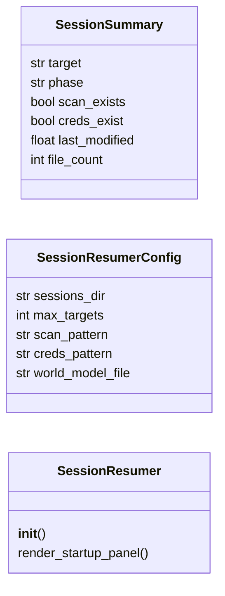

# `cli.session_resumer`

> Source: [cli/session_resumer.py:1](../../cli/session_resumer.py#L1) | language `py` | coverage 100.0% | [API index](../index.md)

Session resumer for the LazyOwn shell.

Scans ``sessions/`` for previous engagement data (IP directories, scan files,
credentials) and presents a resume panel at shell startup so the operator
can quickly pick up where they left off.

Design contract:
    - Zero imports from ``lazyown.py`` or ``lazyc2.py``.
    - All output through ``rich.console.Console``.
    - `[`SessionResumer`](#sessionresumer)` receives a sessions dir path; no hardcoded paths.

## Contents

- **Classes:** [`SessionSummary`](#sessionsummary), [`SessionResumerConfig`](#sessionresumerconfig), [`SessionResumer`](#sessionresumer)

## Type Diagram



## Call Graph

Solid arrows stay in this module, dashed arrows leave it.


## Classes

<a id="sessionsummary"></a>

### `SessionSummary`

`class` `dataclass` | [cli/session_resumer.py:29](../../cli/session_resumer.py#L29)

Decorators: `@dataclass(frozen=True)`

```python
class SessionSummary
```

One previous engagement discovered in sessions/.

**Attributes**

| Name | Type | Default | Description |
|---|---|---|---|
| [`target`](#sessionsummary-target) | `str` |  |  |
| [`phase`](#sessionsummary-phase) | `str` |  |  |
| [`scan_exists`](#sessionsummary-scan_exists) | `bool` |  |  |
| [`creds_exist`](#sessionsummary-creds_exist) | `bool` |  |  |
| [`last_modified`](#sessionsummary-last_modified) | `float` |  |  |
| [`file_count`](#sessionsummary-file_count) | `int` |  |  |

---

<a id="sessionresumerconfig"></a>

### `SessionResumerConfig`

`class` `dataclass` | [cli/session_resumer.py:41](../../cli/session_resumer.py#L41)

Decorators: `@dataclass`

```python
class SessionResumerConfig
```

Centralised constants for the session resumer.

**Attributes**

| Name | Type | Default | Description |
|---|---|---|---|
| [`sessions_dir`](#sessionresumerconfig-sessions_dir) | `str` | `'sessions'` |  |
| [`max_targets`](#sessionresumerconfig-max_targets) | `int` | `10` |  |
| [`scan_pattern`](#sessionresumerconfig-scan_pattern) | `str` | `'scan_*.nmap'` |  |
| [`creds_pattern`](#sessionresumerconfig-creds_pattern) | `str` | `'credentials*.txt'` |  |
| [`world_model_file`](#sessionresumerconfig-world_model_file) | `str` | `'world_model.json'` |  |

---

<a id="sessionresumer"></a>

### `SessionResumer`

`class` | [cli/session_resumer.py:51](../../cli/session_resumer.py#L51)

```python
class SessionResumer
```

Scan sessions/ and present a resume panel.

**Parameters**

| Name | Type | Default | Description |
|---|---|---|---|
| `config` |  |  | Optional config override. |

**Members**

| Member | Kind | Summary |
|---|---|---|
| [`__init__`](#sessionresumer-__init__) | constructor |  |
| [`render_startup_panel`](#sessionresumer-render_startup_panel) | method | Render the resume panel and return the selected target IP, or None. |

<a id="sessionresumer-__init__"></a>

#### `SessionResumer.__init__`

`constructor` | [cli/session_resumer.py:58](../../cli/session_resumer.py#L58)

```python
def __init__(self, config: SessionResumerConfig | None = None) -> None
```

**Parameters**

| Name | Type | Default | Description |
|---|---|---|---|
| `config` | `SessionResumerConfig \| None` | `None` | Optional config override. |

*Calls:* [`SessionResumerConfig`](#sessionresumerconfig)

*Called by:* [`SessionOpsCommandSet.do_resume`](cli.commands.session_ops.py.md#sessionopscommandset-do_resume)

<a id="sessionresumer-render_startup_panel"></a>

#### `SessionResumer.render_startup_panel`

`method` | [cli/session_resumer.py:129](../../cli/session_resumer.py#L129)

```python
def render_startup_panel(self) -> str | None
```

Render the resume panel and return the selected target IP, or None.

**Returns:** `str | None`

*Called by:* [`SessionOpsCommandSet.do_resume`](cli.commands.session_ops.py.md#sessionopscommandset-do_resume)

---
