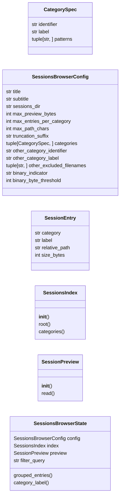
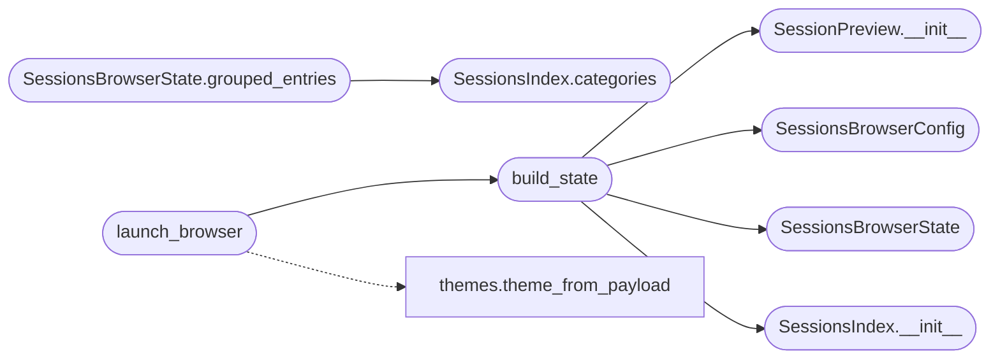

# `cli.sessions_browser`

> Source: [cli/sessions_browser.py:1](../../cli/sessions_browser.py#L1) | language `py` | coverage 100.0% | [API index](../index.md)

Textual browser for the LazyOwn ``sessions/`` directory.

The browser turns ``sessions/`` into a navigable surface so the operator
no longer needs to leave the shell to inspect credentials, hashes,
vulns, notes, or raw nmap output. Files are categorised, listed in a
left pane, and previewed in a right pane with bounded reads to keep the
TUI responsive on multi-megabyte transcripts.

Design (SOLID):

- Single Responsibility: [`SessionsBrowserConfig`](#sessionsbrowserconfig) owns constants,
  [`SessionEntry`](#sessionentry) is the immutable record, [`SessionsIndex`](#sessionsindex)
  classifies files, [`SessionPreview`](#sessionpreview) returns bounded text, and
  `SessionsBrowserApp` renders.
- Open/Closed: a new category is one entry in
  [`SessionsBrowserConfig.categories`](#sessionsbrowserconfig-categories).
- Dependency Inversion: the app is always constructed from a state
  object so tests exercise the data layer without Textual.
- No magic numbers / hardcoded paths: every value lives in the config.

## Contents

- **Classes:** [`CategorySpec`](#categoryspec), [`SessionsBrowserConfig`](#sessionsbrowserconfig), [`SessionEntry`](#sessionentry), [`SessionsIndex`](#sessionsindex), [`SessionPreview`](#sessionpreview), [`SessionsBrowserState`](#sessionsbrowserstate)
- **Functions:** [`build_state`](#build_state), [`launch_browser`](#launch_browser)

## Type Diagram



## Call Graph

Solid arrows stay in this module, dashed arrows leave it.



## Classes

<a id="categoryspec"></a>

### `CategorySpec`

`class` `dataclass` | [cli/sessions_browser.py:33](../../cli/sessions_browser.py#L33)

Decorators: `@dataclass(frozen=True)`

```python
class CategorySpec
```

One row in [`SessionsBrowserConfig.categories`](#sessionsbrowserconfig-categories).

**Attributes**

| Name | Type | Default | Description |
|---|---|---|---|
| [`identifier`](#categoryspec-identifier) | `str` |  | Stable lowercase identifier (`[`creds`](cli.session_hud.py.md#hudsnapshot-creds)`, `[`hashes`](modules.domain_dominance.py.md#credentialstash-hashes)`...). |
| [`label`](#categoryspec-label) | `str` |  | Human-readable header rendered in the tree. |
| [`patterns`](#categoryspec-patterns) | `tuple[str, ...]` |  | Glob expressions evaluated relative to the sessions root. The first matching pattern wins. |

---

<a id="sessionsbrowserconfig"></a>

### `SessionsBrowserConfig`

`class` `dataclass` | [cli/sessions_browser.py:49](../../cli/sessions_browser.py#L49)

Decorators: `@dataclass(frozen=True)`

```python
class SessionsBrowserConfig
```

Centralised constants for the browser.

**Attributes**

| Name | Type | Default | Description |
|---|---|---|---|
| [`title`](#sessionsbrowserconfig-title) | `str` | `'Sessions browser'` |  |
| [`subtitle`](#sessionsbrowserconfig-subtitle) | `str` | `'Tab to switch panes, / to filter, Esc to close'` |  |
| [`sessions_dir`](#sessionsbrowserconfig-sessions_dir) | `str` | `'sessions'` |  |
| [`max_preview_bytes`](#sessionsbrowserconfig-max_preview_bytes) | `int` | `524288` |  |
| [`max_entries_per_category`](#sessionsbrowserconfig-max_entries_per_category) | `int` | `250` |  |
| [`max_path_chars`](#sessionsbrowserconfig-max_path_chars) | `int` | `64` |  |
| [`truncation_suffix`](#sessionsbrowserconfig-truncation_suffix) | `str` | `'...'` |  |
| [`categories`](#sessionsbrowserconfig-categories) | `tuple[CategorySpec, ...]` | `(CategorySpec('creds', 'Credentials', ('credentials*.txt',)), CategorySpec('hashes', 'Hashes', ('hash*.txt',)), CategorySpec('vulns', 'Vulnerabilities', ('vulns_*.json', 'vulns_*.nmap')), CategorySpec('scan', 'Scans', ('scan_*.nmap', 'scan_*.xml')), CategorySpec('notes', 'Notes', ('notes.jsonl', 'notes.txt', 'sessionLazyOwn.json')), CategorySpec('events', 'Events', ('events.jsonl', 'autonomous_events.jsonl', 'engagement_audit.jsonl')), CategorySpec('world', 'World model', ('world_model.json', 'tasks.json', 'os.json')))` |  |
| [`other_category_identifier`](#sessionsbrowserconfig-other_category_identifier) | `str` | `'other'` |  |
| [`other_category_label`](#sessionsbrowserconfig-other_category_label) | `str` | `'Other'` |  |
| [`other_excluded_filenames`](#sessionsbrowserconfig-other_excluded_filenames) | `tuple[str, ...]` | `('.toast_state.json',)` |  |
| [`binary_indicator`](#sessionsbrowserconfig-binary_indicator) | `str` | `'(binary)'` |  |
| [`binary_byte_threshold`](#sessionsbrowserconfig-binary_byte_threshold) | `int` | `32` |  |

---

<a id="sessionentry"></a>

### `SessionEntry`

`class` `dataclass` | [cli/sessions_browser.py:76](../../cli/sessions_browser.py#L76)

Decorators: `@dataclass(frozen=True)`

```python
class SessionEntry
```

Immutable description of a single file under ``sessions/``.

**Attributes**

| Name | Type | Default | Description |
|---|---|---|---|
| [`category`](#sessionentry-category) | `str` |  |  |
| [`label`](#sessionentry-label) | `str` |  |  |
| [`relative_path`](#sessionentry-relative_path) | `str` |  |  |
| [`size_bytes`](#sessionentry-size_bytes) | `int` |  |  |

---

<a id="sessionsindex"></a>

### `SessionsIndex`

`class` | [cli/sessions_browser.py:85](../../cli/sessions_browser.py#L85)

```python
class SessionsIndex
```

Classify files under the sessions root into operator-relevant buckets.

**Members**

| Member | Kind | Summary |
|---|---|---|
| [`__init__`](#sessionsindex-__init__) | constructor | Bind to config and resolve the sessions root. |
| [`root`](#sessionsindex-root) | property | Return the resolved sessions root. |
| [`categories`](#sessionsindex-categories) | method | Return a mapping ``category_identifier -> [SessionEntry, ...]``. |

<a id="sessionsindex-__init__"></a>

#### `SessionsIndex.__init__`

`constructor` | [cli/sessions_browser.py:88](../../cli/sessions_browser.py#L88)

```python
def __init__(self, config: SessionsBrowserConfig, root: Path | None = None) -> None
```

Bind to config and resolve the sessions root.

**Parameters**

| Name | Type | Default | Description |
|---|---|---|---|
| `config` | `SessionsBrowserConfig` |  | Active configuration. |
| `root` | `Path \| None` | `None` | Optional explicit root override; defaults to ``Path(config.sessions_dir)``. |

*Called by:* [`build_state`](#build_state)

<a id="sessionsindex-root"></a>

#### `SessionsIndex.root`

`property` | [cli/sessions_browser.py:100](../../cli/sessions_browser.py#L100)

Decorators: `@property`

```python
def root(self) -> Path
```

Return the resolved sessions root.

**Returns:** `Path`

<a id="sessionsindex-categories"></a>

#### `SessionsIndex.categories`

`method` | [cli/sessions_browser.py:104](../../cli/sessions_browser.py#L104)

```python
def categories(self) -> dict[str, list[SessionEntry]]
```

Return a mapping ``category_identifier -> [SessionEntry, ...]``.

**Returns:** `dict[str, list[SessionEntry]]`

*Called by:* [`SessionsBrowserState.grouped_entries`](#sessionsbrowserstate-grouped_entries)

---

<a id="sessionpreview"></a>

### `SessionPreview`

`class` | [cli/sessions_browser.py:185](../../cli/sessions_browser.py#L185)

```python
class SessionPreview
```

Bounded text reader for the preview pane.

**Members**

| Member | Kind | Summary |
|---|---|---|
| [`__init__`](#sessionpreview-__init__) | constructor | Bind to config and the sessions root. |
| [`read`](#sessionpreview-read) | method | Return ``relative`` as text, capped at `[`max_preview_bytes`](#sessionsbrowserconfig-max_preview_bytes)`. |

<a id="sessionpreview-__init__"></a>

#### `SessionPreview.__init__`

`constructor` | [cli/sessions_browser.py:188](../../cli/sessions_browser.py#L188)

```python
def __init__(self, config: SessionsBrowserConfig, root: Path | None = None) -> None
```

Bind to config and the sessions root.

**Parameters**

| Name | Type | Default | Description |
|---|---|---|---|
| `config` | `SessionsBrowserConfig` |  |  |
| `root` | `Path \| None` | `None` |  |

*Called by:* [`build_state`](#build_state)

<a id="sessionpreview-read"></a>

#### `SessionPreview.read`

`method` | [cli/sessions_browser.py:193](../../cli/sessions_browser.py#L193)

```python
def read(self, relative: str) -> str
```

Return ``relative`` as text, capped at `[`max_preview_bytes`](#sessionsbrowserconfig-max_preview_bytes)`.

**Parameters**

| Name | Type | Default | Description |
|---|---|---|---|
| `relative` | `str` |  | Path fragment under the sessions root. ``..`` and absolute paths are rejected. |

**Returns:** `str` - UTF-8 decoded text. Files that appear binary (more than
`[`binary_byte_threshold`](#sessionsbrowserconfig-binary_byte_threshold)` NUL bytes in the head) return the
configured binary indicator instead of garbled output.

---

<a id="sessionsbrowserstate"></a>

### `SessionsBrowserState`

`class` `dataclass` | [cli/sessions_browser.py:225](../../cli/sessions_browser.py#L225)

Decorators: `@dataclass`

```python
class SessionsBrowserState
```

Top-level state passed to the Textual app and to tests.

**Attributes**

| Name | Type | Default | Description |
|---|---|---|---|
| [`config`](#sessionsbrowserstate-config) | `SessionsBrowserConfig` |  |  |
| [`index`](#sessionsbrowserstate-index) | `SessionsIndex` |  |  |
| [`preview`](#sessionsbrowserstate-preview) | `SessionPreview` |  |  |
| [`filter_query`](#sessionsbrowserstate-filter_query) | `str` | `''` |  |

**Members**

| Member | Kind | Summary |
|---|---|---|
| [`grouped_entries`](#sessionsbrowserstate-grouped_entries) | method | Return classified entries, optionally filtered by [`filter_query`](#sessionsbrowserstate-filter_query). |
| [`category_label`](#sessionsbrowserstate-category_label) | method | Return the human-readable label for `[`identifier`](#categoryspec-identifier)`. |

<a id="sessionsbrowserstate-grouped_entries"></a>

#### `SessionsBrowserState.grouped_entries`

`method` | [cli/sessions_browser.py:233](../../cli/sessions_browser.py#L233)

```python
def grouped_entries(self) -> dict[str, list[SessionEntry]]
```

Return classified entries, optionally filtered by [`filter_query`](#sessionsbrowserstate-filter_query).

**Returns:** `dict[str, list[SessionEntry]]`

*Calls:* [`SessionsIndex.categories`](#sessionsindex-categories)

<a id="sessionsbrowserstate-category_label"></a>

#### `SessionsBrowserState.category_label`

`method` | [cli/sessions_browser.py:248](../../cli/sessions_browser.py#L248)

```python
def category_label(self, identifier: str) -> str
```

Return the human-readable label for `[`identifier`](#categoryspec-identifier)`.

**Parameters**

| Name | Type | Default | Description |
|---|---|---|---|
| `identifier` | `str` |  |  |

**Returns:** `str`

---

## Functions

<a id="build_state"></a>

### `build_state`

`function` | [cli/sessions_browser.py:258](../../cli/sessions_browser.py#L258)

```python
def build_state(payload: Mapping[str, Any] | None = None, sessions_dir: str | None = None, config: SessionsBrowserConfig | None = None) -> SessionsBrowserState
```

Wire the canonical state used by [`launch_browser`](#launch_browser).

**Parameters**

| Name | Type | Default | Description |
|---|---|---|---|
| `payload` | `Mapping[str, Any] \| None` | `None` | Loaded ``payload.json``. Currently unused beyond theme propagation but accepted for forward compatibility. |
| `sessions_dir` | `str \| None` | `None` | Optional override for the sessions root. |
| `config` | `SessionsBrowserConfig \| None` | `None` | Optional explicit [`SessionsBrowserConfig`](#sessionsbrowserconfig). |

**Returns:** `SessionsBrowserState` - A fresh [`SessionsBrowserState`](#sessionsbrowserstate).

*Calls:* [`SessionPreview.__init__`](#sessionpreview-__init__), [`SessionsBrowserConfig`](#sessionsbrowserconfig), [`SessionsBrowserState`](#sessionsbrowserstate), [`SessionsIndex.__init__`](#sessionsindex-__init__)

*Called by:* [`launch_browser`](#launch_browser)

---

<a id="launch_browser"></a>

### `launch_browser`

`function` | [cli/sessions_browser.py:281](../../cli/sessions_browser.py#L281)

```python
def launch_browser(payload: Mapping[str, Any] | None = None, state: SessionsBrowserState | None = None, runner: Any | None = None) -> str | None
```

Open the Textual browser and return the last-viewed relative path.

**Parameters**

| Name | Type | Default | Description |
|---|---|---|---|
| `payload` | `Mapping[str, Any] \| None` | `None` | Loaded ``payload.json``. |
| `state` | `SessionsBrowserState \| None` | `None` | Optional pre-built state (tests inject one). |
| `runner` | `Any \| None` | `None` | Optional callable used by tests instead of running the real Textual app. |

**Returns:** `str | None` - The relative path of the last file the operator inspected, or
``None`` when the browser was cancelled or Textual is missing.

*Calls:* [`build_state`](#build_state), [`theme_from_payload`](cli.themes.py.md#theme_from_payload)

---
