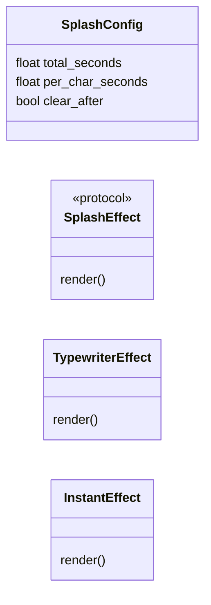
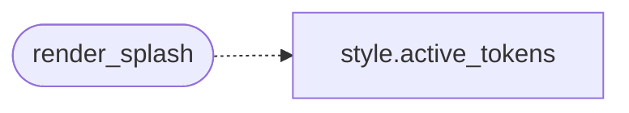

# `cli.splash`

> Source: [cli/splash.py:1](../../cli/splash.py#L1) | language `py` | coverage 66.7% | [API index](../index.md)

Animated splash overlay for the LazyOwn first-run experience.

The splash is rendered with Rich on top of the existing ASCII art
banner. Operators keep their original art: this overlay just paints
a typewriter effect around it during the first 1-2 seconds of
startup, then exits cleanly back to the cmd2 prompt. Opt-in via
``payload.json["splash"] = true`` (default false), and auto-on
when ``payload.json`` does not yet exist.

Design notes:

- Single Responsibility: only the overlay animation lives here.
  No payload reading, no shell state, no theme mutation. Callers
  pass the already-resolved theme tokens.
- Open/Closed: new animation kinds (e.g. glitch, fade) extend
  [`SplashEffect`](#splasheffect); the dispatcher in [`render_splash`](#render_splash)
  does not change.
- Dependency Inversion: callers depend on [`render_splash`](#render_splash)
  and the [`SplashEffect`](#splasheffect) protocol, not on Rich directly.
- No magic numbers: timing constants live in [`SPLASH_CONFIG`](#splash_config).

## Contents

- **Classes:** [`SplashConfig`](#splashconfig), [`TypewriterEffect`](#typewritereffect), [`InstantEffect`](#instanteffect)
- **Protocols:** [`SplashEffect`](#splasheffect)
- **Functions:** [`render_splash`](#render_splash)
- **Constants:** [`SPLASH_CONFIG`](#splash_config)

## Type Diagram



## Call Graph

Solid arrows stay in this module, dashed arrows leave it.



## Classes

<a id="splashconfig"></a>

### `SplashConfig`

`class` `dataclass` | [cli/splash.py:37](../../cli/splash.py#L37)

Decorators: `@dataclass(frozen=True)`

```python
class SplashConfig
```

Timing and behaviour knobs for the splash overlay.

**Attributes**

| Name | Type | Default | Description |
|---|---|---|---|
| [`total_seconds`](#splashconfig-total_seconds) | `float` | `1.5` | How long the overlay stays on screen. ``0`` or negative means render-and-exit immediately. The effect never blocks longer than this regardless of the typewriter per-character delay. |
| [`per_char_seconds`](#splashconfig-per_char_seconds) | `float` | `0.012` | Delay between consecutive characters in the typewriter effect. Lower values feel snappier. |
| [`clear_after`](#splashconfig-clear_after) | `bool` | `True` | Whether to clear the overlay before returning to the caller. When ``False`` the operator sees the splash frozen at its final state -- useful for screencasts but disruptive in a real shell. |

---

<a id="typewritereffect"></a>

### `TypewriterEffect`

`class` | [cli/splash.py:80](../../cli/splash.py#L80)

```python
class TypewriterEffect
```

Print each character of each line with a fixed delay.

A blinking caret is appended to the active line so the
operator sees the typewriter working. The caret is removed
before the function returns. The accumulated prefix is
redrawn on every step so the operator sees the line growing
left-to-right, not single characters flickering.

**Members**

| Member | Kind | Summary |
|---|---|---|
| [`render`](#typewritereffect-render) | method |  |

<a id="typewritereffect-render"></a>

#### `TypewriterEffect.render`

`method` | [cli/splash.py:90](../../cli/splash.py#L90)

```python
def render(self, console: Console, lines: list[str], tokens: Mapping[str, str], config: SplashConfig) -> None
```

**Parameters**

| Name | Type | Default | Description |
|---|---|---|---|
| `console` | `Console` |  |  |
| `lines` | `list[str]` |  |  |
| `tokens` | `Mapping[str, str]` |  |  |
| `config` | `SplashConfig` |  |  |

---

<a id="instanteffect"></a>

### `InstantEffect`

`class` | [cli/splash.py:141](../../cli/splash.py#L141)

```python
class InstantEffect
```

Print every line at once with no animation.

Used in tests.

The effect renders and returns immediately so unit tests do
not have to mock `time.sleep`. `[`render_splash`](#render_splash)` picks
this effect whenever ``config.total_seconds <= 0`` or the
caller asks for it explicitly.

**Members**

| Member | Kind | Summary |
|---|---|---|
| [`render`](#instanteffect-render) | method |  |

<a id="instanteffect-render"></a>

#### `InstantEffect.render`

`method` | [cli/splash.py:150](../../cli/splash.py#L150)

```python
def render(self, console: Console, lines: list[str], tokens: Mapping[str, str], config: SplashConfig) -> None
```

**Parameters**

| Name | Type | Default | Description |
|---|---|---|---|
| `console` | `Console` |  |  |
| `lines` | `list[str]` |  |  |
| `tokens` | `Mapping[str, str]` |  |  |
| `config` | `SplashConfig` |  |  |

---

## Protocols

<a id="splasheffect"></a>

### `SplashEffect`

`protocol` | [cli/splash.py:62](../../cli/splash.py#L62)

```python
class SplashEffect(Protocol)
```

Bases: `Protocol`

Strategy protocol for splash animations.

A new effect implements ``render`` and is registered in
[`render_splash`](#render_splash) dispatch. The effect owns its own
progress and timing -- the dispatcher only hands it the
console, the lines to animate, and the resolved tokens.

**Members**

| Member | Kind | Summary |
|---|---|---|
| [`render`](#splasheffect-render) | method |  |

<a id="splasheffect-render"></a>

#### `SplashEffect.render`

`method` | [cli/splash.py:71](../../cli/splash.py#L71)

```python
def render(self, console: Console, lines: list[str], tokens: Mapping[str, str], config: SplashConfig) -> None
```

**Parameters**

| Name | Type | Default | Description |
|---|---|---|---|
| `console` | `Console` |  |  |
| `lines` | `list[str]` |  |  |
| `tokens` | `Mapping[str, str]` |  |  |
| `config` | `SplashConfig` |  |  |

---

## Functions

<a id="render_splash"></a>

### `render_splash`

`function` | [cli/splash.py:166](../../cli/splash.py#L166)

```python
def render_splash(console: Console, lines: list[str], payload: Mapping[str, object] | None = None, config: SplashConfig | None = None, effect_name: str = 'typewriter') -> None
```

Render the splash overlay and optionally clear the screen.

**Parameters**

| Name | Type | Default | Description |
|---|---|---|---|
| `console` | `Console` |  | Rich console the shell already uses. The overlay writes through it so colours and terminal width match the rest of the operator surface. |
| `lines` | `list[str]` |  | Lines to animate. Each entry is a plain string -- markup is intentionally NOT parsed, so the operator's ASCII art (which often contains brackets) renders verbatim. |
| `payload` | `Mapping[str, object] \| None` | `None` | Payload mapping for theme resolution. ``None`` uses the default theme; passing the live payload honours the operator's chosen ``tui_theme``. |
| `config` | `SplashConfig \| None` | `None` | Override timing/clear behaviour. ``None`` uses [`SPLASH_CONFIG`](#splash_config). |
| `effect_name` | `str` | `'typewriter'` | Which effect to dispatch. ``"typewriter"`` or ``"instant"``. Unknown values fall back to ``"instant"`` so a bad config never crashes startup. |

**Returns:** `None` - None. The console is left in a state ready for the next
prompt line to be printed (or cleared, depending on
``config.clear_after``).

*Calls:* [`active_tokens`](cli.style.py.md#active_tokens)

---

## Constants

<a id="splash_config"></a>

### `SPLASH_CONFIG`

`constant` | [cli/splash.py:58](../../cli/splash.py#L58)

```python
SPLASH_CONFIG: SplashConfig = SplashConfig()
```

Default timing for the splash.

Tuned for ~1.5s on a modern TTY.

---
