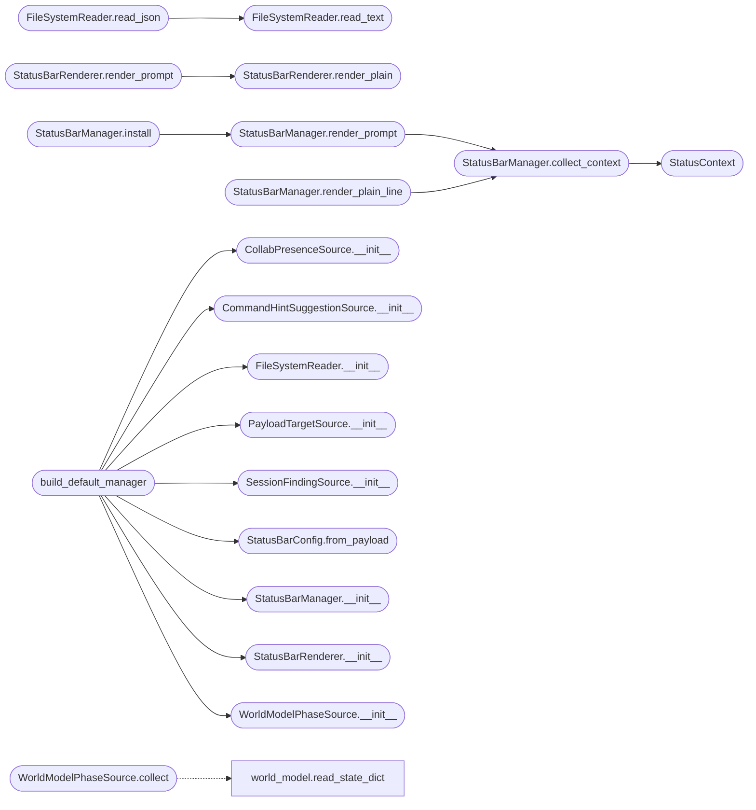

# `cli.status_bar`

> Source: [cli/status_bar.py:1](../../cli/status_bar.py#L1) | language `py` | coverage 100.0% | [API index](../index.md)

Persistent operator status bar for the LazyOwn cmd2 shell.

The status bar collapses the four pieces of context an operator constantly
reaches for into a single line embedded in the shell prompt:

    [ target | phase | found: <last_finding> | next: <suggestion> ]

It replaces the round-trip of opening ``sessions/`` artefacts after every
command. The renderer is wired into ``cmd2`` through a precommand hook so
the bar is recomputed *before* each prompt is drawn, never blocking input.

Design constraints honoured here:

* Single Responsibility: every source class produces exactly one field.
* Open / Closed: new fields are added by registering another
  [`IStatusSource`](#istatussource), never by editing the renderer.
* Liskov: every source returns a ``str`` of bounded width.
* Interface Segregation: the source protocol exposes only `[`collect`](#istatussource-collect)`.
* Dependency Inversion: [`StatusBarManager`](#statusbarmanager) depends on the
  abstractions, never on `[`LazyOwnShell`](lazyown.py.md#lazyownshell)` or ``cmd2`` directly.
* No magic numbers / hardcoded paths: every default lives in
  [`StatusBarConfig`](#statusbarconfig); runtime overrides come from ``payload.json``.
* Prompt-toolkit native ANSI: colour escapes are emitted raw because the
  cmd2 shell parses ANSI itself and paints GNU-readline `` ... ``
  bytes as visible ``^A``/``^B`` glyphs. Marker fencing is opt-in via
  ``readline_safe=True`` for genuine readline consumers only.

## Contents

- **Classes:** [`StatusBarConfig`](#statusbarconfig), [`StatusContext`](#statuscontext), [`FileSystemReader`](#filesystemreader), [`PayloadTargetSource`](#payloadtargetsource), [`WorldModelPhaseSource`](#worldmodelphasesource), [`SessionFindingSource`](#sessionfindingsource), [`CommandHintSuggestionSource`](#commandhintsuggestionsource), [`GraphSuggestionSource`](#graphsuggestionsource), [`CollabPresenceSource`](#collabpresencesource), [`StatusBarRenderer`](#statusbarrenderer), [`StatusBarManager`](#statusbarmanager)
- **Protocols:** [`IStatusSource`](#istatussource)
- **Functions:** [`build_default_manager`](#build_default_manager)

## Type Diagram

```mermaid
classDiagram
    direction LR
    class StatusBarConfig
    StatusBarConfig : str enabled_key
    StatusBarConfig : str format_key
    StatusBarConfig : str operators_enabled_key
    StatusBarConfig : str operators_format_key
    StatusBarConfig : str sessions_dir
    StatusBarConfig : str world_model_filename
    StatusBarConfig : str os_filename
    StatusBarConfig : str session_report_filename
    StatusBarConfig : str operators_filename
    StatusBarConfig : str credentials_glob
    StatusBarConfig : str hashes_glob
    StatusBarConfig : str vulns_glob
    StatusBarConfig : str notes_filename
    StatusBarConfig : tuple[str, ] target_payload_keys
    StatusBarConfig : str phase_payload_key
    StatusBarConfig : str phase_world_model_key
    StatusBarConfig : bool enabled_default
    StatusBarConfig : bool operators_enabled_default
    StatusBarConfig : str default_format
    StatusBarConfig : str default_format_with_operators
    StatusBarConfig : str fallback_target
    StatusBarConfig : str fallback_phase
    StatusBarConfig : str fallback_finding
    StatusBarConfig : str fallback_suggestion
    class StatusContext
    StatusContext : str target
    StatusContext : str phase
    StatusContext : str last_finding
    StatusContext : str next_suggestion
    StatusContext : str operators
    class IStatusSource
    <<protocol>> IStatusSource
    IStatusSource : collect()
    class FileSystemReader
    FileSystemReader : __init__()
    FileSystemReader : root()
    FileSystemReader : read_text()
    FileSystemReader : read_json()
    FileSystemReader : glob_latest()
    class PayloadTargetSource
    PayloadTargetSource : __init__()
    PayloadTargetSource : collect()
    class WorldModelPhaseSource
    WorldModelPhaseSource : __init__()
    WorldModelPhaseSource : collect()
    class SessionFindingSource
    SessionFindingSource : __init__()
    SessionFindingSource : collect()
    class CommandHintSuggestionSource
    CommandHintSuggestionSource : __init__()
    CommandHintSuggestionSource : collect()
    class GraphSuggestionSource
    GraphSuggestionSource : __init__()
    GraphSuggestionSource : collect()
    class CollabPresenceSource
    CollabPresenceSource : __init__()
    CollabPresenceSource : collect()
    class StatusBarRenderer
    StatusBarRenderer : __init__()
    StatusBarRenderer : render_plain()
    StatusBarRenderer : render_prompt()
    class StatusBarManager
    StatusBarManager : __init__()
    StatusBarManager : enabled()
    StatusBarManager : collect_context()
    StatusBarManager : render_prompt()
    StatusBarManager : render_plain_line()
    StatusBarManager : set_enabled()
    StatusBarManager : install()
```



## Call Graph

Solid arrows stay in this module, dashed arrows leave it.



## Classes

<a id="statusbarconfig"></a>

### `StatusBarConfig`

`class` `dataclass` | [cli/status_bar.py:41](../../cli/status_bar.py#L41)

Decorators: `@dataclass(frozen=True)`

```python
class StatusBarConfig
```

Immutable configuration container for the status bar subsystem.

Every tunable lives here. Operator overrides flow in through
[`from_payload`](#statusbarconfig-from_payload) which reads ``payload.json``; downstream code only
ever sees an instance of this class.

**Attributes**

| Name | Type | Default | Description |
|---|---|---|---|
| [`enabled_key`](#statusbarconfig-enabled_key) | `str` | `'enable_status_bar'` |  |
| [`format_key`](#statusbarconfig-format_key) | `str` | `'status_bar_format'` |  |
| [`operators_enabled_key`](#statusbarconfig-operators_enabled_key) | `str` | `'enable_operator_presence'` |  |
| [`operators_format_key`](#statusbarconfig-operators_format_key) | `str` | `'status_bar_format_with_operators'` |  |
| [`sessions_dir`](#statusbarconfig-sessions_dir) | `str` | `'sessions'` |  |
| [`world_model_filename`](#statusbarconfig-world_model_filename) | `str` | `'world_model.json'` |  |
| [`os_filename`](#statusbarconfig-os_filename) | `str` | `'os.json'` |  |
| [`session_report_filename`](#statusbarconfig-session_report_filename) | `str` | `'LazyOwn_session_report.csv'` |  |
| [`operators_filename`](#statusbarconfig-operators_filename) | `str` | `'operators.json'` |  |
| [`credentials_glob`](#statusbarconfig-credentials_glob) | `str` | `'credentials*.txt'` |  |
| [`hashes_glob`](#statusbarconfig-hashes_glob) | `str` | `'hash*.txt'` |  |
| [`vulns_glob`](#statusbarconfig-vulns_glob) | `str` | `'vulns_*.json'` |  |
| [`notes_filename`](#statusbarconfig-notes_filename) | `str` | `'notes.jsonl'` |  |
| [`target_payload_keys`](#statusbarconfig-target_payload_keys) | `tuple[str, ...]` | `('active_target', 'rhost', 'domain')` |  |
| [`phase_payload_key`](#statusbarconfig-phase_payload_key) | `str` | `'current_phase'` |  |
| [`phase_world_model_key`](#statusbarconfig-phase_world_model_key) | `str` | `'phase'` |  |
| [`enabled_default`](#statusbarconfig-enabled_default) | `bool` | `True` |  |
| [`operators_enabled_default`](#statusbarconfig-operators_enabled_default) | `bool` | `False` |  |
| [`default_format`](#statusbarconfig-default_format) | `str` | `'[ {target} \| {phase} \| found: {finding} \| next: {suggestion} ]'` |  |
| [`default_format_with_operators`](#statusbarconfig-default_format_with_operators) | `str` | `'[ {target} \| {phase} \| found: {finding} \| ops: {operators} \| next: {suggestion} ]'` |  |
| [`fallback_target`](#statusbarconfig-fallback_target) | `str` | `'no-target'` |  |
| [`fallback_phase`](#statusbarconfig-fallback_phase) | `str` | `'recon'` |  |
| [`fallback_finding`](#statusbarconfig-fallback_finding) | `str` | `'-'` |  |
| [`fallback_suggestion`](#statusbarconfig-fallback_suggestion) | `str` | `'ping'` |  |
| [`fallback_operators`](#statusbarconfig-fallback_operators) | `str` | `'0'` |  |
| [`max_target_chars`](#statusbarconfig-max_target_chars) | `int` | `32` |  |
| [`max_phase_chars`](#statusbarconfig-max_phase_chars) | `int` | `12` |  |
| [`max_finding_chars`](#statusbarconfig-max_finding_chars) | `int` | `36` |  |
| [`max_suggestion_chars`](#statusbarconfig-max_suggestion_chars) | `int` | `24` |  |
| [`max_operators_chars`](#statusbarconfig-max_operators_chars) | `int` | `24` |  |
| [`max_field_chars`](#statusbarconfig-max_field_chars) | `int` | `64` |  |
| [`max_file_bytes`](#statusbarconfig-max_file_bytes) | `int` | `524288` |  |
| [`csv_max_rows`](#statusbarconfig-csv_max_rows) | `int` | `2000` |  |
| [`suggestion_limit`](#statusbarconfig-suggestion_limit) | `int` | `1` |  |
| [`operator_stale_seconds`](#statusbarconfig-operator_stale_seconds) | `float` | `90.0` |  |
| [`color_enabled`](#statusbarconfig-color_enabled) | `bool` | `True` |  |
| [`color_open`](#statusbarconfig-color_open) | `str` | `'\x1b[2;36m'` |  |
| [`color_close`](#statusbarconfig-color_close) | `str` | `'\x1b[0m'` |  |
| [`readline_open_marker`](#statusbarconfig-readline_open_marker) | `str` | `'\x01'` |  |
| [`readline_close_marker`](#statusbarconfig-readline_close_marker) | `str` | `'\x02'` |  |
| [`prompt_join`](#statusbarconfig-prompt_join) | `str` | `'\n'` |  |
| [`truncation_suffix`](#statusbarconfig-truncation_suffix) | `str` | `'...'` |  |
| [`allowed_field_pattern`](#statusbarconfig-allowed_field_pattern) | `str` | `'^[\\w./:@\\-\\[\\]+ ]{1,128}$'` |  |
| [`forbidden_substrings`](#statusbarconfig-forbidden_substrings) | `tuple[str, ...]` | `('\x1b', '\r', '\n', '\x07', '\x00')` |  |
| [`truthy_strings`](#statusbarconfig-truthy_strings) | `tuple[str, ...]` | `('1', 'true', 'yes', 'on')` |  |
| [`falsy_strings`](#statusbarconfig-falsy_strings) | `tuple[str, ...]` | `('0', 'false', 'no', 'off')` |  |

**Members**

| Member | Kind | Summary |
|---|---|---|
| [`from_payload`](#statusbarconfig-from_payload) | classmethod | Return a config with overrides applied from a ``payload.json`` mapping. |

<a id="statusbarconfig-from_payload"></a>

#### `StatusBarConfig.from_payload`

`classmethod` | [cli/status_bar.py:99](../../cli/status_bar.py#L99)

Decorators: `@classmethod`

```python
def from_payload(cls, payload: Mapping[str, Any] | None) -> StatusBarConfig
```

Return a config with overrides applied from a ``payload.json`` mapping.

**Parameters**

| Name | Type | Default | Description |
|---|---|---|---|
| `payload` | `Mapping[str, Any] \| None` |  | The loaded ``payload.json`` dictionary, or ``None`` to accept the defaults verbatim. |

**Returns:** `StatusBarConfig` - A new [`StatusBarConfig`](#statusbarconfig) instance. Unknown keys are
ignored so the framework never crashes on a malformed payload.

*Called by:* [`build_default_manager`](#build_default_manager)

---

<a id="statuscontext"></a>

### `StatusContext`

`class` `dataclass` | [cli/status_bar.py:127](../../cli/status_bar.py#L127)

Decorators: `@dataclass(frozen=True)`

```python
class StatusContext
```

Immutable snapshot of the pieces the bar renders.

`[`operators`](modules.collab_bp.py.md#operators)` is an opt-in fifth segment populated by
[`CollabPresenceSource`](#collabpresencesource). Empty strings are treated as "field
disabled" by the renderer so the historical four-segment format remains
the default.

**Attributes**

| Name | Type | Default | Description |
|---|---|---|---|
| [`target`](#statuscontext-target) | `str` |  |  |
| [`phase`](#statuscontext-phase) | `str` |  |  |
| [`last_finding`](#statuscontext-last_finding) | `str` |  |  |
| [`next_suggestion`](#statuscontext-next_suggestion) | `str` |  |  |
| [`operators`](#statuscontext-operators) | `str` | `''` |  |

---

<a id="filesystemreader"></a>

### `FileSystemReader`

`class` | [cli/status_bar.py:151](../../cli/status_bar.py#L151)

```python
class FileSystemReader
```

Path-validated, size-bounded reader for ``sessions/`` artefacts.

The reader is the only filesystem entry point in this module. It
refuses anything that escapes the configured `[`sessions_dir`](core.defaults.py.md#sessions_dir)` and
truncates reads to `[`max_file_bytes`](#statusbarconfig-max_file_bytes)` so a runaway log never blows up
the prompt.

**Members**

| Member | Kind | Summary |
|---|---|---|
| [`__init__`](#filesystemreader-__init__) | constructor | Initialise with the active config and optional explicit root. |
| [`root`](#filesystemreader-root) | property | Return the resolved root directory backing this reader. |
| [`read_text`](#filesystemreader-read_text) | method | Return the contents of ``relative`` truncated to `[`max_file_bytes`](#statusbarconfig-max_file_bytes)`. |
| [`read_json`](#filesystemreader-read_json) | method | Return parsed JSON from ``relative`` or ``None`` on failure. |
| [`glob_latest`](#filesystemreader-glob_latest) | method | Return the most recently modified path matching `[`pattern`](modules.intercept.py.md#interceptrule-pattern)`. |

<a id="filesystemreader-__init__"></a>

#### `FileSystemReader.__init__`

`constructor` | [cli/status_bar.py:160](../../cli/status_bar.py#L160)

```python
def __init__(self, config: StatusBarConfig, root: Path | None = None) -> None
```

Initialise with the active config and optional explicit root.

**Parameters**

| Name | Type | Default | Description |
|---|---|---|---|
| `config` | `StatusBarConfig` |  | The active [`StatusBarConfig`](#statusbarconfig). |
| `root` | `Path \| None` | `None` | Override for the resolved sessions directory. Defaults to ``config.sessions_dir`` relative to the current working directory. |

**Raises**

- `ValueError`: When ``config.max_file_bytes`` is non-positive.

*Called by:* [`build_default_manager`](#build_default_manager)

<a id="filesystemreader-root"></a>

#### `FileSystemReader.root`

`property` | [cli/status_bar.py:179](../../cli/status_bar.py#L179)

Decorators: `@property`

```python
def root(self) -> Path
```

Return the resolved root directory backing this reader.

**Returns:** `Path`

<a id="filesystemreader-read_text"></a>

#### `FileSystemReader.read_text`

`method` | [cli/status_bar.py:183](../../cli/status_bar.py#L183)

```python
def read_text(self, relative: str) -> str
```

Return the contents of ``relative`` truncated to `[`max_file_bytes`](#statusbarconfig-max_file_bytes)`.

**Parameters**

| Name | Type | Default | Description |
|---|---|---|---|
| `relative` | `str` |  | Path fragment under the sessions root. A leading separator is rejected; ``..`` escape attempts are rejected. |

**Returns:** `str` - The file contents as text, or an empty string when the file
is missing or unreadable.

*Called by:* [`FileSystemReader.read_json`](#filesystemreader-read_json)

<a id="filesystemreader-read_json"></a>

#### `FileSystemReader.read_json`

`method` | [cli/status_bar.py:204](../../cli/status_bar.py#L204)

```python
def read_json(self, relative: str) -> Any
```

Return parsed JSON from ``relative`` or ``None`` on failure.

**Parameters**

| Name | Type | Default | Description |
|---|---|---|---|
| `relative` | `str` |  | Path fragment under the sessions root. |

**Returns:** `Any` - The decoded JSON object, or ``None`` when the file does not
exist or contains invalid JSON.

*Calls:* [`FileSystemReader.read_text`](#filesystemreader-read_text)

<a id="filesystemreader-glob_latest"></a>

#### `FileSystemReader.glob_latest`

`method` | [cli/status_bar.py:222](../../cli/status_bar.py#L222)

```python
def glob_latest(self, pattern: str) -> Path | None
```

Return the most recently modified path matching `[`pattern`](modules.intercept.py.md#interceptrule-pattern)`.

**Parameters**

| Name | Type | Default | Description |
|---|---|---|---|
| `pattern` | `str` |  | Glob expression evaluated relative to the sessions root. Patterns are constrained to the root via `_safe_path` once a match is selected. |

**Returns:** `Path | None` - The newest matching path, or ``None`` if no match exists.

---

<a id="payloadtargetsource"></a>

### `PayloadTargetSource`

`class` | [cli/status_bar.py:268](../../cli/status_bar.py#L268)

```python
class PayloadTargetSource
```

Status source: active target identifier.

**Members**

| Member | Kind | Summary |
|---|---|---|
| [`__init__`](#payloadtargetsource-__init__) | constructor | Bind to the live config and a payload mapping. |
| [`collect`](#payloadtargetsource-collect) | method | Return the first non-empty target key from ``payload.json``. |

<a id="payloadtargetsource-__init__"></a>

#### `PayloadTargetSource.__init__`

`constructor` | [cli/status_bar.py:271](../../cli/status_bar.py#L271)

```python
def __init__(self, config: StatusBarConfig, payload: Mapping[str, Any] | None) -> None
```

Bind to the live config and a payload mapping.

**Parameters**

| Name | Type | Default | Description |
|---|---|---|---|
| `config` | `StatusBarConfig` |  | Active configuration. |
| `payload` | `Mapping[str, Any] \| None` |  | ``payload.json`` mapping. ``None`` is treated as an empty payload — the source then falls back to ``config.fallback_target``. |

*Called by:* [`build_default_manager`](#build_default_manager)

<a id="payloadtargetsource-collect"></a>

#### `PayloadTargetSource.collect`

`method` | [cli/status_bar.py:283](../../cli/status_bar.py#L283)

```python
def collect(self) -> str
```

Return the first non-empty target key from ``payload.json``.

**Returns:** `str`

---

<a id="worldmodelphasesource"></a>

### `WorldModelPhaseSource`

`class` | [cli/status_bar.py:292](../../cli/status_bar.py#L292)

```python
class WorldModelPhaseSource
```

Status source: current kill-chain phase.

**Members**

| Member | Kind | Summary |
|---|---|---|
| [`__init__`](#worldmodelphasesource-__init__) | constructor | Bind to config, sessions reader and payload mapping. |
| [`collect`](#worldmodelphasesource-collect) | method | Return the active phase from ``world_model.json`` then payload then default. |

<a id="worldmodelphasesource-__init__"></a>

#### `WorldModelPhaseSource.__init__`

`constructor` | [cli/status_bar.py:295](../../cli/status_bar.py#L295)

```python
def __init__(self, config: StatusBarConfig, reader: FileSystemReader, payload: Mapping[str, Any] | None) -> None
```

Bind to config, sessions reader and payload mapping.

**Parameters**

| Name | Type | Default | Description |
|---|---|---|---|
| `config` | `StatusBarConfig` |  |  |
| `reader` | `FileSystemReader` |  |  |
| `payload` | `Mapping[str, Any] \| None` |  |  |

*Called by:* [`build_default_manager`](#build_default_manager)

<a id="worldmodelphasesource-collect"></a>

#### `WorldModelPhaseSource.collect`

`method` | [cli/status_bar.py:306](../../cli/status_bar.py#L306)

```python
def collect(self) -> str
```

Return the active phase from ``world_model.json`` then payload then default.

**Returns:** `str`

*Calls:* [`read_state_dict`](modules.world_model.py.md#read_state_dict)

---

<a id="sessionfindingsource"></a>

### `SessionFindingSource`

`class` | [cli/status_bar.py:321](../../cli/status_bar.py#L321)

```python
class SessionFindingSource
```

Status source: most recent meaningful finding.

**Members**

| Member | Kind | Summary |
|---|---|---|
| [`__init__`](#sessionfindingsource-__init__) | constructor | Bind to config and sessions reader. |
| [`collect`](#sessionfindingsource-collect) | method | Return a short description of the freshest credential / vuln / note. |

<a id="sessionfindingsource-__init__"></a>

#### `SessionFindingSource.__init__`

`constructor` | [cli/status_bar.py:324](../../cli/status_bar.py#L324)

```python
def __init__(self, config: StatusBarConfig, reader: FileSystemReader) -> None
```

Bind to config and sessions reader.

**Parameters**

| Name | Type | Default | Description |
|---|---|---|---|
| `config` | `StatusBarConfig` |  |  |
| `reader` | `FileSystemReader` |  |  |

*Called by:* [`build_default_manager`](#build_default_manager)

<a id="sessionfindingsource-collect"></a>

#### `SessionFindingSource.collect`

`method` | [cli/status_bar.py:329](../../cli/status_bar.py#L329)

```python
def collect(self) -> str
```

Return a short description of the freshest credential / vuln / note.

**Returns:** `str`

---

<a id="commandhintsuggestionsource"></a>

### `CommandHintSuggestionSource`

`class` | [cli/status_bar.py:425](../../cli/status_bar.py#L425)

```python
class CommandHintSuggestionSource
```

Status source: next command verb derived from kill-chain + phase priority.

Wraps [`cli.reactive_hints.command_hints`](cli.reactive_hints.py.md#command_hints) so the bar always
suggests an actionable CLI verb (``lazynmap``, ``gobuster``, ...)
instead of a graph-node label like a class name. The graph advisor
remains available as a secondary source for callers that need
arbitrary node lookups.

**Members**

| Member | Kind | Summary |
|---|---|---|
| [`__init__`](#commandhintsuggestionsource-__init__) | constructor | Bind to config, reader and the current-phase callable. |
| [`collect`](#commandhintsuggestionsource-collect) | method | Return the top kill-chain suggestion or the configured fallback. |

<a id="commandhintsuggestionsource-__init__"></a>

#### `CommandHintSuggestionSource.__init__`

`constructor` | [cli/status_bar.py:435](../../cli/status_bar.py#L435)

```python
def __init__(self, config: StatusBarConfig, reader: FileSystemReader, phase_provider: Callable[[], str], hint_provider: Callable[[str, str, str, int], list[str]] | None = None) -> None
```

Bind to config, reader and the current-phase callable.

**Parameters**

| Name | Type | Default | Description |
|---|---|---|---|
| `config` | `StatusBarConfig` |  | Active configuration. |
| `reader` | `FileSystemReader` |  | Sessions filesystem reader (used to discover the most recent command verb). |
| `phase_provider` | `Callable[[], str]` |  | Zero-arg callable returning the active phase identifier. Decoupled so the suggestion source does not duplicate the phase-detection logic. |
| `hint_provider` | `Callable[[str, str, str, int], list[str]] \| None` | `None` | Optional override for the hint engine. When omitted the default [`cli.reactive_hints.command_hints`](cli.reactive_hints.py.md#command_hints) is resolved lazily so the import order stays clean. |

*Called by:* [`build_default_manager`](#build_default_manager)

<a id="commandhintsuggestionsource-collect"></a>

#### `CommandHintSuggestionSource.collect`

`method` | [cli/status_bar.py:460](../../cli/status_bar.py#L460)

```python
def collect(self) -> str
```

Return the top kill-chain suggestion or the configured fallback.

**Returns:** `str`

---

<a id="graphsuggestionsource"></a>

### `GraphSuggestionSource`

`class` | [cli/status_bar.py:517](../../cli/status_bar.py#L517)

```python
class GraphSuggestionSource
```

Status source: top next-step suggestion from the graph advisor.

**Members**

| Member | Kind | Summary |
|---|---|---|
| [`__init__`](#graphsuggestionsource-__init__) | constructor | Bind to config, reader, and an optional advisor factory. |
| [`collect`](#graphsuggestionsource-collect) | method | Return a one-token suggestion. |

<a id="graphsuggestionsource-__init__"></a>

#### `GraphSuggestionSource.__init__`

`constructor` | [cli/status_bar.py:520](../../cli/status_bar.py#L520)

```python
def __init__(self, config: StatusBarConfig, reader: FileSystemReader, advisor_factory: Callable[[], Any] | None = None) -> None
```

Bind to config, reader, and an optional advisor factory.

**Parameters**

| Name | Type | Default | Description |
|---|---|---|---|
| `config` | `StatusBarConfig` |  | Active configuration. |
| `reader` | `FileSystemReader` |  | Sessions filesystem reader. |
| `advisor_factory` | `Callable[[], Any] \| None` | `None` | Zero-arg callable returning an object that exposes ``suggest_next(recent_commands, limit)``. When ``None`` the source falls back to ``config.fallback_suggestion``. |

<a id="graphsuggestionsource-collect"></a>

#### `GraphSuggestionSource.collect`

`method` | [cli/status_bar.py:539](../../cli/status_bar.py#L539)

```python
def collect(self) -> str
```

Return a one-token suggestion.

Never raises.

**Returns:** `str`

---

<a id="collabpresencesource"></a>

### `CollabPresenceSource`

`class` | [cli/status_bar.py:599](../../cli/status_bar.py#L599)

```python
class CollabPresenceSource
```

Status source: number of active collaboration operators.

Reads ``sessions/operators.json`` (a snapshot written by
[`modules.collab_bp`](modules.collab_bp.py.md) or its export hook). The file is expected to
contain ``{"operators": [{"name": ..., "last_seen": ..., "active": ...}]}``
where ``last_seen`` is a Unix timestamp. Operators older than
[`StatusBarConfig.operator_stale_seconds`](#statusbarconfig-operator_stale_seconds) are filtered out so the
count reflects live presence and survives a server restart.

**Members**

| Member | Kind | Summary |
|---|---|---|
| [`__init__`](#collabpresencesource-__init__) | constructor | Bind to the active config, reader, and an injectable clock. |
| [`collect`](#collabpresencesource-collect) | method | Return the active-operator count formatted as a short string. |

<a id="collabpresencesource-__init__"></a>

#### `CollabPresenceSource.__init__`

`constructor` | [cli/status_bar.py:610](../../cli/status_bar.py#L610)

```python
def __init__(self, config: StatusBarConfig, reader: FileSystemReader, clock: Callable[[], float] | None = None) -> None
```

Bind to the active config, reader, and an injectable clock.

**Parameters**

| Name | Type | Default | Description |
|---|---|---|---|
| `config` | `StatusBarConfig` |  | Active configuration. |
| `reader` | `FileSystemReader` |  | Sessions reader (the only filesystem entry point). |
| `clock` | `Callable[[], float] \| None` | `None` | Zero-argument callable returning the current Unix timestamp. Defaults to `time.time`; tests inject a fixed value for determinism. |

*Called by:* [`build_default_manager`](#build_default_manager)

<a id="collabpresencesource-collect"></a>

#### `CollabPresenceSource.collect`

`method` | [cli/status_bar.py:631](../../cli/status_bar.py#L631)

```python
def collect(self) -> str
```

Return the active-operator count formatted as a short string.

**Returns:** `str`

---

<a id="statusbarrenderer"></a>

### `StatusBarRenderer`

`class` | [cli/status_bar.py:665](../../cli/status_bar.py#L665)

```python
class StatusBarRenderer
```

Compose a sanitised status line from a [`StatusContext`](#statuscontext).

**Members**

| Member | Kind | Summary |
|---|---|---|
| [`__init__`](#statusbarrenderer-__init__) | constructor | Bind to the active configuration. |
| [`render_plain`](#statusbarrenderer-render_plain) | method | Return the line without ANSI colour or readline markers. |
| [`render_prompt`](#statusbarrenderer-render_prompt) | method | Return ``base_prompt`` with the status line prefixed. |

<a id="statusbarrenderer-__init__"></a>

#### `StatusBarRenderer.__init__`

`constructor` | [cli/status_bar.py:668](../../cli/status_bar.py#L668)

```python
def __init__(self, config: StatusBarConfig) -> None
```

Bind to the active configuration.

**Parameters**

| Name | Type | Default | Description |
|---|---|---|---|
| `config` | `StatusBarConfig` |  |  |

*Called by:* [`build_default_manager`](#build_default_manager)

<a id="statusbarrenderer-render_plain"></a>

#### `StatusBarRenderer.render_plain`

`method` | [cli/status_bar.py:673](../../cli/status_bar.py#L673)

```python
def render_plain(self, ctx: StatusContext) -> str
```

Return the line without ANSI colour or readline markers.

**Parameters**

| Name | Type | Default | Description |
|---|---|---|---|
| `ctx` | `StatusContext` |  |  |

**Returns:** `str`

*Called by:* [`StatusBarRenderer.render_prompt`](#statusbarrenderer-render_prompt)

<a id="statusbarrenderer-render_prompt"></a>

#### `StatusBarRenderer.render_prompt`

`method` | [cli/status_bar.py:696](../../cli/status_bar.py#L696)

```python
def render_prompt(self, ctx: StatusContext, base_prompt: str, color_open: str | None = None, color_close: str | None = None, readline_safe: bool = False) -> str
```

Return ``base_prompt`` with the status line prefixed.

**Parameters**

| Name | Type | Default | Description |
|---|---|---|---|
| `ctx` | `StatusContext` |  | The context snapshot to render. |
| `base_prompt` | `str` |  | Existing prompt string (may already contain ANSI). |
| `color_open` | `str \| None` | `None` | Optional ANSI prefix override. When ``None`` the renderer falls back to [`StatusBarConfig.color_open`](#statusbarconfig-color_open). |
| `color_close` | `str \| None` | `None` | Optional ANSI suffix override. When ``None`` the renderer falls back to [`StatusBarConfig.color_close`](#statusbarconfig-color_close). |
| `readline_safe` | `bool` | `False` | When ``True`` wrap inserted ANSI escapes with GNU-readline zero-width markers. Defaults to ``False`` because the cmd2/prompt_toolkit shell renders those markers as visible ``^A``/``^B`` glyphs. |

**Returns:** `str` - A new prompt string with the status line joined above
``base_prompt``.

*Calls:* [`StatusBarRenderer.render_plain`](#statusbarrenderer-render_plain)

---

<a id="statusbarmanager"></a>

### `StatusBarManager`

`class` | [cli/status_bar.py:753](../../cli/status_bar.py#L753)

```python
class StatusBarManager
```

Lifecycle façade: collect → render → install on the cmd2 shell.

The manager is the single class ``lazyown.py`` touches. Everything
else in this module is a private collaborator. Tests instantiate this
class directly with hand-rolled doubles for sources and shell.

**Members**

| Member | Kind | Summary |
|---|---|---|
| [`__init__`](#statusbarmanager-__init__) | constructor | Bind config, sources, renderer and a payload mapping. |
| [`enabled`](#statusbarmanager-enabled) | property | Return ``True`` when the bar should render on this shell. |
| [`collect_context`](#statusbarmanager-collect_context) | method | Return a fresh [`StatusContext`](#statuscontext) by polling every source. |
| [`render_prompt`](#statusbarmanager-render_prompt) | method | Return the prompt with the status line prefixed when enabled. |
| [`render_plain_line`](#statusbarmanager-render_plain_line) | method | Return the rendered status line without ANSI / readline markers. |
| [`set_enabled`](#statusbarmanager-set_enabled) | method | Persist a new enabled state in the payload-backed flag. |
| [`install`](#statusbarmanager-install) | method | Wire the manager into `[`shell`](lazyc2.state.py.md#shell)` via a precommand hook. |

<a id="statusbarmanager-__init__"></a>

#### `StatusBarManager.__init__`

`constructor` | [cli/status_bar.py:761](../../cli/status_bar.py#L761)

```python
def __init__(self, config: StatusBarConfig, sources: Mapping[str, IStatusSource], renderer: StatusBarRenderer, payload: Mapping[str, Any] | None = None) -> None
```

Bind config, sources, renderer and a payload mapping.

**Parameters**

| Name | Type | Default | Description |
|---|---|---|---|
| `config` | `StatusBarConfig` |  | Active configuration. |
| `sources` | `Mapping[str, IStatusSource]` |  | Mapping with mandatory keys `[`target`](#statuscontext-target)`, `[`phase`](#statuscontext-phase)`, ``finding``, ``suggestion``. Each value must be an [`IStatusSource`](#istatussource). |
| `renderer` | `StatusBarRenderer` |  | Renderer instance. |
| `payload` | `Mapping[str, Any] \| None` | `None` | Optional ``payload.json`` mapping used to evaluate the enabled flag. |

**Raises**

- `KeyError`: When a mandatory source key is missing.

*Called by:* [`build_default_manager`](#build_default_manager)

<a id="statusbarmanager-enabled"></a>

#### `StatusBarManager.enabled`

`property` | [cli/status_bar.py:792](../../cli/status_bar.py#L792)

Decorators: `@property`

```python
def enabled(self) -> bool
```

Return ``True`` when the bar should render on this shell.

**Returns:** `bool`

<a id="statusbarmanager-collect_context"></a>

#### `StatusBarManager.collect_context`

`method` | [cli/status_bar.py:807](../../cli/status_bar.py#L807)

```python
def collect_context(self) -> StatusContext
```

Return a fresh [`StatusContext`](#statuscontext) by polling every source.

**Returns:** `StatusContext`

*Calls:* [`StatusContext`](#statuscontext)

*Called by:* [`StatusBarManager.render_plain_line`](#statusbarmanager-render_plain_line), [`StatusBarManager.render_prompt`](#statusbarmanager-render_prompt)

<a id="statusbarmanager-render_prompt"></a>

#### `StatusBarManager.render_prompt`

`method` | [cli/status_bar.py:820](../../cli/status_bar.py#L820)

```python
def render_prompt(self, base_prompt: str, readline_safe: bool = False) -> str
```

Return the prompt with the status line prefixed when enabled.

The active TUI theme is resolved on every call so a live
``set tui_theme bright`` updates the prompt colour on the next
prompt without restarting the shell.

**Parameters**

| Name | Type | Default | Description |
|---|---|---|---|
| `base_prompt` | `str` |  |  |
| `readline_safe` | `bool` | `False` |  |

**Returns:** `str`

*Calls:* [`StatusBarManager.collect_context`](#statusbarmanager-collect_context)

*Called by:* [`StatusBarManager.install`](#statusbarmanager-install)

<a id="statusbarmanager-render_plain_line"></a>

#### `StatusBarManager.render_plain_line`

`method` | [cli/status_bar.py:842](../../cli/status_bar.py#L842)

```python
def render_plain_line(self, ctx: StatusContext | None = None) -> str
```

Return the rendered status line without ANSI / readline markers.

**Parameters**

| Name | Type | Default | Description |
|---|---|---|---|
| `ctx` | `StatusContext \| None` | `None` | Optional pre-collected context. When ``None`` the manager collects a fresh one. |

**Returns:** `str` - The plain status line. Useful for the ``status_bar show``
verb when colour escapes would clutter operator scripts.

*Calls:* [`StatusBarManager.collect_context`](#statusbarmanager-collect_context)

<a id="statusbarmanager-set_enabled"></a>

#### `StatusBarManager.set_enabled`

`method` | [cli/status_bar.py:856](../../cli/status_bar.py#L856)

```python
def set_enabled(self, enabled: bool) -> None
```

Persist a new enabled state in the payload-backed flag.

The payload mapping passed to the manager is mutated in place so
subsequent `[`enabled`](#statusbarmanager-enabled)` reads reflect the change without a config
reload. Non-mapping payloads are ignored.

**Parameters**

| Name | Type | Default | Description |
|---|---|---|---|
| `enabled` | `bool` |  |  |

<a id="statusbarmanager-install"></a>

#### `StatusBarManager.install`

`method` | [cli/status_bar.py:866](../../cli/status_bar.py#L866)

```python
def install(self, shell: Any, base_prompt_attribute: str = 'custom_prompt', prompt_attribute: str = 'prompt') -> bool
```

Wire the manager into `[`shell`](lazyc2.state.py.md#shell)` via a precommand hook.

**Parameters**

| Name | Type | Default | Description |
|---|---|---|---|
| `shell` | `Any` |  | The `cmd2.Cmd` instance. |
| `base_prompt_attribute` | `str` | `'custom_prompt'` | Attribute on the shell that holds the static prompt (used as the suffix on every refresh). |
| `prompt_attribute` | `str` | `'prompt'` | Attribute on the shell that cmd2 reads when drawing the prompt. |

**Returns:** `bool` - ``True`` when the hook was registered, ``False`` otherwise.
Failure is always silent — the shell must boot even when the
status bar cannot be installed.

*Calls:* [`StatusBarManager.render_prompt`](#statusbarmanager-render_prompt)

---

## Protocols

<a id="istatussource"></a>

### `IStatusSource`

`protocol` | [cli/status_bar.py:143](../../cli/status_bar.py#L143)

```python
class IStatusSource(Protocol)
```

Bases: `Protocol`

One-method protocol that every status source must satisfy.

**Members**

| Member | Kind | Summary |
|---|---|---|
| [`collect`](#istatussource-collect) | method | Return the field value for this source as a plain string. |

<a id="istatussource-collect"></a>

#### `IStatusSource.collect`

`method` | [cli/status_bar.py:146](../../cli/status_bar.py#L146)

```python
def collect(self) -> str
```

Return the field value for this source as a plain string.

**Returns:** `str`

---

## Functions

<a id="build_default_manager"></a>

### `build_default_manager`

`function` | [cli/status_bar.py:978](../../cli/status_bar.py#L978)

```python
def build_default_manager(payload: Mapping[str, Any] | None, sessions_dir: str | None = None, advisor_factory: Callable[[], Any] | None = None, config: StatusBarConfig | None = None) -> StatusBarManager
```

Wire the canonical multi-source manager used by the live shell.

When ``payload['enable_operator_presence']`` is truthy the manager is
extended with a fifth [`CollabPresenceSource`](#collabpresencesource) keyed
`[`operators`](modules.collab_bp.py.md#operators)`. The historical four-segment layout is preserved when
that flag is absent so existing operators see no change.

**Parameters**

| Name | Type | Default | Description |
|---|---|---|---|
| `payload` | `Mapping[str, Any] \| None` |  | Loaded ``payload.json``. |
| `sessions_dir` | `str \| None` | `None` | Optional override for the sessions root. When given it replaces ``config.sessions_dir``. |
| `advisor_factory` | `Callable[[], Any] \| None` | `None` | Zero-arg callable returning a [`cli.graph_advisor.GraphAdvisor`](cli.graph_advisor.py.md#graphadvisor). Optional. |
| `config` | `StatusBarConfig \| None` | `None` | Optional explicit [`StatusBarConfig`](#statusbarconfig). When omitted the config is derived from ``payload``. |

**Returns:** `StatusBarManager` - A fully constructed [`StatusBarManager`](#statusbarmanager) ready for
[`StatusBarManager.install`](#statusbarmanager-install).

*Calls:* [`CollabPresenceSource.__init__`](#collabpresencesource-__init__), [`CommandHintSuggestionSource.__init__`](#commandhintsuggestionsource-__init__), [`FileSystemReader.__init__`](#filesystemreader-__init__), [`PayloadTargetSource.__init__`](#payloadtargetsource-__init__), [`SessionFindingSource.__init__`](#sessionfindingsource-__init__), [`StatusBarConfig.from_payload`](#statusbarconfig-from_payload), [`StatusBarManager.__init__`](#statusbarmanager-__init__), [`StatusBarRenderer.__init__`](#statusbarrenderer-__init__), [`WorldModelPhaseSource.__init__`](#worldmodelphasesource-__init__)

---
