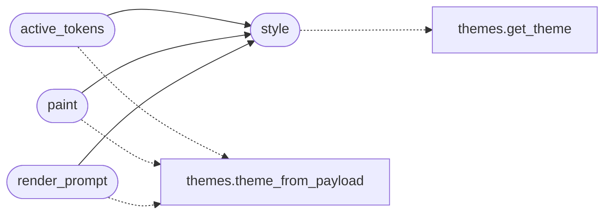

# `cli.style`

> Source: [cli/style.py:1](../../cli/style.py#L1) | language `py` | coverage 100.0% | [API index](../index.md)

Centralised TUI style tokens for the LazyOwn operator surface.

This module is a thin semantic layer over [`cli.themes`](cli.themes.py.md). It exposes a
small, stable set of tokens (``title``, ``accent``, ``hint``...) so that
callers -- the cmd2 prompt, the post-command hint line, the daily tip,
the splash overlay -- never reference raw ANSI escape codes or theme
names directly. Switching the active theme re-paints every surface that
imports from this module without any change in call sites.

Design notes:

- Single Responsibility: only token -> style resolution lives here.
  No I/O, no payload reading, no printing. Callers pass the payload
  mapping in when they need theme resolution.
- Open/Closed: new tokens are added by extending [`TOKEN_KEYS`](#token_keys);
  the resolver does not change.
- Dependency Inversion: callers depend on the [`style`](#style) /
  [`paint`](#paint) functions, never on [`cli.themes`](cli.themes.py.md) directly. The
  underlying theme module can be swapped without touching consumers.
- No magic strings: every token key is declared in [`TOKEN_KEYS`](#token_keys).

## Contents

- **Functions:** [`style`](#style), [`active_tokens`](#active_tokens), [`paint`](#paint), [`render_prompt`](#render_prompt)
- **Constants:** [`TOKEN_KEYS`](#token_keys)

## Call Graph

Solid arrows stay in this module, dashed arrows leave it.



## Functions

<a id="style"></a>

### `style`

`function` | [cli/style.py:49](../../cli/style.py#L49)

```python
def style(token: str, theme: Theme | None = None) -> str
```

Return the Rich style string for a semantic token.

**Parameters**

| Name | Type | Default | Description |
|---|---|---|---|
| `token` | `str` |  | One of [`TOKEN_KEYS`](#token_keys). Unknown tokens fall back to ``"white"`` rather than raising -- callers may pass user-influenced keys without crashing the prompt. |
| `theme` | `Theme \| None` | `None` | Optional pre-resolved [`cli.themes.Theme`](cli.themes.py.md#theme). When ``None`` the default theme is used. |

**Returns:** `str` - A Rich-compatible style string (e.g. ``"bold cyan"``).

*Calls:* [`get_theme`](cli.themes.py.md#get_theme)

*Called by:* [`active_tokens`](#active_tokens), [`paint`](#paint), [`render_prompt`](#render_prompt)

---

<a id="active_tokens"></a>

### `active_tokens`

`function` | [cli/style.py:68](../../cli/style.py#L68)

```python
def active_tokens(payload: Mapping[str, object] | None) -> dict[str, str]
```

Resolve every [`TOKEN_KEYS`](#token_keys) entry for the payload's theme.

**Parameters**

| Name | Type | Default | Description |
|---|---|---|---|
| `payload` | `Mapping[str, object] \| None` |  | Loaded ``payload.json`` mapping. ``None`` returns the default theme tokens. |

**Returns:** `dict[str, str]` - Dict mapping each token key to a Rich style string. Useful
when a surface wants to render multiple tokens without
re-resolving the theme per call.

*Calls:* [`style`](#style), [`theme_from_payload`](cli.themes.py.md#theme_from_payload)

*Called by:* [`render_splash`](cli.splash.py.md#render_splash)

---

<a id="paint"></a>

### `paint`

`function` | [cli/style.py:84](../../cli/style.py#L84)

```python
def paint(text: str, token: str, payload: Mapping[str, object] | None = None) -> Text
```

Render ``text`` with the style of `[`token`](modules.k8s_attacks.py.md#k8sconfig-token)` for the active theme.

**Parameters**

| Name | Type | Default | Description |
|---|---|---|---|
| `text` | `str` |  | Raw text to render. No markup parsing. |
| `token` | `str` |  | Semantic token from [`TOKEN_KEYS`](#token_keys). |
| `payload` | `Mapping[str, object] \| None` | `None` | Optional payload mapping; ``None`` uses defaults. |

**Returns:** `Text` - A `rich.text.Text` instance ready to print or compose.

*Calls:* [`style`](#style), [`theme_from_payload`](cli.themes.py.md#theme_from_payload)

---

<a id="render_prompt"></a>

### `render_prompt`

`function` | [cli/style.py:98](../../cli/style.py#L98)

```python
def render_prompt(console, segments: list[tuple[str, str]], payload: Mapping[str, object] | None = None) -> None
```

Print a themed prompt line composed of ``(text, token)`` pairs.

The function does not terminate with a newline; cmd2's prompt
machinery appends the trailing space. Each segment is coloured
using the resolved theme, and segments are joined with a dim
separator so the prompt reads as a single visual unit.

**Parameters**

| Name | Type | Default | Description |
|---|---|---|---|
| `console` |  |  | A `rich.console.Console` the shell already uses for output. |
| `segments` | `list[tuple[str, str]]` |  | Ordered list of ``(text, token)`` pairs. Tokens come from [`TOKEN_KEYS`](#token_keys). An empty list is a no-op. |
| `payload` | `Mapping[str, object] \| None` | `None` | Optional payload mapping. When ``None`` the default theme is used; passing a payload lets the call site pick the operator's chosen theme. |

**Returns:** `None` - None. The result is written to ``console`` directly.

*Calls:* [`style`](#style), [`theme_from_payload`](cli.themes.py.md#theme_from_payload)

---

## Constants

<a id="token_keys"></a>

### `TOKEN_KEYS`

`constant` | [cli/style.py:31](../../cli/style.py#L31)

```python
TOKEN_KEYS: tuple[str, ...]
```

Semantic style tokens every TUI surface should reference.

Adding a new role here is the only edit required to expose it
across the whole operator surface.

---
