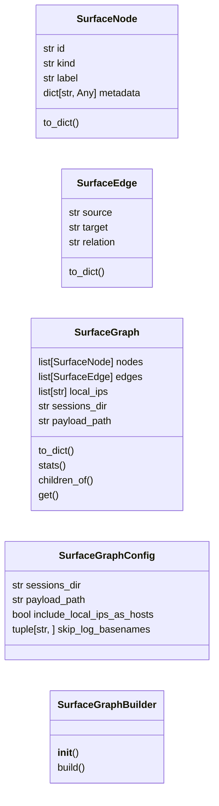
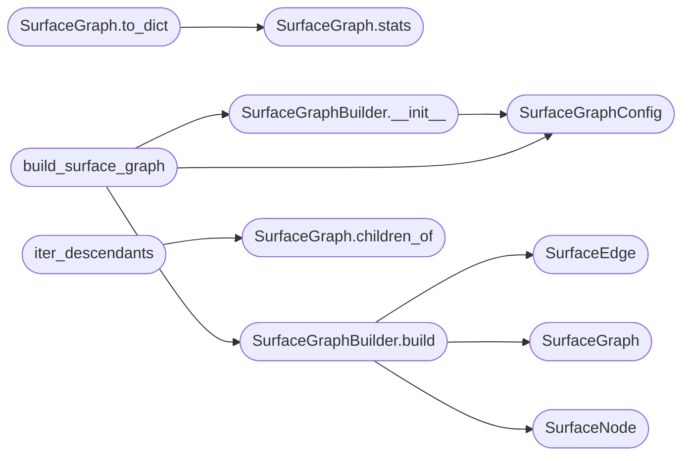

# `cli.surface_graph`

> Source: [cli/surface_graph.py:1](../../cli/surface_graph.py#L1) | language `py` | coverage 93.8% | [API index](../index.md)

Network surface graph reader for the LazyOwn shell.

Mirrors the ``vis.js`` graph rendered by ``templates/index.html`` (consumed
by ``lazyc2.py``), but works entirely from the filesystem artefacts inside
``sessions/`` so the cmd2 shell can render the same picture without
running the Flask server.

The graph has the same five-node taxonomy as the web UI:

* `[`c2`](discord_c2.py.md#c2)`      — the LazyOwn operator station (root).
* `[`client`](modules.professional_report.py.md#reportmetadata-client)`  — an active implant (one ``sessions/<client_id>.log`` file).
* ``host``    — a discovered remote host (from ``hostsdiscovery.txt`` or
                 ``scan_discovery*.csv``, or surfaced via an implant's
                 ``discovered_ips`` column).
* ``port``    — an open TCP/UDP port on a discovered host.
* ``service`` — banner/version metadata attached to a port when known.

Data sources, in priority order:

* ``sessions/hostsdiscovery.txt``        — newline-delimited IPs.
* ``sessions/scan_discovery_*.csv``      — ``;``-quoted IP/PORT/SERVICE.
* ``sessions/<client_id>.log``           — per-implant CSV with the
                                           ``discovered_ips`` and
                                           ``result_portscan`` columns.
* ``payload.json``                       — local C2 host/port (``lhost``,
                                           ``c2_port``) for the root node.
* ``sessions/os.json``                   — current target OS hint.

The module is pure data: it returns plain dataclasses + `[`to_dict`](#surfacenode-to_dict)` so the
result is equally usable from a Rich/Textual renderer, an MCP response or
a unit test.

## Contents

- **Classes:** [`SurfaceNode`](#surfacenode), [`SurfaceEdge`](#surfaceedge), [`SurfaceGraph`](#surfacegraph), [`SurfaceGraphConfig`](#surfacegraphconfig), [`SurfaceGraphBuilder`](#surfacegraphbuilder)
- **Functions:** [`build_surface_graph`](#build_surface_graph), [`iter_descendants`](#iter_descendants)
- **Constants:** [`NODE_C2`](#node_c2), [`NODE_KIND_C2`](#node_kind_c2), [`NODE_KIND_CLIENT`](#node_kind_client), [`NODE_KIND_HOST`](#node_kind_host), [`NODE_KIND_PORT`](#node_kind_port), [`NODE_KIND_SERVICE`](#node_kind_service), [`EDGE_CONTROLS`](#edge_controls), [`EDGE_DISCOVERED`](#edge_discovered), [`EDGE_OPENS`](#edge_opens), [`EDGE_RUNS`](#edge_runs)

## Type Diagram



## Call Graph

Solid arrows stay in this module, dashed arrows leave it.



## Classes

<a id="surfacenode"></a>

### `SurfaceNode`

`class` `dataclass` | [cli/surface_graph.py:87](../../cli/surface_graph.py#L87)

Decorators: `@dataclass(frozen=True)`

```python
class SurfaceNode
```

A node in the network surface graph.

**Parameters**

| Name | Type | Default | Description |
|---|---|---|---|
| `id` | `str` |  | Stable string identifier (e.g. ``host-10-0-0-1``). |
| `kind` | `str` |  | One of `[`c2`](discord_c2.py.md#c2)`, `[`client`](modules.professional_report.py.md#reportmetadata-client)`, ``host``, ``port``, ``service``. |
| `label` | `str` |  | Human-readable label rendered in the TUI. |
| `metadata` | `dict[str, Any]` | `field(default_factory=dict)` | Free-form structured attributes from the source file. |

**Attributes**

| Name | Type | Default | Description |
|---|---|---|---|
| [`id`](#surfacenode-id) | `str` |  |  |
| [`kind`](#surfacenode-kind) | `str` |  |  |
| [`label`](#surfacenode-label) | `str` |  |  |
| [`metadata`](#surfacenode-metadata) | `dict[str, Any]` | `field(default_factory=dict)` |  |

**Members**

| Member | Kind | Summary |
|---|---|---|
| [`to_dict`](#surfacenode-to_dict) | method | Return a JSON-serialisable view of the node. |

<a id="surfacenode-to_dict"></a>

#### `SurfaceNode.to_dict`

`method` | [cli/surface_graph.py:102](../../cli/surface_graph.py#L102)

```python
def to_dict(self) -> dict[str, Any]
```

Return a JSON-serialisable view of the node.

**Returns:** `dict[str, Any]`

---

<a id="surfaceedge"></a>

### `SurfaceEdge`

`class` `dataclass` | [cli/surface_graph.py:113](../../cli/surface_graph.py#L113)

Decorators: `@dataclass(frozen=True)`

```python
class SurfaceEdge
```

A directed edge between two surface nodes.

**Attributes**

| Name | Type | Default | Description |
|---|---|---|---|
| [`source`](#surfaceedge-source) | `str` |  |  |
| [`target`](#surfaceedge-target) | `str` |  |  |
| [`relation`](#surfaceedge-relation) | `str` |  |  |

**Members**

| Member | Kind | Summary |
|---|---|---|
| [`to_dict`](#surfaceedge-to_dict) | method | Return a JSON-serialisable view of the edge. |

<a id="surfaceedge-to_dict"></a>

#### `SurfaceEdge.to_dict`

`method` | [cli/surface_graph.py:120](../../cli/surface_graph.py#L120)

```python
def to_dict(self) -> dict[str, str]
```

Return a JSON-serialisable view of the edge.

**Returns:** `dict[str, str]`

---

<a id="surfacegraph"></a>

### `SurfaceGraph`

`class` `dataclass` | [cli/surface_graph.py:126](../../cli/surface_graph.py#L126)

Decorators: `@dataclass(frozen=True)`

```python
class SurfaceGraph
```

Aggregate snapshot of nodes + edges discovered on disk.

**Attributes**

| Name | Type | Default | Description |
|---|---|---|---|
| [`nodes`](#surfacegraph-nodes) | `list[SurfaceNode]` |  |  |
| [`edges`](#surfacegraph-edges) | `list[SurfaceEdge]` |  |  |
| [`local_ips`](#surfacegraph-local_ips) | `list[str]` |  |  |
| [`sessions_dir`](#surfacegraph-sessions_dir) | `str` |  |  |
| [`payload_path`](#surfacegraph-payload_path) | `str` |  |  |

**Members**

| Member | Kind | Summary |
|---|---|---|
| [`to_dict`](#surfacegraph-to_dict) | method | Return a JSON-serialisable view (mirrors the web UI payload). |
| [`stats`](#surfacegraph-stats) | method | Return per-kind node counts plus edge count. |
| [`children_of`](#surfacegraph-children_of) | method | Return nodes that `[`node_id`](modules.intel_fusion.py.md#node_id)` points to via an outgoing edge. |
| [`get`](#surfacegraph-get) | method | Return the node with `[`node_id`](modules.intel_fusion.py.md#node_id)` or ``None``. |

<a id="surfacegraph-to_dict"></a>

#### `SurfaceGraph.to_dict`

`method` | [cli/surface_graph.py:135](../../cli/surface_graph.py#L135)

```python
def to_dict(self) -> dict[str, Any]
```

Return a JSON-serialisable view (mirrors the web UI payload).

**Returns:** `dict[str, Any]`

*Calls:* [`SurfaceGraph.stats`](#surfacegraph-stats)

<a id="surfacegraph-stats"></a>

#### `SurfaceGraph.stats`

`method` | [cli/surface_graph.py:146](../../cli/surface_graph.py#L146)

```python
def stats(self) -> dict[str, int]
```

Return per-kind node counts plus edge count.

**Returns:** `dict[str, int]`

*Called by:* [`SurfaceGraph.to_dict`](#surfacegraph-to_dict), [`launch_tui`](cli.surface_tui.py.md#launch_tui)

<a id="surfacegraph-children_of"></a>

#### `SurfaceGraph.children_of`

`method` | [cli/surface_graph.py:153](../../cli/surface_graph.py#L153)

```python
def children_of(self, node_id: str) -> list[SurfaceNode]
```

Return nodes that `[`node_id`](modules.intel_fusion.py.md#node_id)` points to via an outgoing edge.

**Parameters**

| Name | Type | Default | Description |
|---|---|---|---|
| `node_id` | `str` |  |  |

**Returns:** `list[SurfaceNode]`

*Called by:* [`iter_descendants`](#iter_descendants), [`launch_tui`](cli.surface_tui.py.md#launch_tui)

<a id="surfacegraph-get"></a>

#### `SurfaceGraph.get`

`method` | [cli/surface_graph.py:165](../../cli/surface_graph.py#L165)

```python
def get(self, node_id: str) -> SurfaceNode | None
```

Return the node with `[`node_id`](modules.intel_fusion.py.md#node_id)` or ``None``.

**Parameters**

| Name | Type | Default | Description |
|---|---|---|---|
| `node_id` | `str` |  |  |

**Returns:** `SurfaceNode | None`

*Called by:* [`launch_tui`](cli.surface_tui.py.md#launch_tui)

---

<a id="surfacegraphconfig"></a>

### `SurfaceGraphConfig`

`class` `dataclass` | [cli/surface_graph.py:174](../../cli/surface_graph.py#L174)

Decorators: `@dataclass(frozen=True)`

```python
class SurfaceGraphConfig
```

Configuration for [`SurfaceGraphBuilder`](#surfacegraphbuilder).

**Parameters**

| Name | Type | Default | Description |
|---|---|---|---|
| `sessions_dir` | `str` | `'sessions'` | Path to the ``sessions/`` directory. |
| `payload_path` | `str` | `PAYLOAD_FILENAME` | Path to ``payload.json`` (read for ``lhost``, ``c2_port``). |
| `include_local_ips_as_hosts` | `bool` | `False` | When true, attach each local IP as a ``host`` node so the C2 is visible alongside the targets. |
| `skip_log_basenames` | `tuple[str, ...]` | `('access', 'ai_model')` | Implant logs that should never be treated as beacons (e.g. ``access``). |

**Attributes**

| Name | Type | Default | Description |
|---|---|---|---|
| [`sessions_dir`](#surfacegraphconfig-sessions_dir) | `str` | `'sessions'` |  |
| [`payload_path`](#surfacegraphconfig-payload_path) | `str` | `PAYLOAD_FILENAME` |  |
| [`include_local_ips_as_hosts`](#surfacegraphconfig-include_local_ips_as_hosts) | `bool` | `False` |  |
| [`skip_log_basenames`](#surfacegraphconfig-skip_log_basenames) | `tuple[str, ...]` | `('access', 'ai_model')` |  |

---

<a id="surfacegraphbuilder"></a>

### `SurfaceGraphBuilder`

`class` | [cli/surface_graph.py:196](../../cli/surface_graph.py#L196)

```python
class SurfaceGraphBuilder
```

Compose a [`SurfaceGraph`](#surfacegraph) from on-disk session artefacts.

**Members**

| Member | Kind | Summary |
|---|---|---|
| [`__init__`](#surfacegraphbuilder-__init__) | constructor |  |
| [`build`](#surfacegraphbuilder-build) | method | Read every session artefact and return the assembled graph. |

<a id="surfacegraphbuilder-__init__"></a>

#### `SurfaceGraphBuilder.__init__`

`constructor` | [cli/surface_graph.py:199](../../cli/surface_graph.py#L199)

```python
def __init__(self, config: SurfaceGraphConfig | None = None) -> None
```

**Parameters**

| Name | Type | Default | Description |
|---|---|---|---|
| `config` | `SurfaceGraphConfig \| None` | `None` |  |

*Calls:* [`SurfaceGraphConfig`](#surfacegraphconfig)

*Called by:* [`build_surface_graph`](#build_surface_graph), [`build_attack_graph`](modules.attack_surface3d.py.md#build_attack_graph)

<a id="surfacegraphbuilder-build"></a>

#### `SurfaceGraphBuilder.build`

`method` | [cli/surface_graph.py:202](../../cli/surface_graph.py#L202)

```python
def build(self) -> SurfaceGraph
```

Read every session artefact and return the assembled graph.

**Returns:** `SurfaceGraph`

*Calls:* [`SurfaceEdge`](#surfaceedge), [`SurfaceGraph`](#surfacegraph), [`SurfaceNode`](#surfacenode)

*Called by:* [`build_surface_graph`](#build_surface_graph), [`build_attack_graph`](modules.attack_surface3d.py.md#build_attack_graph)

---

## Functions

<a id="build_surface_graph"></a>

### `build_surface_graph`

`function` | [cli/surface_graph.py:633](../../cli/surface_graph.py#L633)

```python
def build_surface_graph(sessions_dir: str = 'sessions', payload_path: str = PAYLOAD_FILENAME) -> SurfaceGraph
```

Convenience factory: build a graph from on-disk artefacts.

**Parameters**

| Name | Type | Default | Description |
|---|---|---|---|
| `sessions_dir` | `str` | `'sessions'` | Path to the LazyOwn sessions directory. |
| `payload_path` | `str` | `PAYLOAD_FILENAME` | Path to ``payload.json``. |

**Returns:** `SurfaceGraph` - A populated [`SurfaceGraph`](#surfacegraph).

*Calls:* [`SurfaceGraphBuilder.__init__`](#surfacegraphbuilder-__init__), [`SurfaceGraphBuilder.build`](#surfacegraphbuilder-build), [`SurfaceGraphConfig`](#surfacegraphconfig)

*Called by:* [`launch_tui`](cli.surface_tui.py.md#launch_tui), [`render_json`](cli.surface_tui.py.md#render_json), [`render_static`](cli.surface_tui.py.md#render_static)

---

<a id="iter_descendants"></a>

### `iter_descendants`

`function` `generator` | [cli/surface_graph.py:650](../../cli/surface_graph.py#L650)

```python
def iter_descendants(graph: SurfaceGraph, root_id: str) -> Iterable[SurfaceNode]
```

Yield every node reachable from ``root_id`` via outgoing edges.

**Parameters**

| Name | Type | Default | Description |
|---|---|---|---|
| `graph` | `SurfaceGraph` |  |  |
| `root_id` | `str` |  |  |

**Returns:** `Iterable[SurfaceNode]`

*Calls:* [`SurfaceGraph.children_of`](#surfacegraph-children_of)

---

## Constants

<a id="node_c2"></a>

### `NODE_C2`

`constant` | [cli/surface_graph.py:60](../../cli/surface_graph.py#L60)

```python
NODE_C2: str = 'c2'
```

---

<a id="node_kind_c2"></a>

### `NODE_KIND_C2`

`constant` | [cli/surface_graph.py:61](../../cli/surface_graph.py#L61)

```python
NODE_KIND_C2: str = 'c2'
```

---

<a id="node_kind_client"></a>

### `NODE_KIND_CLIENT`

`constant` | [cli/surface_graph.py:62](../../cli/surface_graph.py#L62)

```python
NODE_KIND_CLIENT: str = 'client'
```

---

<a id="node_kind_host"></a>

### `NODE_KIND_HOST`

`constant` | [cli/surface_graph.py:63](../../cli/surface_graph.py#L63)

```python
NODE_KIND_HOST: str = 'host'
```

---

<a id="node_kind_port"></a>

### `NODE_KIND_PORT`

`constant` | [cli/surface_graph.py:64](../../cli/surface_graph.py#L64)

```python
NODE_KIND_PORT: str = 'port'
```

---

<a id="node_kind_service"></a>

### `NODE_KIND_SERVICE`

`constant` | [cli/surface_graph.py:65](../../cli/surface_graph.py#L65)

```python
NODE_KIND_SERVICE: str = 'service'
```

---

<a id="edge_controls"></a>

### `EDGE_CONTROLS`

`constant` | [cli/surface_graph.py:67](../../cli/surface_graph.py#L67)

```python
EDGE_CONTROLS: str = 'controls'
```

---

<a id="edge_discovered"></a>

### `EDGE_DISCOVERED`

`constant` | [cli/surface_graph.py:68](../../cli/surface_graph.py#L68)

```python
EDGE_DISCOVERED: str = 'discovered'
```

---

<a id="edge_opens"></a>

### `EDGE_OPENS`

`constant` | [cli/surface_graph.py:69](../../cli/surface_graph.py#L69)

```python
EDGE_OPENS: str = 'opens'
```

---

<a id="edge_runs"></a>

### `EDGE_RUNS`

`constant` | [cli/surface_graph.py:70](../../cli/surface_graph.py#L70)

```python
EDGE_RUNS: str = 'runs'
```

---
