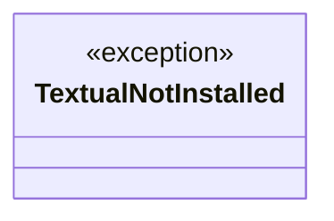
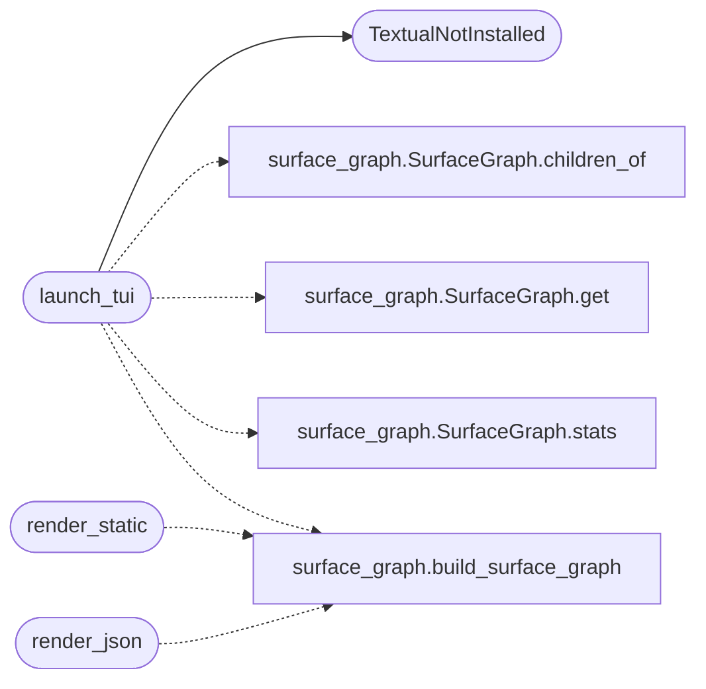

# `cli.surface_tui`

> Source: [cli/surface_tui.py:1](../../cli/surface_tui.py#L1) | language `py` | coverage 100.0% | [API index](../index.md)

Terminal renderer for the LazyOwn network surface graph.

This is the TUI counterpart of the ``vis.js`` graph rendered by
``templates/index.html``. It walks the [`cli.surface_graph.SurfaceGraph`](cli.surface_graph.py.md#surfacegraph)
that [`cli.surface_graph.SurfaceGraphBuilder`](cli.surface_graph.py.md#surfacegraphbuilder) assembled from
``sessions/`` and ``payload.json`` and offers three rendering modes so it
plugs into any operator workflow:

* [`render_static`](#render_static) — print a Rich tree once and return; ideal for the
  `[`do_surface`](cli.commands.recon_migrated.py.md#reconmigratedcommandset-do_surface)` cmd2 command in non-interactive shells.
* [`launch_tui`](#launch_tui)    — open a full-screen Textual app with a navigable
  tree + detail pane (Q to quit, R to refresh).
* [`render_json`](#render_json)   — emit the graph as JSON for piping into other
  tools or feeding the MCP layer.

The module degrades cleanly when ``textual`` is missing: only the TUI
launcher requires it, and it raises a typed [`TextualNotInstalled`](#textualnotinstalled)
that the caller can translate into an operator-friendly message.

## Contents

- **Exceptions:** [`TextualNotInstalled`](#textualnotinstalled)
- **Functions:** [`render_static`](#render_static), [`render_json`](#render_json), [`launch_tui`](#launch_tui)

## Type Diagram



## Call Graph

Solid arrows stay in this module, dashed arrows leave it.



## Exceptions

<a id="textualnotinstalled"></a>

### `TextualNotInstalled`

`exception` | [cli/surface_tui.py:61](../../cli/surface_tui.py#L61)

```python
class TextualNotInstalled(RuntimeError)
```

Bases: `RuntimeError`

Raised when the optional ``textual`` dependency is unavailable.

---

## Functions

<a id="render_static"></a>

### `render_static`

`function` | [cli/surface_tui.py:65](../../cli/surface_tui.py#L65)

```python
def render_static(graph: SurfaceGraph | None = None, sessions_dir: str = 'sessions', payload_path: str = 'payload.json', console: Console | None = None) -> SurfaceGraph
```

Render the surface graph as a Rich tree and return it.

**Parameters**

| Name | Type | Default | Description |
|---|---|---|---|
| `graph` | `SurfaceGraph \| None` | `None` | Optional prebuilt graph. When ``None``, the function reads `[`sessions_dir`](core.defaults.py.md#sessions_dir)` and ``payload_path`` to build one. |
| `sessions_dir` | `str` | `'sessions'` | Path to the LazyOwn sessions directory. |
| `payload_path` | `str` | `'payload.json'` | Path to ``payload.json``. |
| `console` | `Console \| None` | `None` | Optional Rich console; a new stdout console is created when ``None``. |

**Returns:** `SurfaceGraph` - The [`SurfaceGraph`](cli.surface_graph.py.md#surfacegraph) that was rendered (useful for tests).

*Calls:* [`build_surface_graph`](cli.surface_graph.py.md#build_surface_graph)

---

<a id="render_json"></a>

### `render_json`

`function` | [cli/surface_tui.py:92](../../cli/surface_tui.py#L92)

```python
def render_json(graph: SurfaceGraph | None = None, sessions_dir: str = 'sessions', payload_path: str = 'payload.json') -> str
```

Return the surface graph as a JSON string.

**Parameters**

| Name | Type | Default | Description |
|---|---|---|---|
| `graph` | `SurfaceGraph \| None` | `None` | Optional prebuilt graph; built on demand when ``None``. |
| `sessions_dir` | `str` | `'sessions'` | Path to the LazyOwn sessions directory. |
| `payload_path` | `str` | `'payload.json'` | Path to ``payload.json``. |

**Returns:** `str` - A pretty-printed JSON document mirroring the dict returned by
[`SurfaceGraph.to_dict`](cli.surface_graph.py.md#surfacegraph-to_dict).

*Calls:* [`build_surface_graph`](cli.surface_graph.py.md#build_surface_graph)

---

<a id="launch_tui"></a>

### `launch_tui`

`function` | [cli/surface_tui.py:112](../../cli/surface_tui.py#L112)

```python
def launch_tui(sessions_dir: str = 'sessions', payload_path: str = 'payload.json') -> None
```

Open the full-screen Textual surface explorer.

**Parameters**

| Name | Type | Default | Description |
|---|---|---|---|
| `sessions_dir` | `str` | `'sessions'` | Path to the LazyOwn sessions directory. |
| `payload_path` | `str` | `'payload.json'` | Path to ``payload.json``. |

**Raises**

- [`TextualNotInstalled`](#textualnotinstalled): When the ``textual`` package is missing.

*Calls:* [`SurfaceGraph.children_of`](cli.surface_graph.py.md#surfacegraph-children_of), [`SurfaceGraph.get`](cli.surface_graph.py.md#surfacegraph-get), [`SurfaceGraph.stats`](cli.surface_graph.py.md#surfacegraph-stats), [`build_surface_graph`](cli.surface_graph.py.md#build_surface_graph), [`TextualNotInstalled`](#textualnotinstalled)

---
