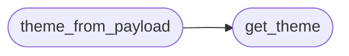

# `cli.themes`

> Source: [cli/themes.py:1](../../cli/themes.py#L1) | language `py` | coverage 100.0% | [API index](../index.md)

Theme registry for the LazyOwn TUI surfaces.

Every Textual overlay (Cmd-K palette, sessions browser, timeline scrubber,
command form, graph overlay) and the persistent status bar pull their
colour tokens from this module. Themes are pure data: a name plus a
mapping from semantic role to a Rich-compatible style string. Consumers
look up styles by role, never by raw colour, so adding a new theme is
one constant declaration and every surface follows along.

Design notes:

- Single Responsibility: only theme registration and lookup live here.
  No widget, no I/O. The active theme is selected by the operator via
  the ``tui_theme`` payload key; this module never touches
  ``payload.json`` directly.
- Open/Closed: new themes are added to [`THEMES`](#themes); the resolver does
  not change.
- Dependency Inversion: callers depend on the [`Theme`](#theme) dataclass,
  never on the underlying terminal capabilities.
- No magic numbers/strings: every role and colour lives in one of the
  declared [`Theme`](#theme) constants below.

## Contents

- **Classes:** [`Theme`](#theme)
- **Functions:** [`get_theme`](#get_theme), [`theme_from_payload`](#theme_from_payload)
- **Constants:** [`DEFAULT_THEME_NAME`](#default_theme_name), [`THEMES`](#themes), [`THEME_ORDER`](#theme_order)

## Call Graph

Solid arrows stay in this module, dashed arrows leave it.



## Classes

<a id="theme"></a>

### `Theme`

`class` `dataclass` | [cli/themes.py:31](../../cli/themes.py#L31)

Decorators: `@dataclass(frozen=True)`

```python
class Theme
```

Immutable mapping from semantic UI role to Rich style string.

**Attributes**

| Name | Type | Default | Description |
|---|---|---|---|
| [`name`](#theme-name) | `str` |  | Stable identifier used by ``payload.json["tui_theme"]``. |
| [`title`](#theme-title) | `str` |  | Style for primary headings (titles, modal headers). |
| [`subtitle`](#theme-subtitle) | `str` |  | Style for secondary headings and helper text. |
| [`accent`](#theme-accent) | `str` |  | Style for highlighted tokens (matches, focused items). |
| [`muted`](#theme-muted) | `str` |  | Style for inactive entries and field labels. |
| [`border`](#theme-border) | `str` |  | Style for panel borders and dividers. |
| [`success`](#theme-success) | `str` |  | Style for positive markers (ok, completed, found). |
| [`warning`](#theme-warning) | `str` |  | Style for cautionary markers. |
| [`danger`](#theme-danger) | `str` |  | Style for destructive or error markers. |
| [`hint`](#theme-hint) | `str` |  | Style for the inline reactive hint footer. |
| [`bar_open`](#theme-bar_open) | `str` |  | Raw ANSI prefix written by the status bar. |
| [`bar_close`](#theme-bar_close) | `str` |  | Raw ANSI suffix written by the status bar. |

---

## Functions

<a id="get_theme"></a>

### `get_theme`

`function` | [cli/themes.py:222](../../cli/themes.py#L222)

```python
def get_theme(name: str | None) -> Theme
```

Return the registered [`Theme`](#theme) for `[`name`](#theme-name)` with safe fallback.

**Parameters**

| Name | Type | Default | Description |
|---|---|---|---|
| `name` | `str \| None` |  | Theme identifier as written in ``payload.json["tui_theme"]``. ``None`` or unknown names fall back to [`DEFAULT_THEME_NAME`](#default_theme_name). |

**Returns:** `Theme` - The matching [`Theme`](#theme). Never raises.

*Called by:* [`style`](cli.style.py.md#style), [`theme_from_payload`](#theme_from_payload)

---

<a id="theme_from_payload"></a>

### `theme_from_payload`

`function` | [cli/themes.py:238](../../cli/themes.py#L238)

```python
def theme_from_payload(payload: Mapping[str, object] | None) -> Theme
```

Return the theme selected by ``payload["tui_theme"]``.

**Parameters**

| Name | Type | Default | Description |
|---|---|---|---|
| `payload` | `Mapping[str, object] \| None` |  | Loaded ``payload.json`` mapping. ``None`` returns the default theme. |

**Returns:** `Theme` - The resolved [`Theme`](#theme).

*Calls:* [`get_theme`](#get_theme)

*Called by:* [`launch_form`](cli.command_form.py.md#launch_form), [`launch_overlay`](cli.graph_overlay.py.md#launch_overlay), [`launch_overlay`](cli.palette_overlay.py.md#launch_overlay), [`build_session_brief`](cli.session_brief.py.md#build_session_brief), [`launch_browser`](cli.sessions_browser.py.md#launch_browser), [`active_tokens`](cli.style.py.md#active_tokens), [`paint`](cli.style.py.md#paint), [`render_prompt`](cli.style.py.md#render_prompt), [`launch_scrubber`](cli.timeline_browser.py.md#launch_scrubber), [`build_default_bus`](cli.toast_bus.py.md#build_default_bus), [`build_toast_renderable`](cli.toast_bus.py.md#build_toast_renderable)

---

## Constants

<a id="default_theme_name"></a>

### `DEFAULT_THEME_NAME`

`constant` | [cli/themes.py:63](../../cli/themes.py#L63)

```python
DEFAULT_THEME_NAME: str = 'default'
```

---

<a id="themes"></a>

### `THEMES`

`constant` | [cli/themes.py:201](../../cli/themes.py#L201)

```python
THEMES: Mapping[str, Theme]
```

---

<a id="theme_order"></a>

### `THEME_ORDER`

`constant` | [cli/themes.py:213](../../cli/themes.py#L213)

```python
THEME_ORDER: tuple[str, ...] = tuple(THEMES)
```

Canonical deterministic ordering for cycle/prev/listing.

Derived from [`THEMES`](#themes) registration order so adding a theme to the
registry automatically surfaces it in every listing. Consumers must
import this instead of maintaining a parallel hardcoded tuple.

---
