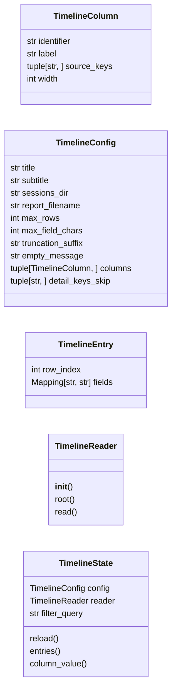
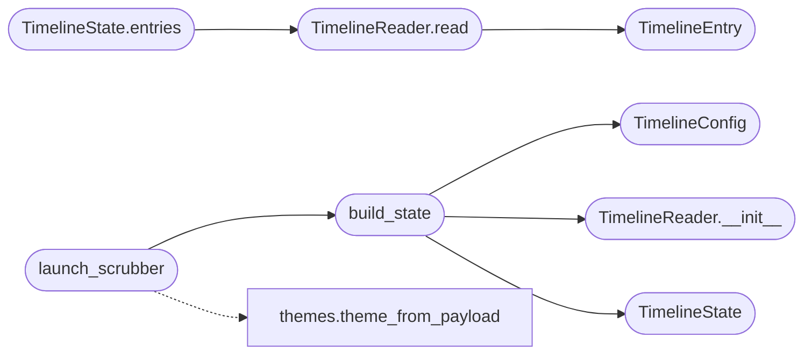

# `cli.timeline_browser`

> Source: [cli/timeline_browser.py:1](../../cli/timeline_browser.py#L1) | language `py` | coverage 100.0% | [API index](../index.md)

Textual scrubber over ``sessions/LazyOwn_session_report.csv``.

The session report is a CSV that every command appends to. The scrubber
turns it into a paginated, searchable, key-driven view so the operator
can replay decisions, jump to artefacts and answer questions like "what
was the gobuster command we ran last week?" without leaving the shell.

Design (SOLID):

- Single Responsibility: [`TimelineConfig`](#timelineconfig) owns constants,
  [`TimelineEntry`](#timelineentry) is the immutable row, [`TimelineReader`](#timelinereader)
  loads CSV rows lazily, [`TimelineState`](#timelinestate) slices and filters,
  `TimelineBrowserApp` renders.
- Open/Closed: a new column is one tuple entry in
  [`TimelineConfig.columns`](#timelineconfig-columns).
- Dependency Inversion: the app is always built from a
  [`TimelineState`](#timelinestate) so tests bypass Textual entirely.
- No magic numbers / hardcoded paths: every value lives in the config.

## Contents

- **Classes:** [`TimelineColumn`](#timelinecolumn), [`TimelineConfig`](#timelineconfig), [`TimelineEntry`](#timelineentry), [`TimelineReader`](#timelinereader), [`TimelineState`](#timelinestate)
- **Functions:** [`build_state`](#build_state), [`launch_scrubber`](#launch_scrubber)

## Type Diagram



## Call Graph

Solid arrows stay in this module, dashed arrows leave it.



## Classes

<a id="timelinecolumn"></a>

### `TimelineColumn`

`class` `dataclass` | [cli/timeline_browser.py:33](../../cli/timeline_browser.py#L33)

Decorators: `@dataclass(frozen=True)`

```python
class TimelineColumn
```

Descriptor for a single column rendered by the scrubber.

**Attributes**

| Name | Type | Default | Description |
|---|---|---|---|
| [`identifier`](#timelinecolumn-identifier) | `str` |  |  |
| [`label`](#timelinecolumn-label) | `str` |  |  |
| [`source_keys`](#timelinecolumn-source_keys) | `tuple[str, ...]` |  |  |
| [`width`](#timelinecolumn-width) | `int` |  |  |

---

<a id="timelineconfig"></a>

### `TimelineConfig`

`class` `dataclass` | [cli/timeline_browser.py:43](../../cli/timeline_browser.py#L43)

Decorators: `@dataclass(frozen=True)`

```python
class TimelineConfig
```

Centralised constants for the scrubber.

**Attributes**

| Name | Type | Default | Description |
|---|---|---|---|
| [`title`](#timelineconfig-title) | `str` | `'Timeline scrubber'` |  |
| [`subtitle`](#timelineconfig-subtitle) | `str` | `'Up/Down to navigate, / to filter, Esc to close'` |  |
| [`sessions_dir`](#timelineconfig-sessions_dir) | `str` | `'sessions'` |  |
| [`report_filename`](#timelineconfig-report_filename) | `str` | `'LazyOwn_session_report.csv'` |  |
| [`max_rows`](#timelineconfig-max_rows) | `int` | `5000` |  |
| [`max_field_chars`](#timelineconfig-max_field_chars) | `int` | `96` |  |
| [`truncation_suffix`](#timelineconfig-truncation_suffix) | `str` | `'...'` |  |
| [`empty_message`](#timelineconfig-empty_message) | `str` | `'(no commands recorded yet)'` |  |
| [`columns`](#timelineconfig-columns) | `tuple[TimelineColumn, ...]` | `(TimelineColumn('timestamp', 'Time', ('timestamp', 'date', 'ts'), 19), TimelineColumn('command', 'Command', ('tool', 'command', 'name'), 28), TimelineColumn('status', 'Status', ('status', 'result', 'exit_code'), 10), TimelineColumn('target', 'Target', ('target', 'rhost', 'host'), 18), TimelineColumn('phase', 'Phase', ('phase',), 8))` |  |
| [`detail_keys_skip`](#timelineconfig-detail_keys_skip) | `tuple[str, ...]` | `()` |  |

---

<a id="timelineentry"></a>

### `TimelineEntry`

`class` `dataclass` | [cli/timeline_browser.py:65](../../cli/timeline_browser.py#L65)

Decorators: `@dataclass(frozen=True)`

```python
class TimelineEntry
```

Immutable row exposed to consumers of [`TimelineState`](#timelinestate).

**Attributes**

| Name | Type | Default | Description |
|---|---|---|---|
| [`row_index`](#timelineentry-row_index) | `int` |  |  |
| [`fields`](#timelineentry-fields) | `Mapping[str, str]` |  |  |

---

<a id="timelinereader"></a>

### `TimelineReader`

`class` | [cli/timeline_browser.py:72](../../cli/timeline_browser.py#L72)

```python
class TimelineReader
```

Read the CSV report into a list of [`TimelineEntry`](#timelineentry) records.

**Members**

| Member | Kind | Summary |
|---|---|---|
| [`__init__`](#timelinereader-__init__) | constructor | Bind to config and resolve the sessions root. |
| [`root`](#timelinereader-root) | property | Return the resolved sessions root. |
| [`read`](#timelinereader-read) | method | Return the parsed entries, newest last. |

<a id="timelinereader-__init__"></a>

#### `TimelineReader.__init__`

`constructor` | [cli/timeline_browser.py:75](../../cli/timeline_browser.py#L75)

```python
def __init__(self, config: TimelineConfig, root: Path | None = None) -> None
```

Bind to config and resolve the sessions root.

**Parameters**

| Name | Type | Default | Description |
|---|---|---|---|
| `config` | `TimelineConfig` |  |  |
| `root` | `Path \| None` | `None` |  |

*Called by:* [`build_state`](#build_state)

<a id="timelinereader-root"></a>

#### `TimelineReader.root`

`property` | [cli/timeline_browser.py:81](../../cli/timeline_browser.py#L81)

Decorators: `@property`

```python
def root(self) -> Path
```

Return the resolved sessions root.

**Returns:** `Path`

<a id="timelinereader-read"></a>

#### `TimelineReader.read`

`method` | [cli/timeline_browser.py:85](../../cli/timeline_browser.py#L85)

```python
def read(self) -> list[TimelineEntry]
```

Return the parsed entries, newest last.

**Returns:** `list[TimelineEntry]`

*Calls:* [`TimelineEntry`](#timelineentry)

*Called by:* [`TimelineState.entries`](#timelinestate-entries)

---

<a id="timelinestate"></a>

### `TimelineState`

`class` `dataclass` | [cli/timeline_browser.py:122](../../cli/timeline_browser.py#L122)

Decorators: `@dataclass`

```python
class TimelineState
```

Filtering + selection state shared with the Textual app.

**Attributes**

| Name | Type | Default | Description |
|---|---|---|---|
| [`config`](#timelinestate-config) | `TimelineConfig` |  |  |
| [`reader`](#timelinestate-reader) | `TimelineReader` |  |  |
| [`filter_query`](#timelinestate-filter_query) | `str` | `''` |  |

**Members**

| Member | Kind | Summary |
|---|---|---|
| [`reload`](#timelinestate-reload) | method | Drop the cache so the next [`entries`](modules.verb_catalog.py.md#entries) call re-reads disk. |
| [`entries`](#timelinestate-entries) | method | Return filtered entries; reads disk on the first call. |
| [`column_value`](#timelinestate-column_value) | method | Return the first non-empty value among ``column.source_keys``. |

<a id="timelinestate-reload"></a>

#### `TimelineState.reload`

`method` | [cli/timeline_browser.py:130](../../cli/timeline_browser.py#L130)

```python
def reload(self) -> None
```

Drop the cache so the next [`entries`](modules.verb_catalog.py.md#entries) call re-reads disk.

<a id="timelinestate-entries"></a>

#### `TimelineState.entries`

`method` | [cli/timeline_browser.py:134](../../cli/timeline_browser.py#L134)

```python
def entries(self) -> list[TimelineEntry]
```

Return filtered entries; reads disk on the first call.

**Returns:** `list[TimelineEntry]`

*Calls:* [`TimelineReader.read`](#timelinereader-read)

<a id="timelinestate-column_value"></a>

#### `TimelineState.column_value`

`method` | [cli/timeline_browser.py:148](../../cli/timeline_browser.py#L148)

```python
def column_value(self, entry: TimelineEntry, column: TimelineColumn) -> str
```

Return the first non-empty value among ``column.source_keys``.

**Parameters**

| Name | Type | Default | Description |
|---|---|---|---|
| `entry` | `TimelineEntry` |  |  |
| `column` | `TimelineColumn` |  |  |

**Returns:** `str`

---

## Functions

<a id="build_state"></a>

### `build_state`

`function` | [cli/timeline_browser.py:157](../../cli/timeline_browser.py#L157)

```python
def build_state(payload: Mapping[str, Any] | None = None, sessions_dir: str | None = None, config: TimelineConfig | None = None) -> TimelineState
```

Wire the canonical state used by [`launch_scrubber`](#launch_scrubber).

**Parameters**

| Name | Type | Default | Description |
|---|---|---|---|
| `payload` | `Mapping[str, Any] \| None` | `None` |  |
| `sessions_dir` | `str \| None` | `None` |  |
| `config` | `TimelineConfig \| None` | `None` |  |

**Returns:** `TimelineState`

*Calls:* [`TimelineConfig`](#timelineconfig), [`TimelineReader.__init__`](#timelinereader-__init__), [`TimelineState`](#timelinestate)

*Called by:* [`launch_scrubber`](#launch_scrubber)

---

<a id="launch_scrubber"></a>

### `launch_scrubber`

`function` | [cli/timeline_browser.py:169](../../cli/timeline_browser.py#L169)

```python
def launch_scrubber(payload: Mapping[str, Any] | None = None, state: TimelineState | None = None, runner: Any | None = None) -> int | None
```

Open the scrubber and return the highlighted row index on exit.

**Parameters**

| Name | Type | Default | Description |
|---|---|---|---|
| `payload` | `Mapping[str, Any] \| None` | `None` | Loaded ``payload.json``. |
| `state` | `TimelineState \| None` | `None` | Optional pre-built state (tests inject one). |
| `runner` | `Any \| None` | `None` | Optional callable replacing the real Textual app. |

**Returns:** `int | None` - The 0-based row index the operator last highlighted, or ``None``
when the scrubber was closed without selection / Textual is
unavailable.

*Calls:* [`theme_from_payload`](cli.themes.py.md#theme_from_payload), [`build_state`](#build_state)

---
