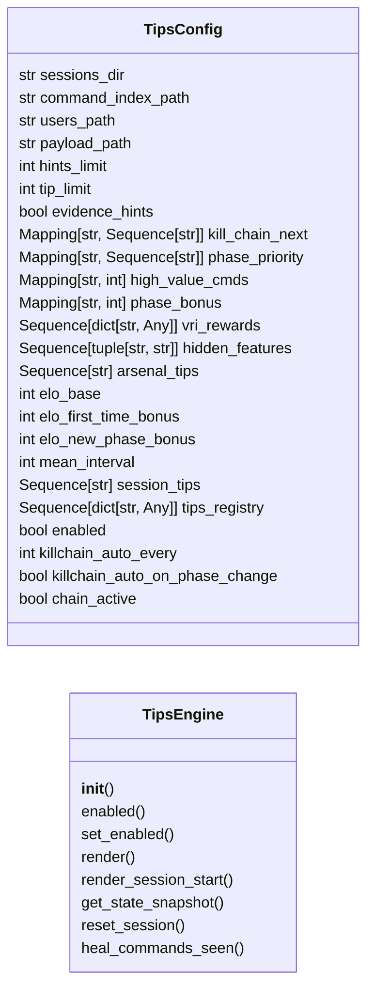
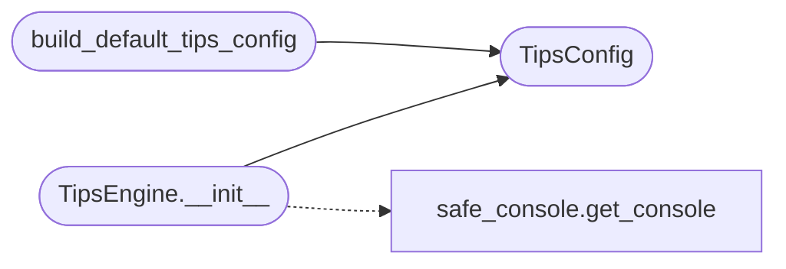

# `cli.tips_engine`

> Source: [cli/tips_engine.py:1](../../cli/tips_engine.py#L1) | language `py` | coverage 100.0% | [API index](../index.md)

Unified post-command tips engine: single coordination point for all suggestion surfaces.

Before this module, the shell registered five independent postcmd hooks that
rendered suggestion lines without coordination:
  - ``_inline_hint_hook``: kill-chain adjacency hints (reactive_hints.py)
  - ``_engagement_hook``: curiosity/VRI/ELO rewards (engagement_hooks.py)
  - ``_autosuggest_hook``: ghost-text next-command (autosuggest.py)
  - ``_toast_hook``: event toasts (toasts.py)
  - ``_recording_hook``: makerc recording

Each hook computed its own context, parsed the same transcript, and produced
overlapping or contradictory advice. The operator saw up to five different
"You should run X" lines with no coordination.

This module collapses them into one logical chain of thought:

1.  **Kill-chain adjacency hints** — fast, deterministic follow-ups from
    ``_KILL_CHAIN_NEXT`` and ``_PHASE_PRIORITY`` tables.
2.  **Contextual tips** — triggers that match session state (OS, phase,
    creds found) to surface rarely-discovered commands.
3.  **Curiosity reveal** — one undiscovered command from the same phase,
    varying within the session.
4.  **Auto-suggest refresh** — ghost-text for the next prompt (press '.').
5.  **VRI reward** — variable-interval reinforcement at unpredictable
    command counts.
6.  **ELO / karma scoring** — persistent skill tracking.

All rendering is non-blocking and respects ``ui_hints`` level. A misbehaving
surface is silently skipped; the rest continue.

Design contract (SOLID):
    - Single responsibility: coordinate rendering surfaces.
    - Open/Closed: surfaces are registered as callables; adding a surface
      means appending one entry, never modifying the engine.
    - Dependency Inversion: the engine receives its dependencies (hints
      tables, tip registry, curiosity/engagement state, autosuggest engine)
      via constructor injection, never importing lazyown.py or lazyc2.py.
    - Zero side effects beyond stdout — the engine is pure coordination.

## Contents

- **Classes:** [`TipsConfig`](#tipsconfig), [`TipsEngine`](#tipsengine)
- **Functions:** [`build_default_tips_config`](#build_default_tips_config)
- **Constants:** [`SKIP_COMMANDS`](#skip_commands)

## Type Diagram



## Call Graph

Solid arrows stay in this module, dashed arrows leave it.



## Classes

<a id="tipsconfig"></a>

### `TipsConfig`

`class` `dataclass` | [cli/tips_engine.py:137](../../cli/tips_engine.py#L137)

Decorators: `@dataclass`

```python
class TipsConfig
```

Centralised configuration for the unified tips engine.

Every magic number, path, and lookup table lives here so the engine
is testable without touching the filesystem and tunable without
editing the engine itself.

**Attributes**

| Name | Type | Default | Description |
|---|---|---|---|
| [`sessions_dir`](#tipsconfig-sessions_dir) | `str` | `DEFAULT_SESSIONS_DIR` |  |
| [`command_index_path`](#tipsconfig-command_index_path) | `str` | `DEFAULT_COMMAND_INDEX` |  |
| [`users_path`](#tipsconfig-users_path) | `str` | `DEFAULT_USERS_PATH` |  |
| [`payload_path`](#tipsconfig-payload_path) | `str` | `DEFAULT_PAYLOAD_PATH` |  |
| [`hints_limit`](#tipsconfig-hints_limit) | `int` | `3` |  |
| [`tip_limit`](#tipsconfig-tip_limit) | `int` | `1` |  |
| [`evidence_hints`](#tipsconfig-evidence_hints) | `bool` | `True` |  |
| [`kill_chain_next`](#tipsconfig-kill_chain_next) | `Mapping[str, Sequence[str]]` | `field(default_factory=dict)` |  |
| [`phase_priority`](#tipsconfig-phase_priority) | `Mapping[str, Sequence[str]]` | `field(default_factory=dict)` |  |
| [`high_value_cmds`](#tipsconfig-high_value_cmds) | `Mapping[str, int]` | `field(default_factory=dict)` |  |
| [`phase_bonus`](#tipsconfig-phase_bonus) | `Mapping[str, int]` | `field(default_factory=dict)` |  |
| [`vri_rewards`](#tipsconfig-vri_rewards) | `Sequence[dict[str, Any]]` | `field(default_factory=list)` |  |
| [`hidden_features`](#tipsconfig-hidden_features) | `Sequence[tuple[str, str]]` | `field(default_factory=list)` |  |
| [`arsenal_tips`](#tipsconfig-arsenal_tips) | `Sequence[str]` | `field(default_factory=list)` |  |
| [`elo_base`](#tipsconfig-elo_base) | `int` | `ELO_BASE` |  |
| [`elo_first_time_bonus`](#tipsconfig-elo_first_time_bonus) | `int` | `ELO_FIRST_TIME_BONUS` |  |
| [`elo_new_phase_bonus`](#tipsconfig-elo_new_phase_bonus) | `int` | `ELO_NEW_PHASE_BONUS` |  |
| [`mean_interval`](#tipsconfig-mean_interval) | `int` | `MEAN_INTERVAL` |  |
| [`session_tips`](#tipsconfig-session_tips) | `Sequence[str]` | `field(default_factory=list)` |  |
| [`tips_registry`](#tipsconfig-tips_registry) | `Sequence[dict[str, Any]]` | `field(default_factory=list)` |  |
| [`enabled`](#tipsconfig-enabled) | `bool` | `True` |  |
| [`killchain_auto_every`](#tipsconfig-killchain_auto_every) | `int` | `0` |  |
| [`killchain_auto_on_phase_change`](#tipsconfig-killchain_auto_on_phase_change) | `bool` | `True` |  |
| [`chain_active`](#tipsconfig-chain_active) | `bool` | `False` |  |
| [`hints_level`](#tipsconfig-hints_level) | `str` | `DEFAULT_UI_HINTS` |  |
| [`killchain_display`](#tipsconfig-killchain_display) | `Callable[[], None] \| None` | `None` |  |

---

<a id="tipsengine"></a>

### `TipsEngine`

`class` | [cli/tips_engine.py:186](../../cli/tips_engine.py#L186)

```python
class TipsEngine
```

Coordinate all post-command suggestion surfaces into one render pass.

The engine holds no per-call state beyond the injected config and a
reference to the autosuggest engine. Engagement state is persisted to
disk via ``sessions/engagement_state.json``.

**Members**

| Member | Kind | Summary |
|---|---|---|
| [`__init__`](#tipsengine-__init__) | constructor | Wire the engine with its configuration and optional autosuggest handle. |
| [`enabled`](#tipsengine-enabled) | property | Whether the engine renders any output. |
| [`set_enabled`](#tipsengine-set_enabled) | method | Toggle rendering without dropping state. |
| [`render`](#tipsengine-render) | method | Run all surfaces for the given command. |
| [`render_session_start`](#tipsengine-render_session_start) | method | Print a single tip at session start (once per boot). |
| [`get_state_snapshot`](#tipsengine-get_state_snapshot) | method | Return a read-only snapshot of current engagement state. |
| [`reset_session`](#tipsengine-reset_session) | method | Reset session counters without clearing cross-session progress. |
| [`heal_commands_seen`](#tipsengine-heal_commands_seen) | method | Purge non-command entries from persisted `[`commands_seen`](cli.engagement_hooks.py.md#engagementstate-commands_seen)`. |

<a id="tipsengine-__init__"></a>

#### `TipsEngine.__init__`

`constructor` | [cli/tips_engine.py:194](../../cli/tips_engine.py#L194)

```python
def __init__(self, config: TipsConfig | None = None, autosuggest_engine: Any = None) -> None
```

Wire the engine with its configuration and optional autosuggest handle.

**Parameters**

| Name | Type | Default | Description |
|---|---|---|---|
| `config` | `TipsConfig \| None` | `None` | Centralised configuration. Built from defaults when omitted. |
| `autosuggest_engine` | `Any` | `None` | An [`cli.autosuggest.AutoSuggestEngine`](cli.autosuggest.py.md#autosuggestengine) instance (or any object exposing `[`refresh`](modules.session_state.py.md#refresh)`, `[`current`](cli.autosuggest.py.md#autosuggestengine-current)`, `[`enabled`](#tipsconfig-enabled)`). |

*Calls:* [`TipsConfig`](#tipsconfig), [`get_console`](core.safe_console.py.md#get_console)

<a id="tipsengine-enabled"></a>

#### `TipsEngine.enabled`

`property` | [cli/tips_engine.py:221](../../cli/tips_engine.py#L221)

Decorators: `@property`

```python
def enabled(self) -> bool
```

Whether the engine renders any output.

**Returns:** `bool`

<a id="tipsengine-set_enabled"></a>

#### `TipsEngine.set_enabled`

`method` | [cli/tips_engine.py:225](../../cli/tips_engine.py#L225)

```python
def set_enabled(self, value: bool) -> None
```

Toggle rendering without dropping state.

**Parameters**

| Name | Type | Default | Description |
|---|---|---|---|
| `value` | `bool` |  |  |

<a id="tipsengine-render"></a>

#### `TipsEngine.render`

`method` | [cli/tips_engine.py:229](../../cli/tips_engine.py#L229)

```python
def render(self, cmd: str, phase: str = '', *, hints_level: str | None = None) -> None
```

Run all surfaces for the given command.

**Parameters**

| Name | Type | Default | Description |
|---|---|---|---|
| `cmd` | `str` |  | The command name that just executed (e.g. ``lazynmap``). |
| `phase` | `str` | `''` | Current engagement phase (e.g. ``recon``) from payload.json. |
| `hints_level` | `str \| None` | `None` | Overrides [`TipsConfig.hints_level`](#tipsconfig-hints_level) for this render. ``off`` suppresses every surface; ``minimal`` keeps only the autosuggest accelerator; ``on`` renders everything. |

<a id="tipsengine-render_session_start"></a>

#### `TipsEngine.render_session_start`

`method` | [cli/tips_engine.py:408](../../cli/tips_engine.py#L408)

```python
def render_session_start(self, phase: str = '', os_id: str = '', **ctx: Any) -> None
```

Print a single tip at session start (once per boot).

Registry tips render as plain text so a trigger-authored message
containing markup brackets can never break the render pass; the
curated `[`session_tips`](#tipsconfig-session_tips)` keep their rich markup.

**Parameters**

| Name | Type | Default | Description |
|---|---|---|---|
| `phase` | `str` | `''` | Current engagement phase. |
| `os_id` | `str` | `''` | Detected OS identifier (``"1"`` = Linux, ``"2"`` = Windows). |
| `**ctx` | `Any` |  | Additional context keys forwarded to tip triggers. |

<a id="tipsengine-get_state_snapshot"></a>

#### `TipsEngine.get_state_snapshot`

`method` | [cli/tips_engine.py:440](../../cli/tips_engine.py#L440)

```python
def get_state_snapshot(self) -> dict[str, Any]
```

Return a read-only snapshot of current engagement state.

**Returns:** `dict[str, Any]`

<a id="tipsengine-reset_session"></a>

#### `TipsEngine.reset_session`

`method` | [cli/tips_engine.py:455](../../cli/tips_engine.py#L455)

```python
def reset_session(self) -> None
```

Reset session counters without clearing cross-session progress.

<a id="tipsengine-heal_commands_seen"></a>

#### `TipsEngine.heal_commands_seen`

`method` | [cli/tips_engine.py:460](../../cli/tips_engine.py#L460)

```python
def heal_commands_seen(self, known: set[str]) -> int
```

Purge non-command entries from persisted `[`commands_seen`](cli.engagement_hooks.py.md#engagementstate-commands_seen)`.

**Parameters**

| Name | Type | Default | Description |
|---|---|---|---|
| `known` | `set[str]` |  |  |

**Returns:** `int`

---

## Functions

<a id="build_default_tips_config"></a>

### `build_default_tips_config`

`function` | [cli/tips_engine.py:1242](../../cli/tips_engine.py#L1242)

```python
def build_default_tips_config() -> TipsConfig
```

Build a [`TipsConfig`](#tipsconfig) populated from the live framework tables.

**Returns:** `TipsConfig` - A ready-to-use config wired to the static kill-chain tables, ELO
tables, and tip registries that ship with the framework.

*Calls:* [`TipsConfig`](#tipsconfig)

---

## Constants

<a id="skip_commands"></a>

### `SKIP_COMMANDS`

`constant` | [cli/tips_engine.py:71](../../cli/tips_engine.py#L71)

```python
SKIP_COMMANDS: frozenset[str] = BASE_NOISE_VERBS | TIPS_EXTRA_VERBS
```

---
