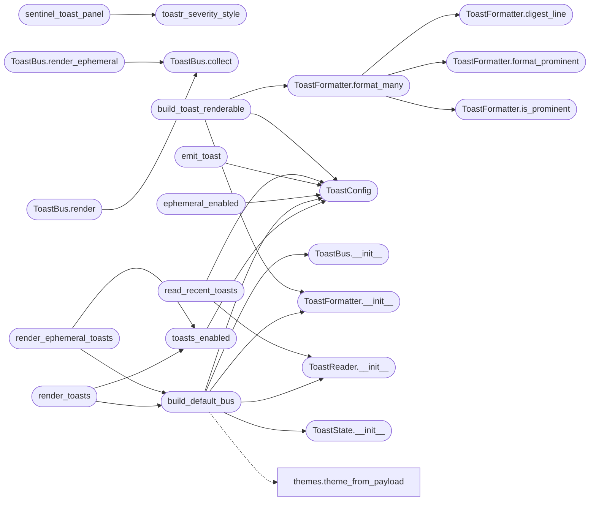

# `cli.toast_bus`

> Source: [cli/toast_bus.py:1](../../cli/toast_bus.py#L1) | language `py` | coverage 100.0% | [API index](../index.md)

Non-blocking toast notification subsystem for the LazyOwn shell.

After each command the postcmd hook calls [`render_toasts`](#render_toasts) which
tails ``sessions/*.jsonl`` event files, deduplicates events the operator
has already seen, and prints at most ``toast_max_per_tick`` formatted
lines to stdout. Toasts surface daemon decisions, beacon callbacks,
collab events, and reactive escalations without forcing the operator
into ``poll_events`` or the SSE feed.

Design (SOLID):

- Single Responsibility: [`ToastConfig`](#toastconfig) owns constants,
  [`ToastState`](#toaststate) persists the seen offsets, [`ToastReader`](#toastreader)
  reads the JSONL files, [`ToastFormatter`](#toastformatter) renders a line,
  [`ToastBus`](#toastbus) orchestrates.
- Open/Closed: a new event source is one extra entry in
  [`ToastConfig.event_files`](#toastconfig-event_files).
- Dependency Inversion: every collaborator is supplied to
  [`ToastBus`](#toastbus) through the constructor so tests substitute fakes.
- No magic numbers / hardcoded paths: every value lives in
  [`ToastConfig`](#toastconfig) and overrides flow through ``payload.json``.

## Contents

- **Classes:** [`ToastConfig`](#toastconfig), [`ToastEvent`](#toastevent), [`ToastState`](#toaststate), [`ToastReader`](#toastreader), [`ToastrConfig`](#toastrconfig), [`ToastFormatter`](#toastformatter), [`ToastBus`](#toastbus)
- **Functions:** [`toastr_severity_style`](#toastr_severity_style), [`rich_toastr_panel`](#rich_toastr_panel), [`shell_hint_bypass`](#shell_hint_bypass), [`sentinel_toast_panel`](#sentinel_toast_panel), [`toasts_enabled`](#toasts_enabled), [`build_default_bus`](#build_default_bus), [`render_toasts`](#render_toasts), [`ephemeral_enabled`](#ephemeral_enabled), [`render_ephemeral_toasts`](#render_ephemeral_toasts), [`emit_toast`](#emit_toast), [`read_recent_toasts`](#read_recent_toasts), [`build_toast_renderable`](#build_toast_renderable)
- **Constants:** [`TOASTR_SEVERITY_STYLES`](#toastr_severity_styles), [`TOASTR_DEFAULT_SEVERITY`](#toastr_default_severity)

## Type Diagram

```mermaid
classDiagram
    direction LR
    class ToastConfig
    ToastConfig : str enabled_key
    ToastConfig : str max_per_tick_key
    ToastConfig : str sessions_dir
    ToastConfig : str state_filename
    ToastConfig : tuple[str, ] event_files
    ToastConfig : bool enabled_default
    ToastConfig : int max_per_tick_default
    ToastConfig : int max_line_chars
    ToastConfig : int max_panel_width
    ToastConfig : int fallback_width
    ToastConfig : int max_offset_value
    ToastConfig : tuple[str, ] truthy_strings
    ToastConfig : tuple[str, ] falsy_strings
    ToastConfig : Mapping[str, str] severity_styles
    ToastConfig : str default_role
    ToastConfig : str truncation_suffix
    ToastConfig : tuple[str, ] prominent_roles
    ToastConfig : tuple[str, ] prominent_kinds
    ToastConfig : int prominent_max_chars
    ToastConfig : str prefix_glyph
    ToastConfig : str file_offset_separator
    ToastConfig : tuple[str, ] skip_event_types
    ToastConfig : str ephemeral_key
    ToastConfig : bool ephemeral_default
    class ToastEvent
    ToastEvent : str source
    ToastEvent : int offset
    ToastEvent : str event_type
    ToastEvent : str severity
    ToastEvent : str summary
    ToastEvent : str timestamp
    class ToastState
    ToastState : __init__()
    ToastState : path()
    ToastState : get()
    ToastState : set()
    ToastState : reset()
    ToastState : flush()
    class ToastReader
    ToastReader : __init__()
    ToastReader : root()
    ToastReader : read_unseen()
    ToastReader : resolve_sources()
    class ToastrConfig
    ToastrConfig : Mapping[str, Mapping[str, str]] severity_styles
    ToastrConfig : str default_severity
    ToastrConfig : str empty_message
    ToastrConfig : float width_fraction
    ToastrConfig : int min_width
    ToastrConfig : int max_width
    ToastrConfig : int width_margin
    ToastrConfig : int sentinel_width
    class ToastFormatter
    ToastFormatter : __init__()
    ToastFormatter : format()
    ToastFormatter : is_prominent()
    ToastFormatter : format_prominent()
    ToastFormatter : format_ephemeral()
    ToastFormatter : duration_for()
    ToastFormatter : digest_line()
    ToastFormatter : format_many()
    class ToastBus
    ToastBus : __init__()
    ToastBus : collect()
    ToastBus : render()
    ToastBus : mark_all_seen()
    ToastBus : render_ephemeral()
```



## Call Graph

Solid arrows stay in this module, dashed arrows leave it.



## Classes

<a id="toastconfig"></a>

### `ToastConfig`

`class` `dataclass` | [cli/toast_bus.py:44](../../cli/toast_bus.py#L44)

Decorators: `@dataclass(frozen=True)`

```python
class ToastConfig
```

Centralised constants for the toast subsystem.

**Attributes**

| Name | Type | Default | Description |
|---|---|---|---|
| [`enabled_key`](#toastconfig-enabled_key) | `str` | `'enable_toasts'` |  |
| [`max_per_tick_key`](#toastconfig-max_per_tick_key) | `str` | `'toast_max_per_tick'` |  |
| [`sessions_dir`](#toastconfig-sessions_dir) | `str` | `'sessions'` |  |
| [`state_filename`](#toastconfig-state_filename) | `str` | `'.toast_state.json'` |  |
| [`event_files`](#toastconfig-event_files) | `tuple[str, ...]` | `('events.jsonl', 'autonomous_events.jsonl', 'activity_*.jsonl')` |  |
| [`enabled_default`](#toastconfig-enabled_default) | `bool` | `True` |  |
| [`max_per_tick_default`](#toastconfig-max_per_tick_default) | `int` | `5` |  |
| [`max_line_chars`](#toastconfig-max_line_chars) | `int` | `96` |  |
| [`max_panel_width`](#toastconfig-max_panel_width) | `int` | `120` |  |
| [`fallback_width`](#toastconfig-fallback_width) | `int` | `80` |  |
| [`max_offset_value`](#toastconfig-max_offset_value) | `int` | `1073741824` |  |
| [`truthy_strings`](#toastconfig-truthy_strings) | `tuple[str, ...]` | `('1', 'true', 'yes', 'on')` |  |
| [`falsy_strings`](#toastconfig-falsy_strings) | `tuple[str, ...]` | `('0', 'false', 'no', 'off')` |  |
| [`severity_styles`](#toastconfig-severity_styles) | `Mapping[str, str]` | `field(default_factory=lambda: {'error': 'danger', 'danger': 'danger', 'critical': 'danger', 'warn': 'warning', 'warning': 'warning', 'info': 'accent', 'success': 'success'})` |  |
| [`default_role`](#toastconfig-default_role) | `str` | `'muted'` |  |
| [`truncation_suffix`](#toastconfig-truncation_suffix) | `str` | `'...'` |  |
| [`prominent_roles`](#toastconfig-prominent_roles) | `tuple[str, ...]` | `('danger', 'warning')` |  |
| [`prominent_kinds`](#toastconfig-prominent_kinds) | `tuple[str, ...]` | `('ENGAGE_DONE',)` |  |
| [`prominent_max_chars`](#toastconfig-prominent_max_chars) | `int` | `800` |  |
| [`prefix_glyph`](#toastconfig-prefix_glyph) | `str` | `'>>'` |  |
| [`file_offset_separator`](#toastconfig-file_offset_separator) | `str` | `'::'` |  |
| [`skip_event_types`](#toastconfig-skip_event_types) | `tuple[str, ...]` | `()` |  |
| [`ephemeral_key`](#toastconfig-ephemeral_key) | `str` | `'toast_ephemeral'` |  |
| [`ephemeral_default`](#toastconfig-ephemeral_default) | `bool` | `False` |  |
| [`ephemeral_durations`](#toastconfig-ephemeral_durations) | `Mapping[str, float]` | `field(default_factory=lambda: {'success': 3.0, 'info': 4.0, 'warning': 6.0, 'error': 8.0, 'danger': 8.0, 'critical': 8.0, 'loading': 0.0})` |  |
| [`ephemeral_default_duration`](#toastconfig-ephemeral_default_duration) | `float` | `4.0` |  |
| [`ephemeral_icons`](#toastconfig-ephemeral_icons) | `Mapping[str, str]` | `field(default_factory=lambda: {'success': '✔', 'info': 'ℹ', 'warning': '⚠', 'error': '✖', 'danger': '✖', 'critical': '✖', 'loading': '⏳'})` |  |
| [`ephemeral_max_chars`](#toastconfig-ephemeral_max_chars) | `int` | `200` |  |

---

<a id="toastevent"></a>

### `ToastEvent`

`class` `dataclass` | [cli/toast_bus.py:112](../../cli/toast_bus.py#L112)

Decorators: `@dataclass(frozen=True)`

```python
class ToastEvent
```

Immutable record produced by [`ToastReader`](#toastreader).

**Attributes**

| Name | Type | Default | Description |
|---|---|---|---|
| [`source`](#toastevent-source) | `str` |  |  |
| [`offset`](#toastevent-offset) | `int` |  |  |
| [`event_type`](#toastevent-event_type) | `str` |  |  |
| [`severity`](#toastevent-severity) | `str` |  |  |
| [`summary`](#toastevent-summary) | `str` |  |  |
| [`timestamp`](#toastevent-timestamp) | `str` |  |  |

---

<a id="toaststate"></a>

### `ToastState`

`class` | [cli/toast_bus.py:123](../../cli/toast_bus.py#L123)

```python
class ToastState
```

Persist the last byte offset consumed from each event file.

The state file lives under ``sessions/.toast_state.json``. The schema
is intentionally trivial: ``{"offsets": {"events.jsonl": 4096, ...}}``.
Atomic writes (tmp + rename) keep the file safe under SIGINT.

**Members**

| Member | Kind | Summary |
|---|---|---|
| [`__init__`](#toaststate-__init__) | constructor | Bind to config and resolve the on-disk state path. |
| [`path`](#toaststate-path) | property | Return the resolved state-file path. |
| [`get`](#toaststate-get) | method | Return the persisted offset for ``name`` or 0. |
| [`set`](#toaststate-set) | method | Record `[`offset`](#toastevent-offset)` for ``name`` in memory. |
| [`reset`](#toaststate-reset) | method | Forget every persisted offset (force replay on next read). |
| [`flush`](#toaststate-flush) | method | Persist the current offsets atomically. |

<a id="toaststate-__init__"></a>

#### `ToastState.__init__`

`constructor` | [cli/toast_bus.py:131](../../cli/toast_bus.py#L131)

```python
def __init__(self, config: ToastConfig, root: Path | None = None) -> None
```

Bind to config and resolve the on-disk state path.

**Parameters**

| Name | Type | Default | Description |
|---|---|---|---|
| `config` | `ToastConfig` |  | Active toast configuration. |
| `root` | `Path \| None` | `None` | Optional override for the sessions root directory. |

*Called by:* [`build_default_bus`](#build_default_bus)

<a id="toaststate-path"></a>

#### `ToastState.path`

`property` | [cli/toast_bus.py:146](../../cli/toast_bus.py#L146)

Decorators: `@property`

```python
def path(self) -> Path
```

Return the resolved state-file path.

**Returns:** `Path`

<a id="toaststate-get"></a>

#### `ToastState.get`

`method` | [cli/toast_bus.py:150](../../cli/toast_bus.py#L150)

```python
def get(self, name: str) -> int
```

Return the persisted offset for ``name`` or 0.

**Parameters**

| Name | Type | Default | Description |
|---|---|---|---|
| `name` | `str` |  |  |

**Returns:** `int`

<a id="toaststate-set"></a>

#### `ToastState.set`

`method` | [cli/toast_bus.py:155](../../cli/toast_bus.py#L155)

```python
def set(self, name: str, offset: int) -> None
```

Record `[`offset`](#toastevent-offset)` for ``name`` in memory.

**Parameters**

| Name | Type | Default | Description |
|---|---|---|---|
| `name` | `str` |  |  |
| `offset` | `int` |  |  |

<a id="toaststate-reset"></a>

#### `ToastState.reset`

`method` | [cli/toast_bus.py:161](../../cli/toast_bus.py#L161)

```python
def reset(self) -> None
```

Forget every persisted offset (force replay on next read).

<a id="toaststate-flush"></a>

#### `ToastState.flush`

`method` | [cli/toast_bus.py:166](../../cli/toast_bus.py#L166)

```python
def flush(self) -> bool
```

Persist the current offsets atomically.

**Returns:** `bool` - ``True`` on success, ``False`` when the filesystem rejects the
write (read-only mount, missing parent, etc.).

---

<a id="toastreader"></a>

### `ToastReader`

`class` | [cli/toast_bus.py:205](../../cli/toast_bus.py#L205)

```python
class ToastReader
```

Read unseen JSONL events from a single file via byte offset.

**Members**

| Member | Kind | Summary |
|---|---|---|
| [`__init__`](#toastreader-__init__) | constructor | Bind to config and resolve the events root directory. |
| [`root`](#toastreader-root) | property | Return the resolved events root directory. |
| [`read_unseen`](#toastreader-read_unseen) | method | Return events emitted past ``start_offset`` plus the new end offset. |
| [`resolve_sources`](#toastreader-resolve_sources) | method | Expand glob source entries against the sessions root. |

<a id="toastreader-__init__"></a>

#### `ToastReader.__init__`

`constructor` | [cli/toast_bus.py:208](../../cli/toast_bus.py#L208)

```python
def __init__(self, config: ToastConfig, root: Path | None = None) -> None
```

Bind to config and resolve the events root directory.

**Parameters**

| Name | Type | Default | Description |
|---|---|---|---|
| `config` | `ToastConfig` |  | Active configuration. |
| `root` | `Path \| None` | `None` | Optional override for the sessions root directory. |

*Called by:* [`build_default_bus`](#build_default_bus), [`read_recent_toasts`](#read_recent_toasts)

<a id="toastreader-root"></a>

#### `ToastReader.root`

`property` | [cli/toast_bus.py:219](../../cli/toast_bus.py#L219)

Decorators: `@property`

```python
def root(self) -> Path
```

Return the resolved events root directory.

**Returns:** `Path`

<a id="toastreader-read_unseen"></a>

#### `ToastReader.read_unseen`

`method` | [cli/toast_bus.py:223](../../cli/toast_bus.py#L223)

```python
def read_unseen(self, name: str, start_offset: int) -> tuple[list[ToastEvent], int]
```

Return events emitted past ``start_offset`` plus the new end offset.

**Parameters**

| Name | Type | Default | Description |
|---|---|---|---|
| `name` | `str` |  | Filename relative to the sessions root (call [`resolve_sources`](#toastreader-resolve_sources) first for glob patterns). |
| `start_offset` | `int` |  | Last persisted byte offset for this file. |

**Returns:** `tuple[list[ToastEvent], int]` - ``(events, end_offset)``. ``events`` is empty when the file is
missing, truncated, or already consumed. ``end_offset`` matches
the file size at the moment of read.

<a id="toastreader-resolve_sources"></a>

#### `ToastReader.resolve_sources`

`method` | [cli/toast_bus.py:255](../../cli/toast_bus.py#L255)

```python
def resolve_sources(self, names: tuple[str, ...]) -> tuple[tuple[str, ...], bool]
```

Expand glob source entries against the sessions root.

**Parameters**

| Name | Type | Default | Description |
|---|---|---|---|
| `names` | `tuple[str, ...]` |  | Configured source names, possibly glob patterns. |

**Returns:** `tuple[tuple[str, ...], bool]` - ``(resolved_names, changed)`` where `[`changed`](modules.LazyOwnExplorer.py.md#autocompleteentry-changed)` is True when
expansion produced anything different from the input tree.

---

<a id="toastrconfig"></a>

### `ToastrConfig`

`class` `dataclass` | [cli/toast_bus.py:433](../../cli/toast_bus.py#L433)

Decorators: `@dataclass(frozen=True)`

```python
class ToastrConfig
```

Display knobs for the inline toastr boxes every surface shares.

**Attributes**

| Name | Type | Default | Description |
|---|---|---|---|
| [`severity_styles`](#toastrconfig-severity_styles) | `Mapping[str, Mapping[str, str]]` | `field(default_factory=lambda: TOASTR_SEVERITY_STYLES)` |  |
| [`default_severity`](#toastrconfig-default_severity) | `str` | `TOASTR_DEFAULT_SEVERITY` |  |
| [`empty_message`](#toastrconfig-empty_message) | `str` | `TOASTR_EMPTY_MESSAGE` |  |
| [`width_fraction`](#toastrconfig-width_fraction) | `float` | `TOASTR_WIDTH_FRACTION` |  |
| [`min_width`](#toastrconfig-min_width) | `int` | `TOASTR_MIN_WIDTH` |  |
| [`max_width`](#toastrconfig-max_width) | `int` | `TOASTR_MAX_WIDTH` |  |
| [`width_margin`](#toastrconfig-width_margin) | `int` | `TOASTR_WIDTH_MARGIN` |  |
| [`sentinel_width`](#toastrconfig-sentinel_width) | `int` | `TOASTR_SENTINEL_WIDTH` |  |

---

<a id="toastformatter"></a>

### `ToastFormatter`

`class` | [cli/toast_bus.py:563](../../cli/toast_bus.py#L563)

```python
class ToastFormatter
```

Render a [`ToastEvent`](#toastevent) as a `rich.text.Text` line.

**Members**

| Member | Kind | Summary |
|---|---|---|
| [`__init__`](#toastformatter-__init__) | constructor | Bind to config and the active theme. |
| [`format`](#toastformatter-format) | method | Return a single themed line for `[`event`](modules.notify.py.md#notifymessage-event)`. |
| [`is_prominent`](#toastformatter-is_prominent) | method | Return True when an event deserves a full toastr panel. |
| [`format_prominent`](#toastformatter-format_prominent) | method | Render an event as a toastr panel with the complete summary. |
| [`format_ephemeral`](#toastformatter-format_ephemeral) | method | Return a single sonner-style line with severity icon for `[`event`](modules.notify.py.md#notifymessage-event)`. |
| [`duration_for`](#toastformatter-duration_for) | method | Return the auto-dismiss delay in seconds for `[`event`](modules.notify.py.md#notifymessage-event)`. |
| [`digest_line`](#toastformatter-digest_line) | staticmethod | Summarise over-budget events so none vanish silently. |
| [`format_many`](#toastformatter-format_many) | method | Render several events as one Rich renderable. |

<a id="toastformatter-__init__"></a>

#### `ToastFormatter.__init__`

`constructor` | [cli/toast_bus.py:566](../../cli/toast_bus.py#L566)

```python
def __init__(self, config: ToastConfig, theme: Theme) -> None
```

Bind to config and the active theme.

**Parameters**

| Name | Type | Default | Description |
|---|---|---|---|
| `config` | `ToastConfig` |  |  |
| `theme` | `Theme` |  |  |

*Called by:* [`build_default_bus`](#build_default_bus), [`build_toast_renderable`](#build_toast_renderable)

<a id="toastformatter-format"></a>

#### `ToastFormatter.format`

`method` | [cli/toast_bus.py:571](../../cli/toast_bus.py#L571)

```python
def format(self, event: ToastEvent) -> Text
```

Return a single themed line for `[`event`](modules.notify.py.md#notifymessage-event)`.

**Parameters**

| Name | Type | Default | Description |
|---|---|---|---|
| `event` | `ToastEvent` |  |  |

**Returns:** `Text`

<a id="toastformatter-is_prominent"></a>

#### `ToastFormatter.is_prominent`

`method` | [cli/toast_bus.py:584](../../cli/toast_bus.py#L584)

```python
def is_prominent(self, event: ToastEvent) -> bool
```

Return True when an event deserves a full toastr panel.

High-severity events and completion summaries are never squeezed
into a truncated line: they render with their complete text.

**Parameters**

| Name | Type | Default | Description |
|---|---|---|---|
| `event` | `ToastEvent` |  |  |

**Returns:** `bool`

*Called by:* [`ToastFormatter.format_many`](#toastformatter-format_many)

<a id="toastformatter-format_prominent"></a>

#### `ToastFormatter.format_prominent`

`method` | [cli/toast_bus.py:594](../../cli/toast_bus.py#L594)

```python
def format_prominent(self, event: ToastEvent) -> Panel
```

Render an event as a toastr panel with the complete summary.

**Parameters**

| Name | Type | Default | Description |
|---|---|---|---|
| `event` | `ToastEvent` |  |  |

**Returns:** `Panel`

*Called by:* [`ToastFormatter.format_many`](#toastformatter-format_many)

<a id="toastformatter-format_ephemeral"></a>

#### `ToastFormatter.format_ephemeral`

`method` | [cli/toast_bus.py:616](../../cli/toast_bus.py#L616)

```python
def format_ephemeral(self, event: ToastEvent) -> Text
```

Return a single sonner-style line with severity icon for `[`event`](modules.notify.py.md#notifymessage-event)`.

Reuses the severity-to-role table and the active theme, so the
ephemeral line never drifts from the persistent panel palette.
LAZY renders ``toast.success / error / warning / info`` with one
glyph each; this is the terminal equivalent without the ascii box.

**Parameters**

| Name | Type | Default | Description |
|---|---|---|---|
| `event` | `ToastEvent` |  | Toast event to render. |

**Returns:** `Text` - One themed Rich Text line.

<a id="toastformatter-duration_for"></a>

#### `ToastFormatter.duration_for`

`method` | [cli/toast_bus.py:644](../../cli/toast_bus.py#L644)

```python
def duration_for(self, event: ToastEvent) -> float
```

Return the auto-dismiss delay in seconds for `[`event`](modules.notify.py.md#notifymessage-event)`.

Reuses the per-severity duration table from the config, mirroring
the sonner `[`duration`](skills.unified_orchestrator.py.md#orchestratorresult-duration)` option per toast level. ``0`` means sticky.

**Parameters**

| Name | Type | Default | Description |
|---|---|---|---|
| `event` | `ToastEvent` |  | Toast event to time. |

**Returns:** `float` - Seconds before the line is erased, ``0`` for sticky.

<a id="toastformatter-digest_line"></a>

#### `ToastFormatter.digest_line`

`staticmethod` | [cli/toast_bus.py:669](../../cli/toast_bus.py#L669)

Decorators: `@staticmethod`

```python
def digest_line(dropped: list[ToastEvent]) -> str
```

Summarise over-budget events so none vanish silently.

**Parameters**

| Name | Type | Default | Description |
|---|---|---|---|
| `dropped` | `list[ToastEvent]` |  |  |

**Returns:** `str`

*Called by:* [`ToastFormatter.format_many`](#toastformatter-format_many)

<a id="toastformatter-format_many"></a>

#### `ToastFormatter.format_many`

`method` | [cli/toast_bus.py:677](../../cli/toast_bus.py#L677)

```python
def format_many(self, events: list[ToastEvent], width: int = 0) -> Any
```

Render several events as one Rich renderable.

This is the shared presentation contract. The cmd2 shell prints the
result through a Console; the Textual dashboard embeds the very same
renderable in a widget. One formatter, two surfaces, no drift.

Prominent events (high severity, completion summaries) render as
individual toastr panels with full text. Remaining lines share the
per-tick budget; over-budget ones collapse into a digest line so
no unseen notification disappears silently.

**Parameters**

| Name | Type | Default | Description |
|---|---|---|---|
| `events` | `list[ToastEvent]` |  | Events to render, oldest first. |
| `width` | `int` | `0` | Panel width. ``0`` means auto-clamp to the console width. |

**Returns:** `Any` - A ``Panel``/``Group`` for several items, a single ``Text``
line for one plain event, or ``None`` when empty.

*Calls:* [`ToastFormatter.digest_line`](#toastformatter-digest_line), [`ToastFormatter.format_prominent`](#toastformatter-format_prominent), [`ToastFormatter.is_prominent`](#toastformatter-is_prominent)

*Called by:* [`build_toast_renderable`](#build_toast_renderable)

---

<a id="toastbus"></a>

### `ToastBus`

`class` | [cli/toast_bus.py:750](../../cli/toast_bus.py#L750)

```python
class ToastBus
```

Lifecycle façade: collect → format → print.

The bus is the single class the cmd2 shell calls. Other code depends
only on `render` and [`mark_all_seen`](#toastbus-mark_all_seen).

**Members**

| Member | Kind | Summary |
|---|---|---|
| [`__init__`](#toastbus-__init__) | constructor | Bind every collaborator. |
| [`collect`](#toastbus-collect) | method | Return every unseen event across [`ToastConfig.event_files`](#toastconfig-event_files). |
| [`render`](#toastbus-render) | method | Collect, render and persist offsets in a single call. |
| [`mark_all_seen`](#toastbus-mark_all_seen) | method | Advance the offset for every configured file to its current size. |
| [`render_ephemeral`](#toastbus-render_ephemeral) | method | Collect unseen events and print each as an auto-expiring line. |

<a id="toastbus-__init__"></a>

#### `ToastBus.__init__`

`constructor` | [cli/toast_bus.py:757](../../cli/toast_bus.py#L757)

```python
def __init__(self, config: ToastConfig, state: ToastState, reader: ToastReader, formatter: ToastFormatter, console: Console | None = None) -> None
```

Bind every collaborator.

**Parameters**

| Name | Type | Default | Description |
|---|---|---|---|
| `config` | `ToastConfig` |  |  |
| `state` | `ToastState` |  |  |
| `reader` | `ToastReader` |  |  |
| `formatter` | `ToastFormatter` |  |  |
| `console` | `Console \| None` | `None` |  |

*Called by:* [`build_default_bus`](#build_default_bus)

<a id="toastbus-collect"></a>

#### `ToastBus.collect`

`method` | [cli/toast_bus.py:772](../../cli/toast_bus.py#L772)

```python
def collect(self) -> list[ToastEvent]
```

Return every unseen event across [`ToastConfig.event_files`](#toastconfig-event_files).

**Returns:** `list[ToastEvent]`

*Called by:* [`ToastBus.render`](#toastbus-render), [`ToastBus.render_ephemeral`](#toastbus-render_ephemeral)

<a id="toastbus-render"></a>

#### `ToastBus.render`

`method` | [cli/toast_bus.py:785](../../cli/toast_bus.py#L785)

```python
def render(self, enabled: bool = True) -> int
```

Collect, render and persist offsets in a single call.

When multiple toasts arrive in one tick they are wrapped in a
Rich Panel with the theme's ``warning`` border so the operator
can visually separate them from command output. A single toast
renders as a plain line to avoid unnecessary visual weight.

**Parameters**

| Name | Type | Default | Description |
|---|---|---|---|
| `enabled` | `bool` | `True` | When ``False`` the call is a no-op and returns 0. |

**Returns:** `int` - The number of toast lines actually printed.

*Calls:* [`ToastBus.collect`](#toastbus-collect)

<a id="toastbus-mark_all_seen"></a>

#### `ToastBus.mark_all_seen`

`method` | [cli/toast_bus.py:814](../../cli/toast_bus.py#L814)

```python
def mark_all_seen(self) -> None
```

Advance the offset for every configured file to its current size.

<a id="toastbus-render_ephemeral"></a>

#### `ToastBus.render_ephemeral`

`method` | [cli/toast_bus.py:822](../../cli/toast_bus.py#L822)

```python
def render_ephemeral(self, enabled: bool = True, duration: float | None = None) -> int
```

Collect unseen events and print each as an auto-expiring line.

This is the sonner port: one themed icon line per event that is
erased after its per-severity delay when the output is an
interactive TTY. On pipes or dumb terminals the lines stay printed
so logs never lose the event. Offsets persist exactly like
`render`, so both paths share the same read cursor.

**Parameters**

| Name | Type | Default | Description |
|---|---|---|---|
| `enabled` | `bool` | `True` | When ``False`` the call is a no-op and returns 0. |
| `duration` | `float \| None` | `None` | Forced seconds per toast, or None for per-level defaults from the config. ``0`` means sticky. |

**Returns:** `int` - The number of toasts raised.

*Calls:* [`ToastBus.collect`](#toastbus-collect)

---

## Functions

<a id="toastr_severity_style"></a>

### `toastr_severity_style`

`function` | [cli/toast_bus.py:449](../../cli/toast_bus.py#L449)

```python
def toastr_severity_style(severity: str) -> dict[str, str]
```

Resolve one severity into the shared border/text style pair.

**Parameters**

| Name | Type | Default | Description |
|---|---|---|---|
| `severity` | `str` |  |  |

**Returns:** `dict[str, str]`

*Called by:* [`sentinel_toast_panel`](#sentinel_toast_panel)

---

<a id="rich_toastr_panel"></a>

### `rich_toastr_panel`

`function` | [cli/toast_bus.py:456](../../cli/toast_bus.py#L456)

```python
def rich_toastr_panel(message: str, severity: str = TOASTR_DEFAULT_SEVERITY, terminal_width: int = 0, config: ToastrConfig | None = None) -> Panel
```

Build the adaptive toastr panel used by the cmd2 shell.

**Parameters**

| Name | Type | Default | Description |
|---|---|---|---|
| `message` | `str` |  | Plain single- or multi-line notification text. |
| `severity` | `str` | `TOASTR_DEFAULT_SEVERITY` | Key of the shared style table. |
| `terminal_width` | `int` | `0` | Console width; ``0`` reuses the legacy clamp. |
| `config` | `ToastrConfig \| None` | `None` | Optional display configuration override. |

**Returns:** `Panel` - A Rich Panel with adaptive width, wrapped plain text and the
unified severity styling.

*Called by:* [`LazyOwnShell.display_toastr`](lazyown.py.md#lazyownshell-display_toastr)

---

<a id="shell_hint_bypass"></a>

### `shell_hint_bypass`

`function` | [cli/toast_bus.py:509](../../cli/toast_bus.py#L509)

```python
def shell_hint_bypass(console: Any, message: str, severity: str = TOASTR_DEFAULT_SEVERITY) -> bool
```

Print the flat bypass line used when UI hints are off.

**Parameters**

| Name | Type | Default | Description |
|---|---|---|---|
| `console` | `Any` |  | Any console-like object exposing `[`print`](modules.resource_script.py.md#scriptcontext-print)`. |
| `message` | `str` |  | Notification text. |
| `severity` | `str` | `TOASTR_DEFAULT_SEVERITY` | Key of the shared style table. |

**Returns:** `bool` - Always ``True`` so callers can branch on success.

*Called by:* [`LazyOwnShell.display_toastr`](lazyown.py.md#lazyownshell-display_toastr)

---

<a id="sentinel_toast_panel"></a>

### `sentinel_toast_panel`

`function` | [cli/toast_bus.py:528](../../cli/toast_bus.py#L528)

```python
def sentinel_toast_panel(file_name: str, relevant_info: str, commands: str, details: str, severity: str = TOASTR_DEFAULT_SEVERITY) -> Panel
```

Build the yara sentinel popup with the shared styling.

**Parameters**

| Name | Type | Default | Description |
|---|---|---|---|
| `file_name` | `str` |  | Processed file path. |
| `relevant_info` | `str` |  | Sentinel summary. |
| `commands` | `str` |  | Suggested shell commands. |
| `details` | `str` |  | Alert details block. |
| `severity` | `str` | `TOASTR_DEFAULT_SEVERITY` | Sentinel alert level. |

**Returns:** `Panel` - A Rich Panel preserving the sentinel field layout.

*Calls:* [`toastr_severity_style`](#toastr_severity_style)

*Called by:* [`App.display_toastr`](lazy_sentinel4.py.md#app-display_toastr)

---

<a id="toasts_enabled"></a>

### `toasts_enabled`

`function` | [cli/toast_bus.py:920](../../cli/toast_bus.py#L920)

```python
def toasts_enabled(payload: Mapping[str, Any] | None, config: ToastConfig | None = None) -> bool
```

Return ``True`` when toast rendering is permitted.

**Parameters**

| Name | Type | Default | Description |
|---|---|---|---|
| `payload` | `Mapping[str, Any] \| None` |  |  |
| `config` | `ToastConfig \| None` | `None` |  |

**Returns:** `bool`

*Calls:* [`ToastConfig`](#toastconfig)

*Called by:* [`render_ephemeral_toasts`](#render_ephemeral_toasts), [`render_toasts`](#render_toasts)

---

<a id="build_default_bus"></a>

### `build_default_bus`

`function` | [cli/toast_bus.py:943](../../cli/toast_bus.py#L943)

```python
def build_default_bus(payload: Mapping[str, Any] | None, sessions_dir: str | None = None, console: Console | None = None) -> ToastBus
```

Wire the canonical bus used by the shell postcmd hook.

**Parameters**

| Name | Type | Default | Description |
|---|---|---|---|
| `payload` | `Mapping[str, Any] \| None` |  | Loaded ``payload.json``. |
| `sessions_dir` | `str \| None` | `None` | Optional override for the sessions root. |
| `console` | `Console \| None` | `None` | Optional Rich console (tests inject a captured one). |

**Returns:** `ToastBus` - A ready-to-use [`ToastBus`](#toastbus) instance.

*Calls:* [`theme_from_payload`](cli.themes.py.md#theme_from_payload), [`ToastBus.__init__`](#toastbus-__init__), [`ToastConfig`](#toastconfig), [`ToastFormatter.__init__`](#toastformatter-__init__), [`ToastReader.__init__`](#toastreader-__init__), [`ToastState.__init__`](#toaststate-__init__)

*Called by:* [`render_ephemeral_toasts`](#render_ephemeral_toasts), [`render_toasts`](#render_toasts)

---

<a id="render_toasts"></a>

### `render_toasts`

`function` | [cli/toast_bus.py:972](../../cli/toast_bus.py#L972)

```python
def render_toasts(payload: Mapping[str, Any] | None, sessions_dir: str | None = None, console: Console | None = None, bus_factory: Callable[[], ToastBus] | None = None) -> int
```

One-shot helper used by the cmd2 postcmd hook.

**Parameters**

| Name | Type | Default | Description |
|---|---|---|---|
| `payload` | `Mapping[str, Any] \| None` |  | Loaded ``payload.json``. |
| `sessions_dir` | `str \| None` | `None` | Optional override for the sessions root. |
| `console` | `Console \| None` | `None` | Optional pre-built Rich console. |
| `bus_factory` | `Callable[[], ToastBus] \| None` | `None` | Optional factory returning a pre-built [`ToastBus`](#toastbus) (used by tests). |

**Returns:** `int` - Number of toast lines printed; ``0`` when disabled or quiet.

*Calls:* [`build_default_bus`](#build_default_bus), [`toasts_enabled`](#toasts_enabled)

*Called by:* [`UxCommandSet.do_toast`](cli.commands.ux.py.md#uxcommandset-do_toast)

---

<a id="ephemeral_enabled"></a>

### `ephemeral_enabled`

`function` | [cli/toast_bus.py:996](../../cli/toast_bus.py#L996)

```python
def ephemeral_enabled(payload: Mapping[str, Any] | None, config: ToastConfig | None = None) -> bool
```

Return True when toasts must auto-dismiss like sonner.

**Parameters**

| Name | Type | Default | Description |
|---|---|---|---|
| `payload` | `Mapping[str, Any] \| None` |  | Loaded ``payload.json``. |
| `config` | `ToastConfig \| None` | `None` | Optional active configuration. |

**Returns:** `bool` - Value of the ``toast_ephemeral`` payload flag.

*Calls:* [`ToastConfig`](#toastconfig)

---

<a id="render_ephemeral_toasts"></a>

### `render_ephemeral_toasts`

`function` | [cli/toast_bus.py:1012](../../cli/toast_bus.py#L1012)

```python
def render_ephemeral_toasts(payload: Mapping[str, Any] | None, sessions_dir: str | None = None, console: Console | None = None, duration: float | None = None, bus_factory: Callable[[], ToastBus] | None = None) -> int
```

Collect unseen events and print each as an auto-expiring line.

Same read cursor and theme as [`render_toasts`](#render_toasts); only the
presentation differs: one sonner-style icon line per event instead of
the persistent ascii panel.

**Parameters**

| Name | Type | Default | Description |
|---|---|---|---|
| `payload` | `Mapping[str, Any] \| None` |  | Loaded ``payload.json``. |
| `sessions_dir` | `str \| None` | `None` | Optional override for the sessions root. |
| `console` | `Console \| None` | `None` | Optional pre-built Rich console. |
| `duration` | `float \| None` | `None` | Forced seconds per toast, or None for per-level defaults. |
| `bus_factory` | `Callable[[], ToastBus] \| None` | `None` | Optional factory returning a pre-built [`ToastBus`](#toastbus) (used by tests). |

**Returns:** `int` - Number of toasts raised; ``0`` when disabled or quiet.

*Calls:* [`build_default_bus`](#build_default_bus), [`toasts_enabled`](#toasts_enabled)

*Called by:* [`UxCommandSet.do_toast`](cli.commands.ux.py.md#uxcommandset-do_toast)

---

<a id="emit_toast"></a>

### `emit_toast`

`function` | [cli/toast_bus.py:1042](../../cli/toast_bus.py#L1042)

```python
def emit_toast(message: str, severity: str = 'info', event_type: str = 'note', sessions_dir: str | None = None, config: ToastConfig | None = None) -> bool
```

Append one toast event so the existing render hook displays it.

The emitter lives beside the reader on purpose: the JSONL schema is
owned by this module, so writing an event anywhere else would let the
two sides drift. The cmd2 postcmd hook picks the line up on the next
command, or immediately via [`render_toasts`](#render_toasts).

**Parameters**

| Name | Type | Default | Description |
|---|---|---|---|
| `message` | `str` |  | Human-readable one-liner. |
| `severity` | `str` | `'info'` | One of the keys in `[`ToastConfig.severity_styles`](#toastconfig-severity_styles)`. |
| `event_type` | `str` | `'note'` | Short label rendered before the message. |
| `sessions_dir` | `str \| None` | `None` | Override for the sessions root. |
| `config` | `ToastConfig \| None` | `None` | Optional active configuration. |

**Returns:** `bool` - True when the event was appended, False on any write failure.

*Calls:* [`ToastConfig`](#toastconfig)

*Called by:* [`UxCommandSet.do_toast`](cli.commands.ux.py.md#uxcommandset-do_toast)

---

<a id="read_recent_toasts"></a>

### `read_recent_toasts`

`function` | [cli/toast_bus.py:1087](../../cli/toast_bus.py#L1087)

```python
def read_recent_toasts(sessions_dir: str | None = None, limit: int = 5, config: ToastConfig | None = None) -> list[ToastEvent]
```

Return the most recent toast events without touching read offsets.

The dashboard is a read-only mirror. If it consumed events through
[`ToastBus.collect`](#toastbus-collect) it would advance the shared
``sessions/.toast_state.json`` cursor and the cmd2 shell would never
show those events. Tailing the file keeps both surfaces independent.

**Parameters**

| Name | Type | Default | Description |
|---|---|---|---|
| `sessions_dir` | `str \| None` | `None` | Override for the sessions root. |
| `limit` | `int` | `5` | Maximum number of events returned, newest last. |
| `config` | `ToastConfig \| None` | `None` | Optional active configuration. |

**Returns:** `list[ToastEvent]` - Up to ``limit`` events, oldest first. Empty when the file is
missing or unreadable.

*Calls:* [`ToastConfig`](#toastconfig), [`ToastReader.__init__`](#toastreader-__init__)

---

<a id="build_toast_renderable"></a>

### `build_toast_renderable`

`function` | [cli/toast_bus.py:1131](../../cli/toast_bus.py#L1131)

```python
def build_toast_renderable(events: list[ToastEvent], payload: Mapping[str, Any] | None = None, width: int = 0, config: ToastConfig | None = None) -> Any
```

Render events with the active theme for any surface.

**Parameters**

| Name | Type | Default | Description |
|---|---|---|---|
| `events` | `list[ToastEvent]` |  | Events to render. |
| `payload` | `Mapping[str, Any] \| None` | `None` | Loaded payload used to resolve the theme. |
| `width` | `int` | `0` | Panel width. ``0`` means auto. |
| `config` | `ToastConfig \| None` | `None` | Optional active configuration. |

**Returns:** `Any` - A Rich renderable, or ``None`` when there is nothing to show.

*Calls:* [`theme_from_payload`](cli.themes.py.md#theme_from_payload), [`ToastConfig`](#toastconfig), [`ToastFormatter.__init__`](#toastformatter-__init__), [`ToastFormatter.format_many`](#toastformatter-format_many)

---

## Constants

<a id="toastr_severity_styles"></a>

### `TOASTR_SEVERITY_STYLES`

`constant` | [cli/toast_bus.py:406](../../cli/toast_bus.py#L406)

```python
TOASTR_SEVERITY_STYLES: Mapping[str, Mapping[str, str]]
```

---

<a id="toastr_default_severity"></a>

### `TOASTR_DEFAULT_SEVERITY`

`constant` | [cli/toast_bus.py:417](../../cli/toast_bus.py#L417)

```python
TOASTR_DEFAULT_SEVERITY = 'info'
```

---
