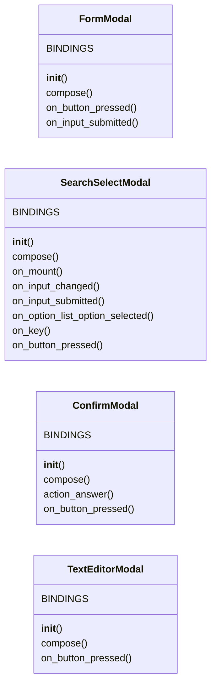

# `cli.tui_forms`

> Source: [cli/tui_forms.py:1](../../cli/tui_forms.py#L1) | language `py` | coverage 100.0% | [API index](../index.md)

Reusable Textual modals shared by the LazyOwn operator consoles.

``lazy_orchestrator`` and the marketplace manager need the same building
blocks: a key/value form, a searchable picker, a destructive-action
confirmation, and a raw YAML editor. Keeping them in one module avoids
two slightly different modal implementations drifting apart.

The apps only need to expose the shared CSS classes (``modal-box``,
``modal-title``, ``modal-label``, ``modal-hint``, ``modal-error``).

## Contents

- **Classes:** [`FormModal`](#formmodal), [`SearchSelectModal`](#searchselectmodal), [`ConfirmModal`](#confirmmodal), [`TextEditorModal`](#texteditormodal)
- **Functions:** [`filter_candidates`](#filter_candidates)

## Type Diagram



## Classes

<a id="formmodal"></a>

### `FormModal`

`class` | [cli/tui_forms.py:63](../../cli/tui_forms.py#L63)

```python
class FormModal(ModalScreen[dict])
```

Bases: `ModalScreen[dict]`

Generic key/value modal with optional pre-filled defaults.

**Attributes**

| Name | Type | Default | Description |
|---|---|---|---|
| [`BINDINGS`](#formmodal-bindings) |  | `[('escape', 'dismiss(None)', 'cancel')]` |  |

**Members**

| Member | Kind | Summary |
|---|---|---|
| [`__init__`](#formmodal-__init__) | constructor | Store the title, ``(id, label, placeholder)`` fields and defaults. |
| [`compose`](#formmodal-compose) | method | One labeled input per field plus the save button. |
| [`on_button_pressed`](#formmodal-on_button_pressed) | method | Save closes the modal with every field value. |
| [`on_input_submitted`](#formmodal-on_input_submitted) | method | Enter commits the form like the save button. |

<a id="formmodal-__init__"></a>

#### `FormModal.__init__`

`constructor` | [cli/tui_forms.py:68](../../cli/tui_forms.py#L68)

```python
def __init__(self, title: str, fields: Iterable[tuple[str, str, str]], defaults: dict[str, str] | None = None, save_label: str = 'Save') -> None
```

Store the title, ``(id, label, placeholder)`` fields and defaults.

**Parameters**

| Name | Type | Default | Description |
|---|---|---|---|
| `title` | `str` |  |  |
| `fields` | `Iterable[tuple[str, str, str]]` |  |  |
| `defaults` | `dict[str, str] \| None` | `None` |  |
| `save_label` | `str` | `'Save'` |  |

*Called by:* [`LazyOrchestratorApp.action_add_item`](cli.lazy_orchestrator.py.md#lazyorchestratorapp-action_add_item), [`LazyOrchestratorApp.action_edit_item`](cli.lazy_orchestrator.py.md#lazyorchestratorapp-action_edit_item), [`MarketplaceConfigApp.action_create`](cli.marketplace_config.py.md#marketplaceconfigapp-action_create)

<a id="formmodal-compose"></a>

#### `FormModal.compose`

`method` `generator` | [cli/tui_forms.py:82](../../cli/tui_forms.py#L82)

```python
def compose(self) -> ComposeResult
```

One labeled input per field plus the save button.

**Returns:** `ComposeResult`

<a id="formmodal-on_button_pressed"></a>

#### `FormModal.on_button_pressed`

`method` | [cli/tui_forms.py:102](../../cli/tui_forms.py#L102)

```python
def on_button_pressed(self, event: Button.Pressed) -> None
```

Save closes the modal with every field value.

**Parameters**

| Name | Type | Default | Description |
|---|---|---|---|
| `event` | `Button.Pressed` |  |  |

<a id="formmodal-on_input_submitted"></a>

#### `FormModal.on_input_submitted`

`method` | [cli/tui_forms.py:107](../../cli/tui_forms.py#L107)

```python
def on_input_submitted(self, event: Input.Submitted) -> None
```

Enter commits the form like the save button.

**Parameters**

| Name | Type | Default | Description |
|---|---|---|---|
| `event` | `Input.Submitted` |  |  |

---

<a id="searchselectmodal"></a>

### `SearchSelectModal`

`class` | [cli/tui_forms.py:112](../../cli/tui_forms.py#L112)

```python
class SearchSelectModal(ModalScreen[str | None])
```

Bases: `ModalScreen[str | None]`

Searchable select with a free-text fallback.

The operator types to filter an ``OptionList``. Enter selects the
highlighted row, or returns the typed text when no row matches so a
new command name can still be registered without leaving the modal.

**Attributes**

| Name | Type | Default | Description |
|---|---|---|---|
| [`BINDINGS`](#searchselectmodal-bindings) |  | `[('escape', 'dismiss(None)', 'cancel')]` |  |

**Members**

| Member | Kind | Summary |
|---|---|---|
| [`__init__`](#searchselectmodal-__init__) | constructor | Store the title, candidate pairs and placeholder. |
| [`compose`](#searchselectmodal-compose) | method | Search box, filtered option list and action buttons. |
| [`on_mount`](#searchselectmodal-on_mount) | method | Render the first page and focus the search box. |
| [`on_input_changed`](#searchselectmodal-on_input_changed) | method | Filter as the operator types. |
| [`on_input_submitted`](#searchselectmodal-on_input_submitted) | method | Enter accepts the highlighted row or the typed custom value. |
| [`on_option_list_option_selected`](#searchselectmodal-on_option_list_option_selected) | method | Clicking or pressing Enter on a row selects it. |
| [`on_key`](#searchselectmodal-on_key) | method | Move focus into the list with the arrow keys. |
| [`on_button_pressed`](#searchselectmodal-on_button_pressed) | method | Select and cancel buttons. |

<a id="searchselectmodal-__init__"></a>

#### `SearchSelectModal.__init__`

`constructor` | [cli/tui_forms.py:122](../../cli/tui_forms.py#L122)

```python
def __init__(self, title: str, options: Sequence[tuple[str, str]], placeholder: str = 'type to filter', allow_custom: bool = True) -> None
```

Store the title, candidate pairs and placeholder.

**Parameters**

| Name | Type | Default | Description |
|---|---|---|---|
| `title` | `str` |  |  |
| `options` | `Sequence[tuple[str, str]]` |  |  |
| `placeholder` | `str` | `'type to filter'` |  |
| `allow_custom` | `bool` | `True` |  |

*Called by:* [`LazyOrchestratorApp.action_add_item`](cli.lazy_orchestrator.py.md#lazyorchestratorapp-action_add_item)

<a id="searchselectmodal-compose"></a>

#### `SearchSelectModal.compose`

`method` `generator` | [cli/tui_forms.py:136](../../cli/tui_forms.py#L136)

```python
def compose(self) -> ComposeResult
```

Search box, filtered option list and action buttons.

**Returns:** `ComposeResult`

<a id="searchselectmodal-on_mount"></a>

#### `SearchSelectModal.on_mount`

`method` | [cli/tui_forms.py:147](../../cli/tui_forms.py#L147)

```python
def on_mount(self) -> None
```

Render the first page and focus the search box.

<a id="searchselectmodal-on_input_changed"></a>

#### `SearchSelectModal.on_input_changed`

`method` | [cli/tui_forms.py:201](../../cli/tui_forms.py#L201)

```python
def on_input_changed(self, event: Input.Changed) -> None
```

Filter as the operator types.

**Parameters**

| Name | Type | Default | Description |
|---|---|---|---|
| `event` | `Input.Changed` |  |  |

<a id="searchselectmodal-on_input_submitted"></a>

#### `SearchSelectModal.on_input_submitted`

`method` | [cli/tui_forms.py:206](../../cli/tui_forms.py#L206)

```python
def on_input_submitted(self, event: Input.Submitted) -> None
```

Enter accepts the highlighted row or the typed custom value.

**Parameters**

| Name | Type | Default | Description |
|---|---|---|---|
| `event` | `Input.Submitted` |  |  |

<a id="searchselectmodal-on_option_list_option_selected"></a>

#### `SearchSelectModal.on_option_list_option_selected`

`method` | [cli/tui_forms.py:211](../../cli/tui_forms.py#L211)

```python
def on_option_list_option_selected(self, event: OptionList.OptionSelected) -> None
```

Clicking or pressing Enter on a row selects it.

**Parameters**

| Name | Type | Default | Description |
|---|---|---|---|
| `event` | `OptionList.OptionSelected` |  |  |

<a id="searchselectmodal-on_key"></a>

#### `SearchSelectModal.on_key`

`method` | [cli/tui_forms.py:220](../../cli/tui_forms.py#L220)

```python
def on_key(self, event) -> None
```

Move focus into the list with the arrow keys.

**Parameters**

| Name | Type | Default | Description |
|---|---|---|---|
| `event` |  |  |  |

<a id="searchselectmodal-on_button_pressed"></a>

#### `SearchSelectModal.on_button_pressed`

`method` | [cli/tui_forms.py:239](../../cli/tui_forms.py#L239)

```python
def on_button_pressed(self, event: Button.Pressed) -> None
```

Select and cancel buttons.

**Parameters**

| Name | Type | Default | Description |
|---|---|---|---|
| `event` | `Button.Pressed` |  |  |

---

<a id="confirmmodal"></a>

### `ConfirmModal`

`class` | [cli/tui_forms.py:247](../../cli/tui_forms.py#L247)

```python
class ConfirmModal(ModalScreen[bool])
```

Bases: `ModalScreen[bool]`

Small yes/no modal for destructive file actions.

**Attributes**

| Name | Type | Default | Description |
|---|---|---|---|
| [`BINDINGS`](#confirmmodal-bindings) |  | `[Binding('y', 'answer(True)', 'Yes'), Binding('n', 'answer(False)', 'No'), Binding('escape', 'answer(False)', 'Cancel')]` |  |

**Members**

| Member | Kind | Summary |
|---|---|---|
| [`__init__`](#confirmmodal-__init__) | constructor | Store the prompt. |
| [`compose`](#confirmmodal-compose) | method | Prompt plus yes/no buttons. |
| [`action_answer`](#confirmmodal-action_answer) | method | Dismiss with the operator's answer. |
| [`on_button_pressed`](#confirmmodal-on_button_pressed) | method | Wire the two buttons to the same answer action. |

<a id="confirmmodal-__init__"></a>

#### `ConfirmModal.__init__`

`constructor` | [cli/tui_forms.py:256](../../cli/tui_forms.py#L256)

```python
def __init__(self, title: str, body: str = '') -> None
```

Store the prompt.

**Parameters**

| Name | Type | Default | Description |
|---|---|---|---|
| `title` | `str` |  |  |
| `body` | `str` | `''` |  |

*Called by:* [`LazyOrchestratorApp.action_delete_item`](cli.lazy_orchestrator.py.md#lazyorchestratorapp-action_delete_item), [`MarketplaceConfigApp.action_delete`](cli.marketplace_config.py.md#marketplaceconfigapp-action_delete)

<a id="confirmmodal-compose"></a>

#### `ConfirmModal.compose`

`method` `generator` | [cli/tui_forms.py:262](../../cli/tui_forms.py#L262)

```python
def compose(self) -> ComposeResult
```

Prompt plus yes/no buttons.

**Returns:** `ComposeResult`

<a id="confirmmodal-action_answer"></a>

#### `ConfirmModal.action_answer`

`method` | [cli/tui_forms.py:272](../../cli/tui_forms.py#L272)

```python
def action_answer(self, answer: bool) -> None
```

Dismiss with the operator's answer.

**Parameters**

| Name | Type | Default | Description |
|---|---|---|---|
| `answer` | `bool` |  |  |

<a id="confirmmodal-on_button_pressed"></a>

#### `ConfirmModal.on_button_pressed`

`method` | [cli/tui_forms.py:276](../../cli/tui_forms.py#L276)

```python
def on_button_pressed(self, event: Button.Pressed) -> None
```

Wire the two buttons to the same answer action.

**Parameters**

| Name | Type | Default | Description |
|---|---|---|---|
| `event` | `Button.Pressed` |  |  |

---

<a id="texteditormodal"></a>

### `TextEditorModal`

`class` | [cli/tui_forms.py:284](../../cli/tui_forms.py#L284)

```python
class TextEditorModal(ModalScreen[str | None])
```

Bases: `ModalScreen[str | None]`

Raw text editor with a validator hook before saving.

**Parameters**

| Name | Type | Default | Description |
|---|---|---|---|
| `title` |  |  | Modal title. |
| `text` |  |  | Initial document. |
| `validator` |  |  | Optional callable raising ``ValueError`` on invalid content. The message is shown inside the modal. |
| `language` |  |  | Syntax highlighting hint (``yaml``, ``json``, ...). |
| `save_label` |  |  | Label for the save button. |

**Attributes**

| Name | Type | Default | Description |
|---|---|---|---|
| [`BINDINGS`](#texteditormodal-bindings) |  | `[('escape', 'dismiss(None)', 'cancel')]` |  |

**Members**

| Member | Kind | Summary |
|---|---|---|
| [`__init__`](#texteditormodal-__init__) | constructor | Store the title, initial document, validator and language. |
| [`compose`](#texteditormodal-compose) | method | Editor plus save/cancel buttons and an error line. |
| [`on_button_pressed`](#texteditormodal-on_button_pressed) | method | Save and cancel buttons. |

<a id="texteditormodal-__init__"></a>

#### `TextEditorModal.__init__`

`constructor` | [cli/tui_forms.py:298](../../cli/tui_forms.py#L298)

```python
def __init__(self, title: str, text: str, validator: Callable[[str], None] | None = None, language: str = 'yaml', save_label: str = 'Save') -> None
```

Store the title, initial document, validator and language.

**Parameters**

| Name | Type | Default | Description |
|---|---|---|---|
| `title` | `str` |  |  |
| `text` | `str` |  |  |
| `validator` | `Callable[[str], None] \| None` | `None` |  |
| `language` | `str` | `'yaml'` |  |
| `save_label` | `str` | `'Save'` |  |

*Called by:* [`MarketplaceConfigApp.action_edit`](cli.marketplace_config.py.md#marketplaceconfigapp-action_edit)

<a id="texteditormodal-compose"></a>

#### `TextEditorModal.compose`

`method` `generator` | [cli/tui_forms.py:314](../../cli/tui_forms.py#L314)

```python
def compose(self) -> ComposeResult
```

Editor plus save/cancel buttons and an error line.

**Returns:** `ComposeResult`

<a id="texteditormodal-on_button_pressed"></a>

#### `TextEditorModal.on_button_pressed`

`method` | [cli/tui_forms.py:338](../../cli/tui_forms.py#L338)

```python
def on_button_pressed(self, event: Button.Pressed) -> None
```

Save and cancel buttons.

**Parameters**

| Name | Type | Default | Description |
|---|---|---|---|
| `event` | `Button.Pressed` |  |  |

---

## Functions

<a id="filter_candidates"></a>

### `filter_candidates`

`function` | [cli/tui_forms.py:27](../../cli/tui_forms.py#L27)

```python
def filter_candidates(query: str, options: Sequence[tuple[str, str]], limit: int = MAX_OPTIONS) -> list[tuple[str, str]]
```

Filter ``(value, description)`` pairs by a case-insensitive query.

Ranking is deterministic and stable: prefix matches first, then
substring matches in the value, then substring matches only in the
description. Original order is preserved inside each bucket.

**Parameters**

| Name | Type | Default | Description |
|---|---|---|---|
| `query` | `str` |  | Operator input typed in the search box. |
| `options` | `Sequence[tuple[str, str]]` |  | Candidate pairs. |
| `limit` | `int` | `MAX_OPTIONS` | Maximum rows returned. |

**Returns:** `list[tuple[str, str]]` - The filtered pairs in display order.

---
