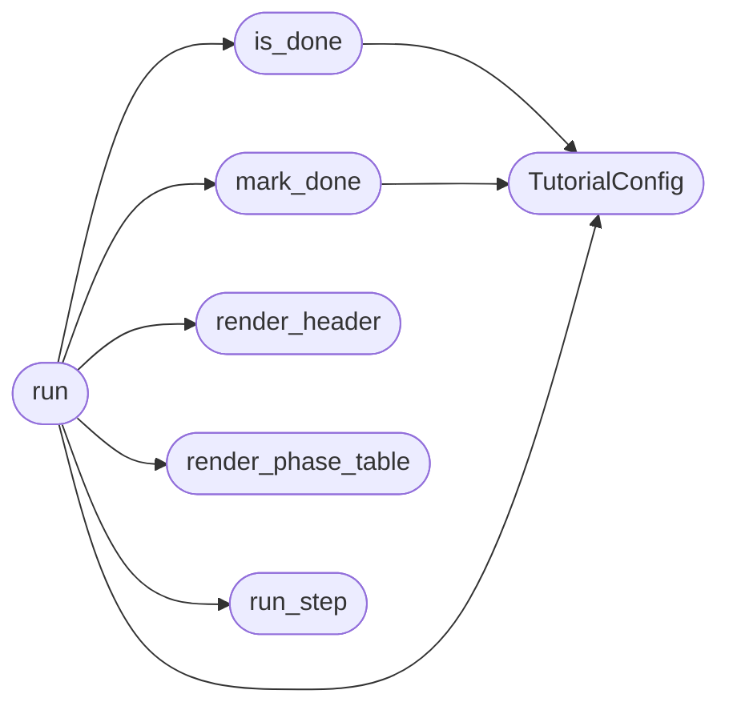

# `cli.tutorial`

> Source: [cli/tutorial.py:1](../../cli/tutorial.py#L1) | language `py` | coverage 100.0% | [API index](../index.md)

Interactive post-install tutorial for the LazyOwn framework.

Guides a new operator through the golden path:
    ping -> lazynmap -> auto_populate -> facts_show -> recommend_next

Each step explains what happens, shows the output, and suggests the next
action.  Persists completion in ``sessions/tutorial_done`` so it does not
repeat on subsequent launches.

Design contract:
    - Zero imports from ``lazyown.py`` or ``lazyc2.py``.
    - All output through ``rich.console.Console``.
    - `[`run`](#run)` receives a ``params`` dict and a ``command_runner`` callable
      so tests can stub execution without touching the shell.

## Contents

- **Classes:** [`TutorialConfig`](#tutorialconfig)
- **Functions:** [`is_done`](#is_done), [`mark_done`](#mark_done), [`render_header`](#render_header), [`render_phase_table`](#render_phase_table), [`run_step`](#run_step), [`run`](#run)
- **Constants:** [`DONE_MARKER`](#done_marker), [`PHASES`](#phases), [`FINISHED_TEXT`](#finished_text)

## Call Graph

Solid arrows stay in this module, dashed arrows leave it.



## Classes

<a id="tutorialconfig"></a>

### `TutorialConfig`

`class` `dataclass` | [cli/tutorial.py:76](../../cli/tutorial.py#L76)

Decorators: `@dataclass(frozen=True)`

```python
class TutorialConfig
```

Centralised constants for the tutorial.

**Attributes**

| Name | Type | Default | Description |
|---|---|---|---|
| [`done_marker`](#tutorialconfig-done_marker) | `Path` | `DONE_MARKER` |  |
| [`sessions_dir`](#tutorialconfig-sessions_dir) | `str` | `'sessions'` |  |

---

## Functions

<a id="is_done"></a>

### `is_done`

`function` | [cli/tutorial.py:83](../../cli/tutorial.py#L83)

```python
def is_done(config: TutorialConfig | None = None) -> bool
```

Return True if the tutorial has already been completed.

**Parameters**

| Name | Type | Default | Description |
|---|---|---|---|
| `config` | `TutorialConfig \| None` | `None` |  |

**Returns:** `bool`

*Calls:* [`TutorialConfig`](#tutorialconfig)

*Called by:* [`run`](#run)

---

<a id="mark_done"></a>

### `mark_done`

`function` | [cli/tutorial.py:89](../../cli/tutorial.py#L89)

```python
def mark_done(config: TutorialConfig | None = None) -> None
```

Persist the tutorial completion marker.

**Parameters**

| Name | Type | Default | Description |
|---|---|---|---|
| `config` | `TutorialConfig \| None` | `None` |  |

*Calls:* [`TutorialConfig`](#tutorialconfig)

*Called by:* [`run`](#run)

---

<a id="render_header"></a>

### `render_header`

`function` | [cli/tutorial.py:96](../../cli/tutorial.py#L96)

```python
def render_header() -> None
```

Print the tutorial welcome banner.

*Called by:* [`run`](#run)

---

<a id="render_phase_table"></a>

### `render_phase_table`

`function` | [cli/tutorial.py:113](../../cli/tutorial.py#L113)

```python
def render_phase_table() -> None
```

Print the full phase overview before starting.

*Called by:* [`run`](#run)

---

<a id="run_step"></a>

### `run_step`

`function` | [cli/tutorial.py:128](../../cli/tutorial.py#L128)

```python
def run_step(index: int, command: str, description: str, why: str, params: dict[str, Any], command_runner: Callable[[str], str]) -> bool
```

Execute one tutorial step and return True if the user wants to continue.

**Parameters**

| Name | Type | Default | Description |
|---|---|---|---|
| `index` | `int` |  | 1-based step number. |
| `command` | `str` |  | The command verb to execute. |
| `description` | `str` |  | One-line explanation of the command. |
| `why` | `str` |  | Why this step matters. |
| `params` | `dict[str, Any]` |  | Live payload params dict. |
| `command_runner` | `Callable[[str], str]` |  | Callable that executes a LazyOwn shell command and returns its output string. |

**Returns:** `bool` - True if the user pressed Enter to continue, False if they typed skip.

*Called by:* [`run`](#run)

---

<a id="run"></a>

### `run`

`function` | [cli/tutorial.py:185](../../cli/tutorial.py#L185)

```python
def run(params: dict[str, Any], command_runner: Callable[[str], str], *, force: bool = False, config: TutorialConfig | None = None) -> bool
```

Run the interactive tutorial.

**Parameters**

| Name | Type | Default | Description |
|---|---|---|---|
| `params` | `dict[str, Any]` |  | Live params dict (in-memory mirror of payload.json). |
| `command_runner` | `Callable[[str], str]` |  | Callable that executes a LazyOwn shell command string. |
| `force` | `bool` | `False` | When True, re-run even if already completed. |
| `config` | `TutorialConfig \| None` | `None` | Optional config override. |

**Returns:** `bool` - True if the tutorial completed, False if skipped or already done.

*Calls:* [`TutorialConfig`](#tutorialconfig), [`is_done`](#is_done), [`mark_done`](#mark_done), [`render_header`](#render_header), [`render_phase_table`](#render_phase_table), [`run_step`](#run_step)

---

## Constants

<a id="done_marker"></a>

### `DONE_MARKER`

`constant` | [cli/tutorial.py:30](../../cli/tutorial.py#L30)

```python
DONE_MARKER = Path('sessions/tutorial_done')
```

---

<a id="phases"></a>

### `PHASES`

`constant` | [cli/tutorial.py:32](../../cli/tutorial.py#L32)

```python
PHASES: tuple[tuple[str, str, str], ...]
```

---

<a id="finished_text"></a>

### `FINISHED_TEXT`

`constant` | [cli/tutorial.py:60](../../cli/tutorial.py#L60)

```python
FINISHED_TEXT
```

---
