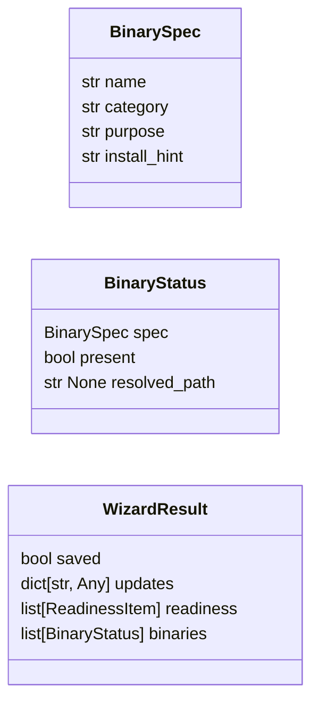
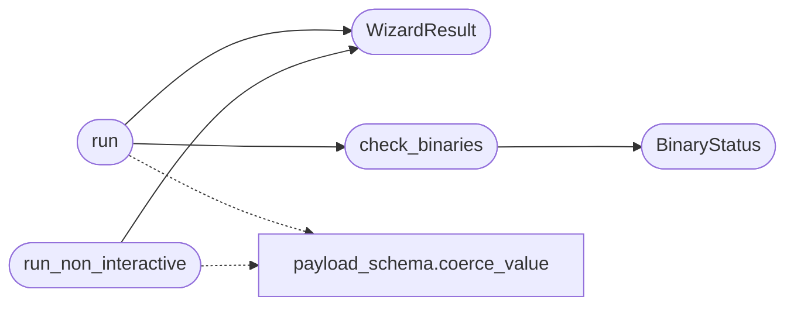

# `cli.wizard`

> Source: [cli/wizard.py:1](../../cli/wizard.py#L1) | language `py` | coverage 100.0% | [API index](../index.md)

Guided first-run setup wizard for the LazyOwn framework.

Walks the operator through the minimum viable configuration:
  rhost, lhost, domain, device, os_id, api_key, wordlist paths.

Auto-detects sensible defaults (lhost from routing table, device from ip route,
SecLists paths on disk) so experts can just press Enter while novices get clear
explanations of every value.

Design contract:
  - Zero imports from lazyown.py or lazyc2.py (Dependency Inversion).
  - The `[`run`](#run)` function takes a ``params`` dict and a ``save`` callable; it
    never touches payload.json directly.
  - All output goes through rich so colours work on all terminals.
  - Ctrl-C at any prompt exits the wizard cleanly without saving partial state.

## Contents

- **Classes:** [`BinarySpec`](#binaryspec), [`BinaryStatus`](#binarystatus), [`WizardResult`](#wizardresult)
- **Functions:** [`run`](#run), [`run_non_interactive`](#run_non_interactive), [`check_binaries`](#check_binaries)

## Type Diagram



## Call Graph

Solid arrows stay in this module, dashed arrows leave it.



## Classes

<a id="binaryspec"></a>

### `BinarySpec`

`class` `dataclass` | [cli/wizard.py:90](../../cli/wizard.py#L90)

Decorators: `@dataclass(frozen=True)`

```python
class BinarySpec
```

Declarative description of an external tool the framework relies on.

The wizard verifies presence only — it never executes the binary so a
malicious shadow ``PATH`` entry cannot be triggered by the readiness
check itself.

**Attributes**

| Name | Type | Default | Description |
|---|---|---|---|
| [`name`](#binaryspec-name) | `str` |  | Executable name as it should appear on ``PATH``. Must satisfy `_BINARY_NAME_RE` so logging is safe and the value cannot inject shell metacharacters. |
| [`category`](#binaryspec-category) | `str` |  | Human-readable group used to bucket the report (recon, web, smb, ad, exploit, c2). |
| [`purpose`](#binaryspec-purpose) | `str` |  | One-line description of why LazyOwn needs the tool. |
| [`install_hint`](#binaryspec-install_hint) | `str` |  | Operator-facing install command shown when the binary is missing. Static string — never interpolated. |

---

<a id="binarystatus"></a>

### `BinaryStatus`

`class` `dataclass` | [cli/wizard.py:141](../../cli/wizard.py#L141)

Decorators: `@dataclass`

```python
class BinaryStatus
```

Result of a presence check for a single [`BinarySpec`](#binaryspec).

**Attributes**

| Name | Type | Default | Description |
|---|---|---|---|
| [`spec`](#binarystatus-spec) | `BinarySpec` |  |  |
| [`present`](#binarystatus-present) | `bool` |  |  |
| [`resolved_path`](#binarystatus-resolved_path) | `str \| None` | `None` |  |

---

<a id="wizardresult"></a>

### `WizardResult`

`class` `dataclass` | [cli/wizard.py:160](../../cli/wizard.py#L160)

Decorators: `@dataclass`

```python
class WizardResult
```

Outcome returned by [`run`](#run).

**Attributes**

| Name | Type | Default | Description |
|---|---|---|---|
| [`saved`](#wizardresult-saved) | `bool` | `False` |  |
| [`updates`](#wizardresult-updates) | `dict[str, Any]` | `field(default_factory=dict)` |  |
| [`readiness`](#wizardresult-readiness) | `list[ReadinessItem]` | `field(default_factory=list)` |  |
| [`binaries`](#wizardresult-binaries) | `list[BinaryStatus]` | `field(default_factory=list)` |  |

---

## Functions

<a id="run"></a>

### `run`

`function` | [cli/wizard.py:169](../../cli/wizard.py#L169)

```python
def run(params: dict[str, Any], save: Callable[[str, Any], None], *, tutorial: bool = False) -> WizardResult
```

Run the interactive setup wizard and return a [`WizardResult`](#wizardresult).

**Parameters**

| Name | Type | Default | Description |
|---|---|---|---|
| `params` | `dict[str, Any]` |  | Live params dict (in-memory mirror of payload.json). |
| `save` | `Callable[[str, Any], None]` |  | Callback to persist a single key/value pair. Signature: ``save(key: str, value: Any) -> None``. Called only for values the operator explicitly accepted. |
| `tutorial` | `bool` | `False` | When ``True`` each step prints the extended help from [`core.payload_schema.SCHEMA`](core.payload_schema.py.md#schema) so first-time operators understand *why* each value matters. Veterans omit this and just see the auto-detected defaults. |

**Returns:** `WizardResult` - WizardResult with ``saved=True`` when at least one value was written.

*Calls:* [`WizardResult`](#wizardresult), [`check_binaries`](#check_binaries), [`coerce_value`](core.payload_schema.py.md#coerce_value)

---

<a id="run_non_interactive"></a>

### `run_non_interactive`

`function` | [cli/wizard.py:234](../../cli/wizard.py#L234)

```python
def run_non_interactive(params: dict[str, Any], save: Callable[[str, Any], None], values: dict[str, Any], *, auto_detect: bool = True) -> WizardResult
```

Apply configuration without prompts — Docker/CI/headless first runs.

**Parameters**

| Name | Type | Default | Description |
|---|---|---|---|
| `params` | `dict[str, Any]` |  | Live params dict (in-memory mirror of payload.json). |
| `save` | `Callable[[str, Any], None]` |  | Persistence callback, same contract as [`run`](#run). |
| `values` | `dict[str, Any]` |  | Keys to apply (``rhost``, ``lhost``, ``domain``, `[`device`](lazyown.py.md#lazyownshell-device)`, ``os_id``, ``api_key``). ``None`` values are ignored. |
| `auto_detect` | `bool` | `True` | When ``True`` (default), fill still-empty ``lhost`` / `[`device`](lazyown.py.md#lazyownshell-device)` from the routing table and wordlist paths from SecLists, mirroring the interactive wizard's detected defaults. |

**Returns:** `WizardResult` - WizardResult with ``saved=True`` when at least one value was written.

*Calls:* [`WizardResult`](#wizardresult), [`coerce_value`](core.payload_schema.py.md#coerce_value)

---

<a id="check_binaries"></a>

### `check_binaries`

`function` | [cli/wizard.py:947](../../cli/wizard.py#L947)

```python
def check_binaries(specs: Sequence[BinarySpec] = _REQUIRED_BINARIES, which: Callable[[str], str | None] = shutil.which) -> list[BinaryStatus]
```

Return the presence status of every spec without executing it.

The check is intentionally side-effect free: it only resolves the
binary on ``PATH`` via ``shutil.which`` (or the caller-supplied
equivalent in tests) and never spawns the discovered process. That
keeps the readiness step deterministic and removes the risk that a
poisoned ``PATH`` entry could be triggered just by running ``wizard``.

**Parameters**

| Name | Type | Default | Description |
|---|---|---|---|
| `specs` | `Sequence[BinarySpec]` | `_REQUIRED_BINARIES` | Iterable of [`BinarySpec`](#binaryspec) definitions to verify. Defaults to `_REQUIRED_BINARIES`. |
| `which` | `Callable[[str], str \| None]` | `shutil.which` | ``shutil.which``-compatible callable. Injected so unit tests can stub presence detection without touching the real ``PATH``. |

**Returns:** `list[BinaryStatus]` - A list of [`BinaryStatus`](#binarystatus) items in the same order as
``specs``. Binaries whose name fails `_BINARY_NAME_RE`
are skipped defensively — the module-level constants always
match, but this guards against future contributions adding
unsafe entries by mistake.

*Calls:* [`BinaryStatus`](#binarystatus)

*Called by:* [`run`](#run)

---
