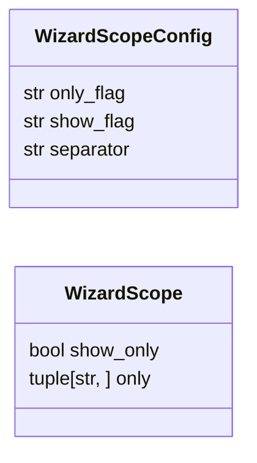
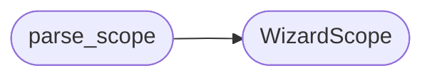

# `cli.wizard_scope`

> Source: [cli/wizard_scope.py:1](../../cli/wizard_scope.py#L1) | language `py` | coverage 100.0% | [API index](../index.md)

Partial wizard scope: show current state or edit selected fields only.

The full wizard walks eight steps linearly. Operators who only need to
change rhost should not pass seven unrelated prompts. This module parses
the scope flags and exposes the editable field registry so do_wizard can
run a subset without duplicating prompt logic.

## Contents

- **Classes:** [`WizardScopeConfig`](#wizardscopeconfig), [`WizardScope`](#wizardscope)
- **Functions:** [`parse_scope`](#parse_scope), [`status_rows`](#status_rows)
- **Constants:** [`DEFAULT_SCOPE_CONFIG`](#default_scope_config), [`EDITABLE_FIELDS`](#editable_fields)

## Type Diagram



## Call Graph

Solid arrows stay in this module, dashed arrows leave it.



## Classes

<a id="wizardscopeconfig"></a>

### `WizardScopeConfig`

`class` `dataclass` | [cli/wizard_scope.py:17](../../cli/wizard_scope.py#L17)

Decorators: `@dataclass(frozen=True)`

```python
class WizardScopeConfig
```

Centralized knobs for partial wizard runs.

**Attributes**

| Name | Type | Default | Description |
|---|---|---|---|
| [`only_flag`](#wizardscopeconfig-only_flag) | `str` | `'--only'` |  |
| [`show_flag`](#wizardscopeconfig-show_flag) | `str` | `'--show'` |  |
| [`separator`](#wizardscopeconfig-separator) | `str` | `','` |  |

---

<a id="wizardscope"></a>

### `WizardScope`

`class` `dataclass` | [cli/wizard_scope.py:31](../../cli/wizard_scope.py#L31)

Decorators: `@dataclass(frozen=True)`

```python
class WizardScope
```

Parsed scope for one wizard invocation.

**Attributes**

| Name | Type | Default | Description |
|---|---|---|---|
| [`show_only`](#wizardscope-show_only) | `bool` | `False` |  |
| [`only`](#wizardscope-only) | `tuple[str, ...]` | `()` |  |

---

## Functions

<a id="parse_scope"></a>

### `parse_scope`

`function` | [cli/wizard_scope.py:38](../../cli/wizard_scope.py#L38)

```python
def parse_scope(tokens: list[str], config: WizardScopeConfig = DEFAULT_SCOPE_CONFIG) -> WizardScope
```

Parse --show and --only=a,b flags from wizard tokens.

**Parameters**

| Name | Type | Default | Description |
|---|---|---|---|
| `tokens` | `list[str]` |  | Tokenised wizard arguments. |
| `config` | `WizardScopeConfig` | `DEFAULT_SCOPE_CONFIG` | Flag spellings and separator. |

**Returns:** `WizardScope` - WizardScope with show_only set and only holding validated field
names in canonical order. Unknown names are dropped.

*Calls:* [`WizardScope`](#wizardscope)

---

<a id="status_rows"></a>

### `status_rows`

`function` | [cli/wizard_scope.py:64](../../cli/wizard_scope.py#L64)

```python
def status_rows(params: Mapping[str, Any]) -> list[tuple[str, str, str]]
```

Build display rows for the current configuration state.

**Parameters**

| Name | Type | Default | Description |
|---|---|---|---|
| `params` | `Mapping[str, Any]` |  | Live payload mapping. |

**Returns:** `list[tuple[str, str, str]]` - List of (setting, value, status) with status ok or missing.

---

## Constants

<a id="default_scope_config"></a>

### `DEFAULT_SCOPE_CONFIG`

`constant` | [cli/wizard_scope.py:25](../../cli/wizard_scope.py#L25)

```python
DEFAULT_SCOPE_CONFIG = WizardScopeConfig()
```

---

<a id="editable_fields"></a>

### `EDITABLE_FIELDS`

`constant` | [cli/wizard_scope.py:27](../../cli/wizard_scope.py#L27)

```python
EDITABLE_FIELDS: tuple[str, ...] = ('rhost', 'lhost', 'domain', 'device', 'os_id')
```

---
