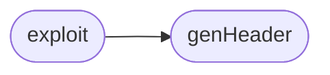

# `contrib.legacy.lazy_http_bof`

> Source: [contrib/legacy/lazy_http_bof.py:1](../../contrib/legacy/lazy_http_bof.py#L1) | language `py` | coverage 0.0% | [API index](../index.md)

## Contents

- **Functions:** [`genHeader`](#genheader), [`exploit`](#exploit)

## Call Graph

Solid arrows stay in this module, dashed arrows leave it.



## Functions

<a id="genheader"></a>

### `genHeader`

`function` | [contrib/legacy/lazy_http_bof.py:6](../../contrib/legacy/lazy_http_bof.py#L6)

```python
def genHeader(raw)
```

**Parameters**

| Name | Type | Default | Description |
|---|---|---|---|
| `raw` |  |  |  |

*Called by:* [`exploit`](#exploit)

---

<a id="exploit"></a>

### `exploit`

`function` | [contrib/legacy/lazy_http_bof.py:29](../../contrib/legacy/lazy_http_bof.py#L29)

```python
def exploit(target, port, payload)
```

**Parameters**

| Name | Type | Default | Description |
|---|---|---|---|
| `target` |  |  |  |
| `port` |  |  |  |
| `payload` |  |  |  |

*Calls:* [`genHeader`](#genheader)

---
