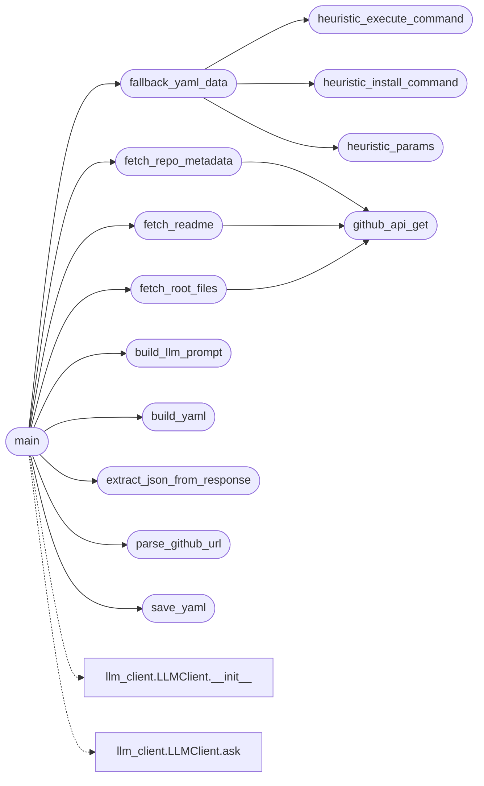

# `contrib.legacy.lazyaddon_creator`

> Source: [contrib/legacy/lazyaddon_creator.py:1](../../contrib/legacy/lazyaddon_creator.py#L1) | language `py` | coverage 93.3% | [API index](../index.md)

lazyaddon_creator.py ==================== Genera automáticamente un addon YAML de LazyOwn a partir de una URL de GitHub.

Uso:
    cd lazyaddons
    python3 ../modules/lazyaddon_creator.py https://github.com/user/repo

Requiere:
    - requests (pip install requests)
    - PyYAML
    - GROQ_API_KEY u Ollama corriendo (para el módulo llm_client)

## Contents

- **Functions:** [`parse_github_url`](#parse_github_url), [`github_api_get`](#github_api_get), [`fetch_repo_metadata`](#fetch_repo_metadata), [`fetch_readme`](#fetch_readme), [`fetch_root_files`](#fetch_root_files), [`build_llm_prompt`](#build_llm_prompt), [`extract_json_from_response`](#extract_json_from_response), [`heuristic_install_command`](#heuristic_install_command), [`heuristic_execute_command`](#heuristic_execute_command), [`heuristic_params`](#heuristic_params), [`fallback_yaml_data`](#fallback_yaml_data), [`build_yaml`](#build_yaml), [`save_yaml`](#save_yaml), [`main`](#main)
- **Constants:** [`SCRIPT_DIR`](#script_dir), [`PROJECT_ROOT`](#project_root), [`GITHUB_API`](#github_api), [`LAZYADDONS_DIR`](#lazyaddons_dir), [`DEFAULT_TIMEOUT`](#default_timeout)

## Call Graph

Solid arrows stay in this module, dashed arrows leave it.



## Functions

<a id="parse_github_url"></a>

### `parse_github_url`

`function` | [contrib/legacy/lazyaddon_creator.py:49](../../contrib/legacy/lazyaddon_creator.py#L49)

```python
def parse_github_url(url: str) -> tuple[str, str]
```

Extrae (owner, repo) de una URL de GitHub.

**Parameters**

| Name | Type | Default | Description |
|---|---|---|---|
| `url` | `str` |  |  |

**Returns:** `tuple[str, str]`

**Raises**

- `ValueError`: (raised in the body, not documented)

*Called by:* [`main`](#main)

---

<a id="github_api_get"></a>

### `github_api_get`

`function` | [contrib/legacy/lazyaddon_creator.py:58](../../contrib/legacy/lazyaddon_creator.py#L58)

```python
def github_api_get(owner: str, repo: str, endpoint: str = '') -> dict
```

GET a la API pública de GitHub (sin auth, rate-limit 60/hr).

**Parameters**

| Name | Type | Default | Description |
|---|---|---|---|
| `owner` | `str` |  |  |
| `repo` | `str` |  |  |
| `endpoint` | `str` | `''` |  |

**Returns:** `dict`

*Called by:* [`fetch_readme`](#fetch_readme), [`fetch_repo_metadata`](#fetch_repo_metadata), [`fetch_root_files`](#fetch_root_files)

---

<a id="fetch_repo_metadata"></a>

### `fetch_repo_metadata`

`function` | [contrib/legacy/lazyaddon_creator.py:68](../../contrib/legacy/lazyaddon_creator.py#L68)

```python
def fetch_repo_metadata(owner: str, repo: str) -> dict
```

Devuelve metadata básica del repo.

**Parameters**

| Name | Type | Default | Description |
|---|---|---|---|
| `owner` | `str` |  |  |
| `repo` | `str` |  |  |

**Returns:** `dict`

*Calls:* [`github_api_get`](#github_api_get)

*Called by:* [`main`](#main)

---

<a id="fetch_readme"></a>

### `fetch_readme`

`function` | [contrib/legacy/lazyaddon_creator.py:73](../../contrib/legacy/lazyaddon_creator.py#L73)

```python
def fetch_readme(owner: str, repo: str) -> str
```

Descarga y decodifica el README.

**Parameters**

| Name | Type | Default | Description |
|---|---|---|---|
| `owner` | `str` |  |  |
| `repo` | `str` |  |  |

**Returns:** `str`

*Calls:* [`github_api_get`](#github_api_get)

*Called by:* [`main`](#main)

---

<a id="fetch_root_files"></a>

### `fetch_root_files`

`function` | [contrib/legacy/lazyaddon_creator.py:85](../../contrib/legacy/lazyaddon_creator.py#L85)

```python
def fetch_root_files(owner: str, repo: str) -> list[str]
```

Lista nombres de archivos en el directorio raíz.

**Parameters**

| Name | Type | Default | Description |
|---|---|---|---|
| `owner` | `str` |  |  |
| `repo` | `str` |  |  |

**Returns:** `list[str]`

*Calls:* [`github_api_get`](#github_api_get)

*Called by:* [`main`](#main)

---

<a id="build_llm_prompt"></a>

### `build_llm_prompt`

`function` | [contrib/legacy/lazyaddon_creator.py:98](../../contrib/legacy/lazyaddon_creator.py#L98)

```python
def build_llm_prompt(meta: dict, readme: str, root_files: list[str]) -> str
```

Construye el prompt para el LLM.

**Parameters**

| Name | Type | Default | Description |
|---|---|---|---|
| `meta` | `dict` |  |  |
| `readme` | `str` |  |  |
| `root_files` | `list[str]` |  |  |

**Returns:** `str`

*Called by:* [`main`](#main)

---

<a id="extract_json_from_response"></a>

### `extract_json_from_response`

`function` | [contrib/legacy/lazyaddon_creator.py:164](../../contrib/legacy/lazyaddon_creator.py#L164)

```python
def extract_json_from_response(text: str) -> dict | None
```

Extrae el primer bloque JSON de una respuesta de LLM.

**Parameters**

| Name | Type | Default | Description |
|---|---|---|---|
| `text` | `str` |  |  |

**Returns:** `dict | None`

*Called by:* [`main`](#main)

---

<a id="heuristic_install_command"></a>

### `heuristic_install_command`

`function` | [contrib/legacy/lazyaddon_creator.py:192](../../contrib/legacy/lazyaddon_creator.py#L192)

```python
def heuristic_install_command(root_files: list[str], language: str) -> str
```

Infiere un install_command básico a partir de los archivos raíz.

**Parameters**

| Name | Type | Default | Description |
|---|---|---|---|
| `root_files` | `list[str]` |  |  |
| `language` | `str` |  |  |

**Returns:** `str`

*Called by:* [`fallback_yaml_data`](#fallback_yaml_data)

---

<a id="heuristic_execute_command"></a>

### `heuristic_execute_command`

`function` | [contrib/legacy/lazyaddon_creator.py:211](../../contrib/legacy/lazyaddon_creator.py#L211)

```python
def heuristic_execute_command(name: str, root_files: list[str], language: str) -> str
```

Infiere un execute_command básico.

**Parameters**

| Name | Type | Default | Description |
|---|---|---|---|
| `name` | `str` |  |  |
| `root_files` | `list[str]` |  |  |
| `language` | `str` |  |  |

**Returns:** `str`

*Called by:* [`fallback_yaml_data`](#fallback_yaml_data)

---

<a id="heuristic_params"></a>

### `heuristic_params`

`function` | [contrib/legacy/lazyaddon_creator.py:245](../../contrib/legacy/lazyaddon_creator.py#L245)

```python
def heuristic_params(name: str, readme: str, root_files: list[str]) -> list[dict]
```

Infiere parámetros comunes basándose en el nombre y README.

**Parameters**

| Name | Type | Default | Description |
|---|---|---|---|
| `name` | `str` |  |  |
| `readme` | `str` |  |  |
| `root_files` | `list[str]` |  |  |

**Returns:** `list[dict]`

*Called by:* [`fallback_yaml_data`](#fallback_yaml_data)

---

<a id="fallback_yaml_data"></a>

### `fallback_yaml_data`

`function` | [contrib/legacy/lazyaddon_creator.py:276](../../contrib/legacy/lazyaddon_creator.py#L276)

```python
def fallback_yaml_data(meta: dict, readme: str, root_files: list[str]) -> dict
```

Genera datos de addon usando solo heurísticas locales (sin LLM).

**Parameters**

| Name | Type | Default | Description |
|---|---|---|---|
| `meta` | `dict` |  |  |
| `readme` | `str` |  |  |
| `root_files` | `list[str]` |  |  |

**Returns:** `dict`

*Calls:* [`heuristic_execute_command`](#heuristic_execute_command), [`heuristic_install_command`](#heuristic_install_command), [`heuristic_params`](#heuristic_params)

*Called by:* [`main`](#main)

---

<a id="build_yaml"></a>

### `build_yaml`

`function` | [contrib/legacy/lazyaddon_creator.py:300](../../contrib/legacy/lazyaddon_creator.py#L300)

```python
def build_yaml(data: dict, repo_url: str) -> dict
```

Construye la estructura de dict que representa el addon YAML.

**Parameters**

| Name | Type | Default | Description |
|---|---|---|---|
| `data` | `dict` |  |  |
| `repo_url` | `str` |  |  |

**Returns:** `dict`

*Called by:* [`main`](#main)

---

<a id="save_yaml"></a>

### `save_yaml`

`function` | [contrib/legacy/lazyaddon_creator.py:336](../../contrib/legacy/lazyaddon_creator.py#L336)

```python
def save_yaml(addon: dict, output_dir: Path) -> Path
```

Guarda el dict como archivo YAML en output_dir.

**Parameters**

| Name | Type | Default | Description |
|---|---|---|---|
| `addon` | `dict` |  |  |
| `output_dir` | `Path` |  |  |

**Returns:** `Path`

*Called by:* [`main`](#main)

---

<a id="main"></a>

### `main`

`function` | [contrib/legacy/lazyaddon_creator.py:357](../../contrib/legacy/lazyaddon_creator.py#L357)

```python
def main() -> None
```

*Calls:* [`build_llm_prompt`](#build_llm_prompt), [`build_yaml`](#build_yaml), [`extract_json_from_response`](#extract_json_from_response), [`fallback_yaml_data`](#fallback_yaml_data), [`fetch_readme`](#fetch_readme), [`fetch_repo_metadata`](#fetch_repo_metadata), [`fetch_root_files`](#fetch_root_files), [`parse_github_url`](#parse_github_url), [`save_yaml`](#save_yaml), [`LLMClient.__init__`](modules.llm_client.py.md#llmclient-__init__), [`LLMClient.ask`](modules.llm_client.py.md#llmclient-ask)

---

## Constants

<a id="script_dir"></a>

### `SCRIPT_DIR`

`constant` | [contrib/legacy/lazyaddon_creator.py:34](../../contrib/legacy/lazyaddon_creator.py#L34)

```python
SCRIPT_DIR = Path(__file__).resolve().parent
```

---

<a id="project_root"></a>

### `PROJECT_ROOT`

`constant` | [contrib/legacy/lazyaddon_creator.py:35](../../contrib/legacy/lazyaddon_creator.py#L35)

```python
PROJECT_ROOT = SCRIPT_DIR.parent
```

---

<a id="github_api"></a>

### `GITHUB_API`

`constant` | [contrib/legacy/lazyaddon_creator.py:42](../../contrib/legacy/lazyaddon_creator.py#L42)

```python
GITHUB_API = 'https://api.github.com/repos'
```

---

<a id="lazyaddons_dir"></a>

### `LAZYADDONS_DIR`

`constant` | [contrib/legacy/lazyaddon_creator.py:43](../../contrib/legacy/lazyaddon_creator.py#L43)

```python
LAZYADDONS_DIR = PROJECT_ROOT / 'lazyaddons'
```

---

<a id="default_timeout"></a>

### `DEFAULT_TIMEOUT`

`constant` | [contrib/legacy/lazyaddon_creator.py:44](../../contrib/legacy/lazyaddon_creator.py#L44)

```python
DEFAULT_TIMEOUT = 30
```

---
