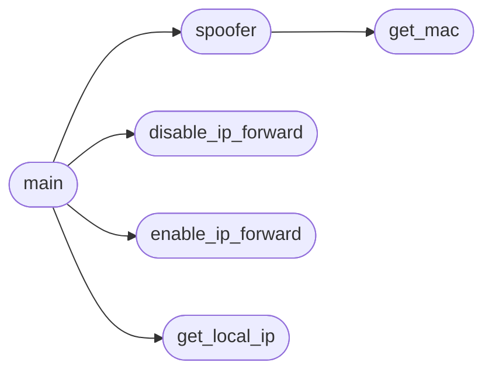

# `contrib.legacy.lazyarpspoofing`

> Source: [contrib/legacy/lazyarpspoofing.py:1](../../contrib/legacy/lazyarpspoofing.py#L1) | language `py` | coverage 0.0% | [API index](../index.md)

## Contents

- **Functions:** [`check_sudo`](#check_sudo), [`enable_ip_forward`](#enable_ip_forward), [`disable_ip_forward`](#disable_ip_forward), [`get_local_ip`](#get_local_ip), [`get_mac`](#get_mac), [`spoofer`](#spoofer), [`main`](#main)
- **Constants:** [`DEBUG`](#debug), [`BANNER`](#banner)

## Call Graph

Solid arrows stay in this module, dashed arrows leave it.



## Functions

<a id="check_sudo"></a>

### `check_sudo`

`function` | [contrib/legacy/lazyarpspoofing.py:27](../../contrib/legacy/lazyarpspoofing.py#L27)

```python
def check_sudo()
```

---

<a id="enable_ip_forward"></a>

### `enable_ip_forward`

`function` | [contrib/legacy/lazyarpspoofing.py:35](../../contrib/legacy/lazyarpspoofing.py#L35)

```python
def enable_ip_forward()
```

*Called by:* [`main`](#main)

---

<a id="disable_ip_forward"></a>

### `disable_ip_forward`

`function` | [contrib/legacy/lazyarpspoofing.py:38](../../contrib/legacy/lazyarpspoofing.py#L38)

```python
def disable_ip_forward()
```

*Called by:* [`main`](#main)

---

<a id="get_local_ip"></a>

### `get_local_ip`

`function` | [contrib/legacy/lazyarpspoofing.py:41](../../contrib/legacy/lazyarpspoofing.py#L41)

```python
def get_local_ip(ifname)
```

**Parameters**

| Name | Type | Default | Description |
|---|---|---|---|
| `ifname` |  |  |  |

*Called by:* [`main`](#main)

---

<a id="get_mac"></a>

### `get_mac`

`function` | [contrib/legacy/lazyarpspoofing.py:49](../../contrib/legacy/lazyarpspoofing.py#L49)

```python
def get_mac(ip, device, retries=3, timeout=5)
```

**Parameters**

| Name | Type | Default | Description |
|---|---|---|---|
| `ip` |  |  |  |
| `device` |  |  |  |
| `retries` |  | `3` |  |
| `timeout` |  | `5` |  |

*Called by:* [`spoofer`](#spoofer)

---

<a id="spoofer"></a>

### `spoofer`

`function` | [contrib/legacy/lazyarpspoofing.py:69](../../contrib/legacy/lazyarpspoofing.py#L69)

```python
def spoofer(target, spoofed, device)
```

**Parameters**

| Name | Type | Default | Description |
|---|---|---|---|
| `target` |  |  |  |
| `spoofed` |  |  |  |
| `device` |  |  |  |

*Calls:* [`get_mac`](#get_mac)

*Called by:* [`main`](#main)

---

<a id="main"></a>

### `main`

`function` | [contrib/legacy/lazyarpspoofing.py:80](../../contrib/legacy/lazyarpspoofing.py#L80)

```python
def main()
```

*Calls:* [`disable_ip_forward`](#disable_ip_forward), [`enable_ip_forward`](#enable_ip_forward), [`get_local_ip`](#get_local_ip), [`spoofer`](#spoofer)

---

## Constants

<a id="debug"></a>

### `DEBUG`

`constant` | [contrib/legacy/lazyarpspoofing.py:15](../../contrib/legacy/lazyarpspoofing.py#L15)

```python
DEBUG = 0
```

---

<a id="banner"></a>

### `BANNER`

`constant` | [contrib/legacy/lazyarpspoofing.py:16](../../contrib/legacy/lazyarpspoofing.py#L16)

```python
BANNER
```

---
