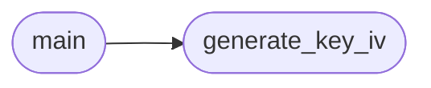

# `contrib.legacy.lazybinenc`

> Source: [contrib/legacy/lazybinenc.py:1](../../contrib/legacy/lazybinenc.py#L1) | language `py` | coverage 0.0% | [API index](../index.md)

## Contents

- **Functions:** [`generate_key_iv`](#generate_key_iv), [`main`](#main)

## Call Graph

Solid arrows stay in this module, dashed arrows leave it.



## Functions

<a id="generate_key_iv"></a>

### `generate_key_iv`

`function` | [contrib/legacy/lazybinenc.py:12](../../contrib/legacy/lazybinenc.py#L12)

```python
def generate_key_iv(sessions_path='./sessions')
```

**Parameters**

| Name | Type | Default | Description |
|---|---|---|---|
| `sessions_path` |  | `'./sessions'` |  |

*Called by:* [`main`](#main)

---

<a id="main"></a>

### `main`

`function` | [contrib/legacy/lazybinenc.py:54](../../contrib/legacy/lazybinenc.py#L54)

```python
def main()
```

*Calls:* [`generate_key_iv`](#generate_key_iv)

---
