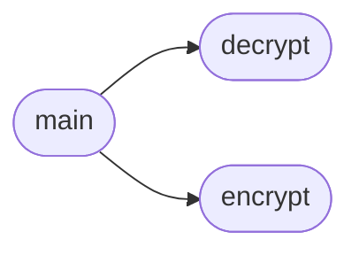

# `contrib.legacy.lazybotcli`

> Source: [contrib/legacy/lazybotcli.py:1](../../contrib/legacy/lazybotcli.py#L1) | language `py` | coverage 25.0% | [API index](../index.md)

main.py

Autor: Gris Iscomeback
Correo electrónico: grisiscomeback[at]gmail[dot]com
Fecha de creación: 09/06/2024
Licencia: GPL v3

Descripción: Cliente LazyOwn BotNet

██╗      █████╗ ███████╗██╗   ██╗ ██████╗ ██╗    ██╗███╗   ██╗
██║     ██╔══██╗╚══███╔╝╚██╗ ██╔╝██╔═══██╗██║    ██║████╗  ██║
██║     ███████║  ███╔╝  ╚████╔╝ ██║   ██║██║ █╗ ██║██╔██╗ ██║
██║     ██╔══██║ ███╔╝    ╚██╔╝  ██║   ██║██║███╗██║██║╚██╗██║
███████╗██║  ██║███████╗   ██║   ╚██████╔╝╚███╔███╔╝██║ ╚████║
╚══════╝╚═╝  ╚═╝╚══════╝   ╚═╝    ╚═════╝  ╚══╝╚══╝ ╚═╝  ╚═══╝

## Contents

- **Functions:** [`encrypt`](#encrypt), [`decrypt`](#decrypt), [`main`](#main)
- **Constants:** [`KEY_SIZE`](#key_size)

## Call Graph

Solid arrows stay in this module, dashed arrows leave it.



## Functions

<a id="encrypt"></a>

### `encrypt`

`function` | [contrib/legacy/lazybotcli.py:30](../../contrib/legacy/lazybotcli.py#L30)

```python
def encrypt(plaintext, key)
```

**Parameters**

| Name | Type | Default | Description |
|---|---|---|---|
| `plaintext` |  |  |  |
| `key` |  |  |  |

*Called by:* [`main`](#main)

---

<a id="decrypt"></a>

### `decrypt`

`function` | [contrib/legacy/lazybotcli.py:36](../../contrib/legacy/lazybotcli.py#L36)

```python
def decrypt(ciphertext, key)
```

**Parameters**

| Name | Type | Default | Description |
|---|---|---|---|
| `ciphertext` |  |  |  |
| `key` |  |  |  |

*Called by:* [`main`](#main)

---

<a id="main"></a>

### `main`

`function` | [contrib/legacy/lazybotcli.py:42](../../contrib/legacy/lazybotcli.py#L42)

```python
def main()
```

*Calls:* [`decrypt`](#decrypt), [`encrypt`](#encrypt)

---

## Constants

<a id="key_size"></a>

### `KEY_SIZE`

`constant` | [contrib/legacy/lazybotcli.py:28](../../contrib/legacy/lazybotcli.py#L28)

```python
KEY_SIZE = 16
```

---
