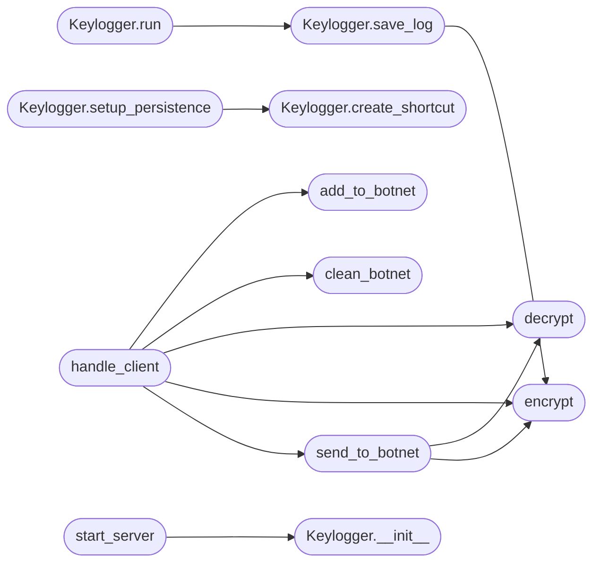

# `contrib.legacy.lazybotnet`

> Source: [contrib/legacy/lazybotnet.py:1](../../contrib/legacy/lazybotnet.py#L1) | language `py` | coverage 5.9% | [API index](../index.md)

main.py

Autor: Gris Iscomeback
Correo electrónico: grisiscomeback[at]gmail[dot]com
Fecha de creación: 09/06/2024
Licencia: AGPL v3

Descripción: Servidor LazyOwn BotNet

██╗      █████╗ ███████╗██╗   ██╗ ██████╗ ██╗    ██╗███╗   ██╗
██║     ██╔══██╗╚══███╔╝╚██╗ ██╔╝██╔═══██╗██║    ██║████╗  ██║
██║     ███████║  ███╔╝  ╚████╔╝ ██║   ██║██║ █╗ ██║██╔██╗ ██║
██║     ██╔══██║ ███╔╝    ╚██╔╝  ██║   ██║██║███╗██║██║╚██╗██║
███████╗██║  ██║███████╗   ██║   ╚██████╔╝╚███╔███╔╝██║ ╚████║
╚══════╝╚═╝  ╚═╝╚══════╝   ╚═╝    ╚═════╝  ╚══╝╚══╝ ╚═╝  ╚═══╝

## Contents

- **Classes:** [`Keylogger`](#keylogger)
- **Functions:** [`encrypt`](#encrypt), [`decrypt`](#decrypt), [`add_to_botnet`](#add_to_botnet), [`clean_botnet`](#clean_botnet), [`send_to_botnet`](#send_to_botnet), [`handle_client`](#handle_client), [`start_server`](#start_server)
- **Constants:** [`KEY_SIZE`](#key_size)

## Call Graph

Solid arrows stay in this module, dashed arrows leave it.



## Classes

<a id="keylogger"></a>

### `Keylogger`

`class` | [contrib/legacy/lazybotnet.py:89](../../contrib/legacy/lazybotnet.py#L89)

```python
class Keylogger
```

**Members**

| Member | Kind | Summary |
|---|---|---|
| [`__init__`](#keylogger-__init__) | constructor |  |
| [`on_press`](#keylogger-on_press) | method |  |
| [`start`](#keylogger-start) | method |  |
| [`get_log`](#keylogger-get_log) | method |  |
| [`save_log`](#keylogger-save_log) | method |  |
| [`run`](#keylogger-run) | method |  |
| [`setup_persistence`](#keylogger-setup_persistence) | method |  |
| [`create_shortcut`](#keylogger-create_shortcut) | method |  |

<a id="keylogger-__init__"></a>

#### `Keylogger.__init__`

`constructor` | [contrib/legacy/lazybotnet.py:90](../../contrib/legacy/lazybotnet.py#L90)

```python
def __init__(self, key, log_file)
```

**Parameters**

| Name | Type | Default | Description |
|---|---|---|---|
| `key` |  |  |  |
| `log_file` |  |  |  |

*Called by:* [`start_server`](#start_server)

<a id="keylogger-on_press"></a>

#### `Keylogger.on_press`

`method` | [contrib/legacy/lazybotnet.py:95](../../contrib/legacy/lazybotnet.py#L95)

```python
def on_press(self, key)
```

**Parameters**

| Name | Type | Default | Description |
|---|---|---|---|
| `key` |  |  |  |

<a id="keylogger-start"></a>

#### `Keylogger.start`

`method` | [contrib/legacy/lazybotnet.py:106](../../contrib/legacy/lazybotnet.py#L106)

```python
def start(self)
```

<a id="keylogger-get_log"></a>

#### `Keylogger.get_log`

`method` | [contrib/legacy/lazybotnet.py:110](../../contrib/legacy/lazybotnet.py#L110)

```python
def get_log(self)
```

<a id="keylogger-save_log"></a>

#### `Keylogger.save_log`

`method` | [contrib/legacy/lazybotnet.py:113](../../contrib/legacy/lazybotnet.py#L113)

```python
def save_log(self)
```

*Calls:* [`encrypt`](#encrypt)

*Called by:* [`Keylogger.run`](#keylogger-run)

<a id="keylogger-run"></a>

#### `Keylogger.run`

`method` | [contrib/legacy/lazybotnet.py:120](../../contrib/legacy/lazybotnet.py#L120)

```python
def run(self)
```

*Calls:* [`Keylogger.save_log`](#keylogger-save_log)

<a id="keylogger-setup_persistence"></a>

#### `Keylogger.setup_persistence`

`method` | [contrib/legacy/lazybotnet.py:125](../../contrib/legacy/lazybotnet.py#L125)

```python
def setup_persistence(self)
```

*Calls:* [`Keylogger.create_shortcut`](#keylogger-create_shortcut)

<a id="keylogger-create_shortcut"></a>

#### `Keylogger.create_shortcut`

`method` | [contrib/legacy/lazybotnet.py:136](../../contrib/legacy/lazybotnet.py#L136)

```python
def create_shortcut(self, script_path, shortcut_path)
```

**Parameters**

| Name | Type | Default | Description |
|---|---|---|---|
| `script_path` |  |  |  |
| `shortcut_path` |  |  |  |

*Called by:* [`Keylogger.setup_persistence`](#keylogger-setup_persistence)

---

## Functions

<a id="encrypt"></a>

### `encrypt`

`function` | [contrib/legacy/lazybotnet.py:46](../../contrib/legacy/lazybotnet.py#L46)

```python
def encrypt(plaintext, key)
```

**Parameters**

| Name | Type | Default | Description |
|---|---|---|---|
| `plaintext` |  |  |  |
| `key` |  |  |  |

*Called by:* [`Keylogger.save_log`](#keylogger-save_log), [`handle_client`](#handle_client), [`send_to_botnet`](#send_to_botnet)

---

<a id="decrypt"></a>

### `decrypt`

`function` | [contrib/legacy/lazybotnet.py:52](../../contrib/legacy/lazybotnet.py#L52)

```python
def decrypt(ciphertext, key)
```

**Parameters**

| Name | Type | Default | Description |
|---|---|---|---|
| `ciphertext` |  |  |  |
| `key` |  |  |  |

*Called by:* [`handle_client`](#handle_client), [`send_to_botnet`](#send_to_botnet)

---

<a id="add_to_botnet"></a>

### `add_to_botnet`

`function` | [contrib/legacy/lazybotnet.py:58](../../contrib/legacy/lazybotnet.py#L58)

```python
def add_to_botnet(ip, port, botnet_file)
```

**Parameters**

| Name | Type | Default | Description |
|---|---|---|---|
| `ip` |  |  |  |
| `port` |  |  |  |
| `botnet_file` |  |  |  |

*Called by:* [`handle_client`](#handle_client)

---

<a id="clean_botnet"></a>

### `clean_botnet`

`function` | [contrib/legacy/lazybotnet.py:62](../../contrib/legacy/lazybotnet.py#L62)

```python
def clean_botnet(ip, port, botnet_file)
```

**Parameters**

| Name | Type | Default | Description |
|---|---|---|---|
| `ip` |  |  |  |
| `port` |  |  |  |
| `botnet_file` |  |  |  |

*Called by:* [`handle_client`](#handle_client)

---

<a id="send_to_botnet"></a>

### `send_to_botnet`

`function` | [contrib/legacy/lazybotnet.py:71](../../contrib/legacy/lazybotnet.py#L71)

```python
def send_to_botnet(cmd, key, botnet_file)
```

**Parameters**

| Name | Type | Default | Description |
|---|---|---|---|
| `cmd` |  |  |  |
| `key` |  |  |  |
| `botnet_file` |  |  |  |

*Calls:* [`decrypt`](#decrypt), [`encrypt`](#encrypt)

*Called by:* [`handle_client`](#handle_client)

---

<a id="handle_client"></a>

### `handle_client`

`function` | [contrib/legacy/lazybotnet.py:144](../../contrib/legacy/lazybotnet.py#L144)

```python
def handle_client(conn, key, botnet_file, log_file)
```

**Parameters**

| Name | Type | Default | Description |
|---|---|---|---|
| `conn` |  |  |  |
| `key` |  |  |  |
| `botnet_file` |  |  |  |
| `log_file` |  |  |  |

*Calls:* [`add_to_botnet`](#add_to_botnet), [`clean_botnet`](#clean_botnet), [`decrypt`](#decrypt), [`encrypt`](#encrypt), [`send_to_botnet`](#send_to_botnet)

---

<a id="start_server"></a>

### `start_server`

`function` | [contrib/legacy/lazybotnet.py:182](../../contrib/legacy/lazybotnet.py#L182)

```python
def start_server(host, port, key, botnet_file, log_file)
```

**Parameters**

| Name | Type | Default | Description |
|---|---|---|---|
| `host` |  |  |  |
| `port` |  |  |  |
| `key` |  |  |  |
| `botnet_file` |  |  |  |
| `log_file` |  |  |  |

**Raises**

- `ValueError`: (raised in the body, not documented)

*Calls:* [`Keylogger.__init__`](#keylogger-__init__)

---

## Constants

<a id="key_size"></a>

### `KEY_SIZE`

`constant` | [contrib/legacy/lazybotnet.py:44](../../contrib/legacy/lazybotnet.py#L44)

```python
KEY_SIZE = 16
```

---
