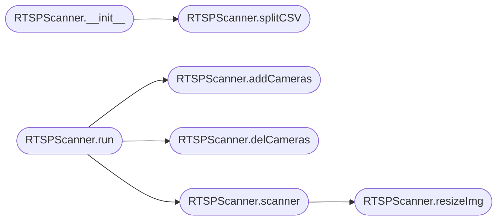

# `contrib.legacy.lazycam`

> Source: [contrib/legacy/lazycam.py:1](../../contrib/legacy/lazycam.py#L1) | language `py` | coverage 11.1% | [API index](../index.md)

This code is a portion of frigate Event Video Recorder (fEVR)  Copyright (C) 2021-2022  The Bearded Tek (http://www.beardedtek.com) William Kenny  This program is free software: you can redistribute it and/or modify it under the terms of the GNU Affero General Public License as published by the Free Software Foundation, either version 3 of the License, or (at your option) any later version.

This program is distributed in the hope that it will be useful, but WITHOUT ANY WARRANTY; without even the implied warranty of MERCHANTABILITY or FITNESS FOR A PARTICULAR PURPOSE.  See the GNU General Public License for more details.  You should have received a copy of the GNU AfferoGeneral Public License along with this program.  If not, see <https://www.gnu.org/licenses/>.  Scans given ports of an IPv4 Address or an IPv4 Network for RTSP Streams and adds them to or removes them from rtsp-simple-server via its API

## Contents

- **Classes:** [`RTSPScanner`](#rtspscanner)

## Call Graph

Solid arrows stay in this module, dashed arrows leave it.



## Classes

<a id="rtspscanner"></a>

### `RTSPScanner`

`class` | [contrib/legacy/lazycam.py:32](../../contrib/legacy/lazycam.py#L32)

```python
class RTSPScanner
```

**Members**

| Member | Kind | Summary |
|---|---|---|
| [`__init__`](#rtspscanner-__init__) | constructor |  |
| [`run`](#rtspscanner-run) | method |  |
| [`resizeImg`](#rtspscanner-resizeimg) | method |  |
| [`splitCSV`](#rtspscanner-splitcsv) | method |  |
| [`scanner`](#rtspscanner-scanner) | method |  |
| [`delCameras`](#rtspscanner-delcameras) | method |  |
| [`addCameras`](#rtspscanner-addcameras) | method |  |

<a id="rtspscanner-__init__"></a>

#### `RTSPScanner.__init__`

`constructor` | [contrib/legacy/lazycam.py:33](../../contrib/legacy/lazycam.py#L33)

```python
def __init__(self, verbose=False, wspace='-')
```

**Parameters**

| Name | Type | Default | Description |
|---|---|---|---|
| `verbose` |  | `False` |  |
| `wspace` |  | `'-'` |  |

*Calls:* [`RTSPScanner.splitCSV`](#rtspscanner-splitcsv)

<a id="rtspscanner-run"></a>

#### `RTSPScanner.run`

`method` | [contrib/legacy/lazycam.py:49](../../contrib/legacy/lazycam.py#L49)

```python
def run(self)
```

*Calls:* [`RTSPScanner.addCameras`](#rtspscanner-addcameras), [`RTSPScanner.delCameras`](#rtspscanner-delcameras), [`RTSPScanner.scanner`](#rtspscanner-scanner)

<a id="rtspscanner-resizeimg"></a>

#### `RTSPScanner.resizeImg`

`method` | [contrib/legacy/lazycam.py:68](../../contrib/legacy/lazycam.py#L68)

```python
def resizeImg(self, img, output, height=180, ratio=1.777777778, fmt='webp')
```

**Parameters**

| Name | Type | Default | Description |
|---|---|---|---|
| `img` |  |  |  |
| `output` |  |  |  |
| `height` |  | `180` |  |
| `ratio` |  | `1.777777778` |  |
| `fmt` |  | `'webp'` |  |

*Called by:* [`RTSPScanner.scanner`](#rtspscanner-scanner)

<a id="rtspscanner-splitcsv"></a>

#### `RTSPScanner.splitCSV`

`method` | [contrib/legacy/lazycam.py:77](../../contrib/legacy/lazycam.py#L77)

```python
def splitCSV(self, csv)
```

**Parameters**

| Name | Type | Default | Description |
|---|---|---|---|
| `csv` |  |  |  |

*Called by:* [`RTSPScanner.__init__`](#rtspscanner-__init__)

<a id="rtspscanner-scanner"></a>

#### `RTSPScanner.scanner`

`method` | [contrib/legacy/lazycam.py:83](../../contrib/legacy/lazycam.py#L83)

```python
def scanner(self)
```

**Raises**

- `ValueError`: (raised in the body, not documented)

*Calls:* [`RTSPScanner.resizeImg`](#rtspscanner-resizeimg)

*Called by:* [`RTSPScanner.run`](#rtspscanner-run)

<a id="rtspscanner-delcameras"></a>

#### `RTSPScanner.delCameras`

`method` | [contrib/legacy/lazycam.py:136](../../contrib/legacy/lazycam.py#L136)

```python
def delCameras(self)
```

*Called by:* [`RTSPScanner.run`](#rtspscanner-run)

<a id="rtspscanner-addcameras"></a>

#### `RTSPScanner.addCameras`

`method` | [contrib/legacy/lazycam.py:149](../../contrib/legacy/lazycam.py#L149)

```python
def addCameras(self)
```

*Called by:* [`RTSPScanner.run`](#rtspscanner-run)

---
