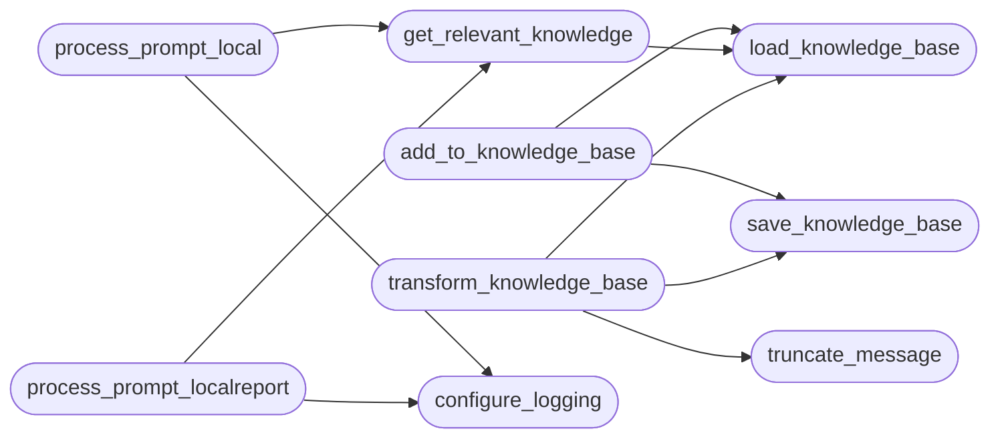

# `contrib.legacy.lazydeepseekcli`

> Source: [contrib/legacy/lazydeepseekcli.py:1](../../contrib/legacy/lazydeepseekcli.py#L1) | language `py` | coverage 9.1% | [API index](../index.md)

Unified Ollama/DeepSeek client for LazyOwn — merges lazydeepseekcli_local + lazydeepseekcli_localreport.

Provides streaming SSE responses via Flask for both red-team strategy and
pentest report generation. Original `[`process_prompt_local`](#process_prompt_local)` and
`[`process_prompt_localreport`](#process_prompt_localreport)` signatures preserved.

Usage::

    from modules.legacy.lazydeepseekcli import process_prompt_local, process_prompt_localreport

## Contents

- **Functions:** [`truncate_message`](#truncate_message), [`configure_logging`](#configure_logging), [`load_knowledge_base`](#load_knowledge_base), [`save_knowledge_base`](#save_knowledge_base), [`add_to_knowledge_base`](#add_to_knowledge_base), [`get_relevant_knowledge`](#get_relevant_knowledge), [`transform_knowledge_base`](#transform_knowledge_base), [`process_prompt_local`](#process_prompt_local), [`process_prompt_localreport`](#process_prompt_localreport), [`parse_args`](#parse_args)
- **Constants:** [`BANNER`](#banner), [`SCRIPT_DIR`](#script_dir), [`KB_FILE`](#kb_file), [`KB_IMPROVED_FILE`](#kb_improved_file), [`PAYLOAD_FILE`](#payload_file), [`SESSION_FILE`](#session_file), [`BODY_REPORT_FILE`](#body_report_file), [`TASKS_FILE`](#tasks_file), [`USERS_FILE`](#users_file), [`OLLAMA_URL`](#ollama_url), [`MODEL`](#model)

## Call Graph

Solid arrows stay in this module, dashed arrows leave it.



## Functions

<a id="truncate_message"></a>

### `truncate_message`

`function` | [contrib/legacy/lazydeepseekcli.py:41](../../contrib/legacy/lazydeepseekcli.py#L41)

```python
def truncate_message(message: str, max_chars: int = 18000) -> str
```

**Parameters**

| Name | Type | Default | Description |
|---|---|---|---|
| `message` | `str` |  |  |
| `max_chars` | `int` | `18000` |  |

**Returns:** `str`

*Called by:* [`transform_knowledge_base`](#transform_knowledge_base), [`ask_general`](modules.llm_adapter.py.md#ask_general)

---

<a id="configure_logging"></a>

### `configure_logging`

`function` | [contrib/legacy/lazydeepseekcli.py:45](../../contrib/legacy/lazydeepseekcli.py#L45)

```python
def configure_logging(debug: bool) -> None
```

**Parameters**

| Name | Type | Default | Description |
|---|---|---|---|
| `debug` | `bool` |  |  |

*Called by:* [`process_prompt_local`](#process_prompt_local), [`process_prompt_localreport`](#process_prompt_localreport)

---

<a id="load_knowledge_base"></a>

### `load_knowledge_base`

`function` | [contrib/legacy/lazydeepseekcli.py:167](../../contrib/legacy/lazydeepseekcli.py#L167)

```python
def load_knowledge_base(file_path: str) -> dict
```

**Parameters**

| Name | Type | Default | Description |
|---|---|---|---|
| `file_path` | `str` |  |  |

**Returns:** `dict`

*Called by:* [`add_to_knowledge_base`](#add_to_knowledge_base), [`get_relevant_knowledge`](#get_relevant_knowledge), [`transform_knowledge_base`](#transform_knowledge_base)

---

<a id="save_knowledge_base"></a>

### `save_knowledge_base`

`function` | [contrib/legacy/lazydeepseekcli.py:174](../../contrib/legacy/lazydeepseekcli.py#L174)

```python
def save_knowledge_base(knowledge_base: dict, file_path: str) -> None
```

**Parameters**

| Name | Type | Default | Description |
|---|---|---|---|
| `knowledge_base` | `dict` |  |  |
| `file_path` | `str` |  |  |

*Called by:* [`add_to_knowledge_base`](#add_to_knowledge_base), [`transform_knowledge_base`](#transform_knowledge_base)

---

<a id="add_to_knowledge_base"></a>

### `add_to_knowledge_base`

`function` | [contrib/legacy/lazydeepseekcli.py:179](../../contrib/legacy/lazydeepseekcli.py#L179)

```python
def add_to_knowledge_base(prompt: str, command: str, file_path: str) -> None
```

**Parameters**

| Name | Type | Default | Description |
|---|---|---|---|
| `prompt` | `str` |  |  |
| `command` | `str` |  |  |
| `file_path` | `str` |  |  |

*Calls:* [`load_knowledge_base`](#load_knowledge_base), [`save_knowledge_base`](#save_knowledge_base)

---

<a id="get_relevant_knowledge"></a>

### `get_relevant_knowledge`

`function` | [contrib/legacy/lazydeepseekcli.py:185](../../contrib/legacy/lazydeepseekcli.py#L185)

```python
def get_relevant_knowledge(prompt: str) -> str
```

**Parameters**

| Name | Type | Default | Description |
|---|---|---|---|
| `prompt` | `str` |  |  |

**Returns:** `str`

*Calls:* [`load_knowledge_base`](#load_knowledge_base)

*Called by:* [`process_prompt_local`](#process_prompt_local), [`process_prompt_localreport`](#process_prompt_localreport)

---

<a id="transform_knowledge_base"></a>

### `transform_knowledge_base`

`function` | [contrib/legacy/lazydeepseekcli.py:193](../../contrib/legacy/lazydeepseekcli.py#L193)

```python
def transform_knowledge_base(prompt_builder) -> None
```

**Parameters**

| Name | Type | Default | Description |
|---|---|---|---|
| `prompt_builder` |  |  |  |

*Calls:* [`load_knowledge_base`](#load_knowledge_base), [`save_knowledge_base`](#save_knowledge_base), [`truncate_message`](#truncate_message)

---

<a id="process_prompt_local"></a>

### `process_prompt_local`

`function` | [contrib/legacy/lazydeepseekcli.py:255](../../contrib/legacy/lazydeepseekcli.py#L255)

```python
def process_prompt_local(prompt: str, debug: bool = False, mode: str = 'console') -> Response
```

**Parameters**

| Name | Type | Default | Description |
|---|---|---|---|
| `prompt` | `str` |  |  |
| `debug` | `bool` | `False` |  |
| `mode` | `str` | `'console'` |  |

**Returns:** `Response`

*Calls:* [`configure_logging`](#configure_logging), [`get_relevant_knowledge`](#get_relevant_knowledge)

---

<a id="process_prompt_localreport"></a>

### `process_prompt_localreport`

`function` | [contrib/legacy/lazydeepseekcli.py:263](../../contrib/legacy/lazydeepseekcli.py#L263)

```python
def process_prompt_localreport(prompt: str, debug: bool = False, mode: str = 'console') -> Response
```

**Parameters**

| Name | Type | Default | Description |
|---|---|---|---|
| `prompt` | `str` |  |  |
| `debug` | `bool` | `False` |  |
| `mode` | `str` | `'console'` |  |

**Returns:** `Response`

*Calls:* [`configure_logging`](#configure_logging), [`get_relevant_knowledge`](#get_relevant_knowledge)

---

<a id="parse_args"></a>

### `parse_args`

`function` | [contrib/legacy/lazydeepseekcli.py:271](../../contrib/legacy/lazydeepseekcli.py#L271)

```python
def parse_args() -> argparse.Namespace
```

**Returns:** `argparse.Namespace`

---

## Constants

<a id="banner"></a>

### `BANNER`

`constant` | [contrib/legacy/lazydeepseekcli.py:23](../../contrib/legacy/lazydeepseekcli.py#L23)

```python
BANNER = '\n[*] Iniciando: LazyOwn DeepSeek Assistant [;,;]\n'
```

---

<a id="script_dir"></a>

### `SCRIPT_DIR`

`constant` | [contrib/legacy/lazydeepseekcli.py:27](../../contrib/legacy/lazydeepseekcli.py#L27)

```python
SCRIPT_DIR = os.path.dirname(os.path.abspath(__file__))
```

---

<a id="kb_file"></a>

### `KB_FILE`

`constant` | [contrib/legacy/lazydeepseekcli.py:28](../../contrib/legacy/lazydeepseekcli.py#L28)

```python
KB_FILE = os.path.join(SCRIPT_DIR, 'knowledge_base_script.json')
```

---

<a id="kb_improved_file"></a>

### `KB_IMPROVED_FILE`

`constant` | [contrib/legacy/lazydeepseekcli.py:29](../../contrib/legacy/lazydeepseekcli.py#L29)

```python
KB_IMPROVED_FILE = os.path.join(SCRIPT_DIR, 'knowledge_base_improved.json')
```

---

<a id="payload_file"></a>

### `PAYLOAD_FILE`

`constant` | [contrib/legacy/lazydeepseekcli.py:31](../../contrib/legacy/lazydeepseekcli.py#L31)

```python
PAYLOAD_FILE = os.path.join(SCRIPT_DIR, '..', '..', 'payload.json')
```

---

<a id="session_file"></a>

### `SESSION_FILE`

`constant` | [contrib/legacy/lazydeepseekcli.py:32](../../contrib/legacy/lazydeepseekcli.py#L32)

```python
SESSION_FILE = os.path.join(SCRIPT_DIR, '..', '..', 'sessions', 'sessionLazyOwn.json')
```

---

<a id="body_report_file"></a>

### `BODY_REPORT_FILE`

`constant` | [contrib/legacy/lazydeepseekcli.py:33](../../contrib/legacy/lazydeepseekcli.py#L33)

```python
BODY_REPORT_FILE = os.path.join(SCRIPT_DIR, '..', '..', 'static', 'body_report.json')
```

---

<a id="tasks_file"></a>

### `TASKS_FILE`

`constant` | [contrib/legacy/lazydeepseekcli.py:34](../../contrib/legacy/lazydeepseekcli.py#L34)

```python
TASKS_FILE = os.path.join(SCRIPT_DIR, '..', '..', 'sessions', 'tasks.json')
```

---

<a id="users_file"></a>

### `USERS_FILE`

`constant` | [contrib/legacy/lazydeepseekcli.py:35](../../contrib/legacy/lazydeepseekcli.py#L35)

```python
USERS_FILE = os.path.join(SCRIPT_DIR, '..', '..', 'users.json')
```

---

<a id="ollama_url"></a>

### `OLLAMA_URL`

`constant` | [contrib/legacy/lazydeepseekcli.py:37](../../contrib/legacy/lazydeepseekcli.py#L37)

```python
OLLAMA_URL = 'http://localhost:11434/api/generate'
```

---

<a id="model"></a>

### `MODEL`

`constant` | [contrib/legacy/lazydeepseekcli.py:38](../../contrib/legacy/lazydeepseekcli.py#L38)

```python
MODEL = 'deepseek-r1:1.5b'
```

---
