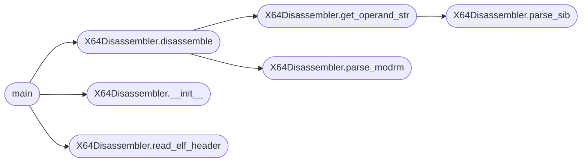

# `contrib.legacy.lazydisassebler`

> Source: [contrib/legacy/lazydisassebler.py:1](../../contrib/legacy/lazydisassebler.py#L1) | language `py` | coverage 100.0% | [API index](../index.md)

disassembler.py

Author: Gris Iscomeback
Email: grisiscomeback[at]gmail[dot]com
Date: 14/04/2025
Licencia: AGPL v3

Description: This file contain a rudimentary disassembler with no warranty

██╗      █████╗ ███████╗██╗   ██╗ ██████╗ ██╗    ██╗███╗   ██╗
██║     ██╔══██╗╚══███╔╝╚██╗ ██╔╝██╔═══██╗██║    ██║████╗  ██║
██║     ███████║  ███╔╝  ╚████╔╝ ██║   ██║██║ █╗ ██║██╔██╗ ██║
██║     ██╔══██║ ███╔╝    ╚██╔╝  ██║   ██║██║███╗██║██║╚██╗██║
███████╗██║  ██║███████╗   ██║   ╚██████╔╝╚███╔███╔╝██║ ╚████║
╚══════╝╚═╝  ╚═╝╚══════╝   ╚═╝    ╚═════╝  ╚══╝╚══╝ ╚═╝  ╚═══╝

## Contents

- **Classes:** [`X64Disassembler`](#x64disassembler)
- **Functions:** [`main`](#main)

## Call Graph

Solid arrows stay in this module, dashed arrows leave it.



## Classes

<a id="x64disassembler"></a>

### `X64Disassembler`

`class` | [contrib/legacy/lazydisassebler.py:24](../../contrib/legacy/lazydisassebler.py#L24)

```python
class X64Disassembler
```

A disassembler class for x86-64 architecture.

This class provides methods to disassemble raw binary data into human-readable assembly instructions.
It supports parsing ELF headers, decoding ModR/M and SIB bytes, and handling various instruction formats.

License: AGPL v3

**Members**

| Member | Kind | Summary |
|---|---|---|
| [`__init__`](#x64disassembler-__init__) | constructor | Initializes the X64Disassembler instance. |
| [`read_elf_header`](#x64disassembler-read_elf_header) | method | Reads the ELF header and finds the code section. |
| [`parse_modrm`](#x64disassembler-parse_modrm) | method | Parses the ModR/M byte and extracts mod, reg, and rm fields. |
| [`parse_sib`](#x64disassembler-parse_sib) | method | Parses the SIB byte and extracts scale, index, and base fields. |
| [`get_operand_str`](#x64disassembler-get_operand_str) | method | Gets the string representation of the operand based on mod/rm. |
| [`disassemble`](#x64disassembler-disassemble) | method | Main disassembler for x86-64 code. |

<a id="x64disassembler-__init__"></a>

#### `X64Disassembler.__init__`

`constructor` | [contrib/legacy/lazydisassebler.py:34](../../contrib/legacy/lazydisassebler.py#L34)

```python
def __init__(self)
```

Initializes the X64Disassembler instance.

Sets up registers, syscalls, and other necessary attributes for disassembly.

*Called by:* [`main`](#main)

<a id="x64disassembler-read_elf_header"></a>

#### `X64Disassembler.read_elf_header`

`method` | [contrib/legacy/lazydisassebler.py:79](../../contrib/legacy/lazydisassebler.py#L79)

```python
def read_elf_header(self, data)
```

Reads the ELF header and finds the code section.

This function parses the ELF file header to locate the executable segment (TEXT).
It checks for 64-bit ELF files and extracts the program headers to find the
first executable segment. Returns the offset, virtual address, size and entry point
of the TEXT segment if found.

Licencia: AGPL v3

**Parameters**

| Name | Type | Default | Description |
|---|---|---|---|
| `data` | `bytes` |  | The raw bytes of the ELF file |

**Returns:** `tuple` - (offset, virtual_address, size, entry_point) or (None, None, None, None) if not found

*Called by:* [`main`](#main)

<a id="x64disassembler-parse_modrm"></a>

#### `X64Disassembler.parse_modrm`

`method` | [contrib/legacy/lazydisassebler.py:135](../../contrib/legacy/lazydisassebler.py#L135)

```python
def parse_modrm(self, modrm, rex=0)
```

Parses the ModR/M byte and extracts mod, reg, and rm fields.

This function decodes the ModR/M byte used in x86/x64 instructions to determine
how operands are addressed. It also applies REX prefix extensions if present.

License: AGPL v3

**Parameters**

| Name | Type | Default | Description |
|---|---|---|---|
| `modrm` | `int` |  | The ModR/M byte to be parsed. |
| `rex` | `int` | `0` | Optional REX prefix byte (default is 0). |

**Returns:** `tuple` - A tuple containing the decoded `mod`, `reg`, and `rm` fields.

*Called by:* [`X64Disassembler.disassemble`](#x64disassembler-disassemble)

<a id="x64disassembler-parse_sib"></a>

#### `X64Disassembler.parse_sib`

`method` | [contrib/legacy/lazydisassebler.py:173](../../contrib/legacy/lazydisassebler.py#L173)

```python
def parse_sib(self, sib, rex=0)
```

Parses the SIB byte and extracts scale, index, and base fields.

This function decodes the Scale/Index/Base (SIB) byte used in x86/x64 addressing modes
to determine how memory operands are addressed. It also applies REX prefix extensions
if present.

License: AGPL v3

**Parameters**

| Name | Type | Default | Description |
|---|---|---|---|
| `sib` | `int` |  | The SIB byte to be parsed. |
| `rex` | `int` | `0` | Optional REX prefix byte (default is 0). |

**Returns:** `tuple` - A tuple containing the decoded `scale`, [`index`](lazyc2.py.md#index), and `base` fields.

*Called by:* [`X64Disassembler.get_operand_str`](#x64disassembler-get_operand_str)

<a id="x64disassembler-get_operand_str"></a>

#### `X64Disassembler.get_operand_str`

`method` | [contrib/legacy/lazydisassebler.py:212](../../contrib/legacy/lazydisassebler.py#L212)

```python
def get_operand_str(self, mod, rm, rex, bytes_data, offset)
```

Gets the string representation of the operand based on mod/rm.

This function decodes the addressing mode specified by the `mod` and `rm` fields
in x86/x64 instructions. It handles different cases such as RIP-relative, SIB,
and direct register addressing, applying REX prefix extensions if present.

License: AGPL v3

**Parameters**

| Name | Type | Default | Description |
|---|---|---|---|
| `mod` | `int` |  | The 'mod' field from the ModR/M byte. |
| `rm` | `int` |  | The 'rm' field from the ModR/M byte. |
| `rex` | `int` |  | Optional REX prefix byte. |
| `bytes_data` | `bytes` |  | The raw instruction bytes. |
| `offset` | `int` |  | Current offset in the instruction bytes. |

**Returns:** `tuple` - A tuple containing the operand string representation and the number
of additional bytes consumed during parsing.

*Calls:* [`X64Disassembler.parse_sib`](#x64disassembler-parse_sib)

*Called by:* [`X64Disassembler.disassemble`](#x64disassembler-disassemble)

<a id="x64disassembler-disassemble"></a>

#### `X64Disassembler.disassemble`

`method` | [contrib/legacy/lazydisassebler.py:305](../../contrib/legacy/lazydisassebler.py#L305)

```python
def disassemble(self, bytes_data, file_offset, vaddr, size, entry_point)
```

Main disassembler for x86-64 code.

This function disassembles raw machine code into human-readable assembly instructions.
It handles various instruction types, including XOR, PUSH/POP, MOV, immediate loads,
and system calls. Additionally, it processes REX prefixes and supports RIP-relative addressing.

License: AGPL v3

**Parameters**

| Name | Type | Default | Description |
|---|---|---|---|
| `bytes_data` | `bytes` |  | Raw binary data of the code section. |
| `file_offset` | `int` |  | File offset of the code section. |
| `vaddr` | `int` |  | Virtual address of the code section. |
| `size` | `int` |  | Size of the code section in bytes. |
| `entry_point` | `int` |  | Entry point of the program. |

*Calls:* [`X64Disassembler.get_operand_str`](#x64disassembler-get_operand_str), [`X64Disassembler.parse_modrm`](#x64disassembler-parse_modrm)

*Called by:* [`main`](#main)

---

## Functions

<a id="main"></a>

### `main`

`function` | [contrib/legacy/lazydisassebler.py:489](../../contrib/legacy/lazydisassebler.py#L489)

```python
def main()
```

Main function for the disassembler.

This function handles command-line arguments, reads the binary file,
and initiates the disassembly process for an ELF file.

Usage: python3 disassembler.py <binary_file>

*Calls:* [`X64Disassembler.__init__`](#x64disassembler-__init__), [`X64Disassembler.disassemble`](#x64disassembler-disassemble), [`X64Disassembler.read_elf_header`](#x64disassembler-read_elf_header)

---
