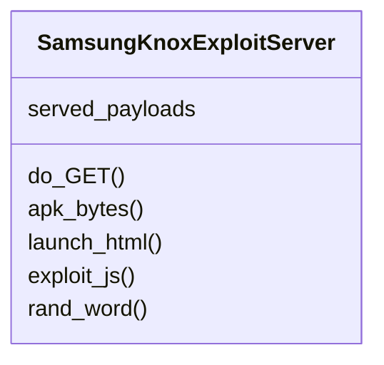

# `contrib.legacy.lazygalazy`

> Source: [contrib/legacy/lazygalazy.py:1](../../contrib/legacy/lazygalazy.py#L1) | language `py` | coverage 0.0% | [API index](../index.md)

## Contents

- **Classes:** [`SamsungKnoxExploitServer`](#samsungknoxexploitserver)
- **Functions:** [`main`](#main)

## Type Diagram



## Call Graph

Solid arrows stay in this module, dashed arrows leave it.


## Classes

<a id="samsungknoxexploitserver"></a>

### `SamsungKnoxExploitServer`

`class` | [contrib/legacy/lazygalazy.py:8](../../contrib/legacy/lazygalazy.py#L8)

```python
class SamsungKnoxExploitServer(BaseHTTPRequestHandler)
```

Bases: `BaseHTTPRequestHandler`

**Attributes**

| Name | Type | Default | Description |
|---|---|---|---|
| [`served_payloads`](#samsungknoxexploitserver-served_payloads) |  | `{}` |  |

**Members**

| Member | Kind | Summary |
|---|---|---|
| [`do_GET`](#samsungknoxexploitserver-do_get) | method |  |
| [`apk_bytes`](#samsungknoxexploitserver-apk_bytes) | method |  |
| [`launch_html`](#samsungknoxexploitserver-launch_html) | method |  |
| [`exploit_js`](#samsungknoxexploitserver-exploit_js) | method |  |
| [`rand_word`](#samsungknoxexploitserver-rand_word) | method |  |

<a id="samsungknoxexploitserver-do_get"></a>

#### `SamsungKnoxExploitServer.do_GET`

`method` | [contrib/legacy/lazygalazy.py:11](../../contrib/legacy/lazygalazy.py#L11)

```python
def do_GET(self)
```

*Calls:* [`SamsungKnoxExploitServer.apk_bytes`](#samsungknoxexploitserver-apk_bytes), [`SamsungKnoxExploitServer.launch_html`](#samsungknoxexploitserver-launch_html)

<a id="samsungknoxexploitserver-apk_bytes"></a>

#### `SamsungKnoxExploitServer.apk_bytes`

`method` | [contrib/legacy/lazygalazy.py:33](../../contrib/legacy/lazygalazy.py#L33)

```python
def apk_bytes(self)
```

*Called by:* [`SamsungKnoxExploitServer.do_GET`](#samsungknoxexploitserver-do_get)

<a id="samsungknoxexploitserver-launch_html"></a>

#### `SamsungKnoxExploitServer.launch_html`

`method` | [contrib/legacy/lazygalazy.py:36](../../contrib/legacy/lazygalazy.py#L36)

```python
def launch_html(self)
```

*Calls:* [`SamsungKnoxExploitServer.exploit_js`](#samsungknoxexploitserver-exploit_js)

*Called by:* [`SamsungKnoxExploitServer.do_GET`](#samsungknoxexploitserver-do_get)

<a id="samsungknoxexploitserver-exploit_js"></a>

#### `SamsungKnoxExploitServer.exploit_js`

`method` | [contrib/legacy/lazygalazy.py:49](../../contrib/legacy/lazygalazy.py#L49)

```python
def exploit_js(self)
```

*Calls:* [`SamsungKnoxExploitServer.rand_word`](#samsungknoxexploitserver-rand_word)

*Called by:* [`SamsungKnoxExploitServer.launch_html`](#samsungknoxexploitserver-launch_html)

<a id="samsungknoxexploitserver-rand_word"></a>

#### `SamsungKnoxExploitServer.rand_word`

`method` | [contrib/legacy/lazygalazy.py:93](../../contrib/legacy/lazygalazy.py#L93)

```python
def rand_word(self)
```

*Called by:* [`SamsungKnoxExploitServer.exploit_js`](#samsungknoxexploitserver-exploit_js)

---

## Functions

<a id="main"></a>

### `main`

`function` | [contrib/legacy/lazygalazy.py:97](../../contrib/legacy/lazygalazy.py#L97)

```python
def main()
```

---
