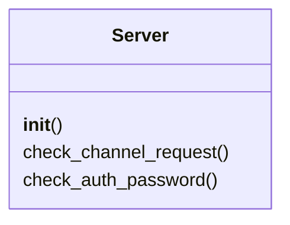
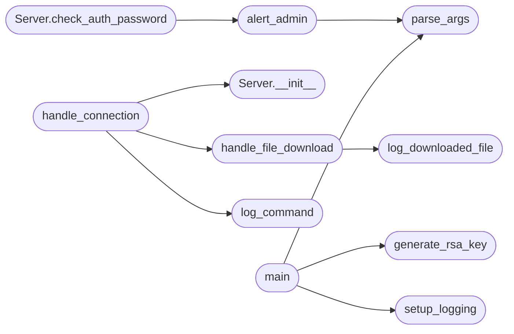

# `contrib.legacy.lazyhoneypot`

> Source: [contrib/legacy/lazyhoneypot.py:1](../../contrib/legacy/lazyhoneypot.py#L1) | language `py` | coverage 6.7% | [API index](../index.md)

main.py

Autor: Gris Iscomeback
Correo electrónico: grisiscomeback[at]gmail[dot]com
Fecha de creación: 09/06/2024
Licencia: AGPL v3

Descripción: LazyOwn HoneyPot

██╗      █████╗ ███████╗██╗   ██╗ ██████╗ ██╗    ██╗███╗   ██╗
██║     ██╔══██╗╚══███╔╝╚██╗ ██╔╝██╔═══██╗██║    ██║████╗  ██║
██║     ███████║  ███╔╝  ╚████╔╝ ██║   ██║██║ █╗ ██║██╔██╗ ██║
██║     ██╔══██║ ███╔╝    ╚██╔╝  ██║   ██║██║███╗██║██║╚██╗██║
███████╗██║  ██║███████╗   ██║   ╚██████╔╝╚███╔███╔╝██║ ╚████║
╚══════╝╚═╝  ╚═╝╚══════╝   ╚═╝    ╚═════╝  ╚══╝╚══╝ ╚═╝  ╚═══╝

## Contents

- **Classes:** [`Server`](#server)
- **Functions:** [`parse_args`](#parse_args), [`setup_logging`](#setup_logging), [`generate_rsa_key`](#generate_rsa_key), [`handle_connection`](#handle_connection), [`handle_file_download`](#handle_file_download), [`log_command`](#log_command), [`log_downloaded_file`](#log_downloaded_file), [`analyze_traffic`](#analyze_traffic), [`alert_admin`](#alert_admin), [`main`](#main)

## Type Diagram



## Call Graph

Solid arrows stay in this module, dashed arrows leave it.



## Classes

<a id="server"></a>

### `Server`

`class` | [contrib/legacy/lazyhoneypot.py:60](../../contrib/legacy/lazyhoneypot.py#L60)

```python
class Server(paramiko.ServerInterface)
```

Bases: `paramiko.ServerInterface`

**Members**

| Member | Kind | Summary |
|---|---|---|
| [`__init__`](#server-__init__) | constructor |  |
| [`check_channel_request`](#server-check_channel_request) | method |  |
| [`check_auth_password`](#server-check_auth_password) | method |  |

<a id="server-__init__"></a>

#### `Server.__init__`

`constructor` | [contrib/legacy/lazyhoneypot.py:61](../../contrib/legacy/lazyhoneypot.py#L61)

```python
def __init__(self)
```

*Called by:* [`handle_connection`](#handle_connection)

<a id="server-check_channel_request"></a>

#### `Server.check_channel_request`

`method` | [contrib/legacy/lazyhoneypot.py:64](../../contrib/legacy/lazyhoneypot.py#L64)

```python
def check_channel_request(self, kind, chanid)
```

**Parameters**

| Name | Type | Default | Description |
|---|---|---|---|
| `kind` |  |  |  |
| `chanid` |  |  |  |

<a id="server-check_auth_password"></a>

#### `Server.check_auth_password`

`method` | [contrib/legacy/lazyhoneypot.py:69](../../contrib/legacy/lazyhoneypot.py#L69)

```python
def check_auth_password(self, username, password)
```

**Parameters**

| Name | Type | Default | Description |
|---|---|---|---|
| `username` |  |  |  |
| `password` |  |  |  |

*Calls:* [`alert_admin`](#alert_admin)

---

## Functions

<a id="parse_args"></a>

### `parse_args`

`function` | [contrib/legacy/lazyhoneypot.py:34](../../contrib/legacy/lazyhoneypot.py#L34)

```python
def parse_args()
```

*Called by:* [`alert_admin`](#alert_admin), [`main`](#main)

---

<a id="setup_logging"></a>

### `setup_logging`

`function` | [contrib/legacy/lazyhoneypot.py:52](../../contrib/legacy/lazyhoneypot.py#L52)

```python
def setup_logging(log_file)
```

**Parameters**

| Name | Type | Default | Description |
|---|---|---|---|
| `log_file` |  |  |  |

*Called by:* [`main`](#main)

---

<a id="generate_rsa_key"></a>

### `generate_rsa_key`

`function` | [contrib/legacy/lazyhoneypot.py:56](../../contrib/legacy/lazyhoneypot.py#L56)

```python
def generate_rsa_key(key_filename)
```

**Parameters**

| Name | Type | Default | Description |
|---|---|---|---|
| `key_filename` |  |  |  |

*Called by:* [`main`](#main)

---

<a id="handle_connection"></a>

### `handle_connection`

`function` | [contrib/legacy/lazyhoneypot.py:74](../../contrib/legacy/lazyhoneypot.py#L74)

```python
def handle_connection(client_socket, host_key, commands_log, downloads_log, downloads_dir)
```

**Parameters**

| Name | Type | Default | Description |
|---|---|---|---|
| `client_socket` |  |  |  |
| `host_key` |  |  |  |
| `commands_log` |  |  |  |
| `downloads_log` |  |  |  |
| `downloads_dir` |  |  |  |

*Calls:* [`Server.__init__`](#server-__init__), [`handle_file_download`](#handle_file_download), [`log_command`](#log_command)

---

<a id="handle_file_download"></a>

### `handle_file_download`

`function` | [contrib/legacy/lazyhoneypot.py:110](../../contrib/legacy/lazyhoneypot.py#L110)

```python
def handle_file_download(command, downloads_dir, downloads_log)
```

**Parameters**

| Name | Type | Default | Description |
|---|---|---|---|
| `command` |  |  |  |
| `downloads_dir` |  |  |  |
| `downloads_log` |  |  |  |

**Raises**

- `ValueError`: (raised in the body, not documented)

*Calls:* [`log_downloaded_file`](#log_downloaded_file)

*Called by:* [`handle_connection`](#handle_connection)

---

<a id="log_command"></a>

### `log_command`

`function` | [contrib/legacy/lazyhoneypot.py:128](../../contrib/legacy/lazyhoneypot.py#L128)

```python
def log_command(command, commands_log)
```

**Parameters**

| Name | Type | Default | Description |
|---|---|---|---|
| `command` |  |  |  |
| `commands_log` |  |  |  |

*Called by:* [`handle_connection`](#handle_connection)

---

<a id="log_downloaded_file"></a>

### `log_downloaded_file`

`function` | [contrib/legacy/lazyhoneypot.py:132](../../contrib/legacy/lazyhoneypot.py#L132)

```python
def log_downloaded_file(filename, url, downloads_log)
```

**Parameters**

| Name | Type | Default | Description |
|---|---|---|---|
| `filename` |  |  |  |
| `url` |  |  |  |
| `downloads_log` |  |  |  |

*Called by:* [`handle_file_download`](#handle_file_download)

---

<a id="analyze_traffic"></a>

### `analyze_traffic`

`function` | [contrib/legacy/lazyhoneypot.py:136](../../contrib/legacy/lazyhoneypot.py#L136)

```python
def analyze_traffic()
```

---

<a id="alert_admin"></a>

### `alert_admin`

`function` | [contrib/legacy/lazyhoneypot.py:147](../../contrib/legacy/lazyhoneypot.py#L147)

```python
def alert_admin(message)
```

**Parameters**

| Name | Type | Default | Description |
|---|---|---|---|
| `message` |  |  |  |

*Calls:* [`parse_args`](#parse_args)

*Called by:* [`Server.check_auth_password`](#server-check_auth_password)

---

<a id="main"></a>

### `main`

`function` | [contrib/legacy/lazyhoneypot.py:165](../../contrib/legacy/lazyhoneypot.py#L165)

```python
def main()
```

**Raises**

- `ValueError`: (raised in the body, not documented)

*Calls:* [`generate_rsa_key`](#generate_rsa_key), [`parse_args`](#parse_args), [`setup_logging`](#setup_logging)

---
