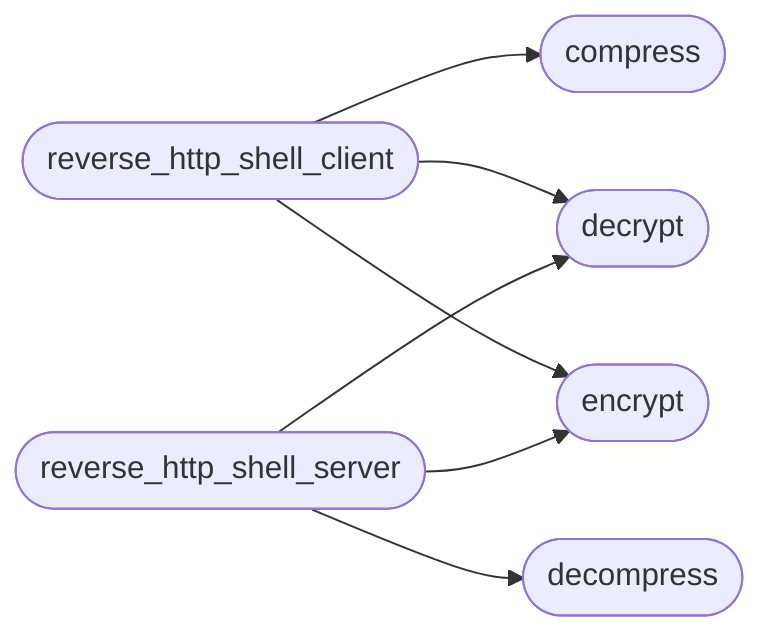

# `contrib.legacy.lazyhttpreverseshell`

> Source: [contrib/legacy/lazyhttpreverseshell.py:1](../../contrib/legacy/lazyhttpreverseshell.py#L1) | language `py` | coverage 0.0% | [API index](../index.md)

## Contents

- **Functions:** [`encrypt`](#encrypt), [`decrypt`](#decrypt), [`compress`](#compress), [`decompress`](#decompress), [`reverse_http_shell_client`](#reverse_http_shell_client), [`reverse_http_shell_server`](#reverse_http_shell_server), [`parse_arguments`](#parse_arguments)
- **Constants:** [`FIXED_KEY`](#fixed_key)

## Call Graph

Solid arrows stay in this module, dashed arrows leave it.



## Functions

<a id="encrypt"></a>

### `encrypt`

`function` | [contrib/legacy/lazyhttpreverseshell.py:14](../../contrib/legacy/lazyhttpreverseshell.py#L14)

```python
def encrypt(data)
```

**Parameters**

| Name | Type | Default | Description |
|---|---|---|---|
| `data` |  |  |  |

*Called by:* [`MiscMigratedCommandSet.do_EOF`](cli.commands.misc_migrated.py.md#miscmigratedcommandset-do_eof), [`MiscMigratedCommandSet.do_exit`](cli.commands.misc_migrated.py.md#miscmigratedcommandset-do_exit), [`SessionOpsCommandSet.do_qa`](cli.commands.session_ops.py.md#sessionopscommandset-do_qa), [`reverse_http_shell_client`](#reverse_http_shell_client), [`reverse_http_shell_server`](#reverse_http_shell_server)

---

<a id="decrypt"></a>

### `decrypt`

`function` | [contrib/legacy/lazyhttpreverseshell.py:17](../../contrib/legacy/lazyhttpreverseshell.py#L17)

```python
def decrypt(data)
```

**Parameters**

| Name | Type | Default | Description |
|---|---|---|---|
| `data` |  |  |  |

*Called by:* [`reverse_http_shell_client`](#reverse_http_shell_client), [`reverse_http_shell_server`](#reverse_http_shell_server)

---

<a id="compress"></a>

### `compress`

`function` | [contrib/legacy/lazyhttpreverseshell.py:20](../../contrib/legacy/lazyhttpreverseshell.py#L20)

```python
def compress(data)
```

**Parameters**

| Name | Type | Default | Description |
|---|---|---|---|
| `data` |  |  |  |

*Called by:* [`reverse_http_shell_client`](#reverse_http_shell_client)

---

<a id="decompress"></a>

### `decompress`

`function` | [contrib/legacy/lazyhttpreverseshell.py:23](../../contrib/legacy/lazyhttpreverseshell.py#L23)

```python
def decompress(data)
```

**Parameters**

| Name | Type | Default | Description |
|---|---|---|---|
| `data` |  |  |  |

*Called by:* [`reverse_http_shell_server`](#reverse_http_shell_server)

---

<a id="reverse_http_shell_client"></a>

### `reverse_http_shell_client`

`function` | [contrib/legacy/lazyhttpreverseshell.py:26](../../contrib/legacy/lazyhttpreverseshell.py#L26)

```python
def reverse_http_shell_client(lhost, rhost, rport)
```

**Parameters**

| Name | Type | Default | Description |
|---|---|---|---|
| `lhost` |  |  |  |
| `rhost` |  |  |  |
| `rport` |  |  |  |

*Calls:* [`compress`](#compress), [`decrypt`](#decrypt), [`encrypt`](#encrypt)

---

<a id="reverse_http_shell_server"></a>

### `reverse_http_shell_server`

`function` | [contrib/legacy/lazyhttpreverseshell.py:50](../../contrib/legacy/lazyhttpreverseshell.py#L50)

```python
def reverse_http_shell_server(lhost, lport)
```

**Parameters**

| Name | Type | Default | Description |
|---|---|---|---|
| `lhost` |  |  |  |
| `lport` |  |  |  |

*Calls:* [`decompress`](#decompress), [`decrypt`](#decrypt), [`encrypt`](#encrypt)

---

<a id="parse_arguments"></a>

### `parse_arguments`

`function` | [contrib/legacy/lazyhttpreverseshell.py:88](../../contrib/legacy/lazyhttpreverseshell.py#L88)

```python
def parse_arguments(args)
```

**Parameters**

| Name | Type | Default | Description |
|---|---|---|---|
| `args` |  |  |  |

---

## Constants

<a id="fixed_key"></a>

### `FIXED_KEY`

`constant` | [contrib/legacy/lazyhttpreverseshell.py:11](../../contrib/legacy/lazyhttpreverseshell.py#L11)

```python
FIXED_KEY = b'TGEPpacDlj_czSt_mNwnLvi67K4yHf16795gV8NZ3Pc='
```

---
