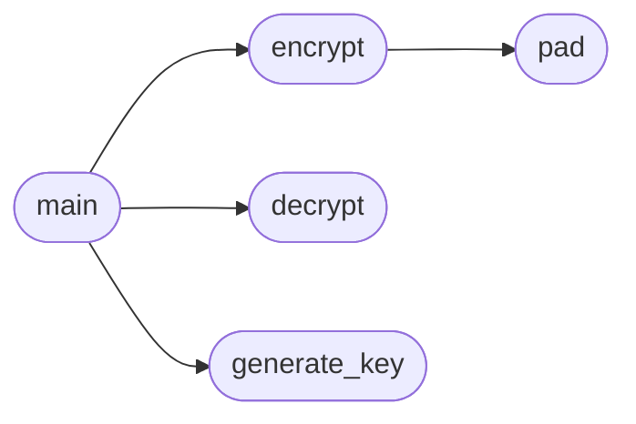

# `contrib.legacy.lazykeygen`

> Source: [contrib/legacy/lazykeygen.py:1](../../contrib/legacy/lazykeygen.py#L1) | language `py` | coverage 0.0% | [API index](../index.md)

## Contents

- **Functions:** [`pad`](#pad), [`encrypt`](#encrypt), [`decrypt`](#decrypt), [`generate_key`](#generate_key), [`main`](#main)

## Call Graph

Solid arrows stay in this module, dashed arrows leave it.



## Functions

<a id="pad"></a>

### `pad`

`function` | [contrib/legacy/lazykeygen.py:8](../../contrib/legacy/lazykeygen.py#L8)

```python
def pad(s)
```

**Parameters**

| Name | Type | Default | Description |
|---|---|---|---|
| `s` |  |  |  |

*Called by:* [`encrypt`](#encrypt)

---

<a id="encrypt"></a>

### `encrypt`

`function` | [contrib/legacy/lazykeygen.py:11](../../contrib/legacy/lazykeygen.py#L11)

```python
def encrypt(plaintext, key)
```

**Parameters**

| Name | Type | Default | Description |
|---|---|---|---|
| `plaintext` |  |  |  |
| `key` |  |  |  |

*Calls:* [`pad`](#pad)

*Called by:* [`main`](#main)

---

<a id="decrypt"></a>

### `decrypt`

`function` | [contrib/legacy/lazykeygen.py:17](../../contrib/legacy/lazykeygen.py#L17)

```python
def decrypt(ciphertext, key)
```

**Parameters**

| Name | Type | Default | Description |
|---|---|---|---|
| `ciphertext` |  |  |  |
| `key` |  |  |  |

*Called by:* [`main`](#main)

---

<a id="generate_key"></a>

### `generate_key`

`function` | [contrib/legacy/lazykeygen.py:23](../../contrib/legacy/lazykeygen.py#L23)

```python
def generate_key(length=16)
```

**Parameters**

| Name | Type | Default | Description |
|---|---|---|---|
| `length` |  | `16` |  |

*Called by:* [`main`](#main)

---

<a id="main"></a>

### `main`

`function` | [contrib/legacy/lazykeygen.py:26](../../contrib/legacy/lazykeygen.py#L26)

```python
def main()
```

*Calls:* [`decrypt`](#decrypt), [`encrypt`](#encrypt), [`generate_key`](#generate_key)

---
