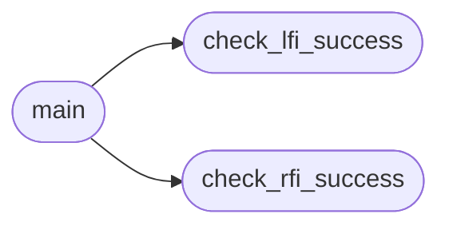

# `contrib.legacy.lazylfi2rce`

> Source: [contrib/legacy/lazylfi2rce.py:1](../../contrib/legacy/lazylfi2rce.py#L1) | language `py` | coverage 0.0% | [API index](../index.md)

## Contents

- **Functions:** [`signal_handler`](#signal_handler), [`check_lfi_success`](#check_lfi_success), [`check_rfi_success`](#check_rfi_success), [`main`](#main)
- **Constants:** [`BANNER`](#banner)

## Call Graph

Solid arrows stay in this module, dashed arrows leave it.



## Functions

<a id="signal_handler"></a>

### `signal_handler`

`function` | [contrib/legacy/lazylfi2rce.py:29](../../contrib/legacy/lazylfi2rce.py#L29)

```python
def signal_handler(sig, frame)
```

**Parameters**

| Name | Type | Default | Description |
|---|---|---|---|
| `sig` |  |  |  |
| `frame` |  |  |  |

---

<a id="check_lfi_success"></a>

### `check_lfi_success`

`function` | [contrib/legacy/lazylfi2rce.py:35](../../contrib/legacy/lazylfi2rce.py#L35)

```python
def check_lfi_success(response_text)
```

**Parameters**

| Name | Type | Default | Description |
|---|---|---|---|
| `response_text` |  |  |  |

*Called by:* [`main`](#main)

---

<a id="check_rfi_success"></a>

### `check_rfi_success`

`function` | [contrib/legacy/lazylfi2rce.py:39](../../contrib/legacy/lazylfi2rce.py#L39)

```python
def check_rfi_success(response_text)
```

**Parameters**

| Name | Type | Default | Description |
|---|---|---|---|
| `response_text` |  |  |  |

*Called by:* [`main`](#main)

---

<a id="main"></a>

### `main`

`function` | [contrib/legacy/lazylfi2rce.py:43](../../contrib/legacy/lazylfi2rce.py#L43)

```python
def main()
```

*Calls:* [`check_lfi_success`](#check_lfi_success), [`check_rfi_success`](#check_rfi_success)

---

## Constants

<a id="banner"></a>

### `BANNER`

`constant` | [contrib/legacy/lazylfi2rce.py:10](../../contrib/legacy/lazylfi2rce.py#L10)

```python
BANNER
```

---
