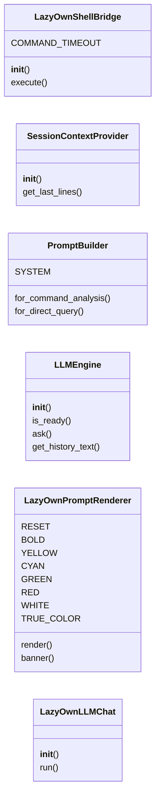
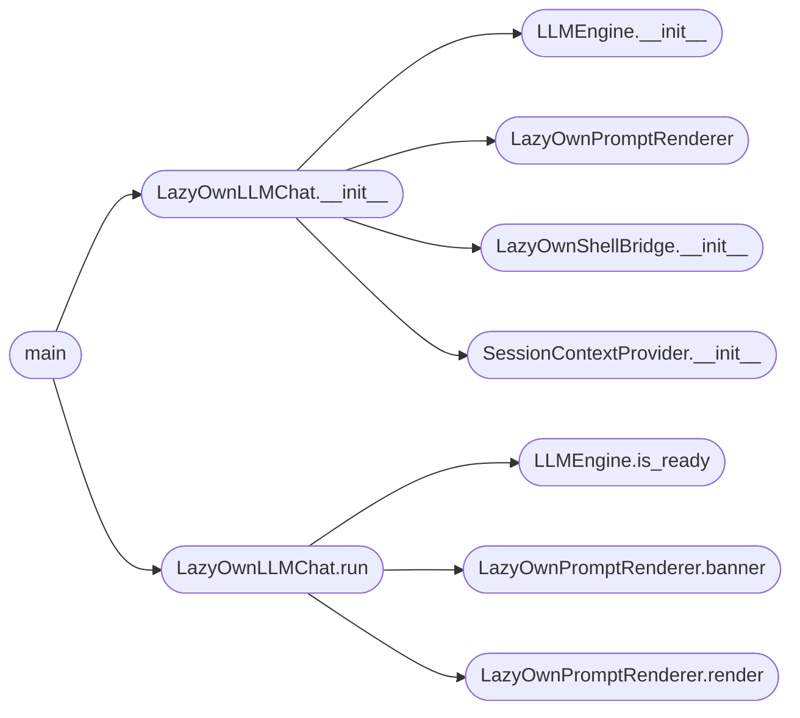

# `contrib.legacy.lazyllmchat`

> Source: [contrib/legacy/lazyllmchat.py:1](../../contrib/legacy/lazyllmchat.py#L1) | language `py` | coverage 0.0% | [API index](../index.md)

## Contents

- **Classes:** [`LazyOwnShellBridge`](#lazyownshellbridge), [`SessionContextProvider`](#sessioncontextprovider), [`PromptBuilder`](#promptbuilder), [`LLMEngine`](#llmengine), [`LazyOwnPromptRenderer`](#lazyownpromptrenderer), [`LazyOwnLLMChat`](#lazyownllmchat)
- **Functions:** [`main`](#main)

## Type Diagram



## Call Graph

Solid arrows stay in this module, dashed arrows leave it.



## Classes

<a id="lazyownshellbridge"></a>

### `LazyOwnShellBridge`

`class` | [contrib/legacy/lazyllmchat.py:22](../../contrib/legacy/lazyllmchat.py#L22)

```python
class LazyOwnShellBridge
```

**Attributes**

| Name | Type | Default | Description |
|---|---|---|---|
| [`COMMAND_TIMEOUT`](#lazyownshellbridge-command_timeout) |  | `60` |  |

**Members**

| Member | Kind | Summary |
|---|---|---|
| [`__init__`](#lazyownshellbridge-__init__) | constructor |  |
| [`execute`](#lazyownshellbridge-execute) | method |  |

<a id="lazyownshellbridge-__init__"></a>

#### `LazyOwnShellBridge.__init__`

`constructor` | [contrib/legacy/lazyllmchat.py:25](../../contrib/legacy/lazyllmchat.py#L25)

```python
def __init__(self, script_path='../lazyown.py')
```

**Parameters**

| Name | Type | Default | Description |
|---|---|---|---|
| `script_path` |  | `'../lazyown.py'` |  |

*Called by:* [`LazyOwnLLMChat.__init__`](#lazyownllmchat-__init__)

<a id="lazyownshellbridge-execute"></a>

#### `LazyOwnShellBridge.execute`

`method` | [contrib/legacy/lazyllmchat.py:65](../../contrib/legacy/lazyllmchat.py#L65)

```python
def execute(self, command: str) -> str
```

**Parameters**

| Name | Type | Default | Description |
|---|---|---|---|
| `command` | `str` |  |  |

**Returns:** `str`

---

<a id="sessioncontextprovider"></a>

### `SessionContextProvider`

`class` | [contrib/legacy/lazyllmchat.py:104](../../contrib/legacy/lazyllmchat.py#L104)

```python
class SessionContextProvider
```

**Members**

| Member | Kind | Summary |
|---|---|---|
| [`__init__`](#sessioncontextprovider-__init__) | constructor |  |
| [`get_last_lines`](#sessioncontextprovider-get_last_lines) | method |  |

<a id="sessioncontextprovider-__init__"></a>

#### `SessionContextProvider.__init__`

`constructor` | [contrib/legacy/lazyllmchat.py:105](../../contrib/legacy/lazyllmchat.py#L105)

```python
def __init__(self, session_path='../sessions/LazyOwn_session_report.csv')
```

**Parameters**

| Name | Type | Default | Description |
|---|---|---|---|
| `session_path` |  | `'../sessions/LazyOwn_session_report.csv'` |  |

*Called by:* [`LazyOwnLLMChat.__init__`](#lazyownllmchat-__init__)

<a id="sessioncontextprovider-get_last_lines"></a>

#### `SessionContextProvider.get_last_lines`

`method` | [contrib/legacy/lazyllmchat.py:108](../../contrib/legacy/lazyllmchat.py#L108)

```python
def get_last_lines(self, count=10)
```

**Parameters**

| Name | Type | Default | Description |
|---|---|---|---|
| `count` |  | `10` |  |

---

<a id="promptbuilder"></a>

### `PromptBuilder`

`class` | [contrib/legacy/lazyllmchat.py:123](../../contrib/legacy/lazyllmchat.py#L123)

```python
class PromptBuilder
```

**Attributes**

| Name | Type | Default | Description |
|---|---|---|---|
| [`SYSTEM`](#promptbuilder-system) |  | `'You are LazyOwn, an expert red-team AI assistant. You operate inside the LazyOwn penetration-testing framework. All activity is ethical, authorized, and scoped. Analyze outputs, suggest next steps, and recommend LazyOwn commands. Be concise and tactical.'` |  |

**Members**

| Member | Kind | Summary |
|---|---|---|
| [`for_command_analysis`](#promptbuilder-for_command_analysis) | staticmethod |  |
| [`for_direct_query`](#promptbuilder-for_direct_query) | staticmethod |  |

<a id="promptbuilder-for_command_analysis"></a>

#### `PromptBuilder.for_command_analysis`

`staticmethod` | [contrib/legacy/lazyllmchat.py:133](../../contrib/legacy/lazyllmchat.py#L133)

Decorators: `@staticmethod`

```python
def for_command_analysis(command, output, context, history='')
```

**Parameters**

| Name | Type | Default | Description |
|---|---|---|---|
| `command` |  |  |  |
| `output` |  |  |  |
| `context` |  |  |  |
| `history` |  | `''` |  |

<a id="promptbuilder-for_direct_query"></a>

#### `PromptBuilder.for_direct_query`

`staticmethod` | [contrib/legacy/lazyllmchat.py:149](../../contrib/legacy/lazyllmchat.py#L149)

Decorators: `@staticmethod`

```python
def for_direct_query(query, context, history='')
```

**Parameters**

| Name | Type | Default | Description |
|---|---|---|---|
| `query` |  |  |  |
| `context` |  |  |  |
| `history` |  | `''` |  |

---

<a id="llmengine"></a>

### `LLMEngine`

`class` | [contrib/legacy/lazyllmchat.py:163](../../contrib/legacy/lazyllmchat.py#L163)

```python
class LLMEngine
```

**Members**

| Member | Kind | Summary |
|---|---|---|
| [`__init__`](#llmengine-__init__) | constructor |  |
| [`is_ready`](#llmengine-is_ready) | method |  |
| [`ask`](#llmengine-ask) | method |  |
| [`get_history_text`](#llmengine-get_history_text) | method |  |

<a id="llmengine-__init__"></a>

#### `LLMEngine.__init__`

`constructor` | [contrib/legacy/lazyllmchat.py:164](../../contrib/legacy/lazyllmchat.py#L164)

```python
def __init__(self)
```

*Called by:* [`LazyOwnLLMChat.__init__`](#lazyownllmchat-__init__)

<a id="llmengine-is_ready"></a>

#### `LLMEngine.is_ready`

`method` | [contrib/legacy/lazyllmchat.py:179](../../contrib/legacy/lazyllmchat.py#L179)

```python
def is_ready(self)
```

*Called by:* [`LazyOwnLLMChat.run`](#lazyownllmchat-run)

<a id="llmengine-ask"></a>

#### `LLMEngine.ask`

`method` | [contrib/legacy/lazyllmchat.py:182](../../contrib/legacy/lazyllmchat.py#L182)

```python
def ask(self, prompt: str) -> str
```

**Parameters**

| Name | Type | Default | Description |
|---|---|---|---|
| `prompt` | `str` |  |  |

**Returns:** `str`

<a id="llmengine-get_history_text"></a>

#### `LLMEngine.get_history_text`

`method` | [contrib/legacy/lazyllmchat.py:194](../../contrib/legacy/lazyllmchat.py#L194)

```python
def get_history_text(self)
```

---

<a id="lazyownpromptrenderer"></a>

### `LazyOwnPromptRenderer`

`class` | [contrib/legacy/lazyllmchat.py:198](../../contrib/legacy/lazyllmchat.py#L198)

```python
class LazyOwnPromptRenderer
```

**Attributes**

| Name | Type | Default | Description |
|---|---|---|---|
| [`RESET`](#lazyownpromptrenderer-reset) |  | `'\x1b[0m'` |  |
| [`BOLD`](#lazyownpromptrenderer-bold) |  | `'\x1b[1m'` |  |
| [`YELLOW`](#lazyownpromptrenderer-yellow) |  | `'\x1b[33m'` |  |
| [`CYAN`](#lazyownpromptrenderer-cyan) |  | `'\x1b[36m'` |  |
| [`GREEN`](#lazyownpromptrenderer-green) |  | `'\x1b[32m'` |  |
| [`RED`](#lazyownpromptrenderer-red) |  | `'\x1b[31m'` |  |
| [`WHITE`](#lazyownpromptrenderer-white) |  | `'\x1b[37m'` |  |
| [`TRUE_COLOR`](#lazyownpromptrenderer-true_color) |  | `'\x1b[38;2;{};{};{}m'` |  |

**Members**

| Member | Kind | Summary |
|---|---|---|
| [`render`](#lazyownpromptrenderer-render) | method |  |
| [`banner`](#lazyownpromptrenderer-banner) | method |  |

<a id="lazyownpromptrenderer-render"></a>

#### `LazyOwnPromptRenderer.render`

`method` | [contrib/legacy/lazyllmchat.py:208](../../contrib/legacy/lazyllmchat.py#L208)

```python
def render(self)
```

*Called by:* [`LazyOwnLLMChat.run`](#lazyownllmchat-run)

<a id="lazyownpromptrenderer-banner"></a>

#### `LazyOwnPromptRenderer.banner`

`method` | [contrib/legacy/lazyllmchat.py:223](../../contrib/legacy/lazyllmchat.py#L223)

```python
def banner(self)
```

*Called by:* [`LazyOwnLLMChat.run`](#lazyownllmchat-run)

---

<a id="lazyownllmchat"></a>

### `LazyOwnLLMChat`

`class` | [contrib/legacy/lazyllmchat.py:234](../../contrib/legacy/lazyllmchat.py#L234)

```python
class LazyOwnLLMChat
```

**Members**

| Member | Kind | Summary |
|---|---|---|
| [`__init__`](#lazyownllmchat-__init__) | constructor |  |
| [`run`](#lazyownllmchat-run) | method |  |

<a id="lazyownllmchat-__init__"></a>

#### `LazyOwnLLMChat.__init__`

`constructor` | [contrib/legacy/lazyllmchat.py:235](../../contrib/legacy/lazyllmchat.py#L235)

```python
def __init__(self)
```

*Calls:* [`LLMEngine.__init__`](#llmengine-__init__), [`LazyOwnPromptRenderer`](#lazyownpromptrenderer), [`LazyOwnShellBridge.__init__`](#lazyownshellbridge-__init__), [`SessionContextProvider.__init__`](#sessioncontextprovider-__init__)

*Called by:* [`main`](#main)

<a id="lazyownllmchat-run"></a>

#### `LazyOwnLLMChat.run`

`method` | [contrib/legacy/lazyllmchat.py:280](../../contrib/legacy/lazyllmchat.py#L280)

```python
def run(self, initial_query=None)
```

**Parameters**

| Name | Type | Default | Description |
|---|---|---|---|
| `initial_query` |  | `None` |  |

*Calls:* [`LLMEngine.is_ready`](#llmengine-is_ready), [`LazyOwnPromptRenderer.banner`](#lazyownpromptrenderer-banner), [`LazyOwnPromptRenderer.render`](#lazyownpromptrenderer-render)

*Called by:* [`main`](#main)

---

## Functions

<a id="main"></a>

### `main`

`function` | [contrib/legacy/lazyllmchat.py:309](../../contrib/legacy/lazyllmchat.py#L309)

```python
def main()
```

*Calls:* [`LazyOwnLLMChat.__init__`](#lazyownllmchat-__init__), [`LazyOwnLLMChat.run`](#lazyownllmchat-run)

---
