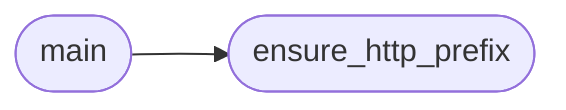

# `contrib.legacy.lazylogpoisoning`

> Source: [contrib/legacy/lazylogpoisoning.py:1](../../contrib/legacy/lazylogpoisoning.py#L1) | language `py` | coverage 0.0% | [API index](../index.md)

## Contents

- **Functions:** [`ensure_http_prefix`](#ensure_http_prefix), [`signal_handler`](#signal_handler), [`main`](#main)
- **Constants:** [`BANNER`](#banner)

## Call Graph

Solid arrows stay in this module, dashed arrows leave it.



## Functions

<a id="ensure_http_prefix"></a>

### `ensure_http_prefix`

`function` | [contrib/legacy/lazylogpoisoning.py:39](../../contrib/legacy/lazylogpoisoning.py#L39)

```python
def ensure_http_prefix(url)
```

**Parameters**

| Name | Type | Default | Description |
|---|---|---|---|
| `url` |  |  |  |

*Called by:* [`main`](#main)

---

<a id="signal_handler"></a>

### `signal_handler`

`function` | [contrib/legacy/lazylogpoisoning.py:45](../../contrib/legacy/lazylogpoisoning.py#L45)

```python
def signal_handler(sig: int, frame: any) -> None
```

**Parameters**

| Name | Type | Default | Description |
|---|---|---|---|
| `sig` | `int` |  |  |
| `frame` | `any` |  |  |

---

<a id="main"></a>

### `main`

`function` | [contrib/legacy/lazylogpoisoning.py:53](../../contrib/legacy/lazylogpoisoning.py#L53)

```python
def main()
```

*Calls:* [`ensure_http_prefix`](#ensure_http_prefix)

---

## Constants

<a id="banner"></a>

### `BANNER`

`constant` | [contrib/legacy/lazylogpoisoning.py:11](../../contrib/legacy/lazylogpoisoning.py#L11)

```python
BANNER
```

---
