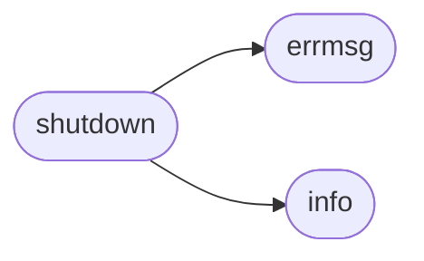

# `contrib.legacy.lazymariadb_rce_cve_2016-662`

> Source: [contrib/legacy/lazymariadb_rce_cve_2016-662.py:1](../../contrib/legacy/lazymariadb_rce_cve_2016-662.py#L1) | language `py` | coverage 25.0% | [API index](../index.md)

MySQL / MariaDB / Percona -  Remote Root Code Execution / PrivEsc PoC Exploit (CVE-2016-6662) 0ldSQL_MySQL_RCE_exploit.py (ver.

1.0)  For testing purposes only. Do no harm.  Discovered/Coded by:  Dawid Golunski http://legalhackers.com   This is a limited version of the PoC exploit. It only allows appending to existing mysql config files with weak permissions. See V) 1) section of the advisory for details on this vector.  Full PoC will be released at a later date, and will show how attackers could exploit the vulnerability on default installations of MySQL on systems with no writable my.cnf config files available.  The upcoming advisory CVE-2016-6663 will also make the exploitation trivial for certain low-privileged attackers that do not have FILE privilege.  See full advisory for details: https://legalhackers.com/advisories/MySQL-Exploit-Remote-Root-Code-Execution-Privesc-CVE-2016-6662.html  Video PoC:

## Contents

- **Functions:** [`info`](#info), [`errmsg`](#errmsg), [`shutdown`](#shutdown)

## Call Graph

Solid arrows stay in this module, dashed arrows leave it.



## Functions

<a id="info"></a>

### `info`

`function` | [contrib/legacy/lazymariadb_rce_cve_2016-662.py:59](../../contrib/legacy/lazymariadb_rce_cve_2016-662.py#L59)

```python
def info(str)
```

**Parameters**

| Name | Type | Default | Description |
|---|---|---|---|
| `str` |  |  |  |

*Called by:* [`shutdown`](#shutdown)

---

<a id="errmsg"></a>

### `errmsg`

`function` | [contrib/legacy/lazymariadb_rce_cve_2016-662.py:63](../../contrib/legacy/lazymariadb_rce_cve_2016-662.py#L63)

```python
def errmsg(str)
```

**Parameters**

| Name | Type | Default | Description |
|---|---|---|---|
| `str` |  |  |  |

*Called by:* [`shutdown`](#shutdown)

---

<a id="shutdown"></a>

### `shutdown`

`function` | [contrib/legacy/lazymariadb_rce_cve_2016-662.py:67](../../contrib/legacy/lazymariadb_rce_cve_2016-662.py#L67)

```python
def shutdown(code)
```

**Parameters**

| Name | Type | Default | Description |
|---|---|---|---|
| `code` |  |  |  |

*Calls:* [`errmsg`](#errmsg), [`info`](#info)

---
