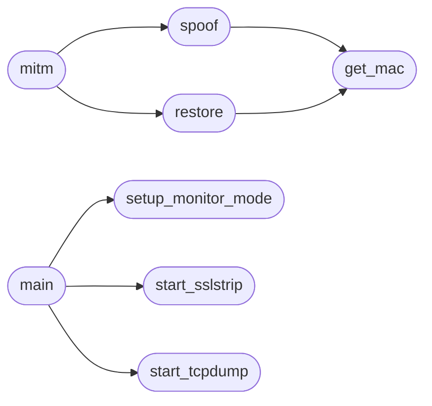

# `contrib.legacy.lazymidm`

> Source: [contrib/legacy/lazymidm.py:1](../../contrib/legacy/lazymidm.py#L1) | language `py` | coverage 0.0% | [API index](../index.md)

## Contents

- **Functions:** [`get_mac`](#get_mac), [`spoof`](#spoof), [`restore`](#restore), [`mitm`](#mitm), [`start_sslstrip`](#start_sslstrip), [`start_tcpdump`](#start_tcpdump), [`setup_monitor_mode`](#setup_monitor_mode), [`main`](#main)

## Call Graph

Solid arrows stay in this module, dashed arrows leave it.



## Functions

<a id="get_mac"></a>

### `get_mac`

`function` | [contrib/legacy/lazymidm.py:12](../../contrib/legacy/lazymidm.py#L12)

```python
def get_mac(ip)
```

**Parameters**

| Name | Type | Default | Description |
|---|---|---|---|
| `ip` |  |  |  |

*Called by:* [`restore`](#restore), [`spoof`](#spoof)

---

<a id="spoof"></a>

### `spoof`

`function` | [contrib/legacy/lazymidm.py:18](../../contrib/legacy/lazymidm.py#L18)

```python
def spoof(target_ip, spoof_ip)
```

**Parameters**

| Name | Type | Default | Description |
|---|---|---|---|
| `target_ip` |  |  |  |
| `spoof_ip` |  |  |  |

*Calls:* [`get_mac`](#get_mac)

*Called by:* [`mitm`](#mitm)

---

<a id="restore"></a>

### `restore`

`function` | [contrib/legacy/lazymidm.py:27](../../contrib/legacy/lazymidm.py#L27)

```python
def restore(target_ip, spoof_ip)
```

**Parameters**

| Name | Type | Default | Description |
|---|---|---|---|
| `target_ip` |  |  |  |
| `spoof_ip` |  |  |  |

*Calls:* [`get_mac`](#get_mac)

*Called by:* [`mitm`](#mitm)

---

<a id="mitm"></a>

### `mitm`

`function` | [contrib/legacy/lazymidm.py:37](../../contrib/legacy/lazymidm.py#L37)

```python
def mitm(target_ip, gateway_ip)
```

**Parameters**

| Name | Type | Default | Description |
|---|---|---|---|
| `target_ip` |  |  |  |
| `gateway_ip` |  |  |  |

*Calls:* [`restore`](#restore), [`spoof`](#spoof)

---

<a id="start_sslstrip"></a>

### `start_sslstrip`

`function` | [contrib/legacy/lazymidm.py:50](../../contrib/legacy/lazymidm.py#L50)

```python
def start_sslstrip(port)
```

**Parameters**

| Name | Type | Default | Description |
|---|---|---|---|
| `port` |  |  |  |

*Called by:* [`main`](#main)

---

<a id="start_tcpdump"></a>

### `start_tcpdump`

`function` | [contrib/legacy/lazymidm.py:54](../../contrib/legacy/lazymidm.py#L54)

```python
def start_tcpdump(interface, output_file)
```

**Parameters**

| Name | Type | Default | Description |
|---|---|---|---|
| `interface` |  |  |  |
| `output_file` |  |  |  |

*Called by:* [`main`](#main)

---

<a id="setup_monitor_mode"></a>

### `setup_monitor_mode`

`function` | [contrib/legacy/lazymidm.py:58](../../contrib/legacy/lazymidm.py#L58)

```python
def setup_monitor_mode(interface)
```

**Parameters**

| Name | Type | Default | Description |
|---|---|---|---|
| `interface` |  |  |  |

**Raises**

- `ValueError`: (raised in the body, not documented)

*Called by:* [`main`](#main)

---

<a id="main"></a>

### `main`

`function` | [contrib/legacy/lazymidm.py:68](../../contrib/legacy/lazymidm.py#L68)

```python
def main()
```

*Calls:* [`setup_monitor_mode`](#setup_monitor_mode), [`start_sslstrip`](#start_sslstrip), [`start_tcpdump`](#start_tcpdump)

---
