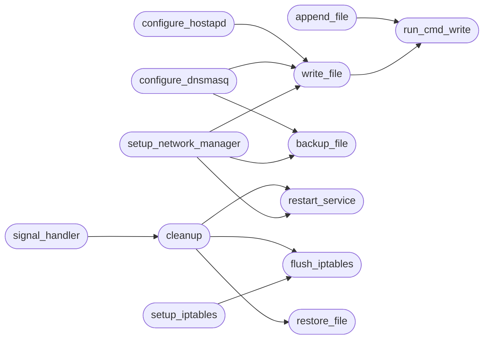

# `contrib.legacy.lazymitmap`

> Source: [contrib/legacy/lazymitmap.py:1](../../contrib/legacy/lazymitmap.py#L1) | language `py` | coverage 80.0% | [API index](../index.md)

## Contents

- **Functions:** [`print_header`](#print_header), [`run_cmd_write`](#run_cmd_write), [`write_file`](#write_file), [`append_file`](#append_file), [`create_dir`](#create_dir), [`set_permissions`](#set_permissions), [`install_dependencies`](#install_dependencies), [`backup_file`](#backup_file), [`restore_file`](#restore_file), [`restart_service`](#restart_service), [`flush_iptables`](#flush_iptables), [`setup_network_manager`](#setup_network_manager), [`configure_dnsmasq`](#configure_dnsmasq), [`configure_hostapd`](#configure_hostapd), [`setup_iptables`](#setup_iptables), [`set_speed_limit`](#set_speed_limit), [`start_services`](#start_services), [`cleanup`](#cleanup), [`signal_handler`](#signal_handler)

## Call Graph

Solid arrows stay in this module, dashed arrows leave it.



## Functions

<a id="print_header"></a>

### `print_header`

`function` | [contrib/legacy/lazymitmap.py:45](../../contrib/legacy/lazymitmap.py#L45)

```python
def print_header()
```

---

<a id="run_cmd_write"></a>

### `run_cmd_write`

`function` | [contrib/legacy/lazymitmap.py:49](../../contrib/legacy/lazymitmap.py#L49)

```python
def run_cmd_write(cmd_args, s)
```

Write a file using sudo.

**Parameters**

| Name | Type | Default | Description |
|---|---|---|---|
| `cmd_args` |  |  |  |
| `s` |  |  |  |

*Called by:* [`append_file`](#append_file), [`write_file`](#write_file)

---

<a id="write_file"></a>

### `write_file`

`function` | [contrib/legacy/lazymitmap.py:63](../../contrib/legacy/lazymitmap.py#L63)

```python
def write_file(path, s)
```

**Parameters**

| Name | Type | Default | Description |
|---|---|---|---|
| `path` |  |  |  |
| `s` |  |  |  |

*Calls:* [`run_cmd_write`](#run_cmd_write)

*Called by:* [`configure_dnsmasq`](#configure_dnsmasq), [`configure_hostapd`](#configure_hostapd), [`setup_network_manager`](#setup_network_manager)

---

<a id="append_file"></a>

### `append_file`

`function` | [contrib/legacy/lazymitmap.py:67](../../contrib/legacy/lazymitmap.py#L67)

```python
def append_file(path, s)
```

Append to the file, don't overwrite.

**Parameters**

| Name | Type | Default | Description |
|---|---|---|---|
| `path` |  |  |  |
| `s` |  |  |  |

*Calls:* [`run_cmd_write`](#run_cmd_write)

---

<a id="create_dir"></a>

### `create_dir`

`function` | [contrib/legacy/lazymitmap.py:72](../../contrib/legacy/lazymitmap.py#L72)

```python
def create_dir(directory)
```

Create directory with sudo if it does not exist.

**Parameters**

| Name | Type | Default | Description |
|---|---|---|---|
| `directory` |  |  |  |

---

<a id="set_permissions"></a>

### `set_permissions`

`function` | [contrib/legacy/lazymitmap.py:77](../../contrib/legacy/lazymitmap.py#L77)

```python
def set_permissions(directory, permissions='777')
```

Set directory permissions with sudo.

**Parameters**

| Name | Type | Default | Description |
|---|---|---|---|
| `directory` |  |  |  |
| `permissions` |  | `'777'` |  |

**Raises**

- `ValueError`: (raised in the body, not documented)

---

<a id="install_dependencies"></a>

### `install_dependencies`

`function` | [contrib/legacy/lazymitmap.py:84](../../contrib/legacy/lazymitmap.py#L84)

```python
def install_dependencies()
```

Install required dependencies.

---

<a id="backup_file"></a>

### `backup_file`

`function` | [contrib/legacy/lazymitmap.py:121](../../contrib/legacy/lazymitmap.py#L121)

```python
def backup_file(filepath)
```

Backup a given file.

**Parameters**

| Name | Type | Default | Description |
|---|---|---|---|
| `filepath` |  |  |  |

**Raises**

- `ValueError`: (raised in the body, not documented)

*Called by:* [`configure_dnsmasq`](#configure_dnsmasq), [`setup_network_manager`](#setup_network_manager)

---

<a id="restore_file"></a>

### `restore_file`

`function` | [contrib/legacy/lazymitmap.py:128](../../contrib/legacy/lazymitmap.py#L128)

```python
def restore_file(filepath)
```

Restore a backed-up file.

**Parameters**

| Name | Type | Default | Description |
|---|---|---|---|
| `filepath` |  |  |  |

**Raises**

- `ValueError`: (raised in the body, not documented)

*Called by:* [`cleanup`](#cleanup)

---

<a id="restart_service"></a>

### `restart_service`

`function` | [contrib/legacy/lazymitmap.py:138](../../contrib/legacy/lazymitmap.py#L138)

```python
def restart_service(service)
```

Restart a given service.

**Parameters**

| Name | Type | Default | Description |
|---|---|---|---|
| `service` |  |  |  |

**Raises**

- `ValueError`: (raised in the body, not documented)

*Called by:* [`cleanup`](#cleanup), [`setup_network_manager`](#setup_network_manager)

---

<a id="flush_iptables"></a>

### `flush_iptables`

`function` | [contrib/legacy/lazymitmap.py:145](../../contrib/legacy/lazymitmap.py#L145)

```python
def flush_iptables()
```

Flush iptables rules.

*Called by:* [`cleanup`](#cleanup), [`setup_iptables`](#setup_iptables)

---

<a id="setup_network_manager"></a>

### `setup_network_manager`

`function` | [contrib/legacy/lazymitmap.py:153](../../contrib/legacy/lazymitmap.py#L153)

```python
def setup_network_manager(ap_iface)
```

Setup NetworkManager configuration for the AP interface.

**Parameters**

| Name | Type | Default | Description |
|---|---|---|---|
| `ap_iface` |  |  |  |

*Calls:* [`backup_file`](#backup_file), [`restart_service`](#restart_service), [`write_file`](#write_file)

---

<a id="configure_dnsmasq"></a>

### `configure_dnsmasq`

`function` | [contrib/legacy/lazymitmap.py:163](../../contrib/legacy/lazymitmap.py#L163)

```python
def configure_dnsmasq(ap_iface, ap_ip_range_start, ap_ip_range_end, ap_ip_gateway, dns_ip_1, dns_ip_2, sslstrip)
```

Configure dnsmasq based on SSLSTRIP usage.

**Parameters**

| Name | Type | Default | Description |
|---|---|---|---|
| `ap_iface` |  |  |  |
| `ap_ip_range_start` |  |  |  |
| `ap_ip_range_end` |  |  |  |
| `ap_ip_gateway` |  |  |  |
| `dns_ip_1` |  |  |  |
| `dns_ip_2` |  |  |  |
| `sslstrip` |  |  |  |

*Calls:* [`backup_file`](#backup_file), [`write_file`](#write_file)

---

<a id="configure_hostapd"></a>

### `configure_hostapd`

`function` | [contrib/legacy/lazymitmap.py:195](../../contrib/legacy/lazymitmap.py#L195)

```python
def configure_hostapd(ap_iface, ssid, channel, wpa_passphrase=None)
```

Configure hostapd based on user input.

**Parameters**

| Name | Type | Default | Description |
|---|---|---|---|
| `ap_iface` |  |  |  |
| `ssid` |  |  |  |
| `channel` |  |  |  |
| `wpa_passphrase` |  | `None` |  |

*Calls:* [`write_file`](#write_file)

---

<a id="setup_iptables"></a>

### `setup_iptables`

`function` | [contrib/legacy/lazymitmap.py:228](../../contrib/legacy/lazymitmap.py#L228)

```python
def setup_iptables(ap_iface, ap_ip, net_iface)
```

Setup iptables rules.

**Parameters**

| Name | Type | Default | Description |
|---|---|---|---|
| `ap_iface` |  |  |  |
| `ap_ip` |  |  |  |
| `net_iface` |  |  |  |

*Calls:* [`flush_iptables`](#flush_iptables)

---

<a id="set_speed_limit"></a>

### `set_speed_limit`

`function` | [contrib/legacy/lazymitmap.py:248](../../contrib/legacy/lazymitmap.py#L248)

```python
def set_speed_limit(ap_iface, speed_up, speed_down)
```

Set speed limit for the clients.

**Parameters**

| Name | Type | Default | Description |
|---|---|---|---|
| `ap_iface` |  |  |  |
| `speed_up` |  |  |  |
| `speed_down` |  |  |  |

---

<a id="start_services"></a>

### `start_services`

`function` | [contrib/legacy/lazymitmap.py:254](../../contrib/legacy/lazymitmap.py#L254)

```python
def start_services(ap_iface, script_path, sslstrip, wireshark, driftnet, tshark)
```

Start necessary services based on user input.

**Parameters**

| Name | Type | Default | Description |
|---|---|---|---|
| `ap_iface` |  |  |  |
| `script_path` |  |  |  |
| `sslstrip` |  |  |  |
| `wireshark` |  |  |  |
| `driftnet` |  |  |  |
| `tshark` |  |  |  |

---

<a id="cleanup"></a>

### `cleanup`

`function` | [contrib/legacy/lazymitmap.py:315](../../contrib/legacy/lazymitmap.py#L315)

```python
def cleanup()
```

Cleanup actions to restore system state.

*Calls:* [`flush_iptables`](#flush_iptables), [`restart_service`](#restart_service), [`restore_file`](#restore_file)

*Called by:* [`signal_handler`](#signal_handler)

---

<a id="signal_handler"></a>

### `signal_handler`

`function` | [contrib/legacy/lazymitmap.py:324](../../contrib/legacy/lazymitmap.py#L324)

```python
def signal_handler(sig, frame)
```

**Parameters**

| Name | Type | Default | Description |
|---|---|---|---|
| `sig` |  |  |  |
| `frame` |  |  |  |

*Calls:* [`cleanup`](#cleanup)

---
