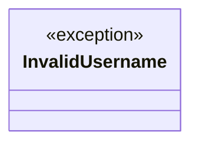

# `contrib.legacy.lazyopenssh77enum2`

> Source: [contrib/legacy/lazyopenssh77enum2.py:1](../../contrib/legacy/lazyopenssh77enum2.py#L1) | language `py` | coverage 16.7% | [API index](../index.md)

CVE-2018-15473 SSH User Enumeration by Leap Security (@LeapSecurity) https://leapsecurity.io Credits: Matthew Daley, Justin Gardner, Lee David Painter

## Contents

- **Exceptions:** [`InvalidUsername`](#invalidusername)
- **Functions:** [`add_boolean`](#add_boolean), [`service_accept`](#service_accept), [`invalid_username`](#invalid_username), [`check_user`](#check_user)

## Type Diagram



## Call Graph

Solid arrows stay in this module, dashed arrows leave it.


## Exceptions

<a id="invalidusername"></a>

### `InvalidUsername`

`exception` | [contrib/legacy/lazyopenssh77enum2.py:14](../../contrib/legacy/lazyopenssh77enum2.py#L14)

```python
class InvalidUsername(Exception)
```

Bases: `Exception`

---

## Functions

<a id="add_boolean"></a>

### `add_boolean`

`function` | [contrib/legacy/lazyopenssh77enum2.py:19](../../contrib/legacy/lazyopenssh77enum2.py#L19)

```python
def add_boolean(*args, **kwargs)
```

**Parameters**

| Name | Type | Default | Description |
|---|---|---|---|
| `*args` |  |  |  |
| `**kwargs` |  |  |  |

---

<a id="service_accept"></a>

### `service_accept`

`function` | [contrib/legacy/lazyopenssh77enum2.py:30](../../contrib/legacy/lazyopenssh77enum2.py#L30)

```python
def service_accept(*args, **kwargs)
```

**Parameters**

| Name | Type | Default | Description |
|---|---|---|---|
| `*args` |  |  |  |
| `**kwargs` |  |  |  |

---

<a id="invalid_username"></a>

### `invalid_username`

`function` | [contrib/legacy/lazyopenssh77enum2.py:36](../../contrib/legacy/lazyopenssh77enum2.py#L36)

```python
def invalid_username(*args, **kwargs)
```

**Parameters**

| Name | Type | Default | Description |
|---|---|---|---|
| `*args` |  |  |  |
| `**kwargs` |  |  |  |

**Raises**

- [`InvalidUsername`](#invalidusername): (raised in the body, not documented)

*Calls:* [`InvalidUsername`](#invalidusername)

---

<a id="check_user"></a>

### `check_user`

`function` | [contrib/legacy/lazyopenssh77enum2.py:50](../../contrib/legacy/lazyopenssh77enum2.py#L50)

```python
def check_user(username)
```

**Parameters**

| Name | Type | Default | Description |
|---|---|---|---|
| `username` |  |  |  |

---
