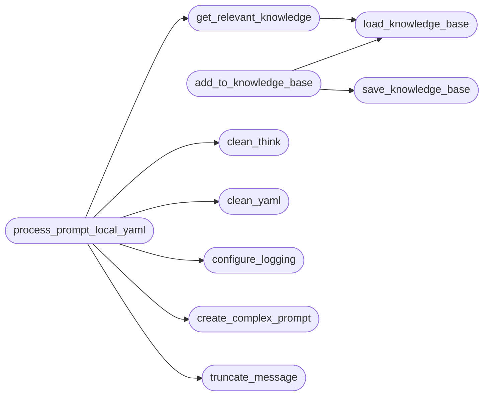

# `contrib.legacy.lazyphishingai`

> Source: [contrib/legacy/lazyphishingai.py:1](../../contrib/legacy/lazyphishingai.py#L1) | language `py` | coverage 8.3% | [API index](../index.md)

main.py

Author: Gris Iscomeback
Email: grisiscomeback[at]gmail[dot]com
Creation Date: 09/06/2024
License: AGPL v3

Description: Console assistant for generating dynamic YAML phishing templates using AI

## Contents

- **Functions:** [`clean_think`](#clean_think), [`clean_yaml`](#clean_yaml), [`truncate_message`](#truncate_message), [`configure_logging`](#configure_logging), [`create_complex_prompt`](#create_complex_prompt), [`load_knowledge_base`](#load_knowledge_base), [`save_knowledge_base`](#save_knowledge_base), [`add_to_knowledge_base`](#add_to_knowledge_base), [`get_relevant_knowledge`](#get_relevant_knowledge), [`process_prompt_local_yaml`](#process_prompt_local_yaml), [`parse_args`](#parse_args)
- **Constants:** [`BANNER`](#banner), [`KNOWLEDGE_BASE_FILE`](#knowledge_base_file)

## Call Graph

Solid arrows stay in this module, dashed arrows leave it.



## Functions

<a id="clean_think"></a>

### `clean_think`

`function` | [contrib/legacy/lazyphishingai.py:28](../../contrib/legacy/lazyphishingai.py#L28)

```python
def clean_think(texto)
```

**Parameters**

| Name | Type | Default | Description |
|---|---|---|---|
| `texto` |  |  |  |

*Called by:* [`process_prompt_local_yaml`](#process_prompt_local_yaml)

---

<a id="clean_yaml"></a>

### `clean_yaml`

`function` | [contrib/legacy/lazyphishingai.py:31](../../contrib/legacy/lazyphishingai.py#L31)

```python
def clean_yaml(texto)
```

**Parameters**

| Name | Type | Default | Description |
|---|---|---|---|
| `texto` |  |  |  |

*Called by:* [`process_prompt_local_yaml`](#process_prompt_local_yaml)

---

<a id="truncate_message"></a>

### `truncate_message`

`function` | [contrib/legacy/lazyphishingai.py:37](../../contrib/legacy/lazyphishingai.py#L37)

```python
def truncate_message(message, max_chars=18000)
```

**Parameters**

| Name | Type | Default | Description |
|---|---|---|---|
| `message` |  |  |  |
| `max_chars` |  | `18000` |  |

*Called by:* [`process_prompt_local_yaml`](#process_prompt_local_yaml)

---

<a id="configure_logging"></a>

### `configure_logging`

`function` | [contrib/legacy/lazyphishingai.py:42](../../contrib/legacy/lazyphishingai.py#L42)

```python
def configure_logging(debug: bool) -> None
```

**Parameters**

| Name | Type | Default | Description |
|---|---|---|---|
| `debug` | `bool` |  |  |

*Called by:* [`process_prompt_local_yaml`](#process_prompt_local_yaml)

---

<a id="create_complex_prompt"></a>

### `create_complex_prompt`

`function` | [contrib/legacy/lazyphishingai.py:46](../../contrib/legacy/lazyphishingai.py#L46)

```python
def create_complex_prompt(base_prompt: str, history: str, knowledge_base: str) -> str
```

**Parameters**

| Name | Type | Default | Description |
|---|---|---|---|
| `base_prompt` | `str` |  |  |
| `history` | `str` |  |  |
| `knowledge_base` | `str` |  |  |

**Returns:** `str`

*Called by:* [`process_prompt_local_yaml`](#process_prompt_local_yaml)

---

<a id="load_knowledge_base"></a>

### `load_knowledge_base`

`function` | [contrib/legacy/lazyphishingai.py:101](../../contrib/legacy/lazyphishingai.py#L101)

```python
def load_knowledge_base(file_path: str) -> dict
```

**Parameters**

| Name | Type | Default | Description |
|---|---|---|---|
| `file_path` | `str` |  |  |

**Returns:** `dict`

*Called by:* [`add_to_knowledge_base`](#add_to_knowledge_base), [`get_relevant_knowledge`](#get_relevant_knowledge)

---

<a id="save_knowledge_base"></a>

### `save_knowledge_base`

`function` | [contrib/legacy/lazyphishingai.py:110](../../contrib/legacy/lazyphishingai.py#L110)

```python
def save_knowledge_base(knowledge_base: dict, file_path: str) -> None
```

**Parameters**

| Name | Type | Default | Description |
|---|---|---|---|
| `knowledge_base` | `dict` |  |  |
| `file_path` | `str` |  |  |

*Called by:* [`add_to_knowledge_base`](#add_to_knowledge_base)

---

<a id="add_to_knowledge_base"></a>

### `add_to_knowledge_base`

`function` | [contrib/legacy/lazyphishingai.py:117](../../contrib/legacy/lazyphishingai.py#L117)

```python
def add_to_knowledge_base(prompt: str, command: str, file_path: str) -> None
```

**Parameters**

| Name | Type | Default | Description |
|---|---|---|---|
| `prompt` | `str` |  |  |
| `command` | `str` |  |  |
| `file_path` | `str` |  |  |

*Calls:* [`load_knowledge_base`](#load_knowledge_base), [`save_knowledge_base`](#save_knowledge_base)

---

<a id="get_relevant_knowledge"></a>

### `get_relevant_knowledge`

`function` | [contrib/legacy/lazyphishingai.py:122](../../contrib/legacy/lazyphishingai.py#L122)

```python
def get_relevant_knowledge(prompt: str) -> str
```

**Parameters**

| Name | Type | Default | Description |
|---|---|---|---|
| `prompt` | `str` |  |  |

**Returns:** `str`

*Calls:* [`load_knowledge_base`](#load_knowledge_base)

*Called by:* [`process_prompt_local_yaml`](#process_prompt_local_yaml)

---

<a id="process_prompt_local_yaml"></a>

### `process_prompt_local_yaml`

`function` | [contrib/legacy/lazyphishingai.py:132](../../contrib/legacy/lazyphishingai.py#L132)

```python
def process_prompt_local_yaml(prompt: str, debug: bool, mode: str, output_file: str = None) -> Response
```

**Parameters**

| Name | Type | Default | Description |
|---|---|---|---|
| `prompt` | `str` |  |  |
| `debug` | `bool` |  |  |
| `mode` | `str` |  |  |
| `output_file` | `str` | `None` |  |

**Returns:** `Response`

*Calls:* [`clean_think`](#clean_think), [`clean_yaml`](#clean_yaml), [`configure_logging`](#configure_logging), [`create_complex_prompt`](#create_complex_prompt), [`get_relevant_knowledge`](#get_relevant_knowledge), [`truncate_message`](#truncate_message)

---

<a id="parse_args"></a>

### `parse_args`

`function` | [contrib/legacy/lazyphishingai.py:192](../../contrib/legacy/lazyphishingai.py#L192)

```python
def parse_args() -> argparse.Namespace
```

**Returns:** `argparse.Namespace`

---

## Constants

<a id="banner"></a>

### `BANNER`

`constant` | [contrib/legacy/lazyphishingai.py:21](../../contrib/legacy/lazyphishingai.py#L21)

```python
BANNER = '\n[*] Starting: LazyOwn GPT Phishing Template Generator [;,;]\n'
```

---

<a id="knowledge_base_file"></a>

### `KNOWLEDGE_BASE_FILE`

`constant` | [contrib/legacy/lazyphishingai.py:26](../../contrib/legacy/lazyphishingai.py#L26)

```python
KNOWLEDGE_BASE_FILE = f'{script_dir}/knowledge_base_script.json'
```

---
